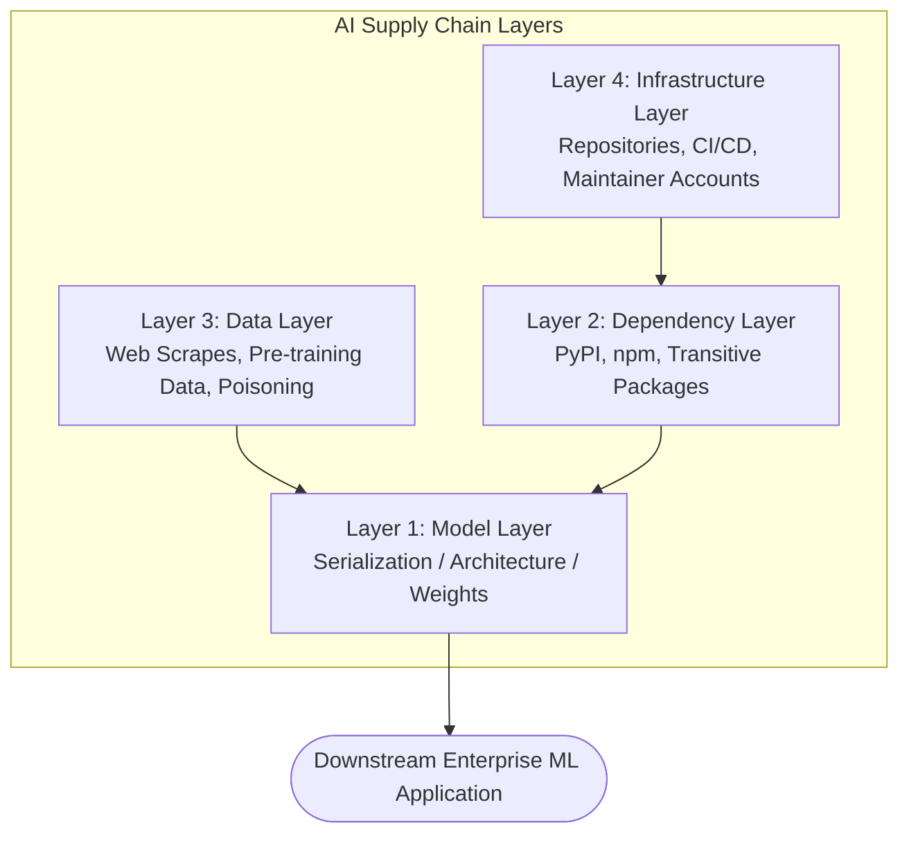
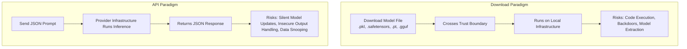
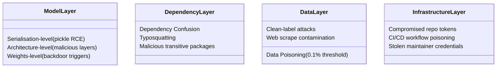
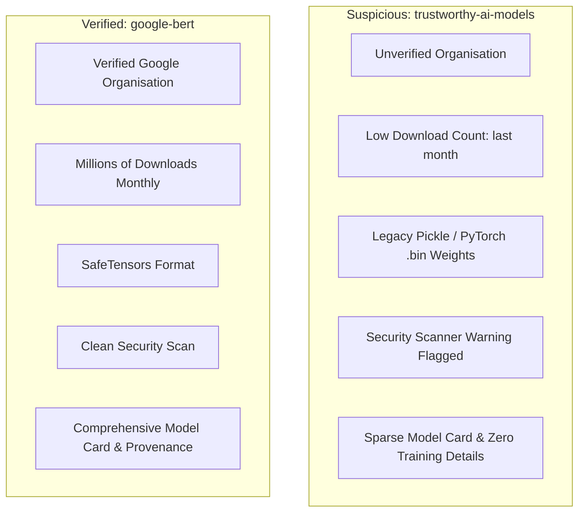

## Overview

Modern artificial intelligence relies on deeply nested networks of pre-trained models, open-source frameworks, uncurated datasets, and package dependencies. In traditional software, supply chain attacks compromise source code, build pipelines, or third-party libraries. In AI systems, the attack surface expands into **serialized weights, model architectures, and data provenance**.

This room, **Understanding AI Supply Chains**, serves as the foundational entry point for Module 4 on TryHackMe. It establishes the critical distinction between traditional software supply chains and AI pipelines, breaks down the four core components and four attack layers, evaluates download versus API consumption models, and investigates historical supply chain compromises (PyTorch dependency confusion, Hugging Face malicious models, and build workflow tampering).



---

## 1. Traditional vs. AI Supply Chains

### Software Supply Chains
A typical application depends on hundreds of direct and transitive dependencies:
- **Direct Dependencies:** Packages explicitly listed in your `requirements.txt` or `package.json`.
- **Transitive Dependencies:** Packages pulled in automatically by your direct dependencies. For example, installing `torch` quietly pulls in `filelock` and `typing-extensions`.

Attackers target upstream dependencies because compromises scale efficiently:
- **SolarWinds (2020):** Attackers compromised the Orion **build process** directly, inserting backdoors into digitally signed, legitimate vendor updates.
- **Log4Shell (2021):** A critical JNDI injection vulnerability inside the ubiquitous Log4j library compromised millions of downstream Java applications.

### The AI Difference: Code vs. Serialized Weights
Traditional software consists of inspectable source code. AI models introduce a fundamentally opaque artifact: **trained model weights**.

```mermaid
flowchart LR
    A[Architecture<br>Neural Net Topology] + B[Training Data<br>Millions of Samples] + C[Hyperparameters<br>Training Process] --> D[Serialized Weights<br>Binary State File]
    D -->|model.load| E[Inference Engine]
```

Model weights are comparable to video game save states: they store the learned state of the network. Because popular formats like Python's `pickle` (`.pkl`, `.pt`, `.bin`) serialize arbitrary Python objects, loading a model file can execute arbitrary system commands before prediction logic ever runs.

---

## 2. Transfer Learning & Inherited Risk

Most organizations do not train foundational models from scratch due to compute costs. Instead, they rely on **transfer learning** and **fine-tuning**:
- **Base Model:** Pre-trained on massive public scrapes (e.g., Common Crawl) by a third party.
- **Fine-Tuning / LoRA:** Adjusting weights or adding small low-rank adapter layers on a smaller, domain-specific dataset.

### The Security Tension
1. **Inherited Backdoors:** Research confirms that backdoors embedded during pre-training survive downstream fine-tuning. Fine-tuning adjusts decision boundaries for specific tasks but cannot erase trigger weights embedded deep within the base network.
2. **Adapter Chaining:** LoRA adapters attach directly onto base models. A clean base model paired with an untrusted adapter produces a compromised model.

---

## 3. The Four Core Components of an AI Supply Chain

An AI supply chain consists of four distinct components, each carrying unique trust assumptions:

| Component | What It Represents | Common Sources | Canonical Examples |
|---|---|---|---|
| **Datasets** | Training, validation, and evaluation data | Hugging Face Datasets, Kaggle, Common Crawl | ImageNet, LAION-5B, Common Crawl |
| **Dependencies** | Supporting libraries and utilities required by frameworks | PyPI, npm, conda-forge | NumPy, SciPy, Pillow, filelock |
| **Frameworks** | Machine learning engines used to train, optimize, and serve models | PyPI, GitHub, conda | PyTorch, TensorFlow, scikit-learn |
| **Models** | Neural network architectures and serialized weight parameters | Hugging Face Hub, PyTorch Hub, Model Zoo | `bert-base-uncased`, `gpt2`, `llama-3-8b` |

---

## 4. Two Consumption Paradigms: Download vs. API

Organizations consume AI through two models, each presenting distinct attack surfaces:



### Weight File Formats & Exploitation Risks
- **`.pkl` / `.pt` / `.bin` (Python Pickle):** Highly insecure. Pickle deserialization is Turing-complete and executes arbitrary Python code at load time.
- **`.safetensors`:** Secure weight storage format developed by Hugging Face. Stores raw numerical tensor buffers without executable code. Eliminates serialization-level code execution.
- **`.gguf`:** Dominant format for running quantized local LLMs (LLaMA, Mistral, Qwen) using `llama.cpp`. It does not use Python pickle and prevents serialization execution. However, weights-level backdoors can still reside within GGUF files.
- **`.h5` (Keras/HDF5):** Stores model architecture and weights. While not pickle-based, complex Keras lambda layers can embed executable code.

---

## 5. The Four Attack Layers

Supply chain attacks strike across four distinct architectural layers:



1. **Model Layer:**
   - *Serialisation-level:* Code embedded inside the file format that triggers on `model.load()`.
   - *Architecture-level:* Custom layer implementations that execute malicious logic during inference.
   - *Weights-level:* Altered matrix values that misclassify inputs when a specific trigger is present.
2. **Dependency Layer:** Exploits package management resolvers through dependency confusion and typosquatting (e.g., `torchtriton`).
3. **Data Layer:** Attackers poison upstream datasets. Replacing as little as **0.1%** of a dataset can create a reliable backdoor without reducing overall benchmark accuracy.
4. **Infrastructure Layer:** Compromising the platforms that host and build models (stolen API keys, hijacked GitHub Actions, compromised Hugging Face maintainer accounts).

---

## 6. Real-World Supply Chain Case Studies

| Incident | Date | Vector | Attack Layer | Impact |
|---|---|---|---|---|
| **PyTorch `torchtriton`** | Dec 2022 | Dependency Confusion | Dependency Layer | Malicious package published on PyPI matching PyTorch's internal nightly dependency. Stole SSH keys, git configs, and system files. |
| **Hugging Face Exposed Tokens** | Nov 2023 | Compromised API Tokens | Infrastructure Layer | Lasso Security found 1,500+ exposed tokens, including 655 with write access to major vendor model repos. |
| **JFrog Malicious Models** | 2024 | Malicious Pickle Deserialization | Model Layer | Over 100 functional Hugging Face models found containing reverse shells in serialized pickle files. |
| **Ultralytics YOLO Pipeline** | Dec 2024 | GitHub Actions Poisoning | Infrastructure Layer | Attackers injected cryptominers into published PyPI packages via automated build workflows. |
| **`@solana/web3.js`** | Dec 2024 | Stolen Maintainer Credentials | Infrastructure Layer | Compromised npm maintainer account pushed backdoored versions, draining cryptocurrency wallets. |
| **NullifAI Scanner Evasion** | Feb 2025 | Malformed Pickle Structures | Model Layer | Exploited parser edge cases to bypass Hugging Face security scanners while remaining executable by Python. |

---

## 7. Practical Audit: Hugging Face Model Evaluation

In the practical lab, we audit an unverified sentiment classifier (`trustworthy-ai-models/bert-sentiment-classifier`) against an established reference model (`google-bert/bert-base-uncased`).



### Key Trust Verification Checklist
1. **Organization Verification:** Ensure the author organization has verified status and an established public track record.
2. **Weight Format:** Strict preference for `.safetensors`. Ban raw `.pkl` and `.pt` formats in production inference pipelines.
3. **Download Activity:** High download counts alone do not guarantee safety, but very low counts on popular architectures warrant strict scrutiny.
4. **Security Scanners:** Inspect Hugging Face security scanner tabs for detected pickle opcodes (such as `os.system` or `subprocess.Popen`).

---

## Summary of Questions, Answers, and Flags

| Task | Question | Answer |
|---|---|---|
| **Task 1** | I'm ready to learn about AI supply chains! | *No answer needed* |
| **Task 2** | In the SolarWinds attack, where in the supply chain was the malicious code injected? | `build process` |
| **Task 2** | While installing torch Pip also pulls in filelock, which you never listed. What type of dependency is filelock? | `transitive dependency` |
| **Task 3** | What are the four key components of an AI supply chain? (listed alphabetically) | `Datasets, Dependencies, Frameworks, Models` |
| **Task 3** | What do model files contain that allows them to run code when loaded? | `serialised objects` *(or `serialized objects`)* |
| **Task 4** | What is the dominant file format for running local large language models such as LLaMA, Mistral, and Qwen? | `GGUF` |
| **Task 5** | At which layer of the AI supply chain do pickle-based attacks occur? | `Model Layer` *(or `Model`)* |
| **Task 5** | Which level of model attack is eliminated by converting to SafeTensors format? | `Serialisation-level` *(or `Serialization-level`)* |
| **Task 5** | Researchers find that 0.1% of a public training dataset has been replaced with crafted samples designed to introduce a backdoor. Which attack layer does this represent? | `Data Layer` *(or `Data`)* |
| **Task 6** | The torchtriton package exploited pip's version resolution to install a public package over an internal one. Which of the four attack layers does this target? | `Dependency Layer` *(or `Dependency`)* |
| **Task 6** | The @solana/web3.js attacker stole a maintainer's credentials to push malicious updates to a legitimate, high-trust repository. Which attack layer does this represent? | `Infrastructure Layer` *(or `Infrastructure`)* |
| **Task 7** | In the static site, what is the name of the unverified organisation that uploaded the model? | `trustworthy-ai-models` |
| **Task 7** | How many downloads does this model have (last month)? | *(Check the right sidebar of the mock site, e.g., 3-digit download figure)* |
| **Task 7** | What file format does the verified model (google-bert/bert-base-uncased) use for its weights? | `SafeTensors` |
| **Task 8** | I understand AI Supply Chain Attack Vectors! | *No answer needed* |

---

## You can find me online at:


- **GitHub:** [Mhdomer](https://github.com/Mhdomer)
- **LinkedIn:** [mhd3omar](https://www.linkedin.com/in/mhd3omar/)
- **Tryhackme:** [nonlouy](https://tryhackme.com/p/nonlouy)
