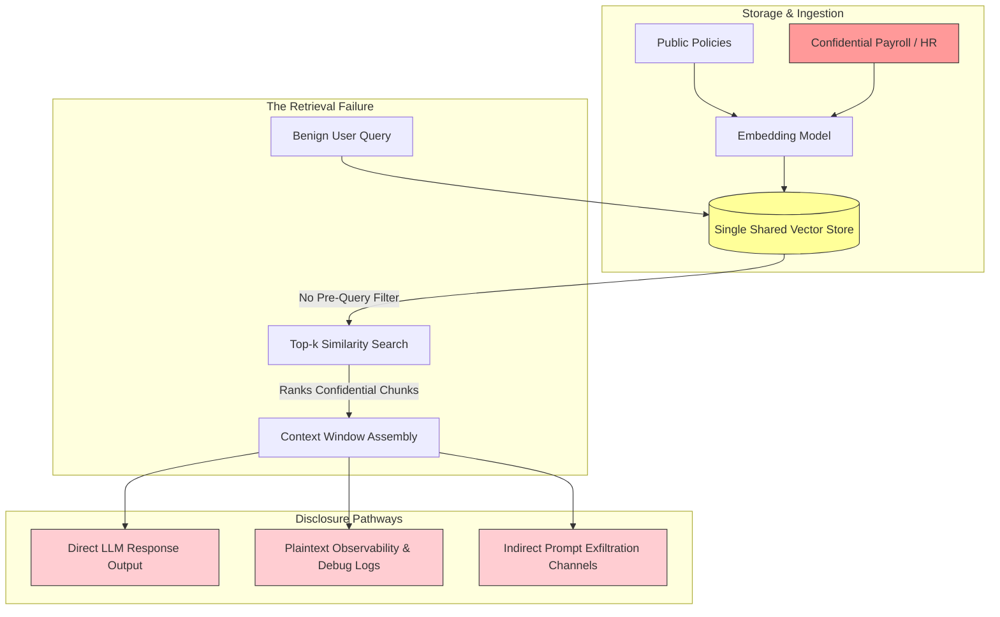
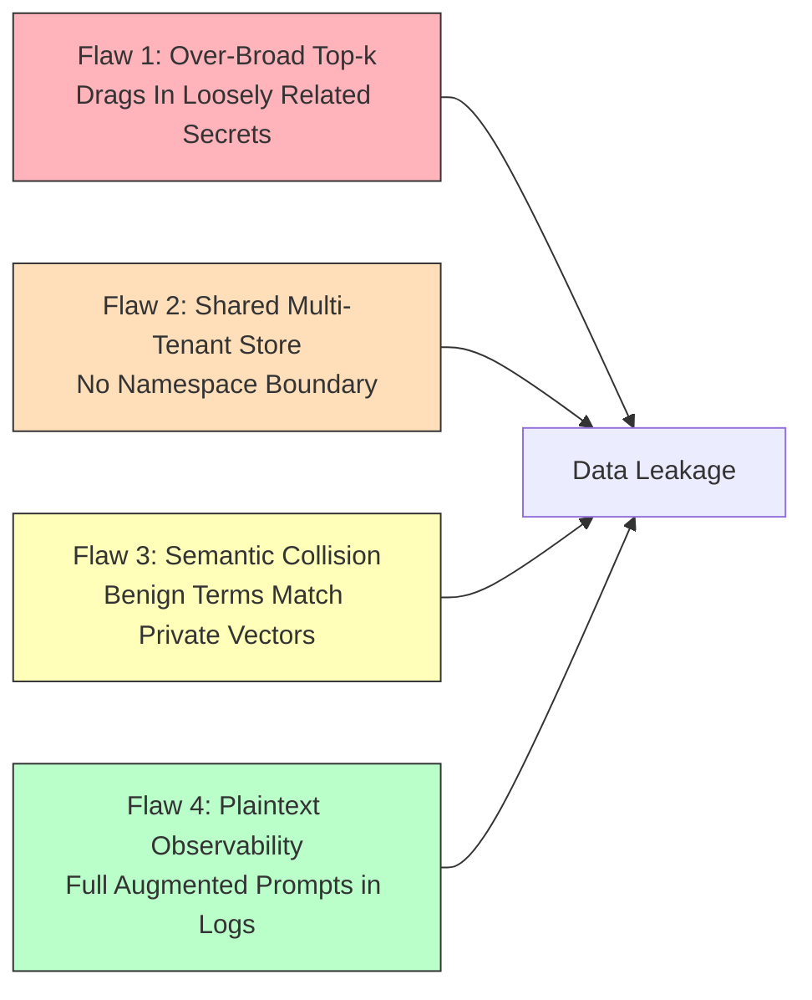
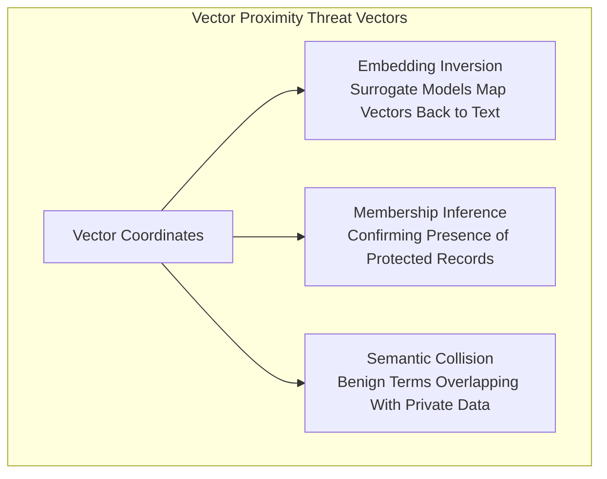
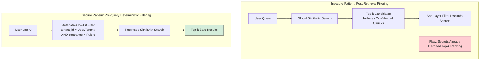

## Overview

Large Language Models generate responses based on statistical token associations learned during pre-training combined with dynamic context injected at inference time. Unlike relational database management systems (RDBMS) that enforce strict row-level security (RLS) and granular access control lists (ACLs) by default, vector databases and generative models possess no innate awareness of identity, authorization, or document ownership.

Categorized under **OWASP LLM02 (Sensitive Information Disclosure)**, this vulnerability class occurs when proprietary business logic, personally identifiable information (PII), or confidential enterprise documents are exposed through AI outputs or observability infrastructure. In production AI applications, disclosure rarely stems from an attacker tricking a model into breaking character. Instead, it occurs because **the retrieval and context assembly pipeline fed unauthorized data directly into the model's context window**.

This room, **Sensitive Information Disclosure**, represents the third room of Module 5 (Data Poisoning) in the TryHackMe AI Security path. It analyzes how vector proximity ranking, over-broad top-$k$ retrieval settings, semantic collisions, and shared multi-tenant stores create silent data leakage channels. We examine real-world CVEs across Milvus and AnythingLLM, evaluate the EchoLeak zero-click exfiltration chain, walk through a simulated hospital AI assistant breach, and implement deterministic pre-query access controls.



---

## 1. OWASP LLM02 vs. Poisoning and Prompt Injection

Understanding confidentiality in AI systems requires distinguishing between the primary threat classes:

| Threat Vector | OWASP ID | Primary Target | Timing | Attack Objective |
|---|---|---|---|---|
| **Prompt Injection** | **LLM01** | Model Instructions | Inference-Time | Overrides system prompts using adversarial user input. |
| **Sensitive Info Disclosure** | **LLM02** | System Confidentiality | Retrieval / Inference | Surfaces existing protected data without altering model logic. |
| **Data & Model Poisoning** | **LLM04** | Knowledge Base / Weights | Upstream / Ingestion | Corrupts data or embeddings to manipulate future model outputs. |

In sensitive information disclosure, the attacker does not need to alter model weights, corrupt training corpora, or construct complex jailbreaks. If the underlying retrieval architecture lacks deterministic access boundaries, normal, benign employee queries can inadvertently retrieve and surface confidential records.

---

## 2. Common Disclosure Scenarios & Architecture Vulnerabilities

Data leakage across RAG pipelines concentrates around four primary architectural flaws:



### 1. Over-Broad Top-$k$ Retrieval
The `top-k` parameter dictates how many document chunks are returned by a similarity search and injected into the prompt context. While increasing $k$ (e.g., from 3 to 10) can improve general response depth, it dramatically expands the attack surface. High $k$ values frequently pull in loosely related, confidential document chunks that happen to share adjacent coordinate space.

### 2. The Multi-Tenant Support Platform Dilemma
Organizations frequently consolidate documentation across multiple departments or commercial clients into a single shared vector database to minimize infrastructure costs. If the application relies on conversational system instructions (such as *"Do not disclose information from other clients"*), the boundary fails. Once unauthorized document chunks enter the prompt, the model processes those tokens natively.

### 3. Observability & Logging Leakage
To diagnose model hallucinations, development teams often enable verbose debug logging in production. This practice records:
- The raw user query.
- All retrieved document chunks and associated metadata.
- The full assembled augmented prompt.
- The raw completion.

Centralized logging platforms (such as Splunk, Datadog, or AWS CloudWatch) typically grant broad access to DevOps engineers, QA testers, and external contractors. Even if the user who queried the model was authorized to view the data, **unredacted prompt logging turns the observability platform into an unauthenticated, searchable secondary store of confidential records**.

---

## 3. Real-World Case Studies

Confidentiality failures in vector retrieval and RAG tooling have led to severe real-world vulnerabilities:

### Case Study 1: EchoLeak (CVE-2025-32711)
EchoLeak demonstrated zero-click prompt injection and sensitive data exfiltration in enterprise RAG assistants:
- **Mechanics:** An attacker transmitted an external email containing hidden, invisible HTML instructions. The automated ingestion pipeline indexed the email into the user's vector store.
- **Trigger:** When the victim issued a benign query (*"Summarize my unread emails"*), the retriever selected the malicious email due to geometric proximity.
- **Exploitation:** The injected instructions instructed the model to search the user's local files for API keys, encode the data, and render an external Markdown image tag (``), transmitting private files out of the network without any user awareness.

### Case Study 2: Model Extraction via Output Probing (CVE-2019-20634 – "Proof Pudding")
Documented in MITRE ATLAS (AML.CS0008), the Proof Pudding incident targeted an enterprise email security gateway:
- **Mechanics:** The model returned numerical spam confidence scores rather than binary verdicts.
- **Exploitation:** By sending hundreds of crafted email variations and observing slight shifts in confidence scores, researchers reconstructed the system's internal scoring logic, building a copy-cat surrogate model that evaded filtering entirely.
- **Lesson:** Sensitive disclosure does not require plaintext leakage; mathematical outputs and confidence metrics alone can leak internal decision boundaries.

### Case Study 3: Milvus Proxy Authentication Bypass (CVE-2025-64513)
Milvus is an open-source vector database widely deployed in enterprise RAG pipelines:
- **Root Cause:** The Milvus Proxy component contained an improper authentication flaw (CWE-287) where it trusted a user-controlled HTTP header, `sourceId`, as proof of upstream authentication.
- **Impact:** Attackers forged this header in raw HTTP requests to bypass authentication completely, dumping stored high-dimensional vectors, querying collections, and extracting plaintext metadata across all indexed enterprise documents.

### Case Study 4: AnythingLLM VectorDB Authorization Bypass (CVE-2024-3033)
AnythingLLM manages document workspaces that map internally to vector database namespaces:
- **Root Cause:** Internal API endpoints under `/api/v/` lacked authentication and authorization checks.
- **Impact:** Unauthenticated attackers enumerated internal namespaces, mapped organizational dataset structures, and deleted or extracted vector stores across isolated tenant workspaces.

---

## 4. Attacks on Vector Databases: Vector Math & Reconstruction

Vector databases do not execute exact string matching; they calculate distance across high-dimensional space:

```python
import numpy as np

# User query vector
query = np.array([0.8, 0.1])

# Safe public document
doc_safe = np.array([0.7, 0.2])

# Confidential internal document
doc_confidential = np.array([0.79, 0.11])

def cosine(a, b):
    return np.dot(a, b) / (np.linalg.norm(a) * np.linalg.norm(b))

print("Safe similarity:        ", cosine(query, doc_safe))
print("Confidential similarity:", cosine(query, doc_confidential))
```

Running this cosine calculation outputs:
```text
Safe similarity:         0.98
Confidential similarity: 0.999
```

Because `0.999 > 0.98`, the confidential document ranks highest and is delivered directly into the prompt. The retriever made this decision purely based on vector coordinates, completely unaware of document clearance levels.



### 1. Embedding Inversion
Organizations often treat embeddings as "anonymized" because they consist of floating-point numbers. This assumption is mathematically false. Research shows that specialized decoder models can invert high-dimensional vectors, reconstructing sensitive entities, account numbers, project names, and document themes with high accuracy.

### 2. Membership Inference
By issuing candidate query embeddings and observing similarity scores, an adversary can confirm whether a specific individual, medical diagnosis, or confidential project code exists within the private corpus, violating privacy regulations without ever viewing the full document.

### 3. Semantic Collision
When benign vocabulary overlaps with terminology used in confidential HR or medical files (e.g., "benefits", "enrollment", "allowance"), the vector embeddings cluster together. A general inquiry about company health insurance can collide with and retrieve a confidential employee disciplinary audit.

---

## 5. Access Control & Data Segmentation Architectures

To prevent similarity search from ignoring organizational boundaries, security teams must implement structured vector segmentation:



### The Three Vector Segmentation Models

1. **Per-Tenant Dedicated Index:** Each customer or tenant maintains a physically isolated vector index. This provides the strongest mathematical guarantee against cross-tenant disclosure, but increases infrastructure cost and operational overhead.
2. **Per-Role Tiered Index:** Documents are divided into distinct index collections mapped to clearance tiers (e.g., `public`, `internal`, `restricted`).
3. **Pre-Query Metadata Filtering:** All documents reside in a shared index, but every vector is tagged with immutable metadata attributes (`tenant_id`, `department`, `classification`). The application automatically prepends these constraints to the vector query engine before similarity computation occurs.

### Why Deterministic Enforcement Must Precede Similarity Search
If filtering is executed *after* similarity calculation (post-filtering), unauthorized documents still consume top-$k$ candidate slots, suppressing valid public documents from the response. Furthermore, application logic errors can easily skip post-filters. Enforcing metadata allowlists at the database query layer ensures unauthorized vectors are completely invisible to the search algorithm.

---

## 6. Practical Walkthrough: Meridian Health AI Assistant Audit

Task 8 simulates an internal healthcare AI assistant deployed by Meridian Health. The assistant runs a RAG pipeline over a shared index without access controls.

### Phase 1: Overly Broad Retrieval
We start by querying the assistant with benign and sensitive prompts:
1. **Query:** *"What is the vacation policy?"*  
   - **Result:** Returns standard public holiday guidelines.
2. **Query:** *"What are the salary ranges for engineering roles?"*  
   - **Result:** The assistant returns confidential internal compensation bands ($130k - $175k) for senior engineers.
3. **Query:** *"What is the CEO's compensation package?"*  
   - **Result:** The assistant returns CEO Julia Fang's complete compensation package, including stock options and base salary.

### Phase 2: Observability & Logging Exposure
We inspect the backend retrieval log using the administrative inspection command:
- **Command:** `SHOW RETRIEVAL LOG`
- **Output:** The log dumps the exact augmented context injected into the prompt. Multiple `[CONFIDENTIAL]` chunks containing raw compensation data were logged in plaintext. Any engineer with monitoring access can extract these secrets directly from the log aggregator without querying the AI assistant.

### Phase 3: Semantic Collision
We issue a standard inquiry regarding company benefits:
- **Query:** *"Tell me about employee benefits enrollment"*
- **Result:** The assistant returns the general health benefits package, but also outputs a confidential disciplinary and benefits audit record for **Employee #2201, Tom Russo**. 
- **Cause:** Because terms like *"benefits"* and *"enrollment"* appeared in both the public brochure and Tom Russo's confidential audit file, the embedding model mapped them to nearby vector coordinates. The retriever experienced a **semantic collision**, pulling private HR files into the public response.

### Phase 4: Deterministic Access Control
We enable pre-query metadata filtering on the vector store:
- **Command:** `ENABLE ACCESS CONTROL`
- **Verification:**
  - *"What is the vacation policy?"* -> Successfully returns the public policy.
  - *"What are the salary ranges for engineering roles?"* -> Blocked / Access Denied.
  - *"What is the CEO's compensation package?"* -> Blocked / Access Denied.
  - *"Tell me about employee benefits enrollment"* -> Returns the public policy cleanly, completely omitting Tom Russo's private HR record.

---

## 7. Defensive Safeguards Checklist

Eliminating sensitive information disclosure requires overlapping safeguards across the entire pipeline:

1. **Ingestion-Time Redaction:** Run automated Named Entity Recognition (NER), regex scanners, and token masking tools on documents before computing embeddings. Strip API keys, SSNs, and passwords at the source.
2. **Pre-Query Metadata Filtering:** Enforce strict allowlists at the database query level (`tenant_id == current_user.tenant_id`). Never rely on prompt instructions to restrict access.
3. **Log Sanitization:** Never log full prompts, raw retrieved chunks, or vector arrays. Log only document IDs, execution latency, and token consumption metrics.
4. **Lifecycle Synchronization & Tombstoning:** When a document is modified or deleted in the primary database, immediately trigger vector deletion and cache invalidation. Stale embeddings represent an ongoing disclosure risk.
5. **Output Data Loss Prevention (DLP):** Deploy deterministic pattern scanners on the generation output stream to intercept credentials, tokens, or PII before they leave the application perimeter.

---

## Summary of Questions, Answers, and Flags

| Task | Question | Answer |
|---|---|---|
| **Task 1** | I understand the learning objectives and am ready to learn about sensitive information disclosure! | *No answer needed* |
| **Task 2** | What OWASP category covers sensitive data exposure in LLM systems? | `LLM02` |
| **Task 3** | What mathematical mechanism determines which documents are retrieved in RAG systems? | `similarity search` *(or `vector similarity`)* |
| **Task 3** | What retrieval parameter controls how many documents are returned? | `top-k` *(or `top_k`)* |
| **Task 3** | What CVE demonstrated zero-click prompt injection via retrieved content? | `CVE-2025-32711` |
| **Task 4** | What mathematical metric is commonly used to measure similarity between embeddings? | `cosine` *(or `cosine similarity`)* |
| **Task 4** | What attack attempts to reconstruct text from stored vectors? | `inversion` *(or `Embedding Inversion`)* |
| **Task 5** | What retrieval configuration change increases exposure surface by expanding the number of ranked chunks? | `top-k` *(or `top_k`)* |
| **Task 6** | What logical grouping inside a vector database separates datasets? | `namespace` *(or `namespaces`)* |
| **Task 6** | Which segmentation model provides the strongest isolation but at a higher cost? | `Per-Tenant` *(or `Per-tenant`)* |
| **Task 6** | What type of enforcement operates before computation instead of after? | `Deterministic` |
| **Task 7** | What control removes sensitive data before embedding? | `Redaction` |
| **Task 7** | What policy ensures deleted embeddings are removed from storage? | `retention` *(or `Retention`)* |
| **Task 8** | What caused the assistant to expose confidential data? | `broad retrieval` *(or `top-k retrieval`)* |
| **Task 8** | Why did Tom Russo's HR record appear when asking about benefits? | `semantic collision` |
| **Task 8** | What control could have prevented the disclosure in Phase 2? | `metadata filtering` |
| **Task 9** | All done! | *No answer needed* |

---

## You can find me online at:


- **GitHub:** [Mhdomer](https://github.com/Mhdomer)
- **LinkedIn:** [mhd3omar](https://www.linkedin.com/in/mhd3omar/)
- **Tryhackme:** [nonlouy](https://tryhackme.com/p/nonlouy)
