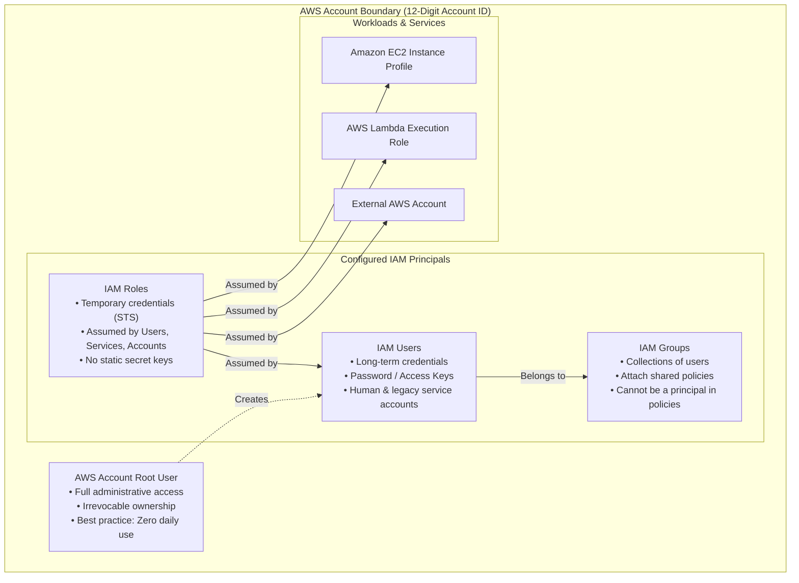
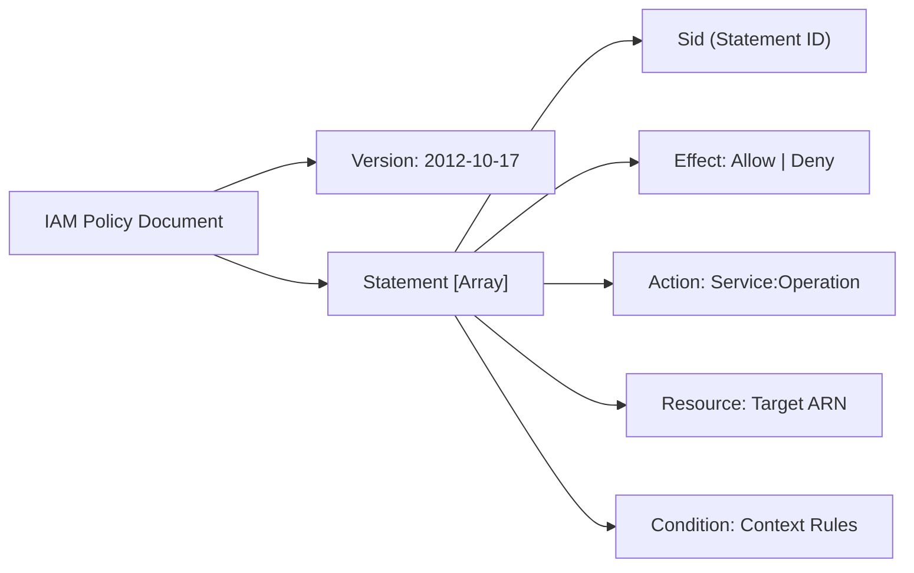
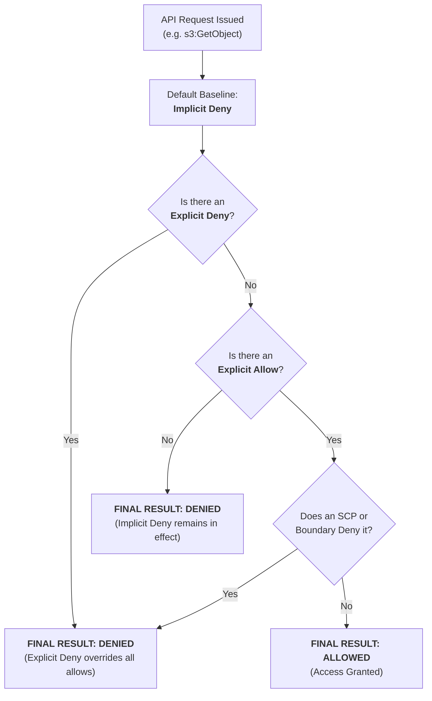

## Overview

[Introduction to IAM](https://tryhackme.com/room/introductiontoawsiam) is Room 1.3 in Module 1 (**Welcome to AWS**) of TryHackMe's **Defending AWS** learning path. In traditional on-premises infrastructure, network perimeters (firewalls, DMZs, VLANs) form the primary barrier against unauthorized access. In the cloud, the network perimeter dissolves: **Identity is the new perimeter**.

AWS Identity and Access Management (IAM) is the central control plane service governing authentication (who you are) and authorization (what you are allowed to do) across every API call. A single misconfigured policy statement or over-privileged role can expose entire databases, allow unmonitored infrastructure deployment, or permit account takeover.

This walkthrough dissects the core pillars of AWS IAM:
- **IAM Principals:** Differentiating the Root user, IAM Users, IAM Groups, and IAM Roles.
- **Credential Lifecycles:** Comparing permanent access keys against temporary Security Token Service (STS) credentials.
- **Policy Anatomy:** Decoding JSON policy statements (`Effect`, `Action`, `Resource`, `Condition`).
- **Policy Evaluation Logic:** Understanding how AWS evaluates conflicting permissions using the strict precedence of Explicit Deny.
- **CLI Discovery:** Auditing IAM configurations programmatically via the AWS CLI.

---

## 1. The IAM Principal Architecture

An IAM principal is an entity that can request an action or operation on an AWS resource. Principals are structured into distinct tiers based on privilege and lifecycle:



### 1. The Root User
- Created automatically when the AWS account is opened.
- Holds unconditional, unrestricted access to every resource and billing setting in the account.
- **Security Rule:** The root user must never be used for daily administrative tasks. It must be protected with hardware-based Multi-Factor Authentication (MFA), and all root access keys must be deleted immediately.

### 2. IAM Users
- Long-term identities representing specific human operators or legacy applications.
- Carry two possible authentication mechanisms:
  - **Console Password:** For interactive login to the AWS Management Console.
  - **Access Key Pair (Access Key ID & Secret Access Key):** For programmatic access via the AWS CLI, SDKs, or direct REST API calls.

### 3. IAM Groups
- Organizational collections of IAM users.
- Useful for assigning identical permissions to teams (e.g. `Tier1-SOC`, `CloudAdmins`, `Developers`).
- **Architectural Constraints:** Groups cannot be nested (a group cannot contain another group), and groups cannot be referenced as a `Principal` in resource-based policies.

### 4. IAM Roles
- Dynamic identities designed to grant temporary permissions.
- Unlike IAM users, roles **do not possess long-term credentials**.
- When an entity assumes a role (via the `sts:AssumeRole` API call), the AWS Security Token Service (STS) generates a temporary credential set:
  - `AccessKeyId`: Begins with `ASIA` (denoting temporary session keys).
  - `SecretAccessKey`: Ephemeral secret string.
  - `SessionToken`: Cryptographic validation token.
  - `Expiration`: UTC timestamp when the session expires (default: 1 hour, configurable up to 12 hours).

---

## 2. Anatomy of an IAM Policy (JSON)

Permissions in AWS are defined through JSON documents known as **IAM Policies**. Every policy consists of top-level metadata and one or more `Statement` blocks:



### Policy Elements Breakdown

1. **`Version`:** Specifies the language syntax version. Must always be set to `"2012-10-17"`. (Using older versions like `"2008-10-17"` breaks advanced condition variable evaluations).
2. **`Sid` (Optional):** An alphanumeric identifier describing the statement's purpose.
3. **`Effect`:** Mandatory. Declares whether the statement grants access (`"Allow"`) or restricts access (`"Deny"`).
4. **`Action`:** Specifies the exact API operations. Uses the syntax `<service>:<action>`. Supports wildcards (e.g. `s3:Get*`), though wildcards should be avoided in production.
5. **`Resource`:** The Amazon Resource Name (ARN) identifying the target object.
6. **`Condition` (Optional):** Contextual gates requiring specific conditions to be true for the policy to trigger (e.g., verifying client IP address, requiring MFA, or checking tags).

### Comparative Policy Example: Wildcard vs Least-Privilege

#### Insecure Over-Privileged Policy
```json
{
  "Version": "2012-10-17",
  "Statement": [
    {
      "Sid": "DangerousFullAccess",
      "Effect": "Allow",
      "Action": "*",
      "Resource": "*"
    }
  ]
}
```
*Risk:* Grants full administrative access to all AWS services and data in the account.

#### Hardened Least-Privilege Policy
```json
{
  "Version": "2012-10-17",
  "Statement": [
    {
      "Sid": "RestrictedReadOnlyStorageWithMFA",
      "Effect": "Allow",
      "Action": [
        "s3:GetObject",
        "s3:ListBucket"
      ],
      "Resource": [
        "arn:aws:s3:::corporate-finance-prod",
        "arn:aws:s3:::corporate-finance-prod/*"
      ],
      "Condition": {
        "Bool": {
          "aws:MultiFactorAuthPresent": "true"
        },
        "IpAddress": {
          "aws:SourceIp": "198.51.100.0/24"
        }
      }
    }
  ]
}
```
*Security Features:* Scoped strictly to read actions, locked to one specific bucket ARN, requires active MFA, and restricts source IP to the corporate office subnet.

---

## 3. Deterministic Policy Evaluation Logic

When an authenticated principal issues an API request, AWS evaluates all applicable policies (Identity-based policies, Resource-based policies, Permissions Boundaries, and Service Control Policies) through a strict decision tree:



### The Three Fundamental Rules
1. **Default Deny:** Every request is denied by default unless an explicit statement permits it.
2. **Explicit Allow:** An explicit `"Effect": "Allow"` statement is required to override the default deny.
3. **Explicit Deny Trumps Everything:** If even one policy statement anywhere in the evaluation chain contains an `"Effect": "Deny"` that matches the request context, the request is immediately denied. No amount of allows can override an explicit deny.

---

## 4. Auditing IAM Configurations via AWS CLI

Security engineers query IAM state programmatically to verify least privilege and detect configuration drift:

### 1. Verifying Active Caller Context
```bash
aws sts get-caller-identity
```

### 2. Enumerating Account Users
```bash
aws iam list-users --output table
```

### 3. Enumerating Roles and Trust Policies
```bash
aws iam list-roles --query "Roles[?contains(RoleName, 'Admin')].[RoleName, Arn]" --output table
```

### 4. Inspecting Attached Managed Policies
```bash
aws iam list-attached-user-policies --user-name Alice --output json
```

### 5. Retrieving Policy Details and Document Versions
```bash
# Retrieve the default policy version ID
aws iam get-policy --policy-arn arn:aws:iam::123456789012:policy/CustomAppPolicy

# Read the raw JSON document
aws iam get-policy-version \
    --policy-arn arn:aws:iam::123456789012:policy/CustomAppPolicy \
    --version-id v1 \
    --query "PolicyVersion.Document" --output json
```

---

## 5. Defensive Engineering Standards for IAM

1. **Eliminate Static Access Keys:**
   - Migrate developers and operational staff to **AWS IAM Identity Center (Single Sign-On)**.
   - Enforce web-based authentication with hardware FIDO2/WebAuthn keys, generating short-lived temporary tokens rather than persisting keys in `~/.aws/credentials`.

2. **Automated Credential Hygiene:**
   - Generate and analyze the IAM Credential Report weekly:
     ```bash
     aws iam generate-credential-report
     aws iam get-credential-report --output text --query "Content" | base64 -d
     ```
   - Automatically disable access keys older than 90 days or unused for 45 days.

3. **Deploy Permissions Boundaries on Delegated Admin Roles:**
   - When granting development teams permission to create IAM roles for their CI/CD pipelines, attach a **Permissions Boundary** to ensure they cannot create a role with greater privileges than their own boundary permits (preventing privilege escalation).

4. **Service Control Policies (SCPs) at the Organization Root:**
   - Deploy guardrails preventing member accounts from disabling CloudTrail, leaving approved regions, or removing the security audit role:
     ```json
     {
       "Version": "2012-10-17",
       "Statement": [
         {
           "Sid": "ProtectCloudTrail",
           "Effect": "Deny",
           "Action": [
             "cloudtrail:StopLogging",
             "cloudtrail:DeleteTrail"
           ],
           "Resource": "*"
         }
       ]
     }
     ```

---

## 6. Step-by-Step Task Walkthrough

### Task 1: Introduction to AWS IAM

This task introduces the core mandate of AWS IAM: managing access permissions and securing administrative control over AWS services.

- **Question:** I understand the purpose and importance of AWS IAM.
- **Answer:** `No answer needed`

---

### Task 2: IAM Principals (Root, Users, Groups, and Roles)

Task 2 examines the four core IAM entity types:
- **Root User:** The foundational account creator identity with unconditional access.
- **IAM Users:** Long-term identities with passwords or access keys.
- **IAM Groups:** Collections of users sharing attached policies.
- **IAM Roles:** Dynamic, temporary identities assumed by workloads or cross-account principals via AWS STS.

#### Questions and Answers for Task 2

1. **Question:** What is the name of the identity that is automatically created with the AWS account and has complete access to all resources?
   - **Answer:** `Root user`

2. **Question:** What IAM entity allows you to group multiple users together to assign identical permissions efficiently?
   - **Answer:** `IAM Group`

3. **Question:** What IAM entity does not have long-term credentials and is temporarily assumed by users, applications, or AWS services?
   - **Answer:** `IAM Role`

---

### Task 3: IAM Policies and JSON Structure

Task 3 covers policy formatting:
- Policies are JSON documents containing statements.
- `Effect` declares whether access is permitted or restricted (`Allow` or `Deny`).
- `Action` specifies the API calls, while `Resource` designates the target ARNs.

#### Questions and Answers for Task 3

1. **Question:** In an IAM policy statement, which required element dictates whether the action is permitted or blocked?
   - **Answer:** `Effect`

2. **Question:** What is the standard policy syntax version string that should be specified at the top of all modern IAM policies?
   - **Answer:** `2012-10-17`

---

### Task 4: IAM Policy Evaluation Logic

Task 4 tests the decision rules governing permission resolution:
- All actions begin with an **Implicit Deny**.
- An **Explicit Allow** permits the action if no deny exists.
- An **Explicit Deny** immediately supersedes any allows.

#### Questions and Answers for Task 4

1. **Question:** If an IAM user has both an explicit Allow and an explicit Deny policy attached for the same action, what is the final decision?
   - **Answer:** `Deny`

2. **Question:** What is the default permission state for all AWS API actions before any explicit policies are evaluated?
   - **Answer:** `Implicit Deny`

---

### Task 5: IAM Practical CLI Discovery

Task 5 practices programmatic discovery using the AWS CLI:
- Run `aws iam list-users` to enumerate account identities.
- Run `aws iam list-roles` to review workload execution roles.
- Run `aws sts get-caller-identity` to verify authentication context.

#### Questions and Answers for Task 5

1. **Question:** What AWS CLI command is used to list all IAM users present in an AWS account?
   - **Answer:** `aws iam list-users`

2. **Question:** What AWS CLI command is used to list all IAM roles configured in an AWS account?
   - **Answer:** `aws iam list-roles`

---

### Task 6: Conclusion

Task 6 synthesizes IAM principles, emphasizing least privilege, temporary credentials, and continuous policy auditing.

- **Question:** I understand AWS IAM fundamentals and am ready to proceed to Cloud Networking!
- **Answer:** `No answer needed`

---

## Complete Question and Answer Summary

| Task | Question / Prompt | Target IAM Element | Answer |
|---|---|---|---|
| **Task 1** | I understand the purpose and importance of AWS IAM. | Introduction | `No answer needed` |
| **Task 2 (Q1)** | What identity is automatically created with the AWS account with complete access? | Root Account | `Root user` |
| **Task 2 (Q2)** | What entity allows you to group multiple users together for shared permissions? | User Management | `IAM Group` |
| **Task 2 (Q3)** | What entity has no long-term credentials and is assumed temporarily by workloads? | Ephemeral Credentials | `IAM Role` |
| **Task 3 (Q1)** | In a policy statement, which required element dictates if an action is permitted or blocked? | Policy JSON Structure | `Effect` |
| **Task 3 (Q2)** | What is the standard policy syntax version string for modern IAM policies? | Policy Metadata | `2012-10-17` |
| **Task 4 (Q1)** | If both an explicit Allow and an explicit Deny apply to an action, what is the final decision? | Evaluation Precedence | `Deny` |
| **Task 4 (Q2)** | What is the default permission state for all AWS actions before explicit policies? | Baseline Authorization | `Implicit Deny` |
| **Task 5 (Q1)** | What AWS CLI command lists all IAM users present in an account? | AWS CLI Enumeration | `aws iam list-users` |
| **Task 5 (Q2)** | What AWS CLI command lists all IAM roles configured in an account? | AWS CLI Enumeration | `aws iam list-roles` |
| **Task 6** | I understand AWS IAM fundamentals and am ready to proceed! | Conclusion | `No answer needed` |

---

## You can find me online at:


- **GitHub:** [Mhdomer](https://github.com/Mhdomer)
- **LinkedIn:** [mhd3omar](https://www.linkedin.com/in/mhd3omar/)
- **Tryhackme:** [nonlouy](https://tryhackme.com/p/nonlouy)
