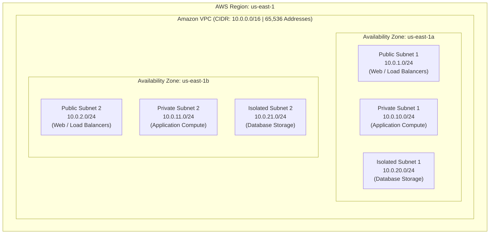
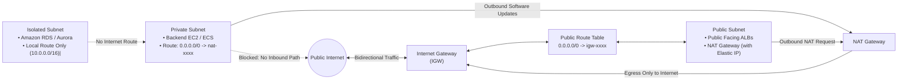
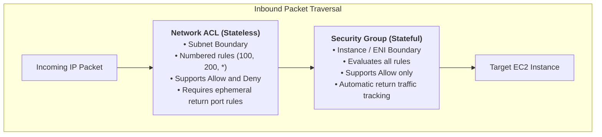

## Overview

[Introduction to Cloud Networking](https://tryhackme.com/room/introtocloudnetworking) is Room 1.4 in Module 1 (**Welcome to AWS**) of TryHackMe's **Defending AWS** learning path. In cloud defense, IAM governs identity permissions across the control plane, while cloud networking enforces traffic boundaries across the data plane.

Without disciplined network architecture, compromised workloads in one tier can pivot unimpeded across an enterprise environment. Amazon Virtual Private Cloud (VPC) provides an isolated, software-defined network (SDN) overlay where defenders define IP addressing, multi-tier subnet boundaries, routing policies, and traffic inspection points.

This room establishes foundational networking principles for cloud security:
- **Amazon VPC Core Architecture:** Software-defined boundaries, CIDR block sizing, and the 5 reserved IP addresses in every AWS subnet.
- **Subnet Segregation:** Distinguishing Public subnets, Private subnets, and Isolated data subnets.
- **Gateway Mechanics:** Controlling inbound and outbound network ingress and egress using Internet Gateways (IGWs) and NAT Gateways.
- **Traffic Routing:** Constructing deterministic Route Tables for traffic steering.
- **Perimeter Defense:** Comparing stateful Security Groups against stateless Network Access Control Lists (NACLs).
- **CLI Discovery:** Auditing VPC topologies via the AWS CLI.

---

## 1. Amazon VPC Architecture and CIDR Allocation

A Virtual Private Cloud (VPC) is a logically isolated virtual network dedicated to an AWS account within a single region.



### CIDR Notation and Private IP Ranges
VPC networking relies on Classless Inter-Domain Routing (CIDR) blocks conforming to RFC 1918 private IPv4 ranges:
- `10.0.0.0/8` (10.0.0.0 to 10.255.255.255)
- `172.16.0.0/12` (172.16.0.0 to 172.31.255.255)
- `192.168.0.0/16` (192.168.0.0 to 192.168.255.255)

The allowable block size in an AWS VPC spans from `/16` (65,536 addresses) down to `/28` (16 addresses).

### The 5 Reserved IP Addresses per Subnet
In any on-premises network, 2 addresses are reserved per subnet (network and broadcast). In AWS, **5 IP addresses are reserved in every subnet** for management functions:

| IP Offset in Subnet (e.g. `10.0.1.0/24`) | Assigned Function in AWS |
|---|---|
| `10.0.1.0` | **Network Address:** The base network identifier. |
| `10.0.1.1` | **VPC Router:** The internal virtual router interface. |
| `10.0.1.2` | **Amazon DNS Server:** Resolves Route 53 and private DNS (`Base IP + 2`). |
| `10.0.1.3` | **AWS Future Use:** Reserved for future infrastructure features. |
| `10.0.1.255` | **Network Broadcast Address:** Broadcast traffic is not supported in VPC, but this address is permanently reserved. |

*Engineering Formula:*  
$$\text{Usable Host IPs} = 2^{(32 - \text{Prefix})} - 5$$  
For a `/24` subnet: $256 - 5 = 251 \text{ usable host IPs}$.

---

## 2. Multi-Tier Subnet Segregation and Gateways

A secure cloud network isolates workloads across tiered boundaries:



### 1. The Internet Gateway (IGW)
- A horizontally scaled, redundant VPC software component that connects the VPC to the public internet.
- Performs Network Address Translation (NAT) between private IPv4 addresses and public IPv4 addresses assigned to instances.
- Does not introduce availability bottlenecks or bandwidth constraints.

### 2. Public Subnets
- A subnet is classified as **Public** if its route table includes an explicit default route (`0.0.0.0/0`) directing internet-bound traffic to an **Internet Gateway (`igw-xxxx`)**.
- Instances inside public subnets must be allocated a public IPv4 address or Elastic IP (EIP) to communicate externally.

### 3. Private Subnets and NAT Gateways
- A subnet is classified as **Private** if its route table lacks a route to an Internet Gateway.
- Workloads in private subnets cannot be reached directly from the internet.
- To allow private instances to download security updates, install packages, or reach external APIs, defenders place a **NAT Gateway** inside a *public* subnet.
- The private subnet's route table directs `0.0.0.0/0` to the `nat-xxxx` gateway ID.
- **Defensive Property:** Traffic is strictly egress-only. Outbound connections are translated, while unsolicited incoming connection attempts from the internet are dropped.

### 4. Isolated Database Subnets
- Route tables in isolated subnets contain only the default local VPC route (`10.0.0.0/16 -> local`).
- No route to an IGW or a NAT Gateway exists. Databases can only be accessed internally by application servers residing in the private subnet.

---

## 3. Stateful vs Stateless Network Filtering

AWS implements two independent layers of virtual firewalls:



### Detailed Comparison Matrix

| Architectural Feature | Security Groups (SGs) | Network Access Control Lists (NACLs) |
|---|---|---|
| **Operating Layer** | Virtual Network Interface (ENI / Host level) | Subnet Boundary |
| **State Tracking** | **Stateful:** Return traffic is automatically permitted regardless of outbound rules | **Stateless:** Return traffic must be explicitly permitted in outbound rules |
| **Rule Types** | **Allow only:** Explicit Deny rules cannot be created (Implicit Deny by default) | **Allow and Deny:** Can explicitly block malicious IP addresses or subnets |
| **Rule Evaluation** | All rules are evaluated simultaneously before access is granted | Rules are evaluated in strict numerical order (lowest number first; first match wins) |
| **Ephemeral Ports** | Handled automatically by state connection tracker | Must explicitly allow ports `1024-65535` for return traffic |
| **Association** | Associated directly with an instance ENI | Associated with an entire subnet |

---

## 4. Auditing Cloud Networking via AWS CLI

Security engineers audit VPC topology and verify route tables programmatically:

### 1. Enumerating Virtual Private Clouds
```bash
aws ec2 describe-vpcs --output table
```

### 2. Enumerating Subnets and CIDR Blocks
```bash
aws ec2 describe-subnets \
    --query "Subnets[*].[SubnetId, VpcId, CidrBlock, AvailabilityZone, MapPublicIpOnLaunch]" \
    --output table
```

### 3. Auditing Route Tables for Public Routing
Check for any subnets routing traffic directly to an Internet Gateway (`igw-`):
```bash
aws ec2 describe-route-tables \
    --query "RouteTables[*].[RouteTableId, VpcId, Routes[?GatewayId!=null && starts_with(GatewayId, 'igw-')].DestinationCidrBlock]" \
    --output table
```

### 4. Detecting Wide-Open Security Groups
Find security groups permitting unrestricted inbound access (`0.0.0.0/0`) on management ports (SSH: 22, RDP: 3389):
```bash
aws ec2 describe-security-groups \
    --filters "Name=ip-permission.cidr,Values=0.0.0.0/0" \
    --query "SecurityGroups[?IpPermissions[?FromPort==`22` || FromPort==`3389`]].{GroupId:GroupId, GroupName:GroupName}" \
    --output table
```

---

## 5. Defensive Engineering Standards for Cloud Networks

1. **Eliminate Public Subnet Workloads:**
   - No database, application backend, or microservice should reside in a public subnet. Public subnets must be restricted strictly to Application Load Balancers (ALBs), NAT Gateways, and managed Bastion hosts.
2. **Restrict Management Access via Systems Manager (SSM):**
   - Eliminate inbound port 22 (SSH) and port 3389 (RDP) from security groups entirely. Manage instances securely via **AWS Systems Manager Session Manager**, which tunnels shell access over HTTPS via the SSM Agent without opening inbound firewall ports or allocating public IPs.
3. **Blacklist Known Malicious CIDRs at the NACL Layer:**
   - Because Security Groups cannot express Deny rules, use Network ACL rule numbers (e.g. Rule `50: Deny 203.0.113.0/24`) to block scanning networks and adversary infrastructure before packets reach workloads.
4. **Enable VPC Flow Logs:**
   - Capture all IP traffic metadata (source, destination, protocol, packet count, accept/reject status) and stream logs directly to Amazon CloudWatch Logs or an S3 security lake for SIEM ingestion and anomaly detection.

---

## 6. Step-by-Step Task Walkthrough

### Task 1: Introduction to Cloud Networking

This task outlines the networking principles required to secure cloud infrastructure, defining how Virtual Private Clouds separate cloud resources.

- **Question:** I understand the objectives of cloud networking.
- **Answer:** `No answer needed`

---

### Task 2: Virtual Private Clouds (VPCs) and CIDR Blocks

Task 2 explores VPC addressing:
- A VPC is defined by its primary CIDR block.
- In every AWS subnet, exactly 5 IP addresses are reserved for network routing and DNS management.

#### Questions and Answers for Task 2

1. **Question:** What is the term for a logically isolated virtual network defined within an AWS account?
   - **Answer:** `Virtual Private Cloud`

2. **Question:** How many IP addresses are permanently reserved by AWS in every subnet?
   - **Answer:** `5`

---

### Task 3: Subnets and Gateways

Task 3 covers subnet categorization and traffic egress:
- Public subnets route directly to an Internet Gateway (`igw-xxxx`).
- Private subnets require a NAT Gateway located in a public subnet to reach the web.

#### Questions and Answers for Task 3

1. **Question:** What AWS component must be attached to a VPC to enable bidirectional communication between public subnets and the internet?
   - **Answer:** `Internet Gateway`

2. **Question:** What managed gateway allows instances in a private subnet to make outbound connections to the internet while preventing inbound connections?
   - **Answer:** `NAT Gateway`

---

### Task 4: Route Tables

Task 4 covers routing rules:
- Route tables dictate packet forwarding based on destination CIDR blocks.
- The default destination for internet-bound traffic is `0.0.0.0/0`.

#### Questions and Answers for Task 4

1. **Question:** What component contains a set of rules that determine where network traffic from your subnet is directed?
   - **Answer:** `Route Table`

2. **Question:** What CIDR block represents the default route matching all external IPv4 internet traffic?
   - **Answer:** `0.0.0.0/0`

---

### Task 5: Security Groups vs Network ACLs

Task 5 tests the distinction between stateful and stateless filtering:
- Security Groups operate at the instance ENI level and are stateful.
- Network ACLs operate at the subnet boundary, are stateless, and support explicit Deny rules.

#### Questions and Answers for Task 5

1. **Question:** Are AWS Security Groups stateful or stateless?
   - **Answer:** `Stateful`

2. **Question:** Which firewall component operates at the subnet boundary, evaluates numbered rules, and supports explicit Deny rules?
   - **Answer:** `Network ACL`

---

### Task 6: Conclusion

Task 6 concludes cloud networking fundamentals, preparing defenders for compute isolation.

- **Question:** I understand cloud networking fundamentals and am ready to proceed to Cloud Computing!
- **Answer:** `No answer needed`

---

## Complete Question and Answer Summary

| Task | Question / Prompt | Target Concept | Answer |
|---|---|---|---|
| **Task 1** | I understand the objectives of cloud networking. | Introduction | `No answer needed` |
| **Task 2 (Q1)** | What is the term for a logically isolated virtual network within AWS? | VPC Definition | `Virtual Private Cloud` |
| **Task 2 (Q2)** | How many IP addresses are permanently reserved by AWS in every subnet? | Subnet Reservation | `5` |
| **Task 3 (Q1)** | What AWS component allows bidirectional communication with the internet? | Gateway Architecture | `Internet Gateway` |
| **Task 3 (Q2)** | What gateway allows private subnets to make outbound requests while blocking inbound traffic? | Egress Defense | `NAT Gateway` |
| **Task 4 (Q1)** | What component contains rules determining where subnet traffic is directed? | Routing Rules | `Route Table` |
| **Task 4 (Q2)** | What CIDR block represents the default route matching all external IPv4 traffic? | IP Routing | `0.0.0.0/0` |
| **Task 5 (Q1)** | Are AWS Security Groups stateful or stateless? | Firewall State Tracking | `Stateful` |
| **Task 5 (Q2)** | Which component operates at the subnet boundary and supports explicit Deny rules? | Subnet Filtering | `Network ACL` |
| **Task 6** | I understand cloud networking fundamentals and am ready to proceed! | Conclusion | `No answer needed` |

---

## You can find me online at:


- **GitHub:** [Mhdomer](https://github.com/Mhdomer)
- **LinkedIn:** [mhd3omar](https://www.linkedin.com/in/mhd3omar/)
- **Tryhackme:** [nonlouy](https://tryhackme.com/p/nonlouy)
