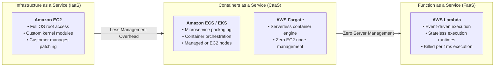
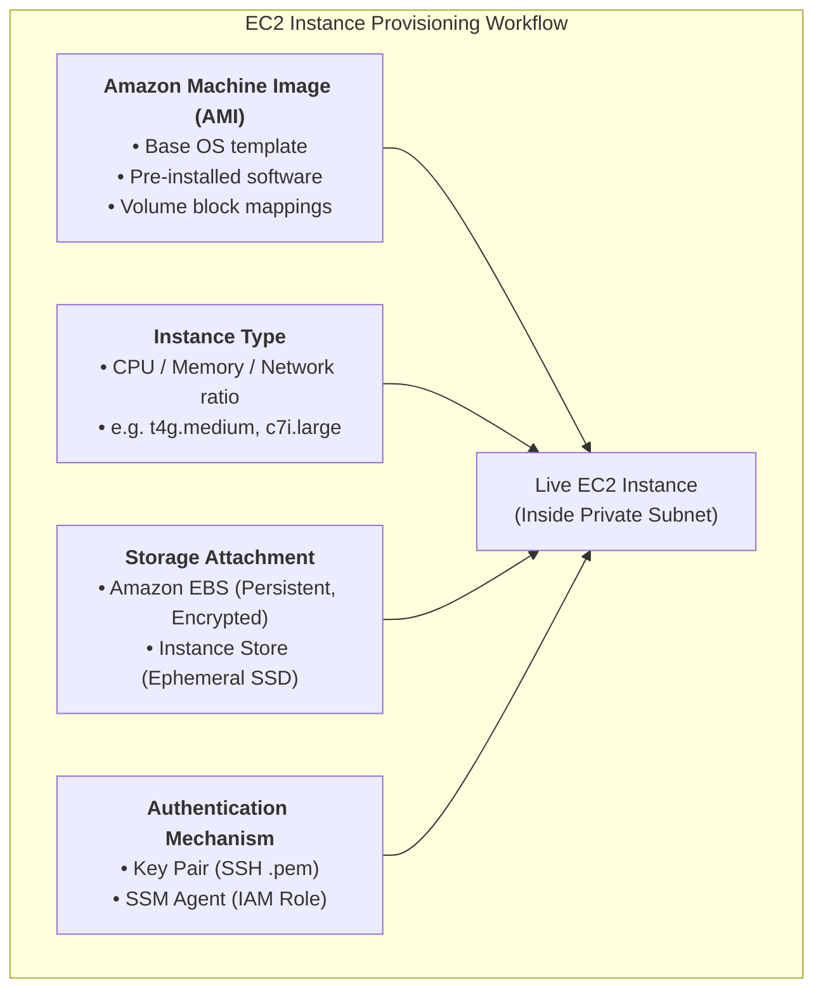
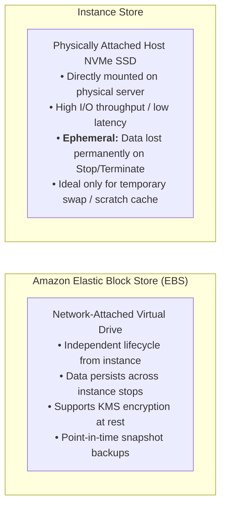
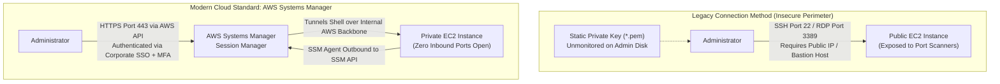
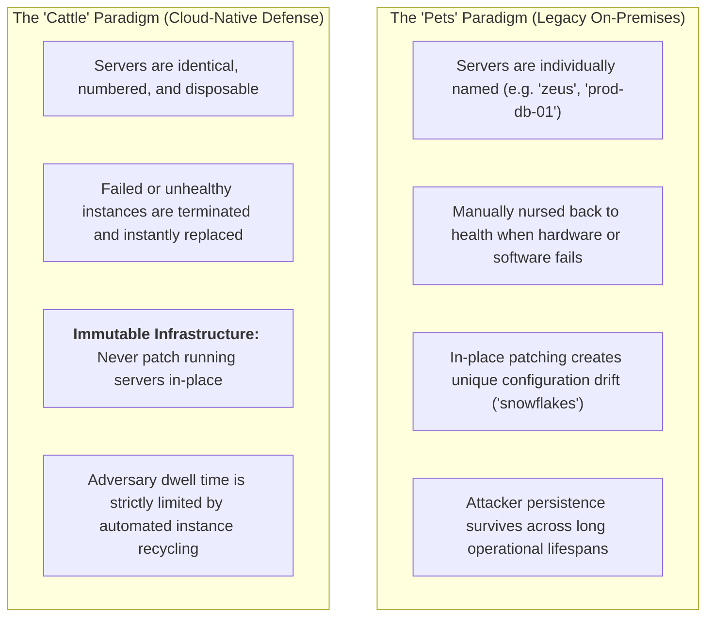

## Overview

[Introduction to Cloud Computing](https://tryhackme.com/room/introductiontocloudcomputing) is Room 1.5 in Module 1 (**Welcome to AWS**) of TryHackMe's **Defending AWS** learning path. Compute infrastructure represents the core execution engine of the cloud: it is where application code executes, databases process transactions, and operational software runs. Consequently, it is also the primary target for malicious exploits, reverse shells, and persistence mechanisms.

Securing compute in Amazon Web Services requires moving beyond traditional physical server maintenance. Cloud engineers must manage virtual machines via programmatic APIs, protect the Instance Metadata Service (IMDS), replace unmonitored SSH bastions with centralized session management, and shift from long-lived stateful servers to immutable, disposable architectures.

This walkthrough covers:
- **AWS Compute Spectrum:** Differentiating Amazon EC2 (Virtual Machines), ECS/EKS (Containers), and AWS Lambda (Serverless Functions).
- **Amazon EC2 Core Concepts:** Amazon Machine Images (AMIs), instance sizing families, and block storage architectures (EBS vs ephemeral Instance Store).
- **Secure Instance Connectivity:** Auditing cryptographic Key Pairs and replacing open management ports with AWS Systems Manager (SSM) Session Manager.
- **The "Pets vs. Cattle" Paradigm:** Embracing immutable infrastructure to eliminate configuration drift and minimize adversary dwell time.
- **CLI Discovery:** Auditing compute workloads, unencrypted EBS volumes, and IMDS configurations using the AWS CLI.

---

## 1. The AWS Compute Spectrum

AWS provides compute capabilities along a spectrum balancing operational control against automated platform management:



### Compute Services Comparison

| Service | Compute Model | Underlying Management | Security Focus |
|---|---|---|---|
| **Amazon EC2** | Virtual Machines (IaaS) | Customer controls OS, middleware, patching, host firewalls | OS hardening, vulnerability patching, SSH/RDP lockdown |
| **Amazon ECS / EKS** | Container Orchestration | Customer manages cluster configs, task definitions, and container images | Image vulnerability scanning, rootless containers, least-privilege task roles |
| **AWS Fargate** | Serverless Containers | AWS manages underlying host OS and hypervisors | Container runtime defense, IAM task execution roles |
| **AWS Lambda** | Serverless Functions (FaaS) | AWS manages language runtime, scaling, and infrastructure entirely | Function code security, least-privilege IAM execution roles, dependency auditing |

---

## 2. Amazon EC2 Core Architectural Concepts

Amazon Elastic Compute Cloud (Amazon EC2) provides scalable virtual computing capacity in the cloud.



### 1. Amazon Machine Images (AMIs)
An AMI is a packaged template that contains the software configuration (operating system, application server, and software packages) required to launch an instance:
- **AWS-Provided AMIs:** Maintained and signed by AWS or verified vendors (e.g., Amazon Linux 2023, Ubuntu Server, Red Hat Enterprise Linux, Windows Server).
- **Custom / Golden AMIs:** Standardized enterprise images built by security teams with pre-hardened configurations, mandatory endpoint detection and response (EDR) agents, and compliance controls pre-installed.
- **Security Gotcha:** Launching unverified public community AMIs exposes environments to pre-installed backdoors, malicious cryptominers, or embedded rootkits.

### 2. Block Storage: Amazon EBS vs Instance Store
EC2 instances utilize two fundamentally different types of block storage:



### 3. The Instance Metadata Service (IMDS)
Every EC2 instance has access to a link-local address (`http://169.254.169.254/latest/meta-data/`) providing operational information about the instance:
- Exposes instance ID, public/private IP addresses, security groups, and temporary credentials for attached IAM roles (`/latest/meta-data/iam/security-credentials/<RoleName>`).
- **Critical Security Control:** Enforce **IMDSv2** to mandate session-oriented token headers (`X-aws-ec2-metadata-token`), preventing Server-Side Request Forgery (SSRF) exploitation.

---

## 3. Securely Connecting to Compute Workloads

Traditional server management relied on opening port 22 (SSH for Linux) or port 3389 (RDP for Windows) to administrative workstations or bastion hosts:



### Why AWS Systems Manager (SSM) Session Manager Wins

1. **Zero Inbound Ports:**
   - Security groups on private instances can completely drop all inbound traffic on port 22 and port 3389.
2. **No Public IP Addresses:**
   - Instances reside entirely inside private subnets, communicating with the Systems Manager service over private VPC endpoints or a NAT Gateway.
3. **IAM Authentication and MFA:**
   - Access is controlled through standard IAM policies rather than shared, unrevokable SSH `.pem` key files.
4. **Complete Forensic Audit Trail:**
   - Every keystroke and command executed in a Session Manager shell is logged and streamed directly to Amazon CloudWatch Logs or encrypted S3 buckets for non-repudiation.

---

## 4. The "Pets vs. Cattle" Paradigm in Cloud Defense

One of the most profound shifts in cloud engineering is the transition from managing servers as **Pets** to managing them as **Cattle**:



### Defensive Engineering Value of Immutable Infrastructure
- **Eliminating Configuration Drift:** When servers are patched in-place over months, slight discrepancies accumulate, creating blind spots where security agents fail or patches miss specific libraries.
- **Minimizing Attacker Dwell Time:** Under an immutable cattle approach, instances are launched from pre-baked Golden AMIs via Auto Scaling Groups. Servers are regularly refreshed (e.g., every 7 to 14 days). Attackers who establish web shells or in-memory persistence in a running instance are evicted automatically when the instance is terminated.
- **Reproducible Recovery:** If a malware infection occurs, defenders take an EBS snapshot for offline memory and disk forensics, quarantine the instance via security group isolation, and let the Auto Scaling Group launch a pristine replacement in seconds.

---

## 5. Auditing EC2 Workloads via AWS CLI

Security engineers use the AWS CLI to identify exposed compute instances and verify hardening standards:

### 1. Enumerating Running EC2 Workloads
```bash
aws ec2 describe-instances \
    --filters "Name=instance-state-name,Values=running" \
    --query "Reservations[*].Instances[*].[InstanceId, InstanceType, KeyName, PrivateIpAddress, PublicIpAddress]" \
    --output table
```

### 2. Auditing IMDSv2 Enforcement Across Instances
Verify that instances require session tokens and block unauthenticated IMDSv1 calls:
```bash
aws ec2 describe-instances \
    --query "Reservations[*].Instances[*].[InstanceId, MetadataOptions.HttpTokens, MetadataOptions.HttpPutResponseHopLimit]" \
    --output table
```
*Expected secure state:* `HttpTokens: required` and `HttpPutResponseHopLimit: 1`.

### 3. Detecting Unencrypted EBS Storage Volumes
Verify that all EBS volumes attached to compute instances are encrypted at rest using KMS:
```bash
aws ec2 describe-volumes \
    --query "Volumes[?Encrypted==\`false\`].[VolumeId, Size, AvailabilityZone, State]" \
    --output table
```

---

## 6. Defensive Engineering Standards for Cloud Compute

1. **Mandate IMDSv2 and Restrict Hop Limits:**
   - Prevent SSRF credential leaks by configuring launch templates to require IMDSv2:
   ```bash
   aws ec2 modify-instance-metadata-options \
       --instance-id i-0123456789abcdef0 \
       --http-tokens required \
       --http-put-response-hop-limit 1
   ```
2. **Decommission SSH Key Pairs in Favor of SSM:**
   - Strip all default key pairs from launch templates. Enforce management access via AWS Systems Manager Session Manager, auditing sessions through CloudWatch log streams.
3. **Bake Hardened Golden AMIs via Automated Pipelines:**
   - Use tools like HashiCorp Packer and EC2 Image Builder to automate the construction of hardened AMIs with CIS Benchmarks applied, vulnerability patches installed, and unnecessary services disabled.
4. **Enforce EBS Encryption by Default:**
   - Enable account-level default EBS encryption so that any volume created in the region is automatically encrypted with an AWS KMS customer managed key (CMK):
   ```bash
   aws ec2 enable-ebs-encryption-by-default
   ```

---

## 7. Step-by-Step Task Walkthrough

### Task 1: Introduction

This task introduces AWS compute services, outlining how Amazon EC2 provides scalable on-demand processing power and the security challenges associated with virtual servers.

- **Question:** I understand the objectives of this room.
- **Answer:** `No answer needed`

---

### Task 2: AWS Compute Services

Task 2 examines the breadth of AWS compute offerings:
- Amazon EC2 provides raw virtual machines (IaaS).
- AWS Lambda enables serverless execution of code without server provisioning.

#### Questions and Answers for Task 2

1. **Question:** What is the foundational Infrastructure as a Service (IaaS) virtual server offering in AWS?
   - **Answer:** `Amazon EC2`

2. **Question:** What AWS service allows running code serverless without provisioning or managing underlying servers?
   - **Answer:** `AWS Lambda`

---

### Task 3: EC2 Core Concepts

Task 3 covers core virtual server building blocks:
- Amazon Machine Images (AMIs) provide the pre-configured OS templates.
- Amazon Elastic Block Store (EBS) provides persistent block storage that survives instance lifecycle changes.

#### Questions and Answers for Task 3

1. **Question:** What pre-configured virtual machine template is used to launch EC2 instances?
   - **Answer:** `Amazon Machine Image`

2. **Question:** What persistent, network-attached block storage service is typically attached as the root drive of an EC2 instance?
   - **Answer:** `Amazon EBS`

---

### Task 4: Connecting to Instances

Task 4 explores instance connectivity and administrative access:
- Key pairs use asymmetric cryptography to authenticate SSH or decrypt Windows passwords.
- AWS Systems Manager Session Manager enables secure terminal access over HTTPS without open inbound management ports or public IPs.

#### Questions and Answers for Task 4

1. **Question:** What cryptographic credential pair is used to authenticate SSH connections to a newly launched EC2 instance?
   - **Answer:** `Key Pair`

2. **Question:** What AWS Systems Manager capability allows managing instances through a secure browser or CLI shell without opening inbound ports?
   - **Answer:** `Session Manager`

---

### Task 5: Pets Versus Cattle

Task 5 tests understanding of the immutable infrastructure paradigm:
- "Pets" are individually maintained, named servers repaired when broken.
- "Cattle" are standardized, disposable instances replaced rather than patched in-place.

#### Questions and Answers for Task 5

1. **Question:** In modern cloud architecture, what term describes disposable, identical servers that are replaced instead of repaired?
   - **Answer:** `Cattle`

2. **Question:** What legacy server management paradigm treats systems as unique, individually maintained entities that cause disruption when they fail?
   - **Answer:** `Pets`

---

### Task 6: Conclusion

Task 6 concludes compute security fundamentals, emphasizing the transition toward immutable architectures and automated session management.

- **Question:** I understand AWS compute security fundamentals and am ready to proceed to Cloud Storage!
- **Answer:** `No answer needed`

---

## Complete Question and Answer Summary

| Task | Question / Prompt | Target Concept | Answer |
|---|---|---|---|
| **Task 1** | I understand the objectives of this room. | Introduction | `No answer needed` |
| **Task 2 (Q1)** | What is the foundational IaaS virtual server offering in AWS? | IaaS Compute | `Amazon EC2` |
| **Task 2 (Q2)** | What service allows running code serverless without managing servers? | Serverless Compute | `AWS Lambda` |
| **Task 3 (Q1)** | What pre-configured template is used to launch EC2 instances? | OS Image Templates | `Amazon Machine Image` |
| **Task 3 (Q2)** | What persistent block storage service is attached as the root drive of an EC2 instance? | Block Storage | `Amazon EBS` |
| **Task 4 (Q1)** | What cryptographic credential pair is used to authenticate SSH connections? | SSH Authentication | `Key Pair` |
| **Task 4 (Q2)** | What capability allows managing instances through shell access without opening inbound ports? | Secure Remote Management | `Session Manager` |
| **Task 5 (Q1)** | What term describes disposable, identical servers replaced instead of repaired? | Infrastructure Philosophy | `Cattle` |
| **Task 5 (Q2)** | What paradigm treats systems as unique, individually maintained entities? | Legacy Infrastructure | `Pets` |
| **Task 6** | I understand AWS compute security fundamentals and am ready to proceed! | Conclusion | `No answer needed` |

---

## You can find me online at:


- **GitHub:** [Mhdomer](https://github.com/Mhdomer)
- **LinkedIn:** [mhd3omar](https://www.linkedin.com/in/mhd3omar/)
- **Tryhackme:** [nonlouy](https://tryhackme.com/p/nonlouy)
