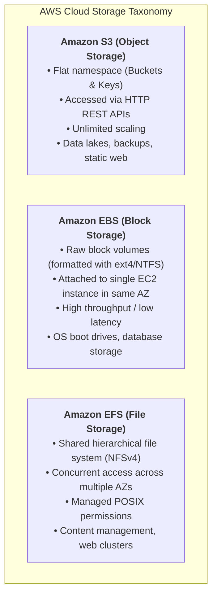
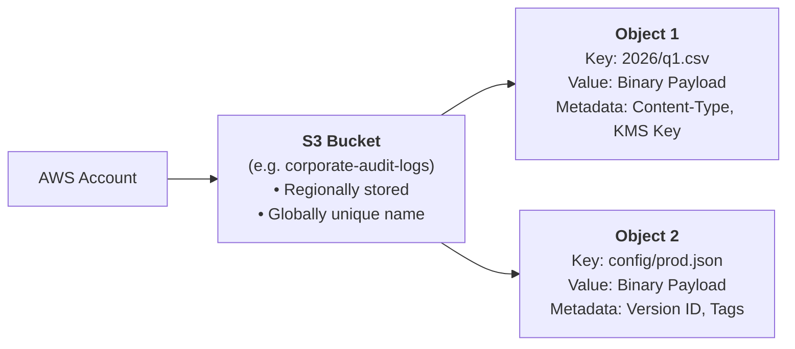
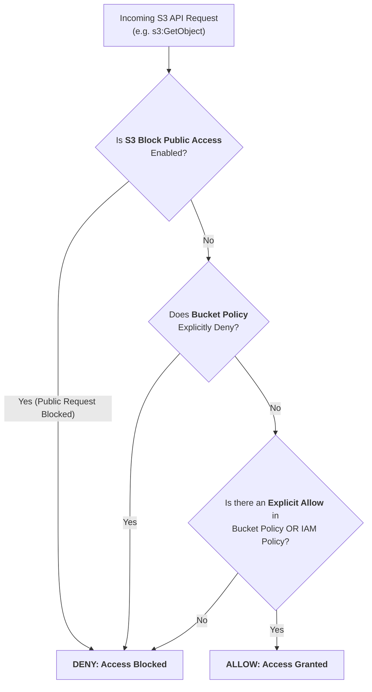
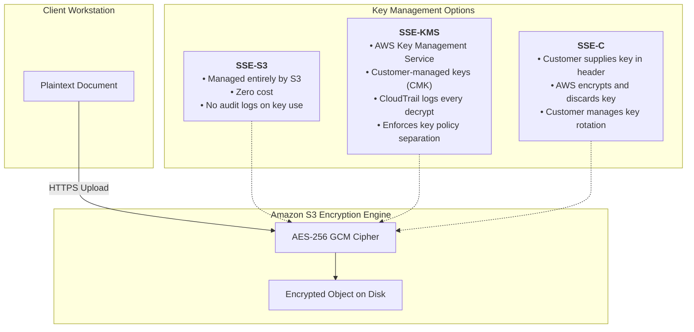

## Overview

[Introduction to Cloud Storage](https://tryhackme.com/room/introtocloudstorage) is Room 1.6 in Module 1 (**Welcome to AWS**) of TryHackMe's **Defending AWS** learning path. In enterprise security, data is the ultimate target. Compute workloads and network gateways exist solely to process, transform, and deliver data stored in cloud repositories.

Amazon Web Services offers three distinct storage paradigms:
1. **Object Storage (Amazon S3):** Scalable, HTTP-accessible storage for unstructured files, data lakes, and backups.
2. **Block Storage (Amazon EBS):** High-performance raw virtual disks dedicated to single compute instances.
3. **File Storage (Amazon EFS):** Elastic, POSIX-compliant network file systems shared across hundreds of compute nodes.

Because Amazon S3 is exposed via internet-facing HTTP REST endpoints, a single misconfiguration (such as disabled public access blocks or a wildcard `Principal: *` policy) can instantly expose millions of confidential records to the public internet. This walkthrough breaks down S3 storage architecture, access control models, encryption mechanisms, and defensive auditing via the AWS CLI.

---

## 1. The Cloud Storage Architecture Spectrum

Understanding the distinction between object, block, and file storage is essential for selecting appropriate security controls:



### Storage Characteristics Comparison

| Storage Service | Architecture | Access Protocol | Primary Use Case | Security Boundary |
|---|---|---|---|---|
| **Amazon S3** | Object Storage | HTTPS REST API | Data lakes, backups, application media | Bucket Policies, IAM, S3 Block Public Access, KMS |
| **Amazon EBS** | Block Storage | Direct hypervisor bus | EC2 root volumes, transactional databases | EBS volume encryption, IAM `ec2:AttachVolume`, snapshot permissions |
| **Amazon EFS** | File Storage | Network File System (NFSv4) | Shared application files, container persistence | Security Groups (port 2049), POSIX permissions, EFS access points |

---

## 2. Amazon S3 Core Concepts and Global Namespace

Amazon Simple Storage Service (Amazon S3) is built around a simple key-value architecture:



### The Global Namespace Rule
- Although data inside an S3 bucket is stored within a specific **AWS Region** (such as `us-east-1` or `eu-west-1`) for data sovereignty and compliance, **S3 bucket names are globally unique across all AWS accounts worldwide**.
- Once an organization creates a bucket named `my-company-backup`, no other AWS customer anywhere in the world can create a bucket with that exact name until it is deleted.
- Bucket names form part of the public DNS record: `https://<bucket-name>.s3.<region>.amazonaws.com/`.

### Anatomy of an Object
- **Key:** The unique string identifier (the "path" within the bucket, e.g. `reports/financials-2026.pdf`).
- **Value:** The actual data payload (ranging from 0 bytes up to 5 terabytes per object).
- **Version ID:** Unique string assigned when S3 Versioning is enabled to track object history.
- **Metadata:** System metadata (creation date, size, cryptographic MD5 hash/ETag) and user-defined key-value tags.

---

## 3. S3 Access Control Architecture

Securing data in S3 requires coordinating multiple independent authorization layers:



### 1. S3 Bucket Policies
A **Bucket Policy** is a resource-based JSON document attached directly to an S3 bucket. Unlike IAM policies (which attach to users and roles), bucket policies govern who can access the bucket from any account:

```json
{
  "Version": "2012-10-17",
  "Statement": [
    {
      "Sid": "EnforceHTTPSOnly",
      "Effect": "Deny",
      "Principal": "*",
      "Action": "s3:*",
      "Resource": [
        "arn:aws:s3:::corporate-audit-logs",
        "arn:aws:s3:::corporate-audit-logs/*"
      ],
      "Condition": {
        "Bool": {
          "aws:SecureTransport": "false"
        }
      }
    }
  ]
}
```
*Security Purpose:* Denies all operations that do not use encrypted HTTPS (`aws:SecureTransport: false`), preventing cleartext HTTP data interception.

### 2. Access Control Lists (ACLs)
- Legacy XML-based access mechanism dating back to the launch of S3 in 2006.
- Grants basic read/write permissions to predefined groups (such as `AllUsers` or `AuthenticatedUsers`).
- **Modern Security Standard:** Disable ACLs entirely by configuring **S3 Object Ownership** to `Bucket owner enforced`. All access is then managed centrally via IAM and Bucket Policies.

### 3. S3 Block Public Access (BPA)
A centralized master control switch that prevents accidental public exposure at both the AWS Account level and the individual Bucket level. It provides four distinct protection gates:
1. `BlockPublicAcls`: Rejects new public ACLs on buckets or objects.
2. `IgnorePublicAcls`: Ignores all existing public ACLs.
3. `BlockPublicPolicy`: Rejects bucket policies granting public access.
4. `RestrictPublicBuckets`: Restricts access to buckets with public policies strictly to authorized AWS services and account users.

---

## 4. Data Encryption at Rest in Amazon S3

AWS provides three primary Server-Side Encryption (SSE) models for data at rest:



### Encryption Models Comparison

| Encryption Mode | Key Owner | Audit Trail | Key Rotation |
|---|---|---|---|
| **SSE-S3 (`AES256`)** | Amazon S3 | No key usage audit trail | Handled automatically by AWS |
| **SSE-KMS (`aws:kms`)** | AWS KMS (Customer Managed Key) | **Full CloudTrail Audit Trail** for every `kms:Decrypt` operation | Automated annual rotation or on-demand |
| **SSE-C** | Customer managed off-cloud | None in AWS (client must log key usage) | Customer must manage and track all keys |

### Defensive Value of SSE-KMS
In regulated environments, SSE-KMS is mandatory because it introduces a **dual-layer permission requirement**: An attacker with full S3 permissions (`s3:GetObject`) still cannot read the encrypted file unless their IAM principal also has explicit permission to use the KMS key (`kms:Decrypt`).

---

## 5. Auditing S3 Workloads via AWS CLI

Security engineers audit storage configurations programmatically:

### 1. Enumerating S3 Buckets in Account
```bash
aws s3 ls
```

### 2. Verifying S3 Block Public Access Status
```bash
aws s3api get-public-access-block \
    --bucket corporate-audit-logs \
    --query "PublicAccessBlockConfiguration" \
    --output json
```
*Expected secure state:* All four parameters (`BlockPublicAcls`, `IgnorePublicAcls`, `BlockPublicPolicy`, `RestrictPublicBuckets`) set to `true`.

### 3. Checking Default Bucket Encryption
```bash
aws s3api get-bucket-encryption \
    --bucket corporate-audit-logs \
    --query "ServerSideEncryptionConfiguration.Rules[0].ApplyServerSideEncryptionByDefault" \
    --output json
```

### 4. Reading and Auditing Bucket Policy
```bash
aws s3api get-bucket-policy \
    --bucket corporate-audit-logs \
    --query "Policy" \
    --output text | jq .
```

---

## 6. Defensive Engineering Standards for Cloud Storage

1. **Enable Account-Wide S3 Block Public Access:**
   Enforce the master override preventing any bucket in the AWS account from being made public:
   ```bash
   aws s3control put-public-access-block \
       --account-id 123456789012 \
       --public-access-block-configuration "BlockPublicAcls=true,IgnorePublicAcls=true,BlockPublicPolicy=true,RestrictPublicBuckets=true"
   ```
2. **Disable ACLs via Object Ownership:**
   Enforce `Bucket owner enforced` to deactivate all legacy ACLs:
   ```bash
   aws s3api put-bucket-ownership-controls \
       --bucket corporate-audit-logs \
       --ownership-controls="Rules=[{ObjectOwnership=BucketOwnerEnforced}]"
   ```
3. **Mandate HTTPS and SSE-KMS in Bucket Policies:**
   Attach policy statements that explicitly deny HTTP uploads and unencrypted object creation.
4. **Enable S3 Versioning and MFA Delete:**
   Protect business-critical data from ransomware overwrite or accidental deletion by requiring Multi-Factor Authentication to delete versions or modify bucket versioning states.

---

## 7. Step-by-Step Task Walkthrough

### Task 1: Introduction to Cloud Storage

This task outlines the primary storage services in AWS, contrasting object storage, block storage, and file storage.

- **Question:** I understand the objectives of this room.
- **Answer:** `No answer needed`

---

### Task 2: Storage Types in AWS (Object vs Block vs File)

Task 2 examines the core storage services:
- Amazon S3 provides scalable object storage accessed over HTTP REST APIs.
- Amazon EFS provides an elastic, shared POSIX-compliant file system.
- Amazon EBS provides virtual block storage attached to individual compute instances.

#### Questions and Answers for Task 2

1. **Question:** What AWS service provides scalable object storage accessed over HTTP REST APIs?
   - **Answer:** `Amazon S3`

2. **Question:** What storage service provides a managed, shared POSIX-compliant network file system mountable by multiple instances concurrently?
   - **Answer:** `Amazon EFS`

3. **Question:** What storage type operates as a raw virtual disk attached to an individual EC2 instance?
   - **Answer:** `Block storage`

---

### Task 3: Amazon S3 Core Concepts

Task 3 covers S3 architecture:
- Objects are stored inside buckets.
- Bucket names are globally unique across all AWS accounts worldwide.

#### Questions and Answers for Task 3

1. **Question:** In Amazon S3, what fundamental container holds objects and data?
   - **Answer:** `Bucket`

2. **Question:** Are Amazon S3 bucket names regional or globally unique across all AWS accounts?
   - **Answer:** `Globally unique`

---

### Task 4: S3 Access Control and Security

Task 4 explores access controls:
- Bucket policies are resource-based JSON documents attached to buckets.
- S3 Block Public Access provides an account-wide and bucket-wide safeguard overriding permissive ACLs and policies.

#### Questions and Answers for Task 4

1. **Question:** What resource-based JSON policy document is attached directly to an S3 bucket to manage access?
   - **Answer:** `Bucket Policy`

2. **Question:** What AWS feature provides a centralized switch to prevent public access across buckets and accounts?
   - **Answer:** `S3 Block Public Access`

---

### Task 5: Data Encryption at Rest in S3

Task 5 covers encryption models:
- SSE-S3 is the default encryption mode using AES-256 with keys managed by Amazon S3.
- SSE-KMS utilizes AWS Key Management Service keys, providing CloudTrail audit trails for decryption events.

#### Questions and Answers for Task 5

1. **Question:** What default server-side encryption mode uses AES-256 with keys managed entirely by Amazon S3?
   - **Answer:** `SSE-S3`

2. **Question:** Which server-side encryption option provides CloudTrail audit logging and customer-controlled key policies?
   - **Answer:** `SSE-KMS`

---

### Task 6: Conclusion

Task 6 synthesizes cloud storage principles, preparing defenders for native AWS security monitoring tools.

- **Question:** I understand cloud storage fundamentals and am ready to proceed to AWS Security Tools!
- **Answer:** `No answer needed`

---

## Complete Question and Answer Summary

| Task | Question / Prompt | Target Concept | Answer |
|---|---|---|---|
| **Task 1** | I understand the objectives of this room. | Introduction | `No answer needed` |
| **Task 2 (Q1)** | What AWS service provides scalable object storage accessed over HTTP? | Object Storage | `Amazon S3` |
| **Task 2 (Q2)** | What service provides a shared POSIX file system for multiple instances? | File Storage | `Amazon EFS` |
| **Task 2 (Q3)** | What storage type operates as a raw virtual disk attached to an instance? | Storage Architecture | `Block storage` |
| **Task 3 (Q1)** | In Amazon S3, what fundamental container holds objects and data? | Storage Hierarchy | `Bucket` |
| **Task 3 (Q2)** | Are Amazon S3 bucket names regional or globally unique across AWS? | Namespace Scope | `Globally unique` |
| **Task 4 (Q1)** | What resource-based JSON policy is attached directly to an S3 bucket? | Access Control | `Bucket Policy` |
| **Task 4 (Q2)** | What feature provides a centralized switch to prevent public access? | Inadvertent Exposure Defense | `S3 Block Public Access` |
| **Task 5 (Q1)** | What default server-side encryption mode uses S3-managed AES-256 keys? | Baseline Encryption | `SSE-S3` |
| **Task 5 (Q2)** | Which encryption option provides CloudTrail audit logging and key policies? | Auditable Cryptography | `SSE-KMS` |
| **Task 6** | I understand cloud storage fundamentals and am ready to proceed! | Conclusion | `No answer needed` |

---

## You can find me online at:


- **GitHub:** [Mhdomer](https://github.com/Mhdomer)
- **LinkedIn:** [mhd3omar](https://www.linkedin.com/in/mhd3omar/)
- **Tryhackme:** [nonlouy](https://tryhackme.com/p/nonlouy)
