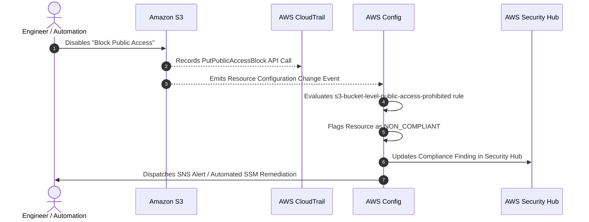
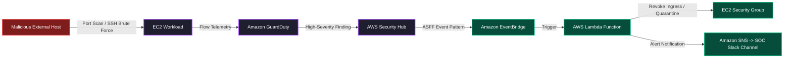

The sixth installment of TryHackMe's **Defending AWS** series explored cloud storage primitives, access controls, and data protection mechanisms. However, securing cloud infrastructure requires more than configuring access policies: cloud defenders need real-time visibility into control plane activities, continuous configuration state evaluation, intelligent behavioral anomaly detection, and centralized posture management.

In traditional on-premises enterprise environments, defenders rely on network taps, physical IDS/IPS appliances, host agents, and centralized SIEM collectors. In AWS, physical network access does not exist for customers, and workloads are ephemeral. AWS provides a native suite of security and compliance services built directly into the cloud fabric.

This room, **Introduction to AWS Security Tools**, provides a foundational orientation to the five core detection, audit, and posture management services native to AWS: **AWS CloudTrail**, **Amazon GuardDuty**, **AWS Config**, **Amazon Inspector**, and **AWS Security Hub**, along with specialized data classification via **Amazon Macie**.

```
+========================================================================================+
|                       AWS NATIVE DEFENSE & DETECTION FABRIC                           |
+========================================================================================+
|  [AUDIT & LOGGING]   --> AWS CloudTrail (Control Plane API & Data Events)             |
|  [THREAT DETECTION]  --> Amazon GuardDuty (VPC Flow, DNS, CloudTrail ML Analysis)     |
|  [DRIFT & AUDIT]     --> AWS Config (Resource State Timeline, Rule Compliance)        |
|  [VULN MANAGEMENT]   --> Amazon Inspector (CVEs, Network Exposure, Package Scans)     |
|  [POSTURE & AGG]     --> AWS Security Hub (CSPM, CIS/FSBP Benchmarks, ASFF Format)     |
|  [DATA GOVERNANCE]   --> Amazon Macie (PII, Sensitive Data Discovery in S3)          |
+========================================================================================+
```

---

## 1. Architectural Overview of Native AWS Security Services

Securing an enterprise AWS environment requires a layered defensive strategy that maps directly to the **NIST Cybersecurity Framework (CSF)** and the **AWS Cloud Adoption Framework (CAF)** security perspective: Identify, Protect, Detect, Respond, and Recover.

The native security services operate at different abstraction layers of the cloud environment:

```mermaid
flowchart TD
    subgraph ControlPlane["Control Plane & API Activity"]
        A[IAM Users / Roles / CLI / SDK] -->|API Requests| B[AWS API Endpoints]
        B -->|Audit Records| C[AWS CloudTrail]
    end

    subgraph DetectionEngines["Automated Analysis & Detection Engines"]
        C -->|Log Telemetry| D[Amazon GuardDuty]
        E[VPC Flow Logs] -->|Network Flow| D
        F[Route 53 DNS Logs] -->|DNS Query Logs| D
        G[S3 Data Events] -->|Data Access Logs| D
        H[EC2 Instances / ECR Images] -->|SSM / Package Metadata| I[Amazon Inspector]
        J[S3 Buckets] -->|Bucket Object Analysis| K[Amazon Macie]
        L[Resource Configuration Changes] -->|State Changes| M[AWS Config]
    end

    subgraph CentralHub["Centralized Posture & Remediation"]
        D -->|Findings (ASFF)| N[AWS Security Hub]
        I -->|Findings (ASFF)| N
        K -->|Findings (ASFF)| N
        M -->|Compliance Status| N
        N -->|Security Score & Aggregation| O[Security Operations / SOC]
        N -->|Automated Events| P[Amazon EventBridge]
        P -->|Automated Remediation| Q[AWS Lambda / SSM Automation]
    end

    classDef audit fill:#1e293b,stroke:#38bdf8,stroke-width:2px,color:#fff;
    classDef detection fill:#1e1e2e,stroke:#a855f7,stroke-width:2px,color:#fff;
    classDef posture fill:#0f172a,stroke:#22c55e,stroke-width:2px,color:#fff;

    class A,B,C audit;
    class D,E,F,G,H,I,J,K,L,M detection;
    class N,O,P,Q posture;
```

---

## 2. AWS CloudTrail: The Cloud Control Plane Audit Log

Every single interaction with AWS, whether through the AWS Management Console, the AWS CLI, an SDK, or an internal AWS service, is an API call. **AWS CloudTrail** is the foundational audit logging service that captures and records these API requests as immutable JSON event records.

### What CloudTrail Records

A CloudTrail event captures seven critical forensic questions:
1. **Who?** The identity (`userIdentity`) that made the request (Root, IAM user, IAM role, or federated identity).
2. **When?** The precise timestamp of the request (`eventTime`).
3. **What?** The API action called (`eventName`) and the service invoked (`eventSource`).
4. **Where?** The AWS Region (`awsRegion`) and the source IP address (`sourceIPAddress`).
5. **How?** The client user agent (`userAgent`) and authentication parameters.
6. **Parameters?** The request parameters passed to the API (`requestParameters`).
7. **Outcome?** The response elements returned by the service or error codes if denied (`errorCode: AccessDenied`).

### Management Events vs. Data Events

CloudTrail categorizes events into two distinct categories:

| Event Category | Scope & Description | Default Status | Pricing Impact |
|---|---|---|---|
| **Management Events** | Control plane operations that configure or manage resources (e.g., `CreateBucket`, `RunInstances`, `AttachUserPolicy`, `DeleteSecurityGroup`). | Enabled by default (free 90-day event history). | Multi-region trail: First copy free; additional trails incur ingestion costs. |
| **Data Events** | High-volume data-plane operations on or within resources (e.g., S3 `GetObject`, `PutObject`, Lambda `InvokeFunction`, DynamoDB `GetItem`). | Disabled by default due to high event volume. | Charged per 100,000 recorded events; must be enabled explicitly per resource. |

### CloudTrail Insights

**CloudTrail Insights** uses machine learning to establish a baseline of operational API activity for an account and automatically generates an alert when anomalous patterns occur. Examples include:
- A sudden spike in write API calls (e.g., unauthorized bulk resource provisioning).
- A sharp surge in `AccessDenied` errors indicating an adversary conducting brute-force privilege enumeration or token brute-forcing.

### CloudTrail Log Structure

Below is an authentic CloudTrail JSON event snippet showing an unauthorized API attempt:

```json
{
  "eventVersion": "1.08",
  "userIdentity": {
    "type": "IAMUser",
    "principalId": "AIDAEXAMPLEUSERID",
    "arn": "arn:aws:iam::123456789012:user/intern-dev",
    "accountId": "123456789012",
    "userName": "intern-dev"
  },
  "eventTime": "2026-04-09T08:14:22Z",
  "eventSource": "iam.amazonaws.com",
  "eventName": "AttachUserPolicy",
  "awsRegion": "us-east-1",
  "sourceIPAddress": "198.51.100.45",
  "userAgent": "aws-cli/2.15.15 Python/3.11.6 Linux/5.15.0",
  "errorCode": "AccessDenied",
  "errorMessage": "User: arn:aws:iam::123456789012:user/intern-dev is not authorized to perform: iam:AttachUserPolicy on resource: user intern-dev",
  "requestParameters": {
    "userName": "intern-dev",
    "policyArn": "arn:aws:iam::aws:policy/AdministratorAccess"
  }
}
```

---

## 3. Amazon GuardDuty: Intelligent Cloud Threat Detection

**Amazon GuardDuty** is an automated threat detection service that continuously monitors AWS accounts and workloads for malicious activity and unauthorized behavior.

### Zero-Footprint Telemetry Sources

Unlike traditional IDS solutions that require installing monitoring agents on every virtual machine or modifying network configurations, GuardDuty processes data directly from the AWS foundational infrastructure without performance degradation or network latency:

1. **AWS CloudTrail Management Events:** Tracks unusual administrative calls, console logins from suspicious IP addresses, and credential anomalies.
2. **AWS CloudTrail S3 Data Events:** Identifies suspicious object-level access, abnormal exfiltration volumes, or mass deletions.
3. **VPC Flow Logs:** Monitors IP traffic flows, outbound connections to known Command and Control (C2) servers, and port-scanning activity.
4. **Route 53 DNS Query Logs:** Detects DNS tunneling, domain generation algorithms (DGAs), and queries to malicious domains.
5. **EKS Audit Logs & Runtime Monitoring:** Identifies container compromise and suspicious processes running inside Kubernetes pods.
6. **RDS Login Activity:** Uncovers brute-force attacks against relational database instances.
7. **Lambda Network Activity:** Alerts on serverless functions initiating unauthorized outbound network connections.

```
+-------------------------------------------------------------------------------+
|                      GUARDDUTY FINDING ANATOMY                                |
+-------------------------------------------------------------------------------+
| Format: ThreatPurpose:ResourceTypeAffected/ThreatFamilyName.DetectionMechanism!Artifact
| Example: Recon:EC2/Portscan
| Example: UnauthorizedAccess:IAMUser/TorIPCaller
| Example: CryptoCurrency:EC2/BitcoinTool.B!DNS
| Example: Stealth:IAMUser/PasswordPolicyChange
+-------------------------------------------------------------------------------+
```

### Finding Severity Levels

GuardDuty findings are rated on a numeric scale from 0.1 to 10.0:
- **Low (0.1 - 3.9):** Suspicious or unusual activity that represents minimal direct threat (e.g., an IAM principal making API calls from a newly observed country).
- **Medium (4.0 - 6.9):** Deviations from behavioral baselines indicating potential reconnaissance or policy violations (e.g., unusual port scanning or abnormal API invocation rates).
- **High (7.0 - 8.9 / 9.0 - 10.0):** Active compromise or immediate exploitation (e.g., an EC2 instance communicating with a known botnet C2 IP or executing cryptocurrency mining software).

---

## 4. AWS Config: Configuration Tracking and Drift Detection

While CloudTrail records the **action** that changed a resource, **AWS Config** records the **resulting configuration state** and tracks how resource relationships evolve over time.



### Key Capabilities of AWS Config

1. **Configuration Recorder:** Continuously inventories all supported AWS resources in an account, recording their configuration attributes and relationships (e.g., which Security Groups are attached to which EC2 instances).
2. **Configuration History and Timeline:** Maintains a complete timeline showing exactly what a resource looked like at any point in the past, enabling incident responders to correlate security events with infrastructure changes.
3. **Config Rules:** Automated compliance guardrails that evaluate resource states against desired baselines:
   - **AWS Managed Rules:** Pre-built rules maintained by AWS (e.g., `s3-bucket-public-read-prohibited`, `iam-password-policy`, `encrypted-volumes`).
   - **Custom Rules:** Custom validation logic written using AWS Lambda functions.
4. **Automated Remediation:** Paired with AWS Systems Manager (SSM) Automation documents, Config can automatically remediate violations (e.g., immediately re-enabling S3 Block Public Access when an unauthorized user disables it).

---

## 5. Amazon Inspector: Automated Workload Vulnerability Scanning

**Amazon Inspector** is an automated vulnerability management service that scans compute and container workloads across an AWS environment for software vulnerabilities (CVEs) and unintended network exposure.

### Scan Coverage

- **Amazon EC2:** Leverages the installed **AWS Systems Manager (SSM) Agent** to inventory installed software packages, comparing them against national vulnerability databases without needing separate security scanning credentials.
- **Amazon Elastic Container Registry (ECR):** Scans container images upon push and continuously re-scans stored images as new CVEs are published.
- **AWS Lambda Functions:** Scans application dependencies and runtime environments for known vulnerabilities in third-party libraries.

### Contextual Inspector Scoring

Traditional scanners provide static CVSS scores. Amazon Inspector enhances CVSS base scores by factoring in environmental reachability. If an EC2 instance has an unpatched software package with a CVSS score of 9.8, but the instance has no public IP, sits in an isolated subnet, and has no open inbound security group rules, Inspector lowers the contextual risk score to reflect the reduced exploitability.

---

## 6. AWS Security Hub: Centralized Posture and Compliance

Managing individual consoles for GuardDuty, Inspector, Config, IAM Access Analyzer, and AWS Firewall Manager creates alert fatigue and fragmented visibility. **AWS Security Hub** serves as a centralized **Cloud Security Posture Management (CSPM)** and **Cloud Workload Protection (CWP)** aggregator.

```
+-----------------------------------------------------------------------------------+
|                           AWS SECURITY HUB AGGREGATION                            |
+-----------------------------------------------------------------------------------+
|  [GuardDuty]       --> Threat Findings              \                             |
|  [Inspector]       --> CVEs & Workload Exposure      \  Standardized into         |
|  [AWS Config]      --> Compliance Violations          > AWS Security Finding      |
|  [IAM Analyzer]    --> External Access Alerts        /  Format (ASFF) JSON        |
|  [Macie]           --> PII & Data Leak Alerts       /                             |
+-----------------------------------------------------------------------------------+
|                                        |                                          |
|                                        v                                          |
|                     [SECURITY HUB POSTURE DASHBOARD]                              |
|           - Overall Security Score (e.g., 78% Compliant)                          |
|           - CIS AWS Foundations Benchmark v1.4 / v3.0                             |
|           - AWS Foundational Security Best Practices (FSBP)                       |
|           - PCI-DSS v3.2.1 / NIST SP 800-53 Rev. 5                                |
+-----------------------------------------------------------------------------------+
```

### AWS Security Finding Format (ASFF)

Security Hub normalizes all ingested findings into a single, standardized JSON schema known as the **AWS Security Finding Format (ASFF)**. This enables standardized SIEM ingestion (Splunk, Datadog, Microsoft Sentinel) and unified automation scripts regardless of which tool generated the alert.

---

## 7. Amazon Macie: Sensitive Data Discovery in Cloud Storage

While AWS Config and Security Hub ensure buckets are properly configured, they do not inspect the actual data inside files. **Amazon Macie** is a fully managed data security and privacy service that uses machine learning and pattern matching to discover, classify, and protect sensitive data stored in Amazon S3.

### What Macie Detects

- **Personally Identifiable Information (PII):** Names, home addresses, passport numbers, national ID numbers, dates of birth.
- **Financial Information:** Credit card numbers, bank account numbers, SWIFT/IBAN codes.
- **Credential Secrets:** Unencrypted private keys, AWS access keys, GitHub personal access tokens, database connection strings.

Macie assigns a **data sensitivity score** to each S3 bucket, alerting defenders when high-risk sensitive data resides in buckets that have public access enabled or lack encryption.

---

## 8. Service Comparison Reference Matrix

Understanding when to deploy each security service is a key competency for AWS security engineers:

| Service | Primary Function | Data Source / Telemetry | Agent Required? | Output / Deliverable |
|---|---|---|---|---|
| **AWS CloudTrail** | Control plane audit logging | AWS API calls across all interfaces | No | JSON event records delivered to S3 / CloudWatch |
| **Amazon GuardDuty** | Threat and anomaly detection | VPC Flow Logs, DNS logs, CloudTrail, S3/EKS/RDS/Lambda events | No | Threat findings with severity ratings (0.1 to 10.0) |
| **AWS Config** | Configuration history and compliance tracking | AWS resource state changes | No | Compliance timeline, drift alerts, remediation |
| **Amazon Inspector** | Software vulnerability scanning | Installed packages and network reachability | SSM Agent (EC2) / Native (ECR, Lambda) | Contextual CVE vulnerability findings |
| **AWS Security Hub** | Centralized CSPM and compliance posture | Ingests from GuardDuty, Config, Inspector, Macie, 3rd parties | No | Overall security score, benchmark reports, ASFF alerts |
| **Amazon Macie** | Sensitive data discovery and classification | S3 object content | No | Sensitive data findings, bucket risk scores |

---

## 9. Hands-On Lab Walkthrough: CLI Enumeration and Verification

In this hands-on exercise, we explore the status and configurations of the native security tools using the AWS CLI.

### Step 1: Verify Caller Identity and Region Context

Always verify the executing security context before querying account-wide security services:

```bash
aws sts get-caller-identity
```

Output:
```json
{
    "UserId": "AROAEXAMPLEIDENTITY:session-name",
    "Account": "123456789012",
    "Arn": "arn:aws:sts::123456789012:assumed-role/CloudSecurityAuditor/session-name"
}
```

### Step 2: Enumerate CloudTrail Audit Trails

Verify that audit logging is active and multi-region logging is enforced:

```bash
aws cloudtrail describe-trails --output table
```

Output:
```
-------------------------------------------------------------------------------------------------------------------------
|                                                     DescribeTrails                                                    |
-------------------------------------------------------------------------------------------------------------------------
||                                                      trailList                                                      ||
|+--------------------+------------------------------------------+-----------------------+-----------------------------+|
|| HomeRegion         | IncludeGlobalServiceEvents               | IsMultiRegionTrail    | Name                        ||
|+--------------------+------------------------------------------+-----------------------+-----------------------------+|
|| us-east-1          | True                                     | True                  | SecurityAuditOrgTrail       ||
|+--------------------+------------------------------------------+-----------------------+-----------------------------+|
```

Check the active logging status of the trail:

```bash
aws cloudtrail get-trail-status --name SecurityAuditOrgTrail
```

Output confirms `IsLogging: true` with continuous heartbeat deliveries.

### Step 3: Inspect Amazon GuardDuty Status

List the active GuardDuty detectors for the current region:

```bash
aws guardduty list-detectors
```

Output:
```json
{
    "DetectorIds": [
        "a1b2c3d4e5f678901234567890abcdef"
    ]
}
```

Retrieve the detector configuration and verify enabled protection data sources:

```bash
aws guardduty get-detector --detector-id a1b2c3d4e5f678901234567890abcdef
```

Output:
```json
{
    "Status": "ENABLED",
    "ServiceRole": "arn:aws:iam::123456789012:role/aws-service-role/guardduty.amazonaws.com/AWSServiceRoleForAmazonGuardDuty",
    "FindingPublishingFrequency": "FIFTEEN_MINUTES",
    "DataSources": {
        "CloudTrail": {
            "Status": "ENABLED"
        },
        "DNSLogs": {
            "Status": "ENABLED"
        },
        "FlowLogs": {
            "Status": "ENABLED"
        },
        "S3Logs": {
            "Status": "ENABLED"
        },
        "Kubernetes": {
            "AuditLogs": {
                "Status": "ENABLED"
            }
        }
    }
}
```

### Step 4: Verify AWS Config Recorders and Rules

Check if the AWS Config recorder is capturing all resource types:

```bash
aws configservice describe-configuration-recorders
```

Inspect the compliance status of deployed AWS Config managed rules:

```bash
aws configservice get-compliance-summary-by-config-rule
```

Output:
```json
{
    "ComplianceSummary": {
        "CompliantResourceCount": {
            "CappedCount": 18,
            "CapExceeded": false
        },
        "NonCompliantResourceCount": {
            "CappedCount": 3,
            "CapExceeded": false
        },
        "ComplianceSummaryTimestamp": "2026-04-09T09:30:00Z"
    }
}
```

### Step 5: Check AWS Security Hub Standards and Security Score

List enabled compliance standards inside Security Hub:

```bash
aws securityhub get-enabled-standards --query 'StandardsSubscriptions[*].[StandardsArn]' --output text
```

Output reveals active subscriptions:
- `arn:aws:securityhub:::ruleset/cis-aws-foundations-benchmark/v/1.4.0`
- `arn:aws:securityhub:us-east-1::standards/aws-foundational-security-best-practices/v/1.0.0`

---

## 10. Practical Defensive Architecture: Automated Threat Remediation

Integrating native AWS security services allows organizations to build automated detection and remediation pipelines without manual human intervention.



### Step-by-Step Remediation Workflow

1. An external attacker targets an Amazon EC2 instance with an aggressive brute-force attack or port scan.
2. GuardDuty analyzes the underlying VPC Flow Logs and flags a finding: `UnauthorizedAccess:EC2/SSHBruteForce`.
3. The finding is automatically sent to AWS Security Hub in the ASFF format.
4. An **Amazon EventBridge** rule matches the finding pattern:
   ```json
   {
     "source": ["aws.securityhub"],
     "detail-type": ["Security Hub Findings - Imported"],
     "detail": {
       "findings": {
         "ProductName": ["GuardDuty"],
         "Severity": {
           "Label": ["HIGH", "CRITICAL"]
         }
       }
     }
   }
   ```
5. EventBridge invokes an **AWS Lambda** remediation function.
6. The Lambda function automatically updates the instance's Security Group, isolating the host into a quarantine state while dispatching an alert to the SOC's incident channel.

---

## 11. TryHackMe Questions and Answers

### Task 1: Introduction
- **Question:** What is the primary purpose of native AWS security tools?
- **Answer:** `Defense in depth`

### Task 2: AWS CloudTrail
- **Question:** Which AWS service records API calls and user activity across your AWS account for audit logging?
- **Answer:** `AWS CloudTrail`
- **Question:** What feature of CloudTrail uses machine learning to detect unusual spikes in API call volume or permission errors?
- **Answer:** `CloudTrail Insights`
- **Question:** Are CloudTrail management events enabled by default across an account?
- **Answer:** `Yes`

### Task 3: Amazon GuardDuty
- **Question:** Which service provides intelligent, continuous threat detection without requiring host agents?
- **Answer:** `Amazon GuardDuty`
- **Question:** Which core telemetry source does GuardDuty analyze to detect malicious network connections and port scans?
- **Answer:** `VPC Flow Logs`
- **Question:** What is the severity score range for high-severity GuardDuty findings?
- **Answer:** `7.0 - 8.9` (or `7.0 - 10.0`)

### Task 4: AWS Config
- **Question:** Which AWS service tracks configuration changes over time and monitors compliance against rules?
- **Answer:** `AWS Config`
- **Question:** What capability in AWS Config provides a chronological view of resource changes?
- **Answer:** `Configuration timeline`

### Task 5: Amazon Inspector
- **Question:** Which automated vulnerability management service scans EC2 instances, ECR container images, and Lambda functions for CVEs?
- **Answer:** `Amazon Inspector`
- **Question:** What local host software component does Amazon Inspector utilize to scan EC2 instances for software vulnerabilities?
- **Answer:** `SSM Agent`

### Task 6: AWS Security Hub
- **Question:** Which service acts as a centralized single-pane-of-glass for aggregating security findings across multiple AWS security services?
- **Answer:** `AWS Security Hub`
- **Question:** What is the standardized JSON schema format used by AWS Security Hub to normalize findings from different services?
- **Answer:** `AWS Security Finding Format`

### Task 7: Amazon Macie
- **Question:** Which service uses pattern matching and machine learning to identify sensitive data like PII stored in Amazon S3 buckets?
- **Answer:** `Amazon Macie`

---

## 12. Defensive Engineering & Production Hardening Checklist

When deploying native security services across an enterprise AWS environment, follow these best practices:

- [ ] **Multi-Account Organization Hierarchy:** Enable GuardDuty, Security Hub, Config, and CloudTrail at the **AWS Organizations** management level with a designated **Delegated Administrator** security account.
- [ ] **Organization Multi-Region CloudTrail:** Configure an organizational trail deployed across all active and inactive regions. Forward logs to an immutable S3 bucket in a dedicated log archive account protected by S3 Object Lock and strict bucket policies.
- [ ] **Log File Validation:** Enable log file validation on CloudTrail trails to generate cryptographic SHA-256 digest files, ensuring logs cannot be tampered with undetected.
- [ ] **GuardDuty Auto-Enablement:** Configure the GuardDuty Organization administrator to automatically enable GuardDuty for all newly joined member accounts.
- [ ] **Enable Core Security Standards in Security Hub:** Activate the **AWS Foundational Security Best Practices (FSBP)** and **CIS AWS Foundations Benchmark** in Security Hub across all production accounts.
- [ ] **AWS Config Conformance Packs:** Deploy pre-packaged collections of AWS Config rules (Conformance Packs) via Infrastructure as Code (Terraform or CloudFormation) to automatically enforce compliance baselines.
- [ ] **Automate Incident Alerting:** Route high-severity Security Hub and GuardDuty findings through Amazon EventBridge directly to your central SIEM or incident response communication channels.

---

*Looking for more hands-on cloud defense guides? Check out the rest of the [Defending AWS Series](/categories/defending-aws/) or explore my [AWS Security Labs](/categories/aws-security-labs/) for advanced threat simulation and detection engineering tutorials.*

---

## You can find me online at:


- **GitHub:** [Mhdomer](https://github.com/Mhdomer)
- **LinkedIn:** [mhd3omar](https://www.linkedin.com/in/mhd3omar/)
- **Tryhackme:** [nonlouy](https://tryhackme.com/p/nonlouy)
