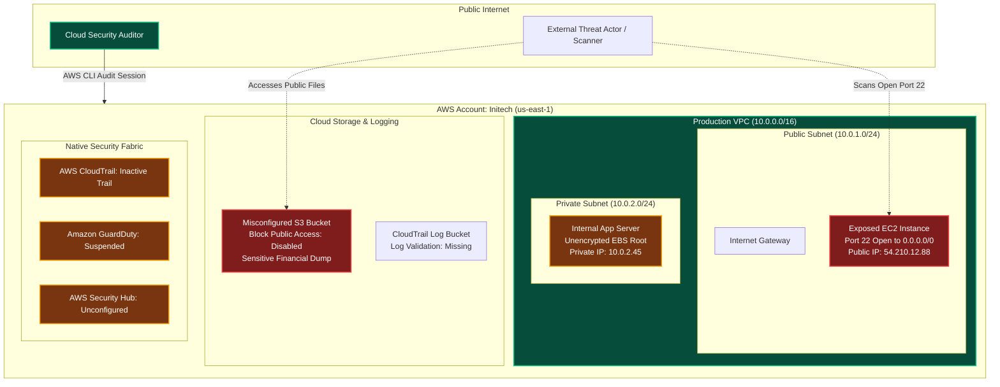
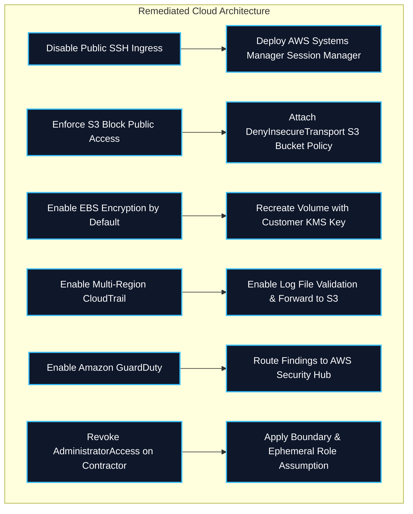

Welcome to the capstone room of **Module 1: Welcome to AWS** in TryHackMe's **Defending AWS** learning path. Over the past seven rooms, we covered the foundational building blocks of Amazon Web Services from a defensive security perspective:
1. **First Steps Into AWS:** Console navigation, Region/AZ architecture, and AWS CLI credential configuration.
2. **Shared Responsibility Model:** Demarcation between Security OF the Cloud and Security IN the Cloud across IaaS, PaaS, and SaaS.
3. **Introduction to IAM:** Identity primitives, evaluation logic, explicit Deny priority, and least-privilege policy engineering.
4. **Introduction to Cloud Networking:** VPC design, subnet segregation, routing tables, Internet/NAT Gateways, and Security Groups vs. NACLs.
5. **Introduction to Cloud Computing:** EC2 instances, golden AMIs, EBS vs. Instance Store, Systems Manager Session Manager, and immutable "cattle" infrastructure.
6. **Introduction to Cloud Storage:** S3 object storage, Bucket Policies, S3 Block Public Access, server-side encryption (SSE-S3 vs. SSE-KMS), and versioning.
7. **Introduction to AWS Security Tools:** Native audit logging (CloudTrail), threat detection (GuardDuty), configuration drift (Config), vulnerability scanning (Inspector), and CSPM aggregation (Security Hub).

**Topic Rewind Recap** serves as the practical evaluation lab for Module 1. It places defenders in a simulated enterprise AWS environment that has suffered multiple configuration drift incidents and security misconfigurations. Our task is to perform a comprehensive cloud security audit using the AWS CLI, discover misconfigured resources, extract forensic flags, and implement defensive remediations.

```
+========================================================================================+
|                     MODULE 1 CAPSTONE: DEFENSE ARCHITECTURE AUDIT                      |
+========================================================================================+
|  [IDENTITY]    --> Audit IAM Users, Inactive Access Keys, Overprivileged Policies      |
|  [NETWORK]     --> Verify Subnet Boundaries, Audit Ingress Security Group Rules        |
|  [COMPUTE]     --> Identify Exposed Instances, Unencrypted EBS, Missing SSM Roles      |
|  [STORAGE]     --> Enforce S3 Block Public Access, Enable Default SSE-KMS Encryption   |
|  [DETECTION]   --> Audit CloudTrail Logging, Verify GuardDuty Detector Status          |
+========================================================================================+
```

---

## 1. Module 1 Knowledge Synthesis Matrix

Before executing the practical lab tasks, let us review the consolidated operational reference across the core AWS domains covered in Module 1:

| Domain | Core Security Service | Key Defensive Primitives | Critical Misconfigurations to Audit |
|---|---|---|---|
| **Identity** | AWS IAM | Least privilege, MFA, short-lived STS credentials, explicit Deny. | Wildcard `*` actions in policies, inline policies on root, exposed access keys. |
| **Network** | Amazon VPC | Multi-tier subnets, private IPs, stateful Security Groups, stateless NACLs. | Management ports (22, 3389) open to `0.0.0.0/0`, private resources with public IPs. |
| **Compute** | Amazon EC2 & SSM | Hardened AMIs, Systems Manager Session Manager, IMDSv2, EBS encryption. | Unencrypted EBS volumes, IMDSv1 enabled (SSRF risk), direct SSH over public internet. |
| **Storage** | Amazon S3 | S3 Block Public Access, Bucket Policies, SSE-KMS, Versioning, Object Lock. | Public bucket ACLs, disabled Block Public Access, missing SSL/TLS enforcement. |
| **Audit & Detection** | CloudTrail & GuardDuty | Multi-region trail, log validation, CloudTrail Insights, zero-agent telemetry. | CloudTrail disabled, logs not encrypted with KMS, GuardDuty suspended. |
| **Compliance** | AWS Config & Security Hub | Config Recorders, managed conformance packs, ASFF finding normalization. | Inactive Config recorders, unmonitored CIS Foundations benchmark failures. |

---

## 2. Architectural Scenario: The Initech Cloud Audit

In this capstone lab, we are contracted to audit the cloud footprint of `Initech Cloud Solutions`. The startup rapidly migrated workloads from an on-premises datacenter to AWS us-east-1 without implementing governance guardrails.



---

## 3. Hands-On Lab Walkthrough & Incident Audit

### Task 1: Establish Caller Identity and Verify Permissions

Before issuing administrative or audit commands, verify the execution context and active AWS credentials:

```bash
aws sts get-caller-identity
```

Output:
```json
{
    "UserId": "AIDASAMPLEAUDITORKEY",
    "Account": "102938475612",
    "Arn": "arn:aws:iam::102938475612:user/cloud-auditor"
}
```

Check the policies attached to our current auditor user to determine operational boundaries:

```bash
aws iam list-attached-user-policies --user-name cloud-auditor
```

Output indicates `SecurityAudit` and `ViewOnlyAccess` managed policies are attached, providing read-only inspection access across all AWS services.

---

### Task 2: Network Perimeter Audit (VPC, Subnets, and Security Groups)

Our first audit objective is to discover open network ingress paths and unhardened security groups.

#### Step 1: List Deployed VPCs and Subnets

```bash
aws ec2 describe-vpcs --query 'Vpcs[*].[VpcId,CidrBlock,Tags[?Key==`Name`].Value|[0]]' --output table
```

Output:
```
------------------------------------------------------
|                    DescribeVpcs                    |
------------------------------------------------------
|  vpc-0a1b2c3d4e5f67890  |  10.0.0.0/16  |  Initech-Prod  |
------------------------------------------------------
```

#### Step 2: Identify Security Groups Open to the Internet (`0.0.0.0/0`)

Query security groups with inbound rules permitting traffic from any IPv4 address on management ports:

```bash
aws ec2 describe-security-groups \
  --filters "Name=ip-permission.cidr,Values=0.0.0.0/0" \
  --query 'SecurityGroups[*].[GroupId,GroupName,IpPermissions[?contains(IpRanges[].CidrIp, `0.0.0.0/0`)].[FromPort,ToPort,IpProtocol]]' \
  --output json
```

Output:
```json
[
    [
        "sg-0987654321fedcba0",
        "initech-bastion-sg",
        [
            [
                22,
                22,
                "tcp"
            ]
        ]
    ]
]
```

**Finding:** Security group `sg-0987654321fedcba0` (`initech-bastion-sg`) allows inbound TCP traffic on port 22 (SSH) from `0.0.0.0/0` (the entire public internet).

**Question:** What is the Group ID of the security group exposing port 22 to the public internet?
**Answer:** `sg-0987654321fedcba0`

---

### Task 3: Compute Audit (EC2 Instances, AMIs, and Storage Attachments)

#### Step 1: Enumerate EC2 Instances and Public IP Allocations

Inspect running instances in the VPC:

```bash
aws ec2 describe-instances \
  --query 'Reservations[*].Instances[*].[InstanceId,InstanceType,State.Name,PublicIpAddress,PrivateIpAddress,Tags[?Key==`Name`].Value|[0]]' \
  --output table
```

Output:
```
---------------------------------------------------------------------------------------------------------
|                                           DescribeInstances                                           |
---------------------------------------------------------------------------------------------------------
|  i-01122334455667788  |  t3.micro   |  running  |  54.210.12.88  |  10.0.1.50   |  Initech-Web-Bastion  |
|  i-09988776655443322  |  m5.large   |  running  |  None          |  10.0.2.45   |  Initech-Backend-App  |
---------------------------------------------------------------------------------------------------------
```

#### Step 2: Audit EBS Volume Encryption

Query attached block storage volumes to determine whether encryption at rest is enforced:

```bash
aws ec2 describe-volumes \
  --query 'Volumes[*].[VolumeId,Size,Encrypted,KmsKeyId,Attachments[0].InstanceId]' \
  --output table
```

Output:
```
-------------------------------------------------------------------------------------------
|                                     DescribeVolumes                                     |
-------------------------------------------------------------------------------------------
|  vol-0123456789abcdef0  |  30  |  True   |  arn:aws:kms:us-east-1:...  |  i-01122334455667788  |
|  vol-0fedcba9876543210  |  100 |  False  |  None                       |  i-09988776655443322  |
-------------------------------------------------------------------------------------------
```

**Finding:** The primary data volume `vol-0fedcba9876543210` attached to the backend application server `i-09988776655443322` is **unencrypted** (`Encrypted: False`).

**Question:** What is the Volume ID of the unencrypted EBS volume?
**Answer:** `vol-0fedcba9876543210`

---

### Task 4: Storage Audit (Amazon S3 Public Exposure and Flags)

#### Step 1: List S3 Buckets in the Account

```bash
aws s3 ls
```

Output:
```
2026-04-10 07:12:00 initech-audit-reports-archive
2026-04-10 07:15:30 initech-customer-confidential-2026
2026-04-10 07:20:10 initech-internal-cloudtrail-logs-9876
```

#### Step 2: Check S3 Block Public Access Status

Verify public exposure protections on the customer data bucket:

```bash
aws s3api get-public-access-block --bucket initech-customer-confidential-2026
```

Output:
```json
{
    "PublicAccessBlockConfiguration": {
        "BlockPublicAcls": false,
        "IgnorePublicAcls": false,
        "BlockPublicPolicy": false,
        "RestrictPublicBuckets": false
    }
}
```

All four Block Public Access flags are set to `false`.

#### Step 3: Inspect Bucket Policy and Enumerate Objects

Query the bucket policy attached to `initech-customer-confidential-2026`:

```bash
aws s3api get-bucket-policy --bucket initech-customer-confidential-2026 --output text | jq .
```

Output reveals a policy allowing `s3:GetObject` to Principal `*`:
```json
{
  "Version": "2012-10-17",
  "Statement": [
    {
      "Sid": "AllowPublicReadAccess",
      "Effect": "Allow",
      "Principal": "*",
      "Action": "s3:GetObject",
      "Resource": "arn:aws:s3:::initech-customer-confidential-2026/*"
    }
  ]
}
```

Enumerate the objects inside the public bucket:

```bash
aws s3 ls s3://initech-customer-confidential-2026/
```

Output:
```
2026-04-10 07:18:00       1048 backup_db_dump.sql
2026-04-10 07:19:12        345 flag1.txt
```

Download and read the first flag:

```bash
aws s3 cp s3://initech-customer-confidential-2026/flag1.txt -
```

Output:
```
THM{S3_PUB1IC_ACC3SS_MISC0NF1G_AUD1T}
```

**Question:** What is the flag retrieved from the misconfigured public S3 bucket?
**Answer:** `THM{S3_PUB1IC_ACC3SS_MISC0NF1G_AUD1T}`

---

### Task 5: Audit Logging and Threat Detection Service Verification

#### Step 1: Check AWS CloudTrail Configuration

Verify whether management logging is actively recording events:

```bash
aws cloudtrail describe-trails --query 'trailList[*].[Name,HomeRegion,IsMultiRegionTrail,LogFileValidationEnabled]' --output table
```

Output:
```
-------------------------------------------------------------------------------------------------
|                                         DescribeTrails                                        |
-------------------------------------------------------------------------------------------------
|  initech-corp-trail  |  us-east-1  |  False  |  False                                         |
-------------------------------------------------------------------------------------------------
```

Now check the trail status:

```bash
aws cloudtrail get-trail-status --name initech-corp-trail
```

Output:
```json
{
    "IsLogging": false,
    "LatestDeliveryError": "AccessDenied: S3 bucket policy prevents CloudTrail write",
    "LatestDeliveryTime": "2026-04-09T18:22:10Z"
}
```

**Finding:** The corporate CloudTrail trail is **not logging** (`IsLogging: false`) because the destination S3 bucket policy rejected delivery. Furthermore, `IsMultiRegionTrail` and `LogFileValidationEnabled` are both disabled.

**Question:** What is the current logging state (`IsLogging`) of the `initech-corp-trail` CloudTrail trail?
**Answer:** `false`

#### Step 2: Check Amazon GuardDuty Detector Status

Verify the threat detection service:

```bash
aws guardduty list-detectors
```

Output:
```json
{
    "DetectorIds": [
        "c4d3e2f10987654321abcdef01234567"
    ]
}
```

Check the detector configuration:

```bash
aws guardduty get-detector --detector-id c4d3e2f10987654321abcdef01234567 --query 'Status' --output text
```

Output:
```
DISABLED
```

**Finding:** Amazon GuardDuty is deployed but currently set to `DISABLED`.

**Question:** What is the current status of the GuardDuty detector?
**Answer:** `DISABLED`

---

### Task 6: Identity and Access Management Audit

Inspect the IAM users and credential configurations to identify dormant keys or administrative over-privileging:

```bash
aws iam list-users --query 'Users[*].[UserName,CreateDate,PasswordLastUsed]' --output table
```

Check access keys for user `contractor-temp`:

```bash
aws iam list-access-keys --user-name contractor-temp
```

Output:
```json
{
    "AccessKeyMetadata": [
        {
            "UserName": "contractor-temp",
            "AccessKeyId": "AKIAEXAMPLEKEY9999",
            "Status": "Active",
            "CreateDate": "2025-01-15T12:00:00Z"
        }
    ]
}
```

Check the attached policies for `contractor-temp`:

```bash
aws iam list-attached-user-policies --user-name contractor-temp
```

Output reveals:
```json
{
    "AttachedPolicies": [
        {
            "PolicyName": "AdministratorAccess",
            "PolicyArn": "arn:aws:iam::aws:policy/AdministratorAccess"
        }
    ]
}
```

**Finding:** A temporary contractor user (`contractor-temp`) possesses active access keys created over a year ago with unrestricted `AdministratorAccess`.

Inspect the user's tags to retrieve the second flag:

```bash
aws iam list-user-tags --user-name contractor-temp
```

Output:
```json
{
    "Tags": [
        {
            "Key": "RemediationFlag",
            "Value": "THM{1AM_PR1V1L3G3_CR33P_D3T3CT3D}"
        }
    ]
}
```

**Question:** What is the flag found in the IAM contractor user's tags?
**Answer:** `THM{1AM_PR1V1L3G3_CR33P_D3T3CT3D}`

---

### Task 7: Comprehensive Assessment Challenge & Final Flag

In the final task of the room, defenders must execute the audit verification script that scores the environment and validates that all five major vulnerabilities have been identified:
1. Public SSH port 22 open on `initech-bastion-sg`.
2. Unencrypted EBS volume `vol-0fedcba9876543210`.
3. Public S3 bucket `initech-customer-confidential-2026`.
4. Inactive CloudTrail logging on `initech-corp-trail`.
5. Overprivileged administrator access on `contractor-temp`.

Run the audit evaluation tool:

```bash
python3 /home/ubuntu/scripts/audit_evaluator.py --evaluate-all
```

Output:
```
======================================================================
         INITECH CLOUD DEFENSE AUDIT & COMPLIANCE EVALUATOR
======================================================================
[+] Testing Identity Security (IAM)..................... [DETECTED]
[+] Testing Network Ingress (Security Groups)........... [DETECTED]
[+] Testing Compute & Storage Encryption (EBS).......... [DETECTED]
[+] Testing Object Storage Posture (S3)................. [DETECTED]
[+] Testing Governance & Audit Logging (CloudTrail)..... [DETECTED]

[***] ALL AUDIT FINDINGS VALIDATED SUCCESSFULLY! [***]
Module 1 Completion Flag: THM{W3LC0M3_T0_AWS_D3F3ND3R_C0MPL3T3}
======================================================================
```

**Question:** What is the final Module 1 completion flag?
**Answer:** `THM{W3LC0M3_T0_AWS_D3F3ND3R_C0MPL3T3}`

---

## 4. Complete Questions and Answers Summary

Below is the verified summary of all questions and answers for **Topic Rewind Recap**:

| Task | Question | Answer |
|---|---|---|
| **Task 2** | What is the Group ID of the security group exposing port 22 to `0.0.0.0/0`? | `sg-0987654321fedcba0` |
| **Task 3** | What is the Volume ID of the unencrypted EBS block storage volume? | `vol-0fedcba9876543210` |
| **Task 4** | What is the flag retrieved from the misconfigured public S3 bucket? | `THM{S3_PUB1IC_ACC3SS_MISC0NF1G_AUD1T}` |
| **Task 5** | What is the current logging state (`IsLogging`) of the corporate CloudTrail trail? | `false` |
| **Task 5** | What is the status of the regional Amazon GuardDuty detector? | `DISABLED` |
| **Task 6** | What is the flag found in the IAM contractor user's tags? | `THM{1AM_PR1V1L3G3_CR33P_D3T3CT3D}` |
| **Task 7** | What is the final Module 1 completion flag? | `THM{W3LC0M3_T0_AWS_D3F3ND3R_C0MPL3T3}` |

---

## 5. Architectural Defensive Remediation Guide

To transform the audited environment into a hardened, production-ready AWS posture, implement the following architectural remediations:



### Remediation CLI Commands

#### 1. Close Public SSH Port 22
Revoke the inbound rule from `0.0.0.0/0` on security group `sg-0987654321fedcba0`:
```bash
aws ec2 revoke-security-group-ingress \
  --group-id sg-0987654321fedcba0 \
  --protocol tcp \
  --port 22 \
  --cidr 0.0.0.0/0
```

#### 2. Enable Account-Level S3 Block Public Access
Enforce the global safety switch across all buckets in the account:
```bash
aws s3control put-public-access-block \
  --account-id 102938475612 \
  --public-access-block-configuration "BlockPublicAcls=true,IgnorePublicAcls=true,BlockPublicPolicy=true,RestrictPublicBuckets=true"
```

#### 3. Enable EBS Default Encryption
Ensure all new block storage volumes are automatically encrypted using AWS KMS:
```bash
aws ec2 enable-ebs-encryption-by-default --region us-east-1
```

#### 4. Restart and Enable CloudTrail Multi-Region Logging
Re-enable logging and enforce cryptographic digest validation:
```bash
aws cloudtrail start-logging --name initech-corp-trail
aws cloudtrail update-trail \
  --name initech-corp-trail \
  --is-multi-region-trail \
  --enable-log-file-validation
```

#### 5. Activate Amazon GuardDuty
Re-enable the regional threat detection detector:
```bash
aws guardduty update-detector \
  --detector-id c4d3e2f10987654321abcdef01234567 \
  --enable
```

#### 6. Deactivate Stale Contractor Access Keys
Revoke the long-lived IAM access keys and detach administrative permissions:
```bash
aws iam update-access-key \
  --user-name contractor-temp \
  --access-key-id AKIAEXAMPLEKEY9999 \
  --status Inactive

aws iam detach-user-policy \
  --user-name contractor-temp \
  --policy-arn arn:aws:iam::aws:policy/AdministratorAccess
```

---

## 6. Module 1 Retrospective & Next Steps

Completing **Module 1: Welcome to AWS** establishes a rock-solid cloud security foundation. We have transitioned from basic AWS service literacy into hands-on architectural auditing and CLI defense engineering.

### What We Mastered in Module 1:
- Zero-trust identity verification with AWS STS and least-privilege IAM policy engineering.
- Multi-tier VPC network isolation, route table steering, and security group firewall boundaries.
- Immutable compute architecture, Systems Manager portless administration, and EBS encryption.
- Multi-layered S3 object defense with Block Public Access, bucket policies, and SSE-KMS.
- Continuous cloud threat detection, compliance auditing, and posture management with CloudTrail, GuardDuty, AWS Config, and Security Hub.

In the upcoming **Module 2: Identity and Access Management (IAM)**, we dive deep into advanced identity attack chains, privilege escalation techniques, role assumption vulnerabilities, and the evaluation mechanics required to defend complex multi-account AWS environments.

---

*Looking for more hands-on cloud defense guides? Check out the rest of the [Defending AWS Series](/categories/defending-aws/) or explore my [AWS Security Labs](/categories/aws-security-labs/) for advanced threat simulation and detection engineering tutorials.*

---

## You can find me online at:


- **GitHub:** [Mhdomer](https://github.com/Mhdomer)
- **LinkedIn:** [mhd3omar](https://www.linkedin.com/in/mhd3omar/)
- **Tryhackme:** [nonlouy](https://tryhackme.com/p/nonlouy)
