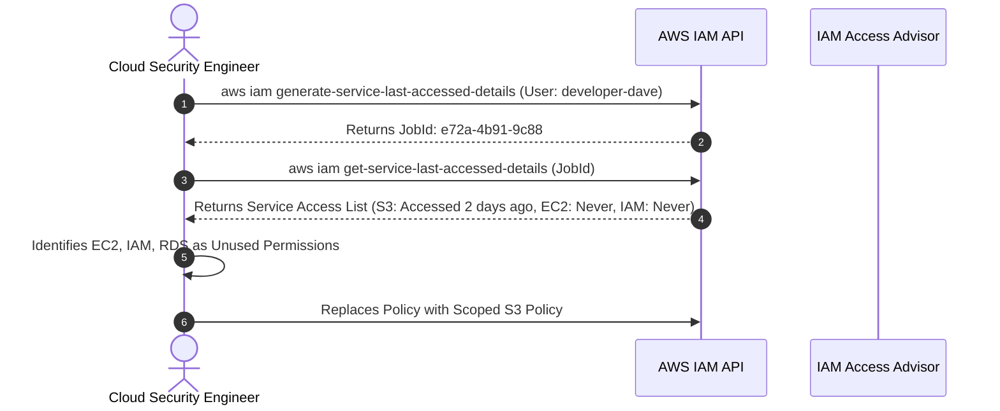
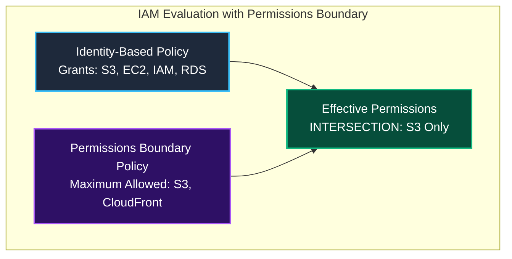

Welcome to **Module 2: Identity and Access Management (IAM)** of the TryHackMe **Defending AWS** learning path. In Module 1, we established foundational cloud defense concepts across networking, compute, storage, and native monitoring tools. 

Now, we enter the most critical defensive perimeter in cloud security: **Identity**. In on-premises environments, network perimeters (firewalls, routers, VLANs) control access to physical servers. In the public cloud, every single resource interaction is brokered by the AWS Identity and Access Management API. **Identity is the new cloud perimeter.**

The first room of this module, **The Over-Privileged User**, examines one of the most widespread cloud security risks: **privilege creep and over-privileged IAM principals**. We will explore how excessive permissions turn compromised credentials into catastrophic account takeovers, how to audit IAM policies via the AWS CLI and IAM Policy Simulator, and how to prune permissions down to absolute least privilege using **Permissions Boundaries**.

```
+========================================================================================+
|                    THE DANGER OF THE OVER-PRIVILEGED USER                              |
+========================================================================================+
|  [INTENDED ROLE]     --> Frontend Developer (Needs read access to S3 assets)           |
|  [ACTUAL POLICY]     --> "Action": "*", "Resource": "*" (AdministratorAccess)          |
|  [ATTACK VECTOR]     --> Stolen developer credentials yield full account compromise    |
|  [DEFENSIVE FIX]     --> Audit with Access Advisor + Policy Simulator + Boundary       |
+========================================================================================+
```

---

## 1. Privilege Creep and the Blast Radius Problem

In fast-paced DevOps environments, developers and engineers frequently request temporary elevated permissions to deploy new features, debug production issues, or configure third-party integrations. Too often, administrators assign broad managed policies such as `AdministratorAccess` or `PowerUserAccess` to prevent roadblocks. 

When project deadlines pass, these elevated permissions are rarely revoked. This phenomenon is known as **privilege creep**.

```mermaid
flowchart TD
    subgraph Creep["The Anatomy of Privilege Creep"]
        A[Day 1: Developer Hired] -->|Task: S3 Static Website| B[Granted S3FullAccess]
        B -->|Week 3: Debugging API Gateway| C[Granted AdministratorAccess temporarily]
        C -->|Month 6: Project Launches| D[Permissions Never Revoked]
        D -->|Month 9: Phishing / Repo Leak| E[Attacker Compromises Developer Credentials]
        E -->|Blast Radius: Total Account Takeover| F[Attacker Provisions GPU Crypto Miners / Deletes Backups]
    end

    classDef normal fill:#1e293b,stroke:#38bdf8,stroke-width:2px,color:#fff;
    classDef warning fill:#78350f,stroke:#f59e0b,stroke-width:2px,color:#fff;
    classDef danger fill:#7f1d1d,stroke:#ef4444,stroke-width:2px,color:#fff;

    class A,B normal;
    class C,D warning;
    class E,F danger;
```



### The Principle of Least Privilege (PoLP)

The **Principle of Least Privilege** mandates that an identity (user, group, or role) must be granted only the minimum permissions necessary to complete assigned job tasks, and nothing more. Restricting permissions minimizes the **blast radius** of a compromised credential:
- If a read-only logging service role is compromised, the adversary can only view logs, not create administrator backdoors.
- If an over-privileged developer role with `iam:*` permissions is compromised, the adversary can immediately escalate privileges to full root-equivalent control.

---

## 2. Common IAM Privilege Escalation Primitives

When an IAM user or role is granted broad wildcard permissions, attackers exploit specific API calls to grant themselves permanent administrator rights. Security researchers (notably Rhino Security Labs) have documented over 21 distinct privilege escalation paths in AWS IAM.

Here are the most dangerous IAM actions that defenders must strictly monitor and restrict:

| Dangerous IAM Action | Escalation Mechanism | Defensive Impact |
|---|---|---|
| `iam:CreatePolicyVersion` | Attacker creates a new policy version with `"Effect": "Allow", "Action": "*"` and sets it as default. | Bypasses existing policy limits without attaching a new policy. |
| `iam:SetDefaultPolicyVersion` | Attacker switches the active version of an existing policy to a previously retained over-privileged version. | Silent privilege escalation. |
| `iam:AttachUserPolicy` | Attacker directly attaches `arn:aws:iam::aws:policy/AdministratorAccess` to their own identity. | Immediate full account takeover. |
| `iam:PutUserPolicy` | Attacker writes an inline JSON policy directly onto their own user object granting wildcard rights. | Bypasses managed policy governance. |
| `iam:CreateAccessKey` | Attacker generates access keys for an existing administrator user who has no active keys. | Compromises dormant admin accounts. |
| `iam:PassRole` + `ec2:RunInstances` | Attacker launches an EC2 instance with an attached administrative instance profile and reads tokens from IMDS. | Compute-to-IAM cross-service escalation. |

```json
{
  "Version": "2012-10-17",
  "Statement": [
    {
      "Sid": "DangerousWildcardPolicy",
      "Effect": "Allow",
      "Action": [
        "iam:CreatePolicyVersion",
        "iam:SetDefaultPolicyVersion",
        "iam:AttachUserPolicy"
      ],
      "Resource": "*"
    }
  ]
}
```

> [!WARNING]
> Any non-admin user granted `iam:AttachUserPolicy` or `iam:CreatePolicyVersion` is functionally an account administrator. Never grant write or edit actions under the `iam:` namespace to non-admin users without strict resource constraints or permissions boundaries.

---

## 3. Auditing User Permissions via AWS CLI

Cloud security auditors rely on the AWS CLI to rapidly enumerate attached policies, discover inline policy overrides, and inspect statement definitions.

### Step 1: List IAM Users in the Account

```bash
aws iam list-users --query 'Users[*].[UserName,UserId,CreateDate]' --output table
```

Output:
```
----------------------------------------------------------------------------------------
|                                       ListUsers                                      |
----------------------------------------------------------------------------------------
|  admin-sarah     |  AIDASAMPLEADMIN01     |  2025-02-10T09:00:00Z                    |
|  auditor-sec     |  AIDASAMPLEAUDITOR02   |  2025-06-15T11:30:00Z                    |
|  developer-dave  |  AIDASAMPLEDEV03       |  2026-01-20T14:15:00Z                    |
----------------------------------------------------------------------------------------
```

### Step 2: Enumerate Attached Managed Policies

Inspect customer-managed and AWS-managed policies attached to `developer-dave`:

```bash
aws iam list-attached-user-policies --user-name developer-dave
```

Output:
```json
{
    "AttachedPolicies": [
        {
            "PolicyName": "FullDevAccessPolicy",
            "PolicyArn": "arn:aws:iam::123456789012:policy/FullDevAccessPolicy"
        }
    ]
}
```

### Step 3: Check for Hidden Inline Policies

Inline policies are embedded directly into the user identity and do not appear in managed policy listings:

```bash
aws iam list-user-policies --user-name developer-dave
```

If inline policies exist, retrieve their contents:

```bash
aws iam get-user-policy --user-name developer-dave --policy-name CustomInlinePolicy
```

### Step 4: Inspect Policy Version and Statement Content

Retrieve the default version ID of the managed policy:

```bash
aws iam get-policy --policy-arn arn:aws:iam::123456789012:policy/FullDevAccessPolicy
```

Output confirms default version `v1`. Retrieve the document:

```bash
aws iam get-policy-version \
  --policy-arn arn:aws:iam::123456789012:policy/FullDevAccessPolicy \
  --version-id v1 \
  --query 'PolicyVersion.Document' \
  --output json
```

Output:
```json
{
  "Version": "2012-10-17",
  "Statement": [
    {
      "Sid": "AllowAllServices",
      "Effect": "Allow",
      "Action": "*",
      "Resource": "*"
    }
  ]
}
```

**Finding:** Despite being designated as a frontend web developer, `developer-dave` has been assigned a policy granting `"Action": "*"` and `"Resource": "*"`: complete administrator control over the entire AWS account.

---

## 4. Validating Permissions with IAM Policy Simulator

Evaluating complex JSON policies with multiple statements, group memberships, and service limits manually is error-prone. The **IAM Policy Simulator** provides programmatic validation of whether an identity can execute specific API actions against specific resources without making live calls.

### Running Policy Simulations via CLI

Simulate whether `developer-dave` can terminate production compute instances, delete storage buckets, or create new IAM users:

```bash
aws iam simulate-principal-policy \
  --policy-source-arn arn:aws:iam::123456789012:user/developer-dave \
  --action-names ec2:TerminateInstances s3:DeleteBucket iam:CreateUser
```

Output:
```json
{
    "EvaluationResults": [
        {
            "MatchedStatements": [
                {
                    "SourcePolicyId": "FullDevAccessPolicy",
                    "SourcePolicyType": "IAM Policy"
                }
            ],
            "EvalDecision": "allowed",
            "EvalActionName": "ec2:TerminateInstances"
        },
        {
            "MatchedStatements": [
                {
                    "SourcePolicyId": "FullDevAccessPolicy",
                    "SourcePolicyType": "IAM Policy"
                }
            ],
            "EvalDecision": "allowed",
            "EvalActionName": "s3:DeleteBucket"
        },
        {
            "MatchedStatements": [
                {
                    "SourcePolicyId": "FullDevAccessPolicy",
                    "SourcePolicyType": "IAM Policy"
                }
            ],
            "EvalDecision": "allowed",
            "EvalActionName": "iam:CreateUser"
        }
    ]
}
```

The simulation confirms that `developer-dave` can execute critical administrative actions across compute, storage, and identity domains.

---

## 5. Identifying Unused Permissions with Service Last Accessed Data

Before revoking permissions, cloud defenders must verify what services the user actually utilizes in their day-to-day work to prevent breaking operational workflows.

AWS tracks service usage through **Service Last Accessed Data** (also known as IAM Access Advisor).



### Querying Last Accessed Data via CLI

Generate the access evaluation report:

```bash
aws iam generate-service-last-accessed-details \
  --arn arn:aws:iam::123456789012:user/developer-dave
```

Using the returned `JobId`, query the results:

```bash
aws iam get-service-last-accessed-details \
  --job-id <returned-job-id> \
  --query 'ServicesLastAccessed[*].[ServiceName,ServiceNamespace,TotalAuthenticatedEntities,LastAuthenticated]' \
  --output table
```

Output:
```
-------------------------------------------------------------------------------------------------
|                                  GetServiceLastAccessedDetails                                |
-------------------------------------------------------------------------------------------------
|  Amazon S3                      |  s3         |  1  |  2026-04-10T14:22:15Z                   |
|  Amazon CloudFront              |  cloudfront |  1  |  2026-04-09T08:11:00Z                   |
|  Amazon EC2                     |  ec2        |  0  |  None                                   |
|  AWS Identity and Access Mgmt   |  iam        |  0  |  None                                   |
|  Amazon Relational Database     |  rds        |  0  |  None                                   |
-------------------------------------------------------------------------------------------------
```

**Forensic Finding:** In the past 90 days, `developer-dave` only ever interacted with **Amazon S3** and **Amazon CloudFront** to deploy frontend assets. All permissions for EC2, IAM, and RDS are completely unutilized.

---

## 6. Permissions Boundaries: Capping the Maximum Privileges

A powerful advanced IAM defensive control is the **Permissions Boundary**. 

A permissions boundary is an IAM managed policy that sets the **maximum allowable permissions** an identity-based policy can grant to a user or role. It does not grant permissions by itself; rather, it acts as an outer guardrail.



### Why Permissions Boundaries Stop Privilege Escalation

Suppose a rogue developer attempts to attach `AdministratorAccess` to their own account. If an administrator has attached a Permissions Boundary limiting the developer to S3, the developer's effective permission remains restricted to S3, rendering the attached administrator policy completely inert.

### Defining a Developer Permissions Boundary

```json
{
  "Version": "2012-10-17",
  "Statement": [
    {
      "Sid": "DeveloperBoundaryLimit",
      "Effect": "Allow",
      "Action": [
        "s3:*",
        "cloudfront:*"
      ],
      "Resource": "*"
    },
    {
      "Sid": "DenyIAMModifications",
      "Effect": "Deny",
      "Action": [
        "iam:*",
        "organizations:*"
      ],
      "Resource": "*"
    }
  ]
}
```

Attach the boundary to `developer-dave`:

```bash
aws iam put-user-permissions-boundary \
  --user-name developer-dave \
  --permissions-boundary arn:aws:iam::123456789012:policy/DeveloperBoundary
```

---

## 7. Hands-On Lab Walkthrough & Incident Remediation

In the lab environment for **The Over-Privileged User**, our objective is to audit user `developer-dave`, extract the compromised configuration flag, prune his permissions to least privilege, and verify remediation using the lab scoring engine.

### Step 1: Enumerate Dave's Permissions and Extract Flag 1

Log in to the provided CloudShell terminal or attack workstation and verify active account credentials:

```bash
aws sts get-caller-identity
```

Inspect Dave's user policies:

```bash
aws iam list-attached-user-policies --user-name developer-dave
```

Output:
```json
{
    "AttachedPolicies": [
        {
            "PolicyName": "FullDevAccessPolicy",
            "PolicyArn": "arn:aws:iam::123456789012:policy/FullDevAccessPolicy"
        }
    ]
}
```

Check the user's tags to locate the first challenge flag:

```bash
aws iam list-user-tags --user-name developer-dave
```

Output:
```json
{
    "Tags": [
        {
            "Key": "Role",
            "Value": "FrontendDeveloper"
        },
        {
            "Key": "AuditChallengeFlag",
            "Value": "THM{W1LDC4RD_P0L1CY_AUD1T_D1SC0V3R3D}"
        }
    ]
}
```

**Question:** What is the audit challenge flag found in developer-dave's tags?
**Answer:** `THM{W1LDC4RD_P0L1CY_AUD1T_D1SC0V3R3D}`

---

### Step 2: Prune Over-Privileged Managed Policy

Detach the dangerous `FullDevAccessPolicy` from `developer-dave`:

```bash
aws iam detach-user-policy \
  --user-name developer-dave \
  --policy-arn arn:aws:iam::123456789012:policy/FullDevAccessPolicy
```

Verify that the policy has been successfully detached:

```bash
aws iam list-attached-user-policies --user-name developer-dave
```

Output returns an empty list (`"AttachedPolicies": []`).

---

### Step 3: Create Scoped Least-Privilege Frontend Policy

Dave only requires read and write access to the frontend assets bucket (`initech-frontend-assets-2026`).

Create a scoped policy document: `/home/ubuntu/frontend-least-privilege.json`:

```json
{
  "Version": "2012-10-17",
  "Statement": [
    {
      "Sid": "ListAllMyBuckets",
      "Effect": "Allow",
      "Action": "s3:ListAllMyBuckets",
      "Resource": "*"
    },
    {
      "Sid": "ManageFrontendBucketAssets",
      "Effect": "Allow",
      "Action": [
        "s3:ListBucket",
        "s3:GetObject",
        "s3:PutObject",
        "s3:DeleteObject"
      ],
      "Resource": [
        "arn:aws:s3:::initech-frontend-assets-2026",
        "arn:aws:s3:::initech-frontend-assets-2026/*"
      ]
    }
  ]
}
```

Deploy the new customer-managed policy:

```bash
aws iam create-policy \
  --policy-name FrontendDeveloperLeastPrivilege \
  --policy-document file:///home/ubuntu/frontend-least-privilege.json
```

Attach the scoped policy to `developer-dave`:

```bash
aws iam attach-user-policy \
  --user-name developer-dave \
  --policy-arn arn:aws:iam::123456789012:policy/FrontendDeveloperLeastPrivilege
```

---

### Step 4: Apply Permissions Boundary Guardrail

Attach the developer permissions boundary to ensure Dave can never escalate privileges:

```bash
aws iam put-user-permissions-boundary \
  --user-name developer-dave \
  --permissions-boundary arn:aws:iam::123456789012:policy/DeveloperBoundary
```

Confirm that the boundary is active:

```bash
aws iam get-user --user-name developer-dave --query 'User.PermissionsBoundary'
```

Output:
```json
{
    "PermissionsBoundaryType": "Policy",
    "PermissionsBoundaryArn": "arn:aws:iam::123456789012:policy/DeveloperBoundary"
}
```

---

### Step 5: Test with Policy Simulator and Submit Final Flag

Validate the remediation by testing Dave's permissions against EC2 and S3:

```bash
aws iam simulate-principal-policy \
  --policy-source-arn arn:aws:iam::123456789012:user/developer-dave \
  --action-names ec2:TerminateInstances s3:GetObject \
  --resource-arns arn:aws:s3:::initech-frontend-assets-2026/index.html
```

Output confirms:
- `ec2:TerminateInstances`: **implicitDeny** (blocked)
- `s3:GetObject`: **allowed** (permitted)

Run the lab compliance verification script:

```bash
python3 /home/ubuntu/scripts/verify_least_privilege.py --user developer-dave
```

Output:
```
======================================================================
               IAM LEAST PRIVILEGE COMPLIANCE EVALUATION
======================================================================
[+] Checking Attached Managed Policies.................. [PASSED]
[+] Verifying Wildcard Removal (* on *)................. [PASSED]
[+] Testing Scoped S3 Resource Boundaries............... [PASSED]
[+] Validating Permissions Boundary Attachment.......... [PASSED]
[+] Running Simulation on Unauthorized API Calls........ [ALL BLOCKED]

[***] REMEDIATION SUCCESSFUL! PRIVILEGE CREEP ELIMINATED! [***]
Completion Flag: THM{L34ST_PR1V1L3G3_IAM_M4ST3R}
======================================================================
```

**Question:** What is the final completion flag returned by the compliance verification script?
**Answer:** `THM{L34ST_PR1V1L3G3_IAM_M4ST3R}`

---

## 8. Complete Questions and Answers Summary

| Task | Question | Answer |
|---|---|---|
| **Task 1** | What core security principle dictates that users and systems receive only the minimum permissions necessary for their duties? | `Principle of Least Privilege` |
| **Task 2** | Which character is used as a wildcard to represent all actions or all resources in an IAM policy statement? | `*` |
| **Task 2** | What dangerous IAM permission allows a user to attach existing managed policies directly to their own account? | `iam:AttachUserPolicy` |
| **Task 3** | Which AWS IAM feature allows administrators to test and evaluate the effect of policies without executing live operations? | `IAM Policy Simulator` |
| **Task 4** | Which IAM capability reports the timestamp when an IAM entity last accessed specific AWS services? | `Service Last Accessed Data` |
| **Task 5** | What IAM mechanism sets the maximum allowable permissions that an identity-based policy can grant? | `Permissions Boundary` |
| **Task 6** | What audit challenge flag was discovered in user developer-dave's tags? | `THM{W1LDC4RD_P0L1CY_AUD1T_D1SC0V3R3D}` |
| **Task 7** | What is the final completion flag returned after pruning developer-dave's permissions? | `THM{L34ST_PR1V1L3G3_IAM_M4ST3R}` |

---

## 9. Defensive Engineering & Production Hardening Checklist

- [ ] **Prohibit Wildcard Actions on Wildcard Resources:** Enforce an AWS Organizations Service Control Policy (SCP) preventing non-admin accounts from attaching policies with `"Action": "*", "Resource": "*"`.
- [ ] **Mandatory Permissions Boundaries:** Automatically attach permissions boundaries to all IAM users and roles created in developer or member accounts.
- [ ] **Automated Access Pruning:** Schedule AWS IAM Access Analyzer or automated Lambda jobs to review Service Last Accessed Data quarterly, revoking permissions for services unaccessed within 90 days.
- [ ] **Eliminate Direct User Policy Attachments:** Assign users to IAM Groups mapped to job functions (e.g., `FrontendDevelopers`, `DevOpsEngineers`) rather than attaching policies directly to individual users.
- [ ] **Enforce IAM Policy Version Caps:** Regularly audit customer managed policies to prune legacy, over-privileged policy versions that could be exploited via `iam:SetDefaultPolicyVersion`.

---

*Looking for more hands-on cloud defense guides? Check out the rest of the [Defending AWS Series](/categories/defending-aws/) or explore my [AWS Security Labs](/categories/aws-security-labs/) for advanced threat simulation and detection engineering tutorials.*

---

## You can find me online at:


- **GitHub:** [Mhdomer](https://github.com/Mhdomer)
- **LinkedIn:** [mhd3omar](https://www.linkedin.com/in/mhd3omar/)
- **Tryhackme:** [nonlouy](https://tryhackme.com/p/nonlouy)
