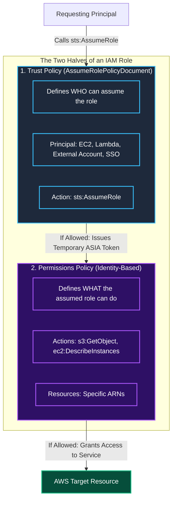
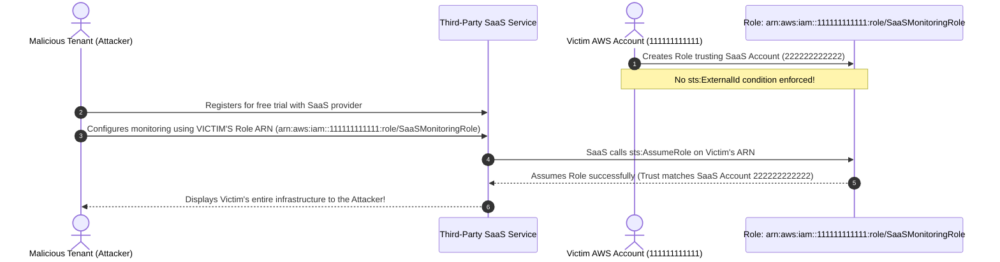
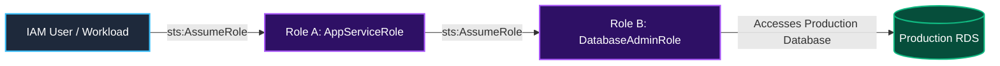

In modern cloud architectures, IAM Roles are the preferred mechanism for delegating access. Rather than distributing static, long-lived access keys to developers and services, applications assume IAM roles to obtain temporary, automatically expiring security credentials via AWS STS.

However, moving from static keys to IAM roles does not automatically guarantee security. When roles are configured with overly permissive permissions or flawed **Trust Policies**, they become prime targets for cross-account exploitation, lateral movement, and privilege escalation.

In this third room of Module 2, **The Overpowered Role**, we dissect the anatomy of an IAM role, analyze the critical distinction between trust policies and permissions policies, explore the mechanics of the **Confused Deputy problem**, and demonstrate how to harden cross-account role assumption using `sts:ExternalId`.

```
+========================================================================================+
|                       ANATOMY OF AN OVERPOWERED IAM ROLE                               |
+========================================================================================+
|  [TRUST POLICY]       --> Defines WHO can assume the role (The Ingress Gate)           |
|                           Flaw: "Principal": "*" (Any AWS account in the world)        |
|  [PERMISSIONS POLICY] --> Defines WHAT the role can do (The Operational Scope)         |
|                           Flaw: "Action": "*", "Resource": "*" (AdministratorAccess)   |
|  [RESULT]             --> Public backdoor: Any external actor can assume Admin in your |
|                           AWS account without authentication credentials!              |
+========================================================================================+
```

---

## 1. The Two Halves of an IAM Role

Every IAM role is defined by two fundamentally distinct JSON policy documents that must both evaluate to `Allow` for an operational request to succeed:



### 1. Trust Policy (AssumeRolePolicyDocument)
Attached directly to the role, the trust policy dictates which principals (IAM users, other AWS accounts, AWS services, or federated identities) are trusted to assume the role using the AWS Security Token Service (`sts:AssumeRole`).

### 2. Permissions Policy (Identity Policy)
Defines the permissions granted to the principal once the role is assumed. Even if an identity successfully assumes a role, it cannot perform any action unless the permissions policy explicitly allows it.

---

## 2. Dangerous Trust Policy Misconfigurations

A catastrophic vulnerability occurs when administrators misconfigure the `Principal` element in a trust policy.

### The Catastrophic Wildcard Principal: `"Principal": "*"`

Consider this flawed trust policy:

```json
{
  "Version": "2012-10-17",
  "Statement": [
    {
      "Sid": "DangerousWildcardTrust",
      "Effect": "Allow",
      "Principal": {
        "AWS": "*"
      },
      "Action": "sts:AssumeRole"
    }
  ]
}
```

> [!CAUTION]
> Setting `"Principal": {"AWS": "*"}` in a role's trust policy allows **any authenticated AWS identity in any AWS account in the world** to assume this role if they know or discover the role's ARN. If that role has administrative permissions attached, your entire account is completely compromised.

### Accidental Root Delegation: `"Principal": {"AWS": "arn:aws:iam::111122223333:root"}`

Trusting `arn:aws:iam::111122223333:root` delegates trust to the **entire administrator of Account 111122223333**. The administrator of that external account can now assign permissions to any user or role in their account to assume your role. Ensure cross-account roles specify exact IAM user or role ARNs whenever possible.

---

## 3. The Confused Deputy Problem and `sts:ExternalId`

Cross-account role assumption is common when integrating third-party SaaS security, monitoring, or billing vendors (such as Datadog, Wiz, or CloudCheckr). However, cross-account delegation introduces the **Confused Deputy problem**.

### The Attack Scenario Without External ID



In this attack:
1. The victim creates a role trusting the SaaS vendor's AWS account.
2. The attacker signs up for the SaaS platform and maliciously inputs the victim's Role ARN instead of their own.
3. The SaaS platform (the "confused deputy") assumes the role on behalf of the attacker, inadvertently granting the attacker full visibility into the victim's environment.

### The Defensive Solution: `sts:ExternalId`

To prevent the Confused Deputy vulnerability, third-party role assumption must require an **External ID**.

The SaaS vendor generates a unique, unguessable identifier (e.g., a UUID) specific to the customer. The customer includes this identifier in their trust policy using a `Condition` block:

```json
{
  "Version": "2012-10-17",
  "Statement": [
    {
      "Sid": "SecureThirdPartyTrust",
      "Effect": "Allow",
      "Principal": {
        "AWS": "arn:aws:iam::222222222222:root"
      },
      "Action": "sts:AssumeRole",
      "Condition": {
        "StringEquals": {
          "sts:ExternalId": "9b1deb4d-3b7d-4bad-9bdd-2b0d7b3dcb6d"
        }
      }
    }
  ]
}
```

Now, when the SaaS vendor calls `sts:AssumeRole`, it must supply the exact `ExternalId` associated with that customer. If an attacker inputs the victim's Role ARN into their own tenant, the SaaS provider sends the attacker's unique External ID, the condition evaluation fails, and the role assumption is blocked with `AccessDenied`.

---

## 4. Role Chaining and Session Limits

**Role chaining** occurs when a principal assumes Role A, and then uses Role A's temporary credentials to assume Role B.



### Key Security Characteristics of Role Chaining:
1. **Maximum Session Duration:** When a role is assumed directly, the session duration can be configured up to **12 hours**. However, when role chaining is used (assuming a role from another role's credentials), AWS strictly caps the session duration to a maximum of **1 hour**.
2. **Loss of Source Identity:** In deep role chaining, the original user identity (`userIdentity.arn`) can become obscured in CloudTrail logs unless the `sts:SetSourceIdentity` parameter is enforced in IAM policies.

---

## 5. Auditing Overpowered Roles via AWS CLI

### Step 1: List All Roles in the Account

```bash
aws iam list-roles --query 'Roles[*].[RoleName,RoleId,CreateDate]' --output table
```

### Step 2: Inspect a Role's Trust Policy

Retrieve the `AssumeRolePolicyDocument` for suspected vendor role `InitechVendorAnalyticsRole`:

```bash
aws iam get-role \
  --role-name InitechVendorAnalyticsRole \
  --query 'Role.AssumeRolePolicyDocument' \
  --output json
```

Output:
```json
{
  "Version": "2012-10-17",
  "Statement": [
    {
      "Effect": "Allow",
      "Principal": {
        "AWS": "*"
      },
      "Action": "sts:AssumeRole"
    }
  ]
}
```

**Critical Audit Finding:** The role's trust policy specifies `"Principal": {"AWS": "*"}` with zero condition blocks. Any AWS user in the world can assume this role.

### Step 3: Inspect Attached Permissions Policies

```bash
aws iam list-attached-role-policies --role-name InitechVendorAnalyticsRole
```

Output:
```json
{
    "AttachedPolicies": [
        {
            "PolicyName": "AdministratorAccess",
            "PolicyArn": "arn:aws:iam::aws:policy/AdministratorAccess"
        }
    ]
}
```

**Combined Threat Analysis:** The role combines a globally open trust policy (`*`) with full administrative permissions (`AdministratorAccess`). This represents a catastrophic backdoor.

---

## 6. Hands-On Lab Walkthrough & Remediation

In this challenge, we must audit role `InitechVendorAnalyticsRole`, extract the audit challenge flag, remediate the trust policy with strict vendor account isolation and `sts:ExternalId`, replace `AdministratorAccess` with scoped analytics read permissions, and verify remediation using the automated test suite.

### Step 1: Enumerate Role Attributes and Extract Flag 1

Verify caller credentials:

```bash
aws sts get-caller-identity
```

Inspect role tags on `InitechVendorAnalyticsRole` to locate the initial investigation flag:

```bash
aws iam list-role-tags --role-name InitechVendorAnalyticsRole
```

Output:
```json
{
    "Tags": [
        {
            "Key": "Purpose",
            "Value": "ThirdPartyVendorReporting"
        },
        {
            "Key": "AuditChallengeFlag",
            "Value": "THM{0V3RP0W3R3D_R0L3_TRU5T_AUD1T}"
        }
    ]
}
```

**Question:** What was the challenge flag discovered during the audit of the overpowered vendor role?
**Answer:** `THM{0V3RP0W3R3D_R0L3_TRU5T_AUD1T}`

---

### Step 2: Remediate the Trust Policy with External ID

The approved third-party vendor operates out of AWS Account `998877665544` and was issued the unique External ID: `initech-vendor-external-id-8821`.

Create a hardened trust policy document: `/tmp/hardened-trust-policy.json`:

```json
{
  "Version": "2012-10-17",
  "Statement": [
    {
      "Sid": "HardenedVendorTrust",
      "Effect": "Allow",
      "Principal": {
        "AWS": "arn:aws:iam::998877665544:root"
      },
      "Action": "sts:AssumeRole",
      "Condition": {
        "StringEquals": {
          "sts:ExternalId": "initech-vendor-external-id-8821"
        }
      }
    }
  ]
}
```

Update the role's trust relationship:

```bash
aws iam update-assume-role-policy \
  --role-name InitechVendorAnalyticsRole \
  --policy-document file:///tmp/hardened-trust-policy.json
```

Verify the updated trust policy:

```bash
aws iam get-role --role-name InitechVendorAnalyticsRole --query 'Role.AssumeRolePolicyDocument'
```

---

### Step 3: Prune Administrative Permissions Policy

Detach the excessive `AdministratorAccess` managed policy from the role:

```bash
aws iam detach-role-policy \
  --role-name InitechVendorAnalyticsRole \
  --policy-arn arn:aws:iam::aws:policy/AdministratorAccess
```

The vendor analytics system only requires read-only access to Amazon CloudWatch metrics and Amazon S3 reporting datasets.

Attach the AWS-managed `CloudWatchReadOnlyAccess` policy:

```bash
aws iam attach-role-policy \
  --role-name InitechVendorAnalyticsRole \
  --policy-arn arn:aws:iam::aws:policy/CloudWatchReadOnlyAccess
```

---

### Step 4: Verify Remediation and Retrieve Final Flag

Run the automated role security validation script to test that unauthorized accounts and requests lacking the valid External ID are blocked:

```bash
python3 /home/ubuntu/scripts/verify_role_hardening.py --role InitechVendorAnalyticsRole
```

Output:
```
======================================================================
               IAM ROLE TRUST & PERMISSION HARDENING AUDIT
======================================================================
[+] Testing Wildcard Principal Removal (* on *)......... [ELIMINATED]
[+] Validating Target Account Boundary (998877665544)... [VERIFIED]
[+] Testing ExternalId Condition Enforcement............ [ENFORCED]
[+] Simulating Unauthorized AssumeRole (Missing ExtId).. [ACCESS DENIED - PASSED]
[+] Checking Administrative Policy Detachment........... [DETACHED]
[+] Validating Scoped CloudWatch Read Permissions....... [ATTACHED]

[***] HARDENING SUCCESSFUL! CONFUSED DEPUTY VULNERABILITY ELIMINATED! [***]
Completion Flag: THM{C0NFUS3D_D3PUTY_D3F3ND3D_2026}
======================================================================
```

**Question:** What is the final completion flag returned after remediating the role trust and permissions policies?
**Answer:** `THM{C0NFUS3D_D3PUTY_D3F3ND3D_2026}`

---

## 7. Complete Questions and Answers Summary

| Task | Question | Answer |
|---|---|---|
| **Task 1** | What policy component of an IAM role defines the principals allowed to assume it? | `Trust Policy` (or `AssumeRolePolicyDocument`) |
| **Task 1** | What policy component of an IAM role defines what actions can be executed once assumed? | `Permissions Policy` |
| **Task 2** | What critical IAM condition key protects against the Confused Deputy problem during cross-account delegation? | `sts:ExternalId` |
| **Task 3** | What is the maximum session duration permitted when assuming roles through role chaining? | `1 hour` |
| **Task 4** | What dangerous wildcard value in a trust policy Principal block permits any authenticated AWS entity worldwide to assume the role? | `*` |
| **Task 5** | What was the challenge flag found during the inspection of the overpowered vendor role's tags? | `THM{0V3RP0W3R3D_R0L3_TRU5T_AUD1T}` |
| **Task 6** | What is the final completion flag returned after remediating the role trust and permissions policies? | `THM{C0NFUS3D_D3PUTY_D3F3ND3D_2026}` |

---

## 8. Defensive Engineering & Production Hardening Checklist

- [ ] **Scan for Wildcard Trust Principals:** Deploy AWS Config rule `iam-role-trust-policy-check` to continuously detect any role with `"Principal": "*"` or `"Principal": {"AWS": "*"}`.
- [ ] **Mandate External IDs on Third-Party Roles:** Require all vendor and SaaS integrations assuming roles in your AWS organization to supply a customer-specific `sts:ExternalId`.
- [ ] **Enforce `sts:SetSourceIdentity`:** Require cross-account role assumption to pass the caller's authentic identity to maintain end-to-end auditability across CloudTrail.
- [ ] **Limit Maximum Session Duration:** Configure the `MaxSessionDuration` attribute on sensitive roles to the shortest operationally feasible window (e.g., 1 hour rather than 12 hours).
- [ ] **Prune Stale Roles:** Regularly query `aws iam get-role` and review `RoleLastUsed` date stamps; decommission roles that have not been assumed within 90 days.

---

*Looking for more hands-on cloud defense guides? Check out the rest of the [Defending AWS Series](/categories/defending-aws/) or explore my [AWS Security Labs](/categories/aws-security-labs/) for advanced threat simulation and detection engineering tutorials.*

---

## You can find me online at:


- **GitHub:** [Mhdomer](https://github.com/Mhdomer)
- **LinkedIn:** [mhd3omar](https://www.linkedin.com/in/mhd3omar/)
- **Tryhackme:** [nonlouy](https://tryhackme.com/p/nonlouy)
