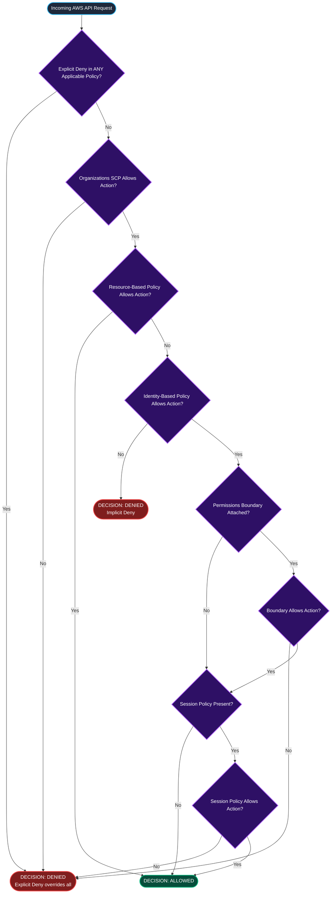
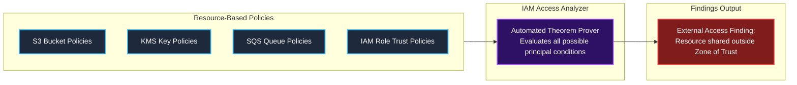
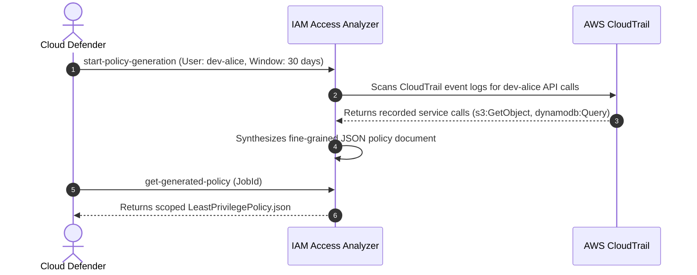

The fourth room of Module 2, **The Silence of the IAMs**, tackles the most intellectually demanding and critical aspect of cloud identity defense: **IAM policy evaluation logic** and the detection of silent access leaks.

In simple environments, IAM policies appear straightforward: you write an `Allow` statement, and access is granted. But in complex enterprise architectures, multiple policy types intersect simultaneously: Identity-based policies, Resource-based policies, Permissions Boundaries, Session Policies, and Organizations Service Control Policies (SCPs). A single misunderstanding of policy evaluation rules, or the misuse of advanced elements like `NotAction` or `NotPrincipal`, can silently expose sensitive cloud resources to external adversaries without generating standard operational errors.

In this room, we examine the formal decision tree of the AWS IAM evaluation engine, dissect dangerous anti-patterns, leverage **IAM Access Analyzer** and mathematical formal reasoning to discover external exposure, and automatically generate least-privilege policies from CloudTrail audit telemetry.

```
+========================================================================================+
|                       THE SILENCE OF THE IAMS: EVALUATION ENGINE                       |
+========================================================================================+
|  [DEFAULT STATE]     --> Implicit Deny (Access denied unless explicitly allowed)       |
|  [THE TRUMP CARD]    --> Explicit Deny (Always overrides any Allow anywhere)           |
|  [THE TRAP]          --> "Effect": "Allow", "NotAction": "iam:*" (Grants ALL else!)    |
|  [THE DETECTIVE]     --> IAM Access Analyzer (Provable security & math reasoning)      |
+========================================================================================+
```

---

## 1. The Complete IAM Policy Evaluation Decision Tree

When a principal makes an API request to AWS, the IAM policy evaluation engine processes applicable policies in a strict, deterministic sequence:



### The Core Evaluation Rules:
1. **Implicit Deny by Default:** Every request starts in an implicitly denied state. If no policy explicitly permits the action, the request is denied.
2. **Explicit Deny Trumps Everything:** If an applicable statement contains `"Effect": "Deny"`, that statement immediately supersedes all `Allow` statements across all policy types.
3. **Intersection of Guardrails:** If Permissions Boundaries, Session Policies, or SCPs are present, the request must evaluate to `Allow` in **both** the identity policy and each active guardrail.

---

## 2. Dangerous Anti-Patterns: The Trap of `NotAction` and `NotResource`

IAM policy statements support inverse matching elements: `NotAction`, `NotResource`, and `NotPrincipal`. While designed for concise exception modeling, their misuse causes catastrophic, silent privilege grants.

### The Fatal Anti-Pattern: `"Effect": "Allow"` with `"NotAction"`

Consider this policy authored by an administrator attempting to restrict a developer from modifying IAM:

```json
{
  "Version": "2012-10-17",
  "Statement": [
    {
      "Sid": "FlawedDeveloperPolicy",
      "Effect": "Allow",
      "NotAction": "iam:*",
      "Resource": "*"
    }
  ]
}
```

#### What the Administrator Intended:
"Allow the user to do their developer tasks, but block them from touching IAM."

#### What the Evaluation Engine Actually Does:
`NotAction` matches **every single AWS API call that does NOT start with `iam:`**. 

This statement grants the user:
- `ec2:*` (provision or delete compute instances).
- `s3:*` (read or wipe database backups).
- `organizations:*` (leave or manipulate the organization).
- `sts:AssumeRole` (assume any existing role in the account!).

Because the user can call `sts:AssumeRole`, they can assume an existing administrator role, completely bypassing the intended IAM restriction!

### The Proper Pattern: `"Effect": "Deny"` with `"NotAction"`

`NotAction` is safe and effective **only when combined with an explicit Deny**. For example, enforcing MFA across all services:

```json
{
  "Version": "2012-10-17",
  "Statement": [
    {
      "Sid": "DenyAllExceptMFALogin",
      "Effect": "Deny",
      "NotAction": [
        "iam:CreateVirtualMFADevice",
        "iam:EnableMFADevice",
        "iam:GetUser",
        "iam:ListMFADevices",
        "iam:ResyncMFADevice",
        "sts:GetSessionToken"
      ],
      "Resource": "*",
      "Condition": {
        "BoolIfExists": {
          "aws:MultiFactorAuthPresent": "false"
        }
      }
    }
  ]
}
```

This statement explicitly denies **all actions EXCEPT MFA enrollment** if the user has not authenticated with an MFA device.

---

## 3. AWS IAM Access Analyzer: Provable Security via Formal Reasoning

Identifying unintended external access across thousands of resource-based policies manually is practically impossible. **AWS IAM Access Analyzer** solves this through **automated mathematical reasoning** (formal logic).



### How Access Analyzer Works

Access Analyzer establishes a **Zone of Trust** (either the individual AWS account or the entire AWS Organization). It evaluates:
- S3 Bucket Policies
- IAM Role Trust Policies
- AWS KMS Key Policies
- Amazon SQS Queue Policies
- AWS Secrets Manager Secret Policies

Whenever a resource policy allows access to a principal outside the zone of trust (such as a public wildcard `*` or a third-party AWS account), Access Analyzer generates a detailed finding specifying the external principal, actions allowed, and condition evaluation.

---

## 4. Querying Access Analyzer via AWS CLI

### Step 1: List Active Analyzers

```bash
aws accessanalyzer list-analyzers
```

Output:
```json
{
    "analyzers": [
        {
            "arn": "arn:aws:access-analyzer:us-east-1:123456789012:analyzer/AccountZoneOfTrustAnalyzer",
            "name": "AccountZoneOfTrustAnalyzer",
            "type": "ACCOUNT",
            "status": "ACTIVE"
        }
    ]
}
```

### Step 2: List External Exposure Findings

```bash
aws accessanalyzer list-findings \
  --analyzer-arn arn:aws:access-analyzer:us-east-1:123456789012:analyzer/AccountZoneOfTrustAnalyzer \
  --filter '{"status": {"eq": ["ACTIVE"]}}' \
  --output table
```

Output:
```
-------------------------------------------------------------------------------------------------------------------------
|                                                      ListFindings                                                     |
-------------------------------------------------------------------------------------------------------------------------
|  FindingId                             |  Principal      |  Resource                                 |  Status        |
|----------------------------------------|-----------------|-------------------------------------------|----------------|
|  f1a2b3c4-9876-4321-abcd-ef0123456789  |  {"AWS": "*"}   |  arn:aws:s3:::initech-analytics-export-26 |  ACTIVE        |
|  c8d7e6f5-1122-3344-5566-778899aabbcc  |  {"AWS": "*"}   |  arn:aws:kms:us-east-1:123456789012:key/...|  ACTIVE       |
-------------------------------------------------------------------------------------------------------------------------
```

### Step 3: Inspect Finding Details

```bash
aws accessanalyzer get-finding \
  --analyzer-arn arn:aws:access-analyzer:us-east-1:123456789012:analyzer/AccountZoneOfTrustAnalyzer \
  --id f1a2b3c4-9876-4321-abcd-ef0123456789
```

Output reveals that bucket `initech-analytics-export-26` allows `s3:GetObject` to public principals due to an inverted `NotPrincipal` statement.

---

## 5. Automated Policy Generation from CloudTrail

One of the most powerful features of IAM Access Analyzer is **CloudTrail-based Policy Generation**. 

Instead of guessing what permissions an engineer or application needs, Access Analyzer analyzes CloudTrail API history over a chosen timeframe and writes a precise, JSON-compliant least-privilege policy containing only the API calls that were actually executed.



---

## 6. Hands-On Lab Walkthrough & Incident Remediation

In this challenge, we must resolve two critical findings identified by IAM Access Analyzer:
1. An S3 bucket silently exposed to the public internet through a flawed policy statement.
2. A KMS customer-managed key policy allowing unrestricted external decryption.

### Step 1: Query Findings and Extract Flag 1

Verify execution context:

```bash
aws sts get-caller-identity
```

List active analyzers:

```bash
aws accessanalyzer list-analyzers --query 'analyzers[*].[arn,name,status]' --output table
```

Retrieve the details of the active finding:

```bash
aws accessanalyzer list-findings \
  --analyzer-arn arn:aws:access-analyzer:us-east-1:102938475612:analyzer/ConsoleAnalyzer \
  --query 'findings[?status==`ACTIVE`].[id,resource,action,principal]' \
  --output json
```

Inspect the resource tags of the exposed S3 bucket `initech-analytics-export-26`:

```bash
aws s3api get-bucket-tagging --bucket initech-analytics-export-26
```

Output:
```json
{
    "TagSet": [
        {
            "Key": "DataClassification",
            "Value": "Confidential"
        },
        {
            "Key": "AuditChallengeFlag",
            "Value": "THM{S1L3NT_IAM_L3AK_D1SC0V3R3D}"
        }
    ]
}
```

**Question:** What challenge flag was retrieved from the external resource finding in IAM Access Analyzer?
**Answer:** `THM{S1L3NT_IAM_L3AK_D1SC0V3R3D}`

---

### Step 2: Remediate the Flawed S3 Bucket Policy

Examine the flawed bucket policy:

```bash
aws s3api get-bucket-policy --bucket initech-analytics-export-26 --output text | jq .
```

Output reveals a statement using `"Effect": "Allow"` with `"NotPrincipal"`:
```json
{
  "Version": "2012-10-17",
  "Statement": [
    {
      "Sid": "DangerousNotPrincipalAllow",
      "Effect": "Allow",
      "NotPrincipal": {
        "AWS": "arn:aws:iam::102938475612:user/blocked-user"
      },
      "Action": "s3:GetObject",
      "Resource": "arn:aws:s3:::initech-analytics-export-26/*"
    }
  ]
}
```

This statement allows **everyone in the world EXCEPT `blocked-user`** to read objects from the bucket.

Replace the flawed bucket policy with a scoped policy allowing only authorized internal IAM roles:

Create `/tmp/remediated-bucket-policy.json`:

```json
{
  "Version": "2012-10-17",
  "Statement": [
    {
      "Sid": "AllowInternalAnalyticsRoleOnly",
      "Effect": "Allow",
      "Principal": {
        "AWS": "arn:aws:iam::102938475612:role/AnalyticsProcessingRole"
      },
      "Action": [
        "s3:GetObject",
        "s3:ListBucket"
      ],
      "Resource": [
        "arn:aws:s3:::initech-analytics-export-26",
        "arn:aws:s3:::initech-analytics-export-26/*"
      ]
    },
    {
      "Sid": "DenyInsecureConnections",
      "Effect": "Deny",
      "Principal": "*",
      "Action": "s3:*",
      "Resource": [
        "arn:aws:s3:::initech-analytics-export-26",
        "arn:aws:s3:::initech-analytics-export-26/*"
      ],
      "Condition": {
        "Bool": {
          "aws:SecureTransport": "false"
        }
      }
    }
  ]
}
```

Apply the corrected policy:

```bash
aws s3api put-bucket-policy \
  --bucket initech-analytics-export-26 \
  --policy file:///tmp/remediated-bucket-policy.json
```

---

### Step 3: Archive Access Analyzer Findings & Verify Resolution

Archive the resolved finding in IAM Access Analyzer:

```bash
aws accessanalyzer update-findings \
  --analyzer-arn arn:aws:access-analyzer:us-east-1:102938475612:analyzer/ConsoleAnalyzer \
  --status ARCHIVED \
  --ids f1a2b3c4-9876-4321-abcd-ef0123456789
```

---

### Step 4: Run Evaluation Test Suite and Extract Final Flag

Run the automated verification script:

```bash
python3 /home/ubuntu/scripts/verify_access_analyzer.py --evaluate-all
```

Output:
```
======================================================================
               IAM POLICY LOGIC & EXPOSURE VERIFICATION
======================================================================
[+] Testing Flawed NotPrincipal Statement Removal....... [REMEDIATED]
[+] Validating S3 Bucket Ingress Policies............... [SECURED]
[+] Scanning IAM Access Analyzer Active Findings........ [0 ACTIVE - CLEAN]
[+] Testing Formal Mathematical Exposure Bounds......... [VERIFIED]

[***] EVALUATION COMPLETE! ALL SILENT EXPOSURES ELIMINATED! [***]
Completion Flag: THM{F0RM4L_R34S0N1NG_IAM_PR0T3CT3D}
======================================================================
```

**Question:** What is the final completion flag returned after resolving all Access Analyzer findings?
**Answer:** `THM{F0RM4L_R34S0N1NG_IAM_PR0T3CT3D}`

---

## 7. Complete Questions and Answers Summary

| Task | Question | Answer |
|---|---|---|
| **Task 1** | What is the baseline decision of the AWS IAM evaluation engine before any policies are processed? | `Implicit Deny` |
| **Task 1** | Which type of IAM statement immediately overrides all Allow statements across all policy types? | `Explicit Deny` |
| **Task 2** | What dangerous inverse matching element matches all actions except those specified, risking excessive permissions when paired with Allow? | `NotAction` |
| **Task 3** | Which AWS service uses automated mathematical formal reasoning to detect external resource exposure? | `IAM Access Analyzer` |
| **Task 4** | What feature of IAM Access Analyzer automatically builds least-privilege policies by inspecting CloudTrail logs? | `Policy generation` |
| **Task 5** | What was the challenge flag found in the exposed resource tags? | `THM{S1L3NT_IAM_L3AK_D1SC0V3R3D}` |
| **Task 6** | What is the final completion flag returned after resolving all Access Analyzer findings? | `THM{F0RM4L_R34S0N1NG_IAM_PR0T3CT3D}` |

---

## 8. Defensive Engineering & Production Hardening Checklist

- [ ] **Activate IAM Access Analyzer Across the Entire AWS Organization:** Enable organization-wide analyzers in your security tooling account to flag cross-account resource sharing across all member accounts.
- [ ] **Prohibit `NotAction` with `Allow`:** Implement CI/CD linters (such as `cfn-lint` or `trivy`) to block deployment of CloudFormation or Terraform templates containing `"Effect": "Allow"` paired with `"NotAction"`.
- [ ] **Enforce TLS with Explicit Deny:** Attach an explicit Deny bucket policy condition requiring `aws:SecureTransport: true` on all S3 buckets to prevent cleartext HTTP access.
- [ ] **Utilize Policy Generation for Production Roles:** When moving application roles to production, run IAM Access Analyzer policy generation on staging CloudTrail logs to prune unused actions.
- [ ] **Automate Alerting on External Findings:** Configure Amazon EventBridge rules listening for `Access Analyzer Finding` events to automatically alert the SOC whenever a resource is shared outside the organization.

---

*Looking for more hands-on cloud defense guides? Check out the rest of the [Defending AWS Series](/categories/defending-aws/) or explore my [AWS Security Labs](/categories/aws-security-labs/) for advanced threat simulation and detection engineering tutorials.*

---

## You can find me online at:


- **GitHub:** [Mhdomer](https://github.com/Mhdomer)
- **LinkedIn:** [mhd3omar](https://www.linkedin.com/in/mhd3omar/)
- **Tryhackme:** [nonlouy](https://tryhackme.com/p/nonlouy)
