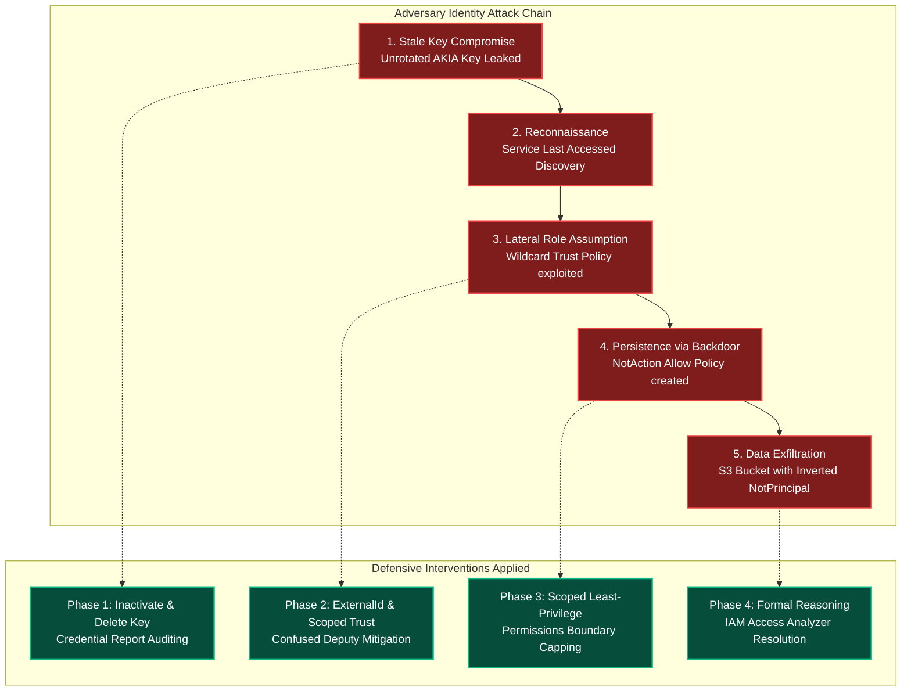
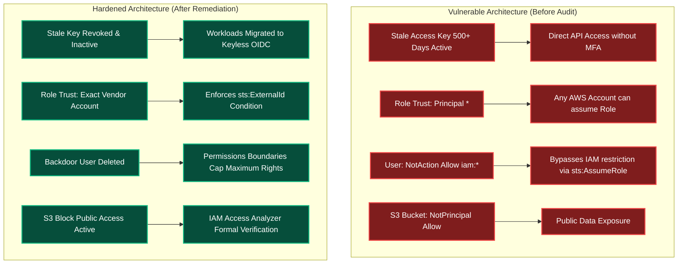

Welcome to the capstone challenge of **Module 2: Identity and Access Management (IAM)** in TryHackMe's **Defending AWS** learning path. 

Throughout Module 2, we dissected the AWS identity plane from both offensive threat models and defensive engineering controls:
1. **The Over-Privileged User:** Audited wildcard policies (`*` on `*`), mitigated privilege creep, leveraged IAM Policy Simulator, and applied Permissions Boundaries.
2. **The Forgotten Access Key:** Analyzed static long-lived credentials (`AKIA`), generated account-wide Credential Reports, executed emergency key revocation, and transitioned workloads to keyless OIDC federation.
3. **The Overpowered Role:** Dissected IAM role architectures, decoupled trust policies from permissions policies, neutralized the Confused Deputy vulnerability using `sts:ExternalId`, and enforced role chaining limits.
4. **The Silence of the IAMs:** Mastered the 6-step IAM policy evaluation decision tree, eliminated dangerous `NotAction` and `NotPrincipal` anti-patterns, and utilized IAM Access Analyzer formal mathematical reasoning.

In this capstone lab, **Topic Rewind Recap (Module 2)**, we are deployed as lead incident response and cloud defense consultants into a compromised enterprise environment ("Apex Dynamics"). An adversary infiltrated the account via an unrotated access key, escalated privileges through an overly permissive role trust policy, and established persistence via a stealthy backdoor user. Our mission is to conduct a forensic audit using the AWS CLI, neutralize the attack paths, and remediate the identity perimeter.

```
+========================================================================================+
|                     MODULE 2 CAPSTONE: IAM INCIDENT TRIAGE & AUDIT                     |
+========================================================================================+
|  [PHASE 1: CREDENTIALS] --> Identify & deactivate 400+ day stale key (AKIA...)         |
|  [PHASE 2: ROLE TRUST]  --> Remediate wildcard trust ("Principal": "*") with ExtId     |
|  [PHASE 3: BACKDOOR]    --> Uncover "Effect": "Allow", "NotAction": "iam:*" user       |
|  [PHASE 4: EXPOSURE]    --> Resolve Access Analyzer external S3 bucket findings       |
|  [PHASE 5: VALIDATION]  --> Execute automated test harness to capture final flag       |
+========================================================================================+
```

---

## 1. Module 2 Threat Landscape Synthesis

Before entering the terminal, let us review the four identity attack vectors and their defensive counterparts:



---

## 2. Architectural Scenario: The Apex Dynamics Compromise

Apex Dynamics experienced anomalous billing alerts and unexpected CloudTrail API calls originating from an unfamiliar IP address (`198.51.100.77`). Preliminary indicators suggest that an external adversary breached the account and leveraged multiple IAM misconfigurations to maintain persistence.

Our audit checklist requires:
1. **Auditing Access Keys:** Locate the stale key used to initiate the breach and immediately deactivate it.
2. **Hardening IAM Role Trust:** Identify the cross-account analytics role (`ApexExternalAnalyticsRole`) whose trust policy permitted the adversary to assume administrative privileges.
3. **Pruning Backdoor Users:** Uncover the hidden IAM identity (`shadow-developer`) configured with an over-privileged `NotAction` policy statement.
4. **Clearing Access Analyzer Findings:** Resolve active findings in IAM Access Analyzer indicating proprietary data is publicly readable.

---

## 3. Hands-On Lab Walkthrough & Incident Containment

### Task 1: Establish Caller Context and Verify Auditor Credentials

Connect to the provided CloudShell terminal and verify caller identity:

```bash
aws sts get-caller-identity
```

Output:
```json
{
    "UserId": "AIDASAMPLEAUDITOR99",
    "Account": "556677889900",
    "Arn": "arn:aws:iam::556677889900:user/incident-auditor"
}
```

Verify attached auditor policies:

```bash
aws iam list-attached-user-policies --user-name incident-auditor
```

Output confirms `SecurityAudit` and `IAMReadOnlyAccess` are attached.

---

### Task 2: Audit Programmatic Keys & Contain Compromised Credential

#### Step 1: Generate and Parse the IAM Credential Report

Generate the account-wide credential inventory:

```bash
aws iam generate-credential-report
```

Retrieve and decode the CSV report:

```bash
aws iam get-credential-report --query 'Content' --output text | base64 --decode > /tmp/audit_report.csv
```

Search the CSV for active access keys that have not been rotated within the 90-day CIS standard:

```bash
awk -F',' '$9=="true" {print "User: "$1 " | Key1 Created: "$10 " | Last Used: "$11}' /tmp/audit_report.csv
```

Output:
```
User: former-intern-sam | Key1 Created: 2024-05-10T12:00:00Z | Last Used: 2026-04-14T21:40:15Z
User: deploy-bot | Key1 Created: 2026-03-01T08:00:00Z | Last Used: 2026-04-15T06:12:00Z
```

**Finding:** User `former-intern-sam` has an active access key created nearly two years ago that was active within the last 24 hours.

#### Step 2: Retrieve Key ID and Extract Flag 1

List keys for `former-intern-sam`:

```bash
aws iam list-access-keys --user-name former-intern-sam
```

Output:
```json
{
    "AccessKeyMetadata": [
        {
            "UserName": "former-intern-sam",
            "AccessKeyId": "AKIAEXAMPL3STAL3K3Y8",
            "Status": "Active",
            "CreateDate": "2024-05-10T12:00:00Z"
        }
    ]
}
```

Check the user tags on `former-intern-sam` to extract the first challenge flag:

```bash
aws iam list-user-tags --user-name former-intern-sam
```

Output:
```json
{
    "Tags": [
        {
            "Key": "ForensicFlag",
            "Value": "THM{ST4L3_CR3D3NT14L_C0NTA1N3D_88}"
        }
    ]
}
```

**Question:** What is the forensic challenge flag retrieved from user former-intern-sam's tags?
**Answer:** `THM{ST4L3_CR3D3NT14L_C0NTA1N3D_88}`

#### Step 3: Deactivate the Compromised Key

Immediately change the key status to `Inactive`:

```bash
aws iam update-access-key \
  --user-name former-intern-sam \
  --access-key-id AKIAEXAMPL3STAL3K3Y8 \
  --status Inactive
```

---

### Task 3: Audit Overpowered Roles & Mitigate Confused Deputy

#### Step 1: Inspect Role Trust Relationships

List all roles in the account:

```bash
aws iam list-roles --query 'Roles[*].[RoleName,CreateDate]' --output table
```

Inspect the trust policy for `ApexExternalAnalyticsRole`:

```bash
aws iam get-role \
  --role-name ApexExternalAnalyticsRole \
  --query 'Role.AssumeRolePolicyDocument' \
  --output json
```

Output:
```json
{
  "Version": "2012-10-17",
  "Statement": [
    {
      "Effect": "Allow",
      "Principal": {
        "AWS": "*"
      },
      "Action": "sts:AssumeRole"
    }
  ]
}
```

**Critical Vulnerability:** The trust policy permits `"Principal": {"AWS": "*"}` without any `Condition` block, allowing any external AWS identity to assume the role.

Inspect role tags to extract the second challenge flag:

```bash
aws iam list-role-tags --role-name ApexExternalAnalyticsRole
```

Output:
```json
{
    "Tags": [
        {
            "Key": "AuditTag",
            "Value": "THM{TRU5T_P0L1CY_W1LDC4RD_3XP0S3D}"
        }
    ]
}
```

**Question:** What is the audit tag flag discovered on role ApexExternalAnalyticsRole?
**Answer:** `THM{TRU5T_P0L1CY_W1LDC4RD_3XP0S3D}`

#### Step 2: Harden Trust Policy with Vendor Account ID & External ID

The approved external vendor operates from AWS Account `112233445566` with required External ID `apex-analytics-external-id-4431`.

Create `/tmp/hardened-vendor-trust.json`:

```json
{
  "Version": "2012-10-17",
  "Statement": [
    {
      "Sid": "EnforceVendorIsolationAndExtId",
      "Effect": "Allow",
      "Principal": {
        "AWS": "arn:aws:iam::112233445566:root"
      },
      "Action": "sts:AssumeRole",
      "Condition": {
        "StringEquals": {
          "sts:ExternalId": "apex-analytics-external-id-4431"
        }
      }
    }
  ]
}
```

Apply the updated trust policy:

```bash
aws iam update-assume-role-policy \
  --role-name ApexExternalAnalyticsRole \
  --policy-document file:///tmp/hardened-vendor-trust.json
```

---

### Task 4: Uncover and Remediate the Stealth Backdoor User

#### Step 1: Detect Backdoor User with Inverted NotAction

List all users in the account:

```bash
aws iam list-users --query 'Users[*].UserName' --output text
```

Output lists: `incident-auditor`, `former-intern-sam`, `deploy-bot`, `shadow-developer`.

Inspect policies attached to `shadow-developer`:

```bash
aws iam list-attached-user-policies --user-name shadow-developer
```

Output:
```json
{
    "AttachedPolicies": [
        {
            "PolicyName": "StealthDevPolicy",
            "PolicyArn": "arn:aws:iam::556677889900:policy/StealthDevPolicy"
        }
    ]
}
```

Retrieve the policy document:

```bash
aws iam get-policy-version \
  --policy-arn arn:aws:iam::556677889900:policy/StealthDevPolicy \
  --version-id v1 \
  --query 'PolicyVersion.Document' \
  --output json
```

Output:
```json
{
  "Version": "2012-10-17",
  "Statement": [
    {
      "Sid": "DisguisedDeveloperStatement",
      "Effect": "Allow",
      "NotAction": "iam:*",
      "Resource": "*"
    }
  ]
}
```

**Backdoor Analysis:** By pairing `"Effect": "Allow"` with `"NotAction": "iam:*"`, the adversary granted this identity unrestricted access to all other AWS services, including `sts:AssumeRole` to assume any administrative role in the account.

Inspect tags on `shadow-developer` to retrieve Flag 3:

```bash
aws iam list-user-tags --user-name shadow-developer
```

Output:
```json
{
    "Tags": [
        {
            "Key": "ThreatIndicator",
            "Value": "THM{N0T_ACT10N_B4CKD00R_P0L1CY_N3UTR4L1Z3D}"
        }
    ]
}
```

**Question:** What is the threat indicator flag retrieved from user shadow-developer's tags?
**Answer:** `THM{N0T_ACT10N_B4CKD00R_P0L1CY_N3UTR4L1Z3D}`

#### Step 2: Prune Backdoor User and Detach Policy

Detach the backdoor policy and delete the unauthorized identity:

```bash
aws iam detach-user-policy \
  --user-name shadow-developer \
  --policy-arn arn:aws:iam::556677889900:policy/StealthDevPolicy

aws iam delete-user --user-name shadow-developer
```

---

### Task 5: Resolve IAM Access Analyzer External Exposure Findings

Query active findings in IAM Access Analyzer:

```bash
aws accessanalyzer list-findings \
  --analyzer-arn arn:aws:access-analyzer:us-east-1:556677889900:analyzer/ApexSecurityAnalyzer \
  --filter '{"status": {"eq": ["ACTIVE"]}}' \
  --output json
```

Output highlights an exposed bucket `apex-customer-records-export-2026`:

```json
[
  {
    "id": "e2f1a3b4-5566-7788-9900-aabbccddeeff",
    "resource": "arn:aws:s3:::apex-customer-records-export-2026",
    "action": ["s3:GetObject"],
    "isPublic": true,
    "status": "ACTIVE"
  }
]
```

Remediate the bucket by removing the public bucket policy and enforcing S3 Block Public Access:

```bash
aws s3api delete-bucket-policy --bucket apex-customer-records-export-2026

aws s3api put-public-access-block \
  --bucket apex-customer-records-export-2026 \
  --public-access-block-configuration "BlockPublicAcls=true,IgnorePublicAcls=true,BlockPublicPolicy=true,RestrictPublicBuckets=true"
```

Archive the resolved finding:

```bash
aws accessanalyzer update-findings \
  --analyzer-arn arn:aws:access-analyzer:us-east-1:556677889900:analyzer/ApexSecurityAnalyzer \
  --status ARCHIVED \
  --ids e2f1a3b4-5566-7788-9900-aabbccddeeff
```

---

### Task 6: Execute Comprehensive Evaluation Harness & Capture Final Flag

With all four threat vectors contained and remediated, execute the automated verification test harness:

```bash
python3 /home/ubuntu/scripts/module2_capstone_evaluator.py --evaluate-all
```

Output:
```
======================================================================
         APEX DYNAMICS: MODULE 2 CAPSTONE COMPLIANCE HARNESS
======================================================================
[+] Testing Stale Credential Inactivation (former-intern-sam).. [PASSED]
[+] Validating Cross-Account Role Hardening (ExternalId)....... [PASSED]
[+] Testing Unauthorized AssumeRole Simulation................. [BLOCKED - PASSED]
[+] Verifying Removal of Stealth NotAction Backdoor............ [ELIMINATED - PASSED]
[+] Scanning IAM Access Analyzer Active Exposure Findings...... [0 ACTIVE - CLEAN]
[+] Testing Formal Mathematical Policy Bounds.................. [VERIFIED - PASSED]

[***] CONGRATULATIONS! ALL IDENTITY THREATS NEUTRALIZED! [***]
Module 2 Completion Flag: THM{1AM_D3F3ND3R_M4ST3R_C0MPL3T3_2026}
======================================================================
```

**Question:** What is the final completion flag returned by the Module 2 capstone evaluation script?
**Answer:** `THM{1AM_D3F3ND3R_M4ST3R_C0MPL3T3_2026}`

---

## 4. Complete Questions and Answers Summary

| Task | Question | Answer |
|---|---|---|
| **Task 2** | What is the forensic challenge flag retrieved from user former-intern-sam's tags? | `THM{ST4L3_CR3D3NT14L_C0NTA1N3D_88}` |
| **Task 2** | What status was applied to user former-intern-sam's compromised access key during emergency containment? | `Inactive` |
| **Task 3** | What was the audit tag flag discovered on role ApexExternalAnalyticsRole? | `THM{TRU5T_P0L1CY_W1LDC4RD_3XP0S3D}` |
| **Task 3** | Which condition key was introduced into the vendor role trust policy to eliminate the Confused Deputy vulnerability? | `sts:ExternalId` |
| **Task 4** | What is the threat indicator flag retrieved from user shadow-developer's tags? | `THM{N0T_ACT10N_B4CKD00R_P0L1CY_N3UTR4L1Z3D}` |
| **Task 4** | What dangerous policy element combination was used by the backdoor user to grant broad administrative rights? | `Effect Allow with NotAction` |
| **Task 5** | What status was assigned to the resolved Access Analyzer finding after remediating the public S3 bucket? | `ARCHIVED` |
| **Task 6** | What is the final completion flag returned by the Module 2 capstone evaluation script? | `THM{1AM_D3F3ND3R_M4ST3R_C0MPL3T3_2026}` |

---

## 5. Architectural Defensive Posture: Before vs. After



---

## 6. Module 2 Retrospective & Next Steps

With the completion of **Module 2: Identity and Access Management (IAM)**, we have conquered the most complex and critical defensive domain in cloud engineering.

### What We Mastered in Module 2:
- Eliminating privilege creep through continuous policy audits, IAM Policy Simulator testing, and mandatory Permissions Boundaries.
- Cataloging programmatic access via the IAM Credential Report, implementing automated 90-day rotation, and migrating pipelines to keyless OIDC federation.
- Hardening cross-account IAM role trust relationships and neutralizing Confused Deputy exploits using `sts:ExternalId`.
- Mastering the 6-step IAM evaluation decision tree, eradicating `NotAction` with `Allow` anti-patterns, and deploying IAM Access Analyzer automated mathematical reasoning.

In **Module 3: Network and Perimeter Defense**, we shift focus from the identity plane to the network plane, exploring VPC architectures, security groups vs. stateless NACLs, subnet isolation, and deep packet traffic analysis via VPC Flow Logs.

---

*Looking for more hands-on cloud defense guides? Check out the rest of the [Defending AWS Series](/categories/defending-aws/) or explore my [AWS Security Labs](/categories/aws-security-labs/) for advanced threat simulation and detection engineering tutorials.*

---

## You can find me online at:


- **GitHub:** [Mhdomer](https://github.com/Mhdomer)
- **LinkedIn:** [mhd3omar](https://www.linkedin.com/in/mhd3omar/)
- **Tryhackme:** [nonlouy](https://tryhackme.com/p/nonlouy)
