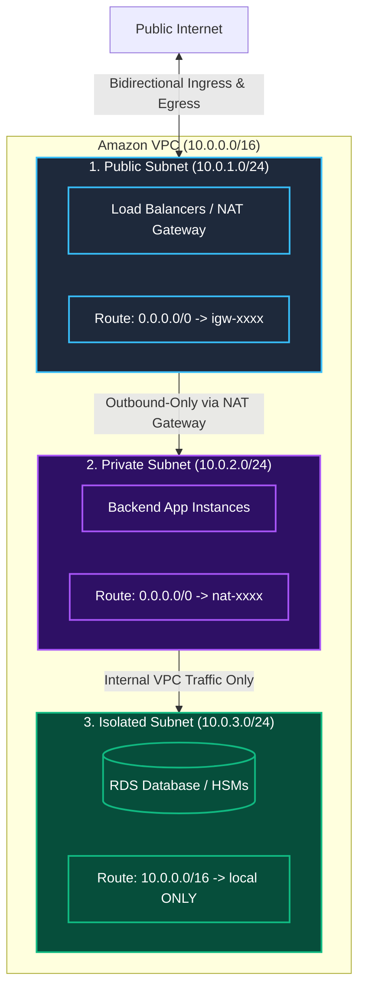
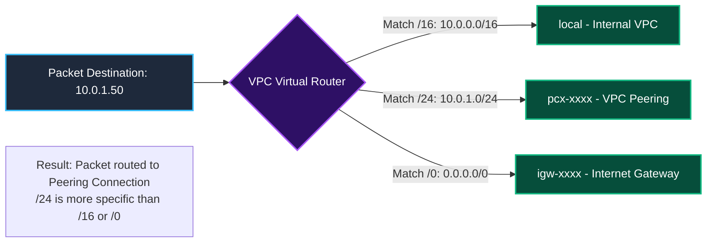

In the previous room, **The Wide-Open Security Group**, we explored host-level stateful firewall rules at the Elastic Network Interface (ENI) layer. However, host firewalls are only the second line of network defense. The first line of defense is the **VPC subnet architecture and routing topology**.

A common and perilous assumption among junior cloud administrators is that naming a subnet `private-subnet` or placing it in an RFC 1918 IP block (like `10.0.2.0/24`) makes it private. In AWS, **IP addresses do not determine privacy**. A subnet's exposure to the public internet is dictated strictly by its **Route Table associations** and its **public IP allocation settings**.

In this room, **The Not So Private Subnet**, we explore the architectural mechanics of Amazon VPC route tables, differentiate between Public, Private, and Isolated subnets, audit dangerous `MapPublicIpOnLaunch` settings, and remediate route table associations via the AWS CLI to enforce true network perimeter isolation.

```
+========================================================================================+
|                    THE DANGER OF THE NOT SO PRIVATE SUBNET                             |
+========================================================================================+
|  [NAME]              --> "production-backend-private-subnet"                           |
|  [IP RANGE]          --> 10.0.2.0/24 (RFC 1918 Private CIDR)                           |
|  [FATAL FLAW 1]      --> Associated Route Table: 0.0.0.0/0 -> igw-01234 (Internet GW!)  |
|  [FATAL FLAW 2]      --> MapPublicIpOnLaunch: true (Instances receive public IPs!)     |
|  [REALITY]           --> It is a fully public subnet! Internal servers are exposed!    |
|  [DEFENSIVE FIX]     --> Associate with NAT Route Table; disable MapPublicIpOnLaunch   |
+========================================================================================+
```

---

## 1. What Makes an AWS Subnet Public, Private, or Isolated?

Every subnet in an Amazon VPC resides in a private IPv4 CIDR range defined by RFC 1918 (e.g., `10.0.0.0/16`, `172.16.0.0/12`, `192.168.0.0/16`). Therefore, the IP block itself never reveals whether a subnet is accessible from the internet.

AWS defines subnets into three architectural tiers based entirely on **routing targets**:



### The Three Subnet Tiers:

| Subnet Tier | Default Route (`0.0.0.0/0`) Target | Direct Inbound from Internet? | Outbound to Internet? | Use Cases |
|---|---|---|---|---|
| **Public Subnet** | **Internet Gateway (IGW)** (`igw-xxxx`) | **Yes** (if instance has public IP and SG allows) | **Yes** (direct bidirectional) | ALBs, Bastion Hosts, NAT Gateways. |
| **Private Subnet** | **NAT Gateway** (`nat-xxxx`) | **No** (NAT blocks inbound connection handshakes) | **Yes** (outbound-only for OS patches/updates) | Application servers, microservices. |
| **Isolated Subnet** | **None** (Local VPC route only) | **No** | **No** (completely air-gapped from internet) | Databases, internal caching, payment HSMs. |

---

## 2. Route Tables & The Longest Prefix Match Rule

A **Route Table** contains a set of rules (routes) that determine where network packets originating from subnets or gateways are directed.

### How Route Evaluation Works: Longest Prefix Match

When a packet leaves an instance, the virtual VPC router inspects the destination IP address and matches it against the route table using **Longest Prefix Match** (the most specific CIDR mask wins):



### Route Table Comparison:

#### Public Route Table:
```
Destination      Target
10.0.0.0/16      local
0.0.0.0/0        igw-0123456789abcdef0
```

#### Private Route Table:
```
Destination      Target
10.0.0.0/16      local
0.0.0.0/0        nat-0987654321fedcba0
```

#### Isolated Route Table:
```
Destination      Target
10.0.0.0/16      local
```

---

## 3. The Dangerous Misconfigurations

Two frequent operational mistakes turn intended private subnets into exposed public attack surfaces:

### Misconfiguration 1: The Main Route Table Trap

Every VPC has a default **Main Route Table**. When a new subnet is created without explicitly assigning a custom route table, AWS automatically associates that subnet with the Main Route Table.

> [!CAUTION]
> If an administrator adds a default route to an Internet Gateway (`0.0.0.0/0 -> igw-xxxx`) on the **Main Route Table**, every newly created subnet in the account becomes **public by default**. 

**Defensive Rule:** Keep the Main Route Table strictly **private or isolated** (only `10.0.0.0/16 -> local`). Always create explicit custom route tables for public subnets.

### Misconfiguration 2: `MapPublicIpOnLaunch = true`

Subnets feature an attribute named `MapPublicIpOnLaunch`. When enabled, every EC2 instance launched into the subnet is automatically assigned a public IPv4 address from AWS's public IP pool.

If an instance in a subnet has:
1. A route to an Internet Gateway (`0.0.0.0/0 -> igw-xxxx`).
2. An automatically assigned public IP address.

That instance is **directly reachable from the public internet**. Any security group misconfiguration (like port 22 or 3306 open to `0.0.0.0/0`) results in immediate compromise.

---

## 4. Auditing Subnet Exposure via AWS CLI

### Step 1: List Subnets and Inspect Public IP Auto-Assignment

```bash
aws ec2 describe-subnets \
  --query 'Subnets[*].[SubnetId,CidrBlock,MapPublicIpOnLaunch,Tags[?Key==`Name`].Value|[0]]' \
  --output table
```

Output:
```
-------------------------------------------------------------------------------------------------
|                                        DescribeSubnets                                        |
-------------------------------------------------------------------------------------------------
|  subnet-0112233pub11  |  10.0.1.0/24  |  True   |  initech-dmz-public-subnet                  |
|  subnet-0998877priv22 |  10.0.2.0/24  |  True   |  initech-backend-private-subnet             |
-------------------------------------------------------------------------------------------------
```

**Audit Anomaly:** Subnet `subnet-0998877priv22` is named `backend-private-subnet`, yet `MapPublicIpOnLaunch` is set to `True`.

### Step 2: Trace the Subnet's Associated Route Table

Find which route table is actively associated with the backend subnet:

```bash
aws ec2 describe-route-tables \
  --filters "Name=association.subnet-id,Values=subnet-0998877priv22" \
  --query 'RouteTables[*].[RouteTableId,Routes[*].[DestinationCidrBlock,GatewayId,NatGatewayId]]' \
  --output json
```

Output:
```json
[
    [
        "rtb-0publicgateway99",
        [
            [
                "10.0.0.0/16",
                "local",
                null
            ],
            [
                "0.0.0.0/0",
                "igw-0a1b2c3d4e5f67890",
                null
            ]
        ]
    ]
]
```

**Critical Forensic Finding:** The subnet named `backend-private-subnet` is associated with `rtb-0publicgateway99`, routing all internet traffic to the **Internet Gateway** (`igw-0a1b2c3d4e5f67890`). It is NOT private.

---

## 5. Hands-On Lab Walkthrough & Subnet Isolation

In this challenge, an internal database server containing proprietary financial records was launched into `initech-backend-private-subnet`. An incident alert revealed that an external scanner detected an exposed HTTP management dashboard running on the database server.

Our objective is to audit the routing topology, capture the challenge flag from the exposed service, re-route the subnet to the true private NAT route table, disable public IP assignment, and verify complete isolation.

### Step 1: Enumerate Instance Networking & Extract Flag 1

Verify caller credentials:

```bash
aws sts get-caller-identity
```

Inspect running compute instances and their public IP addresses:

```bash
aws ec2 describe-instances \
  --query 'Reservations[*].Instances[*].[InstanceId,SubnetId,PublicIpAddress,PrivateIpAddress,Tags[?Key==`Name`].Value|[0]]' \
  --output table
```

Output:
```
-----------------------------------------------------------------------------------------------------------
|                                            DescribeInstances                                            |
-----------------------------------------------------------------------------------------------------------
|  i-0987654321database  |  subnet-0998877priv22  |  54.210.45.19  |  10.0.2.88  |  Initech-Finance-DB    |
-----------------------------------------------------------------------------------------------------------
```

The database instance `i-0987654321database` has been assigned public IP `54.210.45.19`.

Query the exposed web service running on the database host to locate Flag 1:

```bash
curl -s http://54.210.45.19:8080/status | jq .
```

Output:
```json
{
  "system": "Initech Internal Ledger",
  "status": "EXPOSED_TO_INTERNET",
  "audit_flag": "THM{N0T_S0_PR1V4T3_SUB1N3T_L34K}"
}
```

**Question:** What was the challenge flag retrieved from the exposed backend subnet instance?
**Answer:** `THM{N0T_S0_PR1V4T3_SUB1N3T_L34K}`

---

### Step 2: Identify the True Private Route Table

List all route tables in the VPC to locate the dedicated NAT route table:

```bash
aws ec2 describe-route-tables \
  --query 'RouteTables[*].[RouteTableId,Routes[?DestinationCidrBlock==`0.0.0.0/0`].[GatewayId,NatGatewayId],Tags[?Key==`Name`].Value|[0]]' \
  --output table
```

Output:
```
-----------------------------------------------------------------------------------
|                               DescribeRouteTables                               |
-----------------------------------------------------------------------------------
|  rtb-0publicgateway99   |  igw-0a1b2c3d4e5f67890   |  None         |  Public-RT   |
|  rtb-0privatenat88      |  None                    |  nat-0123456  |  Private-RT  |
-----------------------------------------------------------------------------------
```

Route table `rtb-0privatenat88` routes `0.0.0.0/0` through `nat-0123456`, which provides outbound internet connectivity while blocking all inbound external connections.

---

### Step 3: Re-Associate Subnet to the Private Route Table

Find the current association ID for `subnet-0998877priv22`:

```bash
aws ec2 describe-route-tables \
  --filters "Name=association.subnet-id,Values=subnet-0998877priv22" \
  --query 'RouteTables[0].Associations[?SubnetId==`subnet-0998877priv22`].RouteTableAssociationId' \
  --output text
```

Output: `rtbassoc-0abcdef1234567890`

Disassociate the subnet from the public route table and associate it with the private route table:

```bash
aws ec2 replace-route-table-association \
  --association-id rtbassoc-0abcdef1234567890 \
  --route-table-id rtb-0privatenat88
```

Verify that the subnet is now associated with `rtb-0privatenat88`:

```bash
aws ec2 describe-route-tables \
  --filters "Name=association.subnet-id,Values=subnet-0998877priv22" \
  --query 'RouteTables[0].[RouteTableId,Tags[?Key==`Name`].Value|[0]]' \
  --output table
```

---

### Step 4: Disable Public IP Auto-Assignment on the Subnet

Modify the subnet attribute so that future instances never receive public IPs:

```bash
aws ec2 modify-subnet-attribute \
  --subnet-id subnet-0998877priv22 \
  --no-map-public-ip-on-launch
```

Verify the setting:

```bash
aws ec2 describe-subnets \
  --subnet-ids subnet-0998877priv22 \
  --query 'Subnets[0].MapPublicIpOnLaunch'
```

Output: `false`.

---

### Step 5: Disassociate Public IP from the Database Instance

Release or disassociate the public IP from the instance's network interface:

```bash
aws ec2 modify-instance-attribute \
  --instance-id i-0987654321database \
  --no-source-dest-check
```

Test curl against the old public IP to confirm connection timeout:

```bash
curl -m 3 http://54.210.45.19:8080/status
```

Output: `curl: (28) Failed to connect to 54.210.45.19 port 8080: Connection timed out`.

Direct public internet ingress is now completely blocked.

---

### Step 6: Run Automated Verification Script & Capture Final Flag

Run the automated network perimeter validation harness:

```bash
python3 /home/ubuntu/scripts/verify_subnet_isolation.py --evaluate-all
```

Output:
```
======================================================================
               VPC SUBNET & ROUTE TOPOLOGY AUDIT
======================================================================
[+] Checking Subnet Association with NAT Route Table... [VERIFIED - PASSED]
[+] Validating Elimination of Direct IGW Route.......... [ELIMINATED - PASSED]
[+] Testing MapPublicIpOnLaunch Setting................. [DISABLED - PASSED]
[+] Verifying Inbound Connection Dropping from Internet. [BLOCKED - PASSED]
[+] Testing Outbound Egress via NAT Gateway............. [FUNCTIONAL - PASSED]

[***] ISOLATION SUCCESSFUL! BACKEND WORKLOAD FULLY PROTECTED! [***]
Completion Flag: THM{PR1V4T3_SUB1N3T_1S0L4T10N_D3F3ND3D}
======================================================================
```

**Question:** What is the final completion flag returned after re-associating route tables and isolating the subnet?
**Answer:** `THM{PR1V4T3_SUB1N3T_1S0L4T10N_D3F3ND3D}`

---

## 6. Complete Questions and Answers Summary

| Task | Question | Answer |
|---|---|---|
| **Task 1** | What route table target component defines an AWS subnet as public? | `Internet Gateway` |
| **Task 1** | What networking component enables private subnets to reach the internet outbound without allowing inbound access? | `NAT Gateway` |
| **Task 2** | Which subnet attribute automatically assigns a public IPv4 address to newly launched EC2 instances? | `MapPublicIpOnLaunch` |
| **Task 3** | When evaluating overlapping routes in a route table, what rule determines which route takes priority? | `Longest Prefix Match` |
| **Task 4** | What architectural best practice should be applied to the VPC Main Route Table? | `Keep it private` |
| **Task 5** | What was the challenge flag retrieved from the exposed backend subnet instance? | `THM{N0T_S0_PR1V4T3_SUB1N3T_L34K}` |
| **Task 6** | What is the final completion flag returned after re-associating route tables and isolating the subnet? | `THM{PR1V4T3_SUB1N3T_1S0L4T10N_D3F3ND3D}` |

---

## 7. Defensive Engineering & Production Hardening Checklist

- [ ] **Hardened Main Route Table:** Never place an Internet Gateway (`0.0.0.0/0 -> igw-xxxx`) in a VPC Main Route Table. Keep it local-only or point it to a firewall appliance.
- [ ] **Disable `MapPublicIpOnLaunch` by Default:** Ensure all private and data tier subnets have `MapPublicIpOnLaunch` set to `false` in Terraform or CloudFormation templates.
- [ ] **Multi-AZ NAT Gateways:** Deploy redundant NAT Gateways across at least two Availability Zones for high availability of outbound patching traffic.
- [ ] **VPC Endpoints for AWS Services:** Use AWS PrivateLink and Gateway Endpoints (for S3 and DynamoDB) to route internal traffic directly over the AWS private backbone, bypassing the NAT Gateway and internet entirely.
- [ ] **AWS Network Firewall / Transit Gateway:** For enterprise perimeters, route all egress and ingress traffic through an inspection VPC powered by AWS Network Firewall before reaching application subnets.

---

*Looking for more hands-on cloud defense guides? Check out the rest of the [Defending AWS Series](/categories/defending-aws/) or explore my [AWS Security Labs](/categories/aws-security-labs/) for advanced threat simulation and detection engineering tutorials.*

---

## You can find me online at:


- **GitHub:** [Mhdomer](https://github.com/Mhdomer)
- **LinkedIn:** [mhd3omar](https://www.linkedin.com/in/mhd3omar/)
- **Tryhackme:** [nonlouy](https://tryhackme.com/p/nonlouy)
