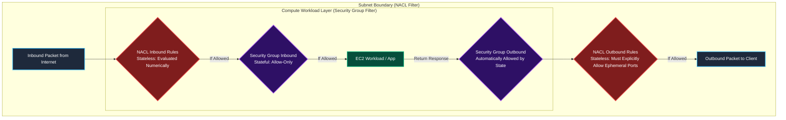
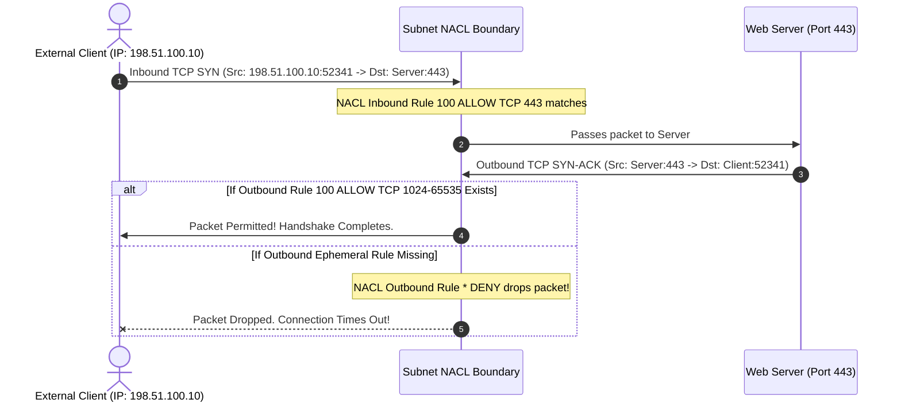

In the first two rooms of Module 3, we examined host-level stateful Security Groups and VPC route table path steering. However, there is another critical firewall layer built directly into the fabric of every Amazon VPC: **Network Access Control Lists (NACLs)**.

While Security Groups are attached to individual Elastic Network Interfaces (ENIs) and operate statefully, NACLs sit at the **subnet boundary** and operate **statelessly**. NACLs are the only native VPC firewall mechanism that supports **explicit Deny rules**, making them the primary defense tool for blocking malicious IP ranges, mitigating distributed scanning campaigns, and isolating compromised subnets during active security incidents.

Yet, NACLs are frequently misunderstood, misconfigured, or entirely forgotten. A single misordered rule or a missing ephemeral port range can either render an IP block completely inert or inadvertently knock entire production applications offline.

In this room, **The Forgotten NACL**, we dissect stateless packet filtering, master numerical rule evaluation mechanics, explore the ephemeral port challenge, and demonstrate how to harden subnet boundaries using the AWS CLI.

```
+========================================================================================+
|                       THE ANATOMY OF A NETWORK ACL (NACL)                              |
+========================================================================================+
|  [FIREWALL LAYER]     --> Subnet Boundary (First line of defense for ingress packets)  |
|  [STATE MECHANISM]    --> Stateless (Inbound AND Outbound must be explicitly allowed)  |
|  [EVALUATION ORDER]   --> Lowest Rule Number First (First match immediately wins!)     |
|  [THE TRAP]           --> Rule 100 ALLOW 0.0.0.0/0 before Rule 150 DENY MaliciousIP    |
|  [THE FIX]            --> Rule 50 DENY MaliciousIP; explicit ephemeral ports (1024+)   |
+========================================================================================+
```

---

## 1. Security Groups vs. Network ACLs: The Definitive Comparison

To defend an AWS network effectively, cloud engineers must understand how Security Groups and Network ACLs interact as complementary layers of defense-in-depth:



### Technical Comparison Matrix:

| Feature | Security Group (SG) | Network ACL (NACL) |
|---|---|---|
| **Operating Level** | Elastic Network Interface (ENI) | Subnet boundary |
| **State Mechanism** | **Stateful** (Return traffic is automatically permitted) | **Stateless** (Return traffic must be explicitly allowed by an outbound rule) |
| **Rule Capabilities** | **Allow-only** (No explicit Deny rules) | **Allow and Deny** |
| **Rule Processing** | All rules evaluated simultaneously | Evaluated in **strict numerical order** (lowest number first) |
| **Default Configuration** | All inbound denied; all outbound allowed | Default NACL: All allowed; Custom NACL: All denied |
| **Ephemeral Port Handling** | Automatic (handled by connection tracking) | **Manual** (outbound ports `1024-65535` must be explicitly authorized) |

---

## 2. Numerical Rule Evaluation & The Ordering Trap

Network ACL rules are assigned rule numbers between **1 and 32766**. Rules are processed in ascending numerical order, and evaluation **terminates immediately upon the first match**.

### The Flawed Rule Order Anti-Pattern

Suppose an enterprise discovers that an attacker is launching brute-force attacks from IP range `203.0.113.0/24`. A junior administrator adds a Deny rule to the NACL:

| Rule Number | Protocol | Port Range | Source CIDR | Action | Evaluation Result |
|---|---|---|---|---|---|
| **100** | TCP | 443 | `0.0.0.0/0` | **ALLOW** | Matches all internet traffic! |
| **150** | TCP | 443 | `203.0.113.0/24` | **DENY** | **NEVER REACHED!** |
| **\*** | ALL | ALL | `0.0.0.0/0` | **DENY** | Default catch-all rule |

#### Why the Attack Still Succeeds:
When a packet arrives from `203.0.113.50` on port 443, the VPC virtual router evaluates Rule `100`. Because `203.0.113.50` is part of `0.0.0.0/0`, Rule `100` matches, the packet is immediately **ALLOWED**, and rule processing stops. Rule `150` is completely ignored!

### The Hardened Rule Order

To block the attacker, the explicit Deny rule must have a **lower number** than the general Allow rule:

| Rule Number | Protocol | Port Range | Source CIDR | Action | Evaluation Result |
|---|---|---|---|---|---|
| **50** | TCP | 443 | `203.0.113.0/24` | **DENY** | **Matches attacker! Dropped immediately.** |
| **100** | TCP | 443 | `0.0.0.0/0` | **ALLOW** | Legitimate traffic permitted. |
| **\*** | ALL | ALL | `0.0.0.0/0` | **DENY** | Default catch-all rule |

Now, when the attacker's packet arrives, Rule `50` matches first, and the packet is immediately discarded at the subnet boundary before ever reaching an EC2 instance.

---

## 3. The Stateless Ephemeral Port Challenge

Because NACLs are stateless, return traffic is **not** automatically permitted. Understanding ephemeral ports is essential to maintaining network connectivity.

When a client web browser connects to an HTTPS server on port 443, the client operating system allocates a temporary random source port known as an **ephemeral port**:
- Windows / Modern Linux clients: Ports `1024-65535`
- Legacy Linux kernels: Ports `32768-60999`



> [!IMPORTANT]
> If a subnet NACL allows inbound traffic on port 80 or 443, its **outbound rules must explicitly allow return traffic to ports `1024-65535`**. Without this outbound ephemeral rule, web servers inside the subnet cannot complete TCP handshakes with clients.

---

## 4. Auditing Network ACLs via AWS CLI

### Step 1: List All NACLs in the VPC

```bash
aws ec2 describe-network-acls \
  --query 'NetworkAcls[*].[NetworkAclId,VpcId,IsDefault,Associations[*].SubnetId]' \
  --output table
```

### Step 2: Inspect Inbound and Outbound Rules of a Specific NACL

Inspect the rules attached to `acl-0a1b2c3d4e5f67890`:

```bash
aws ec2 describe-network-acls \
  --network-acl-ids acl-0a1b2c3d4e5f67890 \
  --query 'NetworkAcls[0].Entries' \
  --output json
```

### Step 3: Identify Subnet Associations

Check which subnets are protected by a custom NACL:

```bash
aws ec2 describe-network-acls \
  --filters "Name=association.subnet-id,Values=subnet-099887766pub" \
  --query 'NetworkAcls[*].[NetworkAclId,Associations[*].NetworkAclAssociationId]' \
  --output table
```

---

## 5. Hands-On Lab Walkthrough & Incident Mitigation

In this challenge scenario, an external malicious scanning syndicate operating from IP range `203.0.113.0/24` is targeting the public web tier of `Apex Defense Cloud`. 

A junior administrator attempted to block the syndicate using a custom NACL, but the security team reported that attack packets continue to bombard the web instances. Furthermore, internal users reported that web services in a second subnet are intermittently failing because the outbound return traffic was misconfigured.

Our mission is to audit the NACL rules, identify the ordering flaw, capture the challenge flag, fix the rule sequence, and ensure ephemeral ports are properly opened.

### Step 1: Enumerate NACLs & Extract Flag 1

Verify caller credentials:

```bash
aws sts get-caller-identity
```

Describe all Network ACLs in the account:

```bash
aws ec2 describe-network-acls \
  --query 'NetworkAcls[*].[NetworkAclId,Tags[?Key==`Name`].Value|[0],IsDefault]' \
  --output table
```

Output reveals custom NACL `acl-011223344webacl` named `Apex-Public-Web-NACL`.

Inspect the resource tags on `acl-011223344webacl` to retrieve the initial challenge flag:

```bash
aws ec2 describe-tags \
  --filters "Name=resource-id,Values=acl-011223344webacl" \
  --output json
```

Output:
```json
{
    "Tags": [
        {
            "Key": "Environment",
            "Value": "Production"
        },
        {
            "Key": "AuditChallengeFlag",
            "Value": "THM{ST4T3L3SS_NACL_RUL3_0RD3R1NG}"
        }
    ]
}
```

**Question:** What was the challenge flag discovered during the NACL audit?
**Answer:** `THM{ST4T3L3SS_NACL_RUL3_0RD3R1NG}`

---

### Step 2: Analyze Inbound Rule Ordering Flaw

Inspect the inbound rules on `acl-011223344webacl`:

```bash
aws ec2 describe-network-acls \
  --network-acl-ids acl-011223344webacl \
  --query 'NetworkAcls[0].Entries[?Egress==`false`].[RuleNumber,RuleAction,Protocol,PortRange.From,CidrBlock]' \
  --output table
```

Output:
```
---------------------------------------------------------------------
|                        DescribeNetworkAcls                        |
---------------------------------------------------------------------
|  100  |  allow  |  6  |  443  |  0.0.0.0/0                        |
|  101  |  allow  |  6  |  80   |  0.0.0.0/0                        |
|  150  |  deny   |  6  |  443  |  203.0.113.0/24                   |
|  32767|  deny   |  -1 |  None |  0.0.0.0/0                        |
---------------------------------------------------------------------
```

**Critical Analysis:** Rule `150` (Deny `203.0.113.0/24`) is positioned **after** Rule `100` (Allow `0.0.0.0/0`). Because Rule 100 matches all IPv4 traffic, Rule 150 is never evaluated!

---

### Step 3: Delete Ineffective Rule and Add Prioritized Deny Rule

First, delete the ineffective Rule `150`:

```bash
aws ec2 delete-network-acl-entry \
  --network-acl-id acl-011223344webacl \
  --rule-number 150 \
  --ingress
```

Now, create a new **Rule 50** configured to explicitly drop all traffic from the malicious CIDR `203.0.113.0/24`:

```bash
aws ec2 create-network-acl-entry \
  --network-acl-id acl-011223344webacl \
  --rule-number 50 \
  --protocol -1 \
  --rule-action deny \
  --ingress \
  --cidr-block 203.0.113.0/24
```

Verify the updated inbound rule hierarchy:

```bash
aws ec2 describe-network-acls \
  --network-acl-ids acl-011223344webacl \
  --query 'NetworkAcls[0].Entries[?Egress==`false`].[RuleNumber,RuleAction,CidrBlock]' \
  --output table
```

Output:
```
------------------------------------------------
|              DescribeNetworkAcls             |
------------------------------------------------
|  50   |  deny   |  203.0.113.0/24             |
|  100  |  allow  |  0.0.0.0/0                  |
|  101  |  allow  |  0.0.0.0/0                  |
|  32767|  deny   |  0.0.0.0/0                  |
------------------------------------------------
```

Now, Rule 50 is evaluated first, immediately dropping all packets from `203.0.113.0/24`.

---

### Step 4: Configure Outbound Ephemeral Return Rules

Inspect the outbound rules of the NACL:

```bash
aws ec2 describe-network-acls \
  --network-acl-ids acl-011223344webacl \
  --query 'NetworkAcls[0].Entries[?Egress==`true`].[RuleNumber,RuleAction,PortRange.From,PortRange.To,CidrBlock]' \
  --output table
```

Output shows only outbound rules for ports 80 and 443, missing ephemeral return ports.

Add Rule `100` on egress to explicitly permit return traffic to client ephemeral ports (`1024-65535`):

```bash
aws ec2 create-network-acl-entry \
  --network-acl-id acl-011223344webacl \
  --rule-number 100 \
  --protocol tcp \
  --rule-action allow \
  --egress \
  --cidr-block 0.0.0.0/0 \
  --port-range From=1024,To=65535
```

Verify that outbound responses can now return to connecting clients.

---

### Step 5: Run Automated Verification Script & Capture Final Flag

Run the automated network perimeter validation harness:

```bash
python3 /home/ubuntu/scripts/verify_nacl_remediation.py --evaluate-all
```

Output:
```
======================================================================
               NETWORK ACL PERIMETER INTEGRITY EVALUATION
======================================================================
[+] Testing Inbound Rule Priority Ordering (< 100)...... [PASSED - RULE 50]
[+] Simulating Malicious Packets from 203.0.113.0/24.... [DROPPED AT BOUNDARY]
[+] Testing Legitimate HTTPS Traffic Ingress............ [PERMITTED - PASSED]
[+] Validating Outbound Ephemeral Return Ports (1024+).. [OPEN - PASSED]
[+] Verifying Subnet Boundary Enforcement............... [VERIFIED - PASSED]

[***] PERIMETER SECURED! STATELESS FIREWALL CONFIGURED CORRECTLY! [***]
Completion Flag: THM{NACL_B0UND4RY_D3F3NS3_M4ST3R}
======================================================================
```

**Question:** What is the final completion flag returned after reordering rules and enforcing subnet perimeter blocking?
**Answer:** `THM{NACL_B0UND4RY_D3F3NS3_M4ST3R}`

---

## 6. Complete Questions and Answers Summary

| Task | Question | Answer |
|---|---|---|
| **Task 1** | At what architectural level of an Amazon VPC do Network ACLs operate? | `Subnet level` |
| **Task 1** | What packet filtering characteristic requires NACLs to have explicit inbound and outbound rules? | `Stateless` |
| **Task 2** | In what order does the VPC virtual router evaluate Network ACL rules? | `Numerical order` |
| **Task 2** | If a Deny rule has rule number 200 and an Allow rule for 0.0.0.0/0 has rule number 100, will the Deny rule be executed? | `No` |
| **Task 3** | What port range must be permitted on outbound NACL rules to allow client return response traffic? | `1024-65535` (or `Ephemeral ports`) |
| **Task 4** | What was the challenge flag discovered during the NACL audit? | `THM{ST4T3L3SS_NACL_RUL3_0RD3R1NG}` |
| **Task 5** | What is the final completion flag returned after reordering rules and enforcing subnet perimeter blocking? | `THM{NACL_B0UND4RY_D3F3NS3_M4ST3R}` |

---

## 7. Defensive Engineering & Production Hardening Checklist

- [ ] **Reserve Low Rule Numbers for Incident Response:** Standardize your NACL numbering schema: reserve rules `1-99` strictly for emergency incident response Deny rules (e.g., blocking active attackers), and start standard Allow rules at `100`.
- [ ] **Always Include Ephemeral Egress Rules:** Any custom NACL that permits inbound web traffic must include an outbound allow rule for ports `1024-65535` to `0.0.0.0/0`.
- [ ] **Replace Default NACLs with Custom NACLs:** Create custom NACLs for each architectural tier (Public, Application, Database) rather than relying on the permissive default VPC NACL.
- [ ] **Use NACLs for Coarse-Grained Subnet Blacklisting:** Use NACLs for blocking large CIDR blocks or rogue geographic ranges; use Security Groups for fine-grained application-tier allow rules.
- [ ] **Automate NACL Audits via AWS Config:** Deploy AWS Config rule `nacl-no-unrestricted-ssh-rdp` to continuously monitor subnet boundaries for overly permissive rules.

---

*Looking for more hands-on cloud defense guides? Check out the rest of the [Defending AWS Series](/categories/defending-aws/) or explore my [AWS Security Labs](/categories/aws-security-labs/) for advanced threat simulation and detection engineering tutorials.*

---

## You can find me online at:


- **GitHub:** [Mhdomer](https://github.com/Mhdomer)
- **LinkedIn:** [mhd3omar](https://www.linkedin.com/in/mhd3omar/)
- **Tryhackme:** [nonlouy](https://tryhackme.com/p/nonlouy)
