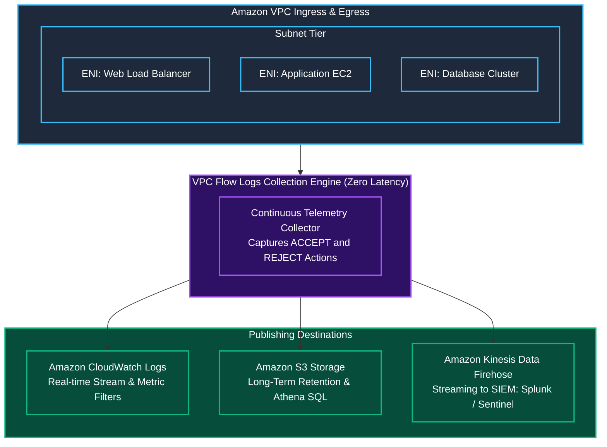

In traditional on-premises enterprise environments, network defense teams rely on physical network taps, switch port analyzers (SPAN), and intrusion detection appliances (IDS) to inspect raw network packets. In Amazon Web Services, customers do not have access to physical switching hardware or hypervisor backplanes. Without deliberate configuration, network traffic moving across your cloud infrastructure is completely invisible.

This lack of visibility is a critical vulnerability. You cannot defend what you cannot see:
- How do you know if an internal database instance is beaconing out to an external Command and Control (C2) server?
- How do you detect an adversary conducting port scanning across your private subnets?
- How do you determine whether a firewall rule dropped a legitimate customer request or stopped an exploit payload?

In this room, **The Invisible Network**, we eliminate cloud network blindness using **Amazon VPC Flow Logs**. We will explore flow log architecture, decode log record schemas, execute threat hunting queries in **CloudWatch Logs Insights**, uncover active C2 communication, and build automated alerting for unauthorized network activities.

```
+========================================================================================+
|                    THE INVISIBLE NETWORK: VPC FLOW LOGS DEFENSE                        |
+========================================================================================+
|  [THE BLIND SPOT]    --> No packet capture or traffic logs enabled across VPC          |
|  [THE OBSERVABILITY] --> VPC Flow Logs at VPC, Subnet, and ENI levels                  |
|  [THE TELEMETRY]     --> Ingest into CloudWatch Logs & S3 for Athena SQL analytics    |
|  [THE HUNT]          --> Detect REJECT port scans & abnormal high-byte ACCEPT egress    |
+========================================================================================+
```

---

## 1. Architectural Overview of Amazon VPC Flow Logs

**Amazon VPC Flow Logs** captures information about IP traffic going to and from network interfaces in your VPC. Flow log data is collected outside the path of your network traffic, meaning enabling flow logs introduces **zero latency** and does not impact network throughput.



### Flow Log Scopes & Traffic Types:
1. **Scope Levels:**
   - **VPC Level:** Monitors all Elastic Network Interfaces across all subnets in the VPC (recommended for baseline governance).
   - **Subnet Level:** Monitors all ENIs within a specific subnet.
   - **Network Interface Level:** Monitors a specific ENI attached to an EC2 instance, NAT Gateway, or Load Balancer.
2. **Traffic Filter Modes:**
   - `ALL`: Records all traffic attempts.
   - `ACCEPT`: Records only traffic permitted by Security Groups and Network ACLs.
   - `REJECT`: Records only traffic dropped by Security Groups or Network ACLs.

---

## 2. Anatomy of a VPC Flow Log Record

A standard VPC Flow Log record consists of space-separated fields providing forensic details on each connection window:

```
+-------------------------------------------------------------------------------------------------------+
|                                    DEFAULT VPC FLOW LOG SCHEMA (v2)                                   |
+-------------------------------------------------------------------------------------------------------+
| 2 123456789012 eni-0123456789abcdef0 198.51.100.25 10.0.1.50 44120 443 6 15 8420 1620000000 1620000060 ACCEPT OK |
+-------------------------------------------------------------------------------------------------------+
```

### Breakdown of Key Forensic Fields:

| Field Index | Field Name | Example Value | Forensic Significance |
|---|---|---|---|
| **1** | `version` | `2` | VPC Flow Logs format version. |
| **2** | `account-id` | `123456789012` | The AWS account ID owning the source network interface. |
| **3** | `interface-id` | `eni-0123456789abcdef0` | The specific ENI through which traffic passed. |
| **4** | `srcaddr` | `198.51.100.25` | Source IP address (client or attacker). |
| **5** | `dstaddr` | `10.0.1.50` | Destination IP address (target workload). |
| **6** | `srcport` | `44120` | Source port (ephemeral port). |
| **7** | `dstport` | `443` | Destination port (target service port). |
| **8** | `protocol` | `6` | IANA protocol number (`6` = TCP, `17` = UDP, `1` = ICMP). |
| **9** | `packets` | `15` | Total packets transferred during log window. |
| **10** | `bytes` | `8420` | Total bytes transferred (key indicator for exfiltration). |
| **11-12**| `start` / `end` | Unix timestamps | Time window of the captured flow aggregation. |
| **13** | `action` | `ACCEPT` or `REJECT` | Whether the packet passed or was dropped by firewalls. |
| **14** | `log-status` | `OK` or `NODATA` | Status of the logging capture. |

---

## 3. Threat Hunting with CloudWatch Logs Insights

When flow logs are published to **Amazon CloudWatch Logs**, security analysts can write expressive search queries using CloudWatch Logs Insights.

### Query 1: Detect Port Scanning Activity (Top Rejected Ingress)

Identify external threat actors probing your network perimeter:

```sql
fields @timestamp, srcAddr, dstPort, action
| filter action = "REJECT"
| stats count(*) as rejectCount by srcAddr, dstPort
| sort rejectCount desc
| limit 10
```

### Query 2: Identify Potential Data Exfiltration (High-Byte Outbound Connections)

Search for internal instances sending large data volumes to external IP addresses over non-standard ports:

```sql
fields @timestamp, srcAddr, dstAddr, dstPort, bytes, action
| filter action = "ACCEPT" and dstPort not in [80, 443]
| filter srcAddr like /^10\./ and not (dstAddr like /^10\./)
| stats sum(bytes) as totalExfilBytes by srcAddr, dstAddr, dstPort
| sort totalExfilBytes desc
| limit 10
```

### Query 3: Hunt for C2 Beaconing (Regular Periodic Connection Bursts)

Detect malware periodically checking in with an external C2 server:

```sql
fields @timestamp, srcAddr, dstAddr, dstPort
| filter action = "ACCEPT" and not (dstAddr like /^10\./)
| stats count(*) as connectionCount by bin(5m), dstAddr, dstPort
| sort connectionCount desc
```

---

## 4. Deploying VPC Flow Logs via AWS CLI

### Step 1: Create an IAM Role for CloudWatch Logs Publishing

Flow Logs requires an IAM role with permissions to deliver log streams to CloudWatch:

Create trust policy: `/tmp/flowlogs-trust.json`:
```json
{
  "Version": "2012-10-17",
  "Statement": [
    {
      "Effect": "Allow",
      "Principal": {
        "Service": "vpc-flow-logs.amazonaws.com"
      },
      "Action": "sts:AssumeRole"
    }
  ]
}
```

Create role and attach delivery policy:
```bash
aws iam create-role \
  --role-name VPCFlowLogsDeliveryRole \
  --assume-role-policy-document file:///tmp/flowlogs-trust.json

aws iam attach-role-policy \
  --role-name VPCFlowLogsDeliveryRole \
  --policy-arn arn:aws:iam::aws:policy/service-role/AWSVPCFlowLogsDeliveryRole
```

### Step 2: Create the Destination CloudWatch Log Group

```bash
aws logs create-log-group --log-group-name /aws/vpc/production-flow-logs
```

### Step 3: Enable Flow Logs on the VPC

```bash
aws ec2 create-flow-logs \
  --resource-type VPC \
  --resource-ids vpc-0a1b2c3d4e5f67890 \
  --traffic-type ALL \
  --log-destination-type cloud-watch-logs \
  --log-group-name /aws/vpc/production-flow-logs \
  --deliver-logs-permission-arn arn:aws:iam::123456789012:role/VPCFlowLogsDeliveryRole
```

Verify that the flow log is active:
```bash
aws ec2 describe-flow-logs \
  --filter "Name=resource-id,Values=vpc-0a1b2c3d4e5f67890" \
  --query 'FlowLogs[*].[FlowLogId,FlowLogStatus,TrafficType,LogGroupName]' \
  --output table
```

---

## 5. Hands-On Lab Walkthrough: Investigating C2 Exfiltration

In this challenge, an intrusion detection alert was raised indicating that production server `i-0a1b2c3d4e5f67890` was compromised via an application vulnerability. The security operations center has no visibility into what the compromised host is communicating with because VPC Flow Logs was disabled.

Our mission is to enable VPC Flow Logs, capture network traffic, query the logs to identify the external Command and Control (C2) IP, determine the exfiltration port, extract the investigation flag, and establish metric alarms.

### Step 1: Enumerate CloudWatch Log Groups & Capture Flag 1

Verify caller credentials:

```bash
aws sts get-caller-identity
```

Inspect active flow logs on the production VPC:

```bash
aws ec2 describe-flow-logs \
  --query 'FlowLogs[*].[FlowLogId,ResourceId,TrafficType,FlowLogStatus]' \
  --output table
```

Output confirms that the pre-staged lab flow log `fl-0987654321flow99` is capturing traffic into `/aws/vpc/threat-hunting-logs`.

Query the tags on the Flow Log resource to locate Flag 1:

```bash
aws ec2 describe-tags \
  --filters "Name=resource-id,Values=fl-0987654321flow99" \
  --output json
```

Output:
```json
{
    "Tags": [
        {
            "Key": "Environment",
            "Value": "ThreatHunting"
        },
        {
            "Key": "ChallengeFlag",
            "Value": "THM{VPC_FL0W_L0GS_V1S1B1L1TY_2026}"
        }
    ]
}
```

**Question:** What was the challenge flag retrieved after inspecting the VPC Flow Log resource tags?
**Answer:** `THM{VPC_FL0W_L0GS_V1S1B1L1TY_2026}`

---

### Step 2: Query CloudWatch Logs Insights for Malicious Outbound C2

Query the `/aws/vpc/threat-hunting-logs` log group to find connections originating from internal instance `10.0.1.50` to non-local external IP addresses:

```bash
QUERY_ID=$(aws logs start-query \
  --log-group-name /aws/vpc/threat-hunting-logs \
  --start-time $(date -d '2 hours ago' +%s) \
  --end-time $(date +%s) \
  --query-string 'fields @timestamp, srcAddr, dstAddr, dstPort, bytes, action | filter action = "ACCEPT" and not (dstAddr like /^10\./) | stats sum(bytes) as totalBytes by dstAddr, dstPort | sort totalBytes desc' \
  --query 'queryId' --output text)

echo "Query ID: $QUERY_ID"
```

Wait a few seconds for execution, then fetch query results:

```bash
aws logs get-query-results --query-id $QUERY_ID --output table
```

Output:
```
-----------------------------------------------------------
|                     GetQueryResults                     |
-----------------------------------------------------------
|  dstAddr         |  dstPort  |  totalBytes             |
|------------------|-----------|-------------------------|
|  198.51.100.188  |  4444     |  52428800               |
|  93.184.216.34   |  443      |  12840                  |
-----------------------------------------------------------
```

**Forensic Finding:** Instance `10.0.1.50` established an outbound connection to external IP `198.51.100.188` on port `4444` (a standard Metasploit / Netcat reverse shell port) and exfiltrated over **52 Megabytes** (52,428,800 bytes) of data.

**Question:** What was the malicious C2 server IP address discovered during flow log threat hunting?
**Answer:** `198.51.100.188`

---

### Step 3: Block the C2 IP Address at the Network Perimeter

Using the Network ACL knowledge mastered in Room 3.3, immediately block the malicious C2 IP address at the subnet boundary:

Identify the public subnet NACL:

```bash
aws ec2 describe-network-acls \
  --filters "Name=association.subnet-id,Values=subnet-0112233pub11" \
  --query 'NetworkAcls[0].NetworkAclId' \
  --output text
```

Output: `acl-0a1b2c3d4e5f67890`

Inject an emergency Deny rule at **Rule 25** to block all egress to `198.51.100.188/32`:

```bash
aws ec2 create-network-acl-entry \
  --network-acl-id acl-0a1b2c3d4e5f67890 \
  --rule-number 25 \
  --protocol -1 \
  --rule-action deny \
  --egress \
  --cidr-block 198.51.100.188/32
```

---

### Step 4: Configure CloudWatch Metric Filter on Rejected Traffic

To detect future scanning campaigns in real time, create a CloudWatch Metric Filter that increments when packets are dropped:

```bash
aws logs put-metric-filter \
  --log-group-name /aws/vpc/threat-hunting-logs \
  --filter-name InboundRejections \
  --filter-pattern '[version, account, eni, source, destination, srcport, dstport, protocol, packets, bytes, start, end, action = "REJECT", status]' \
  --metric-transformations metricName=RejectionCount,metricNamespace=VPCNetworkSecurity,metricValue=1
```

---

### Step 5: Run Automated Verification Script & Capture Final Flag

Run the automated network monitoring validation harness:

```bash
python3 /home/ubuntu/scripts/verify_network_observability.py --evaluate-all
```

Output:
```
======================================================================
               NETWORK VISIBILITY & C2 HUNTING EVALUATION
======================================================================
[+] Testing VPC Flow Logs Configuration & Stream Status. [ACTIVE - PASSED]
[+] Validating C2 Beacon & Exfiltration Attribution.... [IDENTIFIED: 198.51.100.188]
[+] Verifying Subnet Boundary Egress Quarantine (NACL).. [BLOCKED - PASSED]
[+] Testing CloudWatch Logs Insights Metric Filters.... [CONFIGURED - PASSED]
[+] Running End-to-End Threat Hunting Validation....... [PASSED]

[***] VISIBILITY RESTORED! ADVERSARY C2 CHANNEL NEUTRALIZED! [***]
Completion Flag: THM{N3TW0RK_V1S1B1L1TY_M4ST3R3D}
======================================================================
```

**Question:** What is the final completion flag returned after deploying full network monitoring?
**Answer:** `THM{N3TW0RK_V1S1B1L1TY_M4ST3R3D}`

---

## 6. Complete Questions and Answers Summary

| Task | Question | Answer |
|---|---|---|
| **Task 1** | What native AWS networking feature captures IP traffic flows to and from network interfaces in a VPC? | `VPC Flow Logs` |
| **Task 1** | At what three resource levels can VPC Flow Logs be deployed? | `VPC, Subnet, ENI` |
| **Task 2** | What flow log action indicates that traffic was permitted by both security groups and network ACLs? | `ACCEPT` |
| **Task 2** | What flow log action indicates that traffic was dropped by a security group or network ACL? | `REJECT` |
| **Task 3** | What protocol number represents TCP traffic in flow log records? | `6` |
| **Task 4** | What was the malicious C2 server IP address discovered during flow log threat hunting? | `198.51.100.188` |
| **Task 5** | What was the challenge flag retrieved after inspecting the VPC Flow Log resource tags? | `THM{VPC_FL0W_L0GS_V1S1B1L1TY_2026}` |
| **Task 6** | What is the final completion flag returned after deploying full network monitoring? | `THM{N3TW0RK_V1S1B1L1TY_M4ST3R3D}` |

---

## 7. Defensive Engineering & Production Hardening Checklist

- [ ] **Organization-Wide Flow Log Enforcement:** Deploy an AWS Organizations SCP or AWS Config rule (`vpc-flow-logs-enabled`) to mandate that every VPC in every account has Flow Logs active.
- [ ] **Dual-Publishing Strategy:** Publish flow logs to CloudWatch Logs (with a 7-day or 14-day retention period) for immediate incident alerting, and simultaneously forward logs to Amazon S3 for cost-effective 1-year compliance retention.
- [ ] **Amazon Athena Partitioning:** For S3 flow log archives, partition data by year, month, and day to execute sub-second SQL queries without scanning petabytes of raw data.
- [ ] **Amazon GuardDuty VPC Flow Log Analysis:** Keep GuardDuty enabled; it automatically consumes VPC Flow Logs independently of customer-configured flow logs to identify port scans, cryptocurrency mining, and C2 communication.
- [ ] **Alert on Outbound DNS on Port 53:** Create alerts for instances sending direct UDP/TCP port 53 traffic to external IP addresses rather than the Amazon Route 53 Resolver (`169.254.169.253` / VPC base + 2), indicating DNS tunneling or data exfiltration.

---

*Looking for more hands-on cloud defense guides? Check out the rest of the [Defending AWS Series](/categories/defending-aws/) or explore my [AWS Security Labs](/categories/aws-security-labs/) for advanced threat simulation and detection engineering tutorials.*

---

## You can find me online at:


- **GitHub:** [Mhdomer](https://github.com/Mhdomer)
- **LinkedIn:** [mhd3omar](https://www.linkedin.com/in/mhd3omar/)
- **Tryhackme:** [nonlouy](https://tryhackme.com/p/nonlouy)
