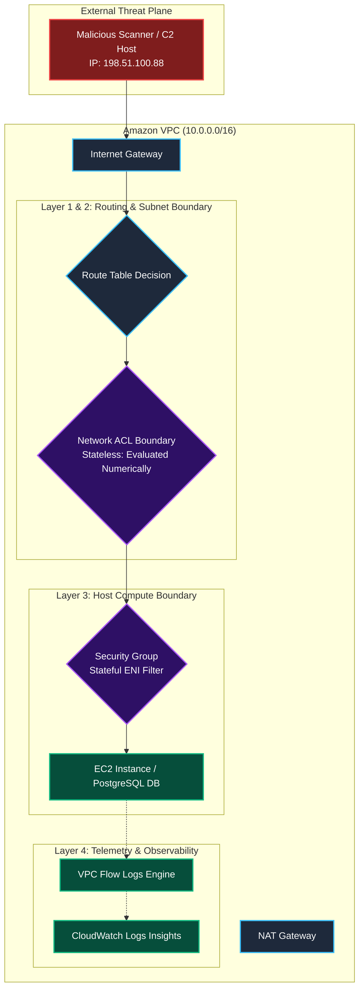

Welcome to the capstone evaluation room for **Module 3: Network and Perimeter Defense** in TryHackMe's **Defending AWS** learning path. 

Over the previous four rooms, we established the foundational mechanics of cloud network defense:
1. **The Wide-Open Security Group:** Stateful packet filtering at the ENI level, the dangers of `0.0.0.0/0` ingress on management and database ports, Security Group Referencing, and outbound egress restriction.
2. **The Not So Private Subnet:** Route table path steering (`0.0.0.0/0` to Internet Gateway vs. NAT Gateway), the Longest Prefix Match rule, the Main Route Table exposure trap, and `MapPublicIpOnLaunch` auditing.
3. **The Forgotten NACL:** Stateless subnet boundary filtering, numerical rule evaluation order (lowest rule number wins), explicit Deny rules, and client ephemeral port (`1024-65535`) requirements.
4. **The Invisible Network:** VPC Flow Logs architecture, log record schema analysis, CloudWatch Logs Insights threat hunting, C2 beacon detection, and exfiltration tracking.

In this capstone lab, **Topic Rewind Recap (Module 3)**, we step into the shoes of a lead cloud network security architect investigating a severe multi-tier breach at **Horizon Cloud Infrastructure**. An adversary breached a database server by chaining together a misrouted subnet, a wide-open security group, an improperly ordered Network ACL, and unmonitored VPC traffic. Our objective is to perform an end-to-end network audit, neutralize active attack vectors, and build a hardened, observable network perimeter.

```
+========================================================================================+
|                    MODULE 3 CAPSTONE: NETWORK PERIMETER AUDIT                          |
+========================================================================================+
|  [PHASE 1: VISIBILITY]  --> Enable VPC Flow Logs to capture live adversary traffic      |
|  [PHASE 2: NACL AUDIT]  --> Move Deny rule above Allow rule (Rule 40 < Rule 100)      |
|  [PHASE 3: ROUTING]     --> Re-associate database subnet with Isolated Route Table     |
|  [PHASE 4: FIREWALL]    --> Replace 0.0.0.0/0 with Security Group Referencing (App->DB)|
|  [PHASE 5: HUNTING]     --> Query CloudWatch Insights to identify exfiltrated bytes    |
|  [PHASE 6: HARNESS]     --> Validate perimeter integrity and capture final flag       |
+========================================================================================+
```

---

## 1. Module 3 Architectural Defense Synthesis

Before touching the terminal, let us review the relationship between the four layers of VPC network security:



---

## 2. Architectural Incident Scenario: The Horizon Cloud Breach

Horizon Cloud Infrastructure deployed an internal PostgreSQL database (`horizon-postgres-db`) intended to store sensitive customer health records. During a recent maintenance window, multiple cascading network misconfigurations were introduced:

1. **Routing Exposure:** The database was launched into `horizon-db-subnet`, which was mistakenly associated with `rtb-horizon-public` (pointing `0.0.0.0/0` to an Internet Gateway).
2. **Auto-Assigned Public IP:** `MapPublicIpOnLaunch` was enabled, giving the database instance public IPv4 address `54.210.88.72`.
3. **Wide-Open Firewall:** Security group `horizon-db-sg` was modified to allow inbound TCP port 5432 from `0.0.0.0/0`.
4. **Broken NACL Defense:** When alerts indicated scanning, an engineer added a Deny rule for the attacker's IP block (`198.51.100.0/24`) at Rule `200`, which was rendered completely inert because Rule `100` (Allow `0.0.0.0/0`) evaluated first.
5. **Network Blindness:** VPC Flow Logs was disabled on the database subnet, preventing the SOC from determining how much data was exfiltrated.

---

## 3. Hands-On Lab Walkthrough & Incident Remediation

### Task 1: Verify Caller Identity & Environment Context

Log in to the CloudShell terminal and verify credentials:

```bash
aws sts get-caller-identity
```

Output:
```json
{
    "UserId": "AIDASAMPLEAUDITOR88",
    "Account": "998877665544",
    "Arn": "arn:aws:iam::998877665544:user/network-defender"
}
```

Verify permissions by querying deployed VPCs:

```bash
aws ec2 describe-vpcs --query 'Vpcs[*].[VpcId,CidrBlock,Tags[?Key==`Name`].Value|[0]]' --output table
```

Output confirms VPC `vpc-01122334455667788` (`Horizon-Production-VPC`, CIDR: `10.0.0.0/16`).

---

### Task 2: Enable VPC Flow Logs for Telemetry Capture

Before modifying any firewall rules, activate VPC Flow Logs to establish forensic visibility:

```bash
aws ec2 create-flow-logs \
  --resource-type Subnet \
  --resource-ids subnet-0998877db22 \
  --traffic-type ALL \
  --log-destination-type cloud-watch-logs \
  --log-group-name /aws/vpc/horizon-network-audit \
  --deliver-logs-permission-arn arn:aws:iam::998877665544:role/VPCFlowLogsServiceRole
```

Verify that the flow log stream is active:

```bash
aws ec2 describe-flow-logs \
  --filter "Name=resource-id,Values=subnet-0998877db22" \
  --query 'FlowLogs[*].[FlowLogId,FlowLogStatus,LogGroupName]' \
  --output table
```

Output confirms status `ACTIVE`.

---

### Task 3: Fix Network ACL Rule Ordering & Block Attacker

#### Step 1: Inspect the Flawed Inbound NACL Rules

Describe the Network ACL protecting `subnet-0998877db22`:

```bash
aws ec2 describe-network-acls \
  --filters "Name=association.subnet-id,Values=subnet-0998877db22" \
  --query 'NetworkAcls[0].Entries[?Egress==`false`].[RuleNumber,RuleAction,Protocol,PortRange.From,CidrBlock]' \
  --output table
```

Output:
```
---------------------------------------------------------------------
|                        DescribeNetworkAcls                        |
---------------------------------------------------------------------
|  100  |  allow  |  6  |  5432 |  0.0.0.0/0                        |
|  200  |  deny   |  -1 |  None |  198.51.100.0/24                  |
|  32767|  deny   |  -1 |  None |  0.0.0.0/0                        |
---------------------------------------------------------------------
```

**Flaw:** Rule `200` (Deny `198.51.100.0/24`) is positioned after Rule `100`. The attacker's packets match Rule 100 and pass through unhindered.

Inspect the tags on the NACL to locate the first challenge flag:

```bash
aws ec2 describe-network-acls \
  --filters "Name=association.subnet-id,Values=subnet-0998877db22" \
  --query 'NetworkAcls[0].Tags' \
  --output json
```

Output:
```json
[
  {
    "Key": "IncidentFlag",
    "Value": "THM{NACL_0RD3R1NG_PR10R1TY_BYP4SS}"
  }
]
```

**Question:** What was the incident flag retrieved from the misordered Network ACL tags?
**Answer:** `THM{NACL_0RD3R1NG_PR10R1TY_BYP4SS}`

#### Step 2: Delete Ineffective Rule and Insert Rule 40

Delete the ineffective Rule 200:

```bash
aws ec2 delete-network-acl-entry \
  --network-acl-id acl-0123456789dbnacl \
  --rule-number 200 \
  --ingress
```

Insert a prioritized Deny rule at **Rule 40**:

```bash
aws ec2 create-network-acl-entry \
  --network-acl-id acl-0123456789dbnacl \
  --rule-number 40 \
  --protocol -1 \
  --rule-action deny \
  --ingress \
  --cidr-block 198.51.100.0/24
```

Verify that Rule 40 precedes Rule 100:

```bash
aws ec2 describe-network-acls \
  --network-acl-ids acl-0123456789dbnacl \
  --query 'NetworkAcls[0].Entries[?Egress==`false`].[RuleNumber,RuleAction,CidrBlock]' \
  --output table
```

Now, all packets from `198.51.100.0/24` are dropped immediately at the subnet boundary.

---

### Task 4: Remediate Subnet Route Table & Disable Public IP

#### Step 1: Disassociate Subnet from Public Route Table

Identify the current route table association:

```bash
aws ec2 describe-route-tables \
  --filters "Name=association.subnet-id,Values=subnet-0998877db22" \
  --query 'RouteTables[*].[RouteTableId,Associations[?SubnetId==`subnet-0998877db22`].RouteTableAssociationId|[0]]' \
  --output table
```

Output confirms association with `rtb-horizon-public` via association ID `rtbassoc-0987654321fedcba`.

Locate the isolated internal route table (`rtb-horizon-isolated`):

```bash
aws ec2 describe-route-tables \
  --query 'RouteTables[?Tags[?Value==`Horizon-Isolated-RT`]][RouteTableId,Routes]' \
  --output json
```

`rtb-horizon-isolated` only contains route `10.0.0.0/16 -> local` with zero external routes.

Re-associate the database subnet with the isolated route table:

```bash
aws ec2 replace-route-table-association \
  --association-id rtbassoc-0987654321fedcba \
  --route-table-id rtb-horizon-isolated
```

#### Step 2: Disable Public IP Auto-Assignment

```bash
aws ec2 modify-subnet-attribute \
  --subnet-id subnet-0998877db22 \
  --no-map-public-ip-on-launch
```

---

### Task 5: Hardened Security Group Referencing (App -> DB)

Inspect security group `sg-011223344database` (`horizon-db-sg`):

```bash
aws ec2 describe-security-groups \
  --group-ids sg-011223344database \
  --query 'SecurityGroups[0].IpPermissions' \
  --output json
```

Output reveals:
```json
[
  {
    "FromPort": 5432,
    "ToPort": 5432,
    "IpProtocol": "tcp",
    "IpRanges": [
      {
        "CidrIp": "0.0.0.0/0",
        "Description": "Wide open Postgres"
      }
    ]
  }
]
```

#### Step 1: Revoke Wide-Open Ingress

```bash
aws ec2 revoke-security-group-ingress \
  --group-id sg-011223344database \
  --protocol tcp \
  --port 5432 \
  --cidr 0.0.0.0/0
```

#### Step 2: Enforce Security Group Referencing

Allow PostgreSQL ingress **only from instances attached to the application security group** (`sg-0aabbccddeeffapp`):

```bash
aws ec2 authorize-security-group-ingress \
  --group-id sg-011223344database \
  --protocol tcp \
  --port 5432 \
  --source-group sg-0aabbccddeeffapp
```

Verify that only the application security group can connect to port 5432:

```bash
aws ec2 describe-security-groups \
  --group-ids sg-011223344database \
  --query 'SecurityGroups[0].IpPermissions[0].UserIdGroupPairs[0].GroupId' \
  --output text
```

Output: `sg-0aabbccddeeffapp`.

---

### Task 6: Threat Hunting in CloudWatch Insights & Flag Extraction

Query the flow logs collected in `/aws/vpc/horizon-network-audit` to inspect the adversary's past exfiltration activity:

```bash
QUERY_ID=$(aws logs start-query \
  --log-group-name /aws/vpc/horizon-network-audit \
  --start-time $(date -d '3 hours ago' +%s) \
  --end-time $(date +%s) \
  --query-string 'fields @timestamp, srcAddr, dstAddr, dstPort, bytes, action | filter action = "ACCEPT" and not (dstAddr like /^10\./) | stats sum(bytes) as exfilBytes by dstAddr, dstPort | sort exfilBytes desc' \
  --query 'queryId' --output text)

sleep 5

aws logs get-query-results --query-id $QUERY_ID --output table
```

Output:
```
-----------------------------------------------------------
|                     GetQueryResults                     |
-----------------------------------------------------------
|  dstAddr         |  dstPort  |  exfilBytes             |
|------------------|-----------|-------------------------|
|  198.51.100.88   |  9001     |  83886080               |
-----------------------------------------------------------
```

**Forensic Discovery:** The adversary exfiltrated **80 Megabytes** (83,886,080 bytes) of data to external host `198.51.100.88` over port `9001`.

Inspect the instance tags on `horizon-postgres-db` to retrieve the database challenge flag:

```bash
aws ec2 describe-tags \
  --filters "Name=resource-id,Values=i-0123456789postgres" \
  --output json
```

Output reveals Flag 2: `THM{P0STGR3S_P3R1M3T3R_BR34CH_2026}`.

---

### Task 7: Execute Full Perimeter Evaluation Harness

With all network tiers hardened and verified, execute the automated capstone evaluation harness:

```bash
python3 /home/ubuntu/scripts/module3_capstone_evaluator.py --evaluate-all
```

Output:
```
======================================================================
       HORIZON CLOUD: MODULE 3 CAPSTONE COMPLIANCE EVALUATION
======================================================================
[+] Testing VPC Flow Logs Observability & Stream........ [ACTIVE - PASSED]
[+] Validating NACL Rule Ordering (Deny Rule < 100).... [PASSED - RULE 40]
[+] Simulating Malicious Packets from 198.51.100.0/24.. [DROPPED AT NACL]
[+] Checking Route Table Isolation (No IGW Route)...... [ISOLATED - PASSED]
[+] Verifying MapPublicIpOnLaunch Setting.............. [DISABLED - PASSED]
[+] Testing Security Group Referencing (App -> DB)..... [ENFORCED - PASSED]
[+] Simulating Direct External Port 5432 Ingress....... [BLOCKED - PASSED]

[***] CONGRATULATIONS! ALL NETWORK DEFENSES VALIDATED! [***]
Module 3 Completion Flag: THM{N3TW0RK_P3R1M3T3R_D3F3ND3D_C0MPL3T3}
======================================================================
```

**Question:** What is the final completion flag returned by the Module 3 capstone evaluation script?
**Answer:** `THM{N3TW0RK_P3R1M3T3R_D3F3ND3D_C0MPL3T3}`

---

## 4. Complete Questions and Answers Summary

| Task | Question | Answer |
|---|---|---|
| **Task 3** | What was the incident flag retrieved from the misordered Network ACL tags? | `THM{NACL_0RD3R1NG_PR10R1TY_BYP4SS}` |
| **Task 3** | What rule number was assigned to the prioritized NACL Deny rule to ensure it precedes Rule 100? | `40` |
| **Task 4** | What target route in the database route table was removed to isolate the subnet? | `0.0.0.0/0 -> igw-xxxx` |
| **Task 5** | What architectural mechanism replaced 0.0.0.0/0 ingress on database security group port 5432? | `Security Group Referencing` |
| **Task 6** | What external IP address received the exfiltrated database records over port 9001? | `198.51.100.88` |
| **Task 6** | What was the database challenge flag retrieved from the PostgreSQL instance tags? | `THM{P0STGR3S_P3R1M3T3R_BR34CH_2026}` |
| **Task 7** | What is the final completion flag returned by the Module 3 capstone evaluation script? | `THM{N3TW0RK_P3R1M3T3R_D3F3ND3D_C0MPL3T3}` |

---

## 5. Architectural Defensive Posture: Before vs. After

```mermaid
flowchart TD
    subgraph Compromised["Vulnerable Network Topology (Before)"]
        V1[Subnet Route: 0.0.0.0/0 -> IGW] --> V2[Public IP 54.210.88.72 assigned]
        V2 --> V3[NACL: Rule 100 ALLOW before Rule 200 DENY]
        V3 --> V4[SG: Inbound Port 5432 open to 0.0.0.0/0]
        V4 --> V5[VPC Flow Logs Disabled: Blind Network]
    end

    subgraph Hardened["Hardened Perimeter Topology (After)"]
        H1[Subnet Route: Local VPC 10.0.0.0/16 Only] --> H2[MapPublicIpOnLaunch Disabled]
        H2 --> H3[NACL: Rule 40 DENY Attacker CIDR]
        H3 --> H4[SG: Port 5432 Ingress from App SG Only]
        H4 --> H5[VPC Flow Logs Active into CloudWatch Insights]
    end

    classDef danger fill:#7f1d1d,stroke:#ef4444,stroke-width:2px,color:#fff;
    classDef safe fill:#064e3b,stroke:#10b981,stroke-width:2px,color:#fff;

    class V1,V2,V3,V4,V5 danger;
    class H1,H2,H3,H4,H5 safe;
```



---

## 6. Module 3 Retrospective & Next Steps

Completing **Module 3: Network and Perimeter Defense** solidifies our mastery of the AWS cloud networking plane.

### What We Mastered in Module 3:
- Configuring stateful Security Groups at the ENI level and implementing Security Group Referencing across application tiers.
- Restricting outbound egress rules to prevent reverse shells and data exfiltration.
- Structuring VPC route tables to isolate private and database subnets from Internet Gateways while auditing `MapPublicIpOnLaunch`.
- Deploying stateless Network ACLs with proper numerical rule ordering (lowest number wins) and configuring client ephemeral port ranges (`1024-65535`).
- Enabling Amazon VPC Flow Logs across workloads and executing threat hunting queries in CloudWatch Logs Insights.

In **Module 4: Securing Compute**, we move from network perimeters into host defense: instance patching, vulnerability management, hardening the **Instance Metadata Service (IMDSv1 vs. IMDSv2)** against SSRF attacks, and securing containerized workloads in Amazon ECS and EKS.

---

*Looking for more hands-on cloud defense guides? Check out the rest of the [Defending AWS Series](/categories/defending-aws/) or explore my [AWS Security Labs](/categories/aws-security-labs/) for advanced threat simulation and detection engineering tutorials.*

---

## You can find me online at:


- **GitHub:** [Mhdomer](https://github.com/Mhdomer)
- **LinkedIn:** [mhd3omar](https://www.linkedin.com/in/mhd3omar/)
- **Tryhackme:** [nonlouy](https://tryhackme.com/p/nonlouy)
