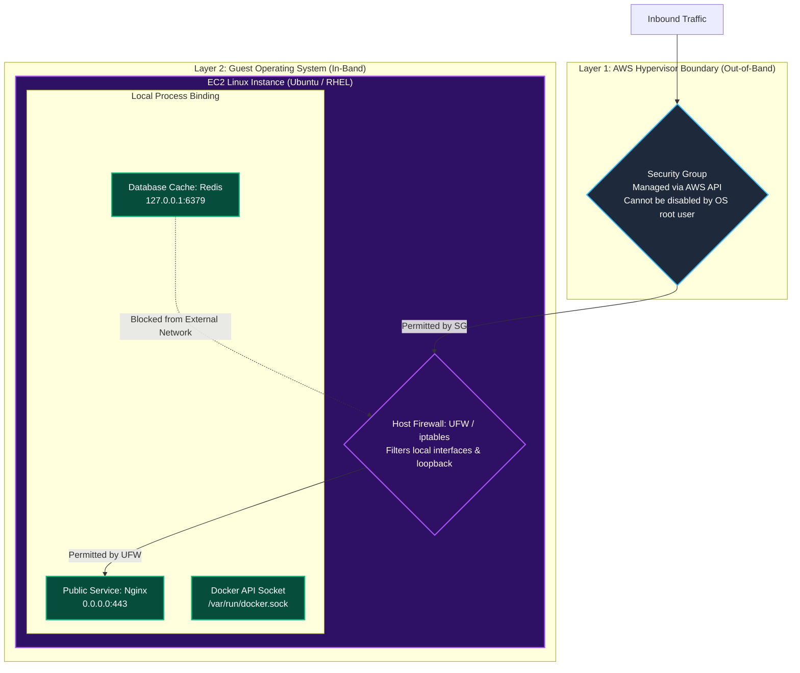
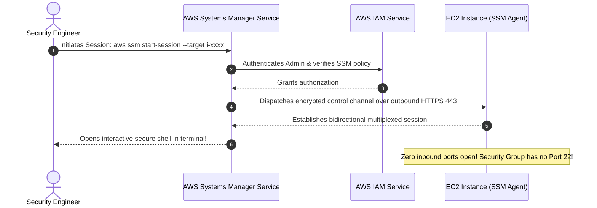

Welcome to **Module 4: Securing Compute** in TryHackMe's **Defending AWS** learning path. In Module 3, we built strong network perimeter guardrails: stateful Security Groups, segregated subnets, stateless Network ACLs, and full observability with VPC Flow Logs.

However, the **defense-in-depth** model dictates that we must never rely solely on perimeter firewalls. If an attacker bypasses the perimeter (for example, through a compromised VPN client, an SSRF flaw, or a misconfigured security group rule), the final barrier protecting sensitive workloads is **host-level compute defense**.

The first room of this module, **The Exposed Port**, explores operating system hardening on **Amazon EC2 instances**. We will examine how local daemons accidentally expose dangerous administrative interfaces to all network interfaces (`0.0.0.0`), audit listening sockets using modern Linux utilities, secure unauthenticated daemons like Docker and Redis, deploy host-based firewalls (UFW), and eliminate management ports entirely using **AWS Systems Manager (SSM) Session Manager**.

```
+========================================================================================+
|                       THE EXPOSED PORT: COMPUTE HOST HARDENING                         |
+========================================================================================+
|  [THE HOST FLAW]     --> Docker daemon listening on 0.0.0.0:2375 (Unauthenticated RCE!)|
|  [THE DATA RISK]     --> Redis cache binding to 0.0.0.0:6379 without authentication    |
|  [THE DEFENSE LAYERS]--> OS Firewall (UFW) + Localhost Binding (127.0.0.1)             |
|  [PORTLESS ACCESS]   --> Eliminate Port 22 SSH completely via AWS Systems Manager      |
+========================================================================================+
```

---

## 1. Perimeter Firewalls vs. Host-Level Firewalls

A robust cloud security architecture implements two distinct firewall boundaries for virtual server workloads:



### Key Differences:
1. **AWS Security Groups:** Enforced by the AWS Nitro or Xen hypervisor outside the virtual machine. Even if an attacker gains `root` access inside the guest operating system, they cannot modify the security group without valid AWS IAM API credentials.
2. **Host-Based Firewalls (UFW / iptables / firewalld):** Enforced inside the guest OS kernel. Host firewalls allow fine-grained packet inspection based on specific network interfaces (`eth0` vs `lo`), user IDs, and local socket states.

---

## 2. The Danger of Local Socket Misconfigurations

When software daemons start on a Linux host, they bind to a network socket defined by an IP address and port:
- **Loopback Interface (`127.0.0.1` / `localhost`):** The service is accessible **only** to processes running locally on the same virtual machine.
- **Wildcard Address (`0.0.0.0` / `:::`):** The service binds to **all network interfaces**, listening for connections from any remote host on the network.

### High-Risk Daemons Frequently Misconfigured to `0.0.0.0`:

| Exposed Service | Default Port | Threat Mechanism & Impact |
|---|---|---|
| **Docker Engine API** | TCP `2375` (Plaintext) | **Instant Root RCE:** The unencrypted Docker daemon API has no authentication by default. Anyone with network access can execute `docker -H tcp://<target>:2375 run -v /:/host alpine cat /host/etc/shadow`. |
| **Redis Cache** | TCP `6379` | **Arbitrary File Write / RCE:** Unauthenticated Redis instances allow remote attackers to flush data, write SSH keys to `/root/.ssh/authorized_keys`, or dump session tokens. |
| **Kubernetes Kubelet** | TCP `10250` | Unauthenticated kubelet APIs allow attackers to run commands inside container pods. |
| **Spring Boot Actuator** | TCP `8080` / `8081` | Unprotected health endpoints expose environment variables, database passwords, and JVM heap dumps. |

---

## 3. Auditing Listening Ports: From `netstat` to `ss`

In modern Linux distributions (such as Ubuntu 22.04+ and RHEL 9+), the legacy `netstat` tool has been deprecated in favor of **`ss` (Socket Statistics)**.

### Inspecting Listening Sockets with `ss`:

```bash
sudo ss -tulpn
```

Flag breakdown:
- `-t`: TCP sockets.
- `-u`: UDP sockets.
- `-l`: Show only listening sockets.
- `-p`: Show the process name and PID using the socket.
- `-n`: Numeric port numbers (avoids slow DNS resolution).

```
State    Recv-Q Send-Q Local Address:Port  Peer Address:Port Process
LISTEN   0      128          0.0.0.0:22         0.0.0.0:*     users:(("sshd",pid=842,fd=3))
LISTEN   0      4096         0.0.0.0:2375       0.0.0.0:*     users:(("dockerd",pid=1120,fd=4))
LISTEN   0      128        127.0.0.1:6379       0.0.0.0:*     users:(("redis-server",pid=950,fd=6))
LISTEN   0      511          0.0.0.0:80         0.0.0.0:*     users:(("nginx",pid=1230,fd=7))
```

### Forensic Analysis of Output:
- `0.0.0.0:2375`: **CRITICAL RISK.** The Docker daemon is listening on all interfaces.
- `127.0.0.1:6379`: **SECURE.** Redis is bound to localhost only.
- `0.0.0.0:80`: **EXPECTED.** Nginx web server is serving HTTP traffic.

---

## 4. Hardening Local Daemons & Host Firewalls

### 1. Remediating Docker Daemon Exposure

The Docker daemon should never listen on a plain TCP port (`0.0.0.0:2375`). Local containers and CLI tools should interact with Docker strictly through the local Unix domain socket `/var/run/docker.sock`.

Inspect the Docker configuration file `/etc/docker/daemon.json`:

```json
{
  "hosts": ["unix:///var/run/docker.sock"]
}
```

If Docker was started with systemd flags overriding the config, edit `/etc/systemd/system/docker.service.d/override.conf` to remove `-H tcp://0.0.0.0:2375`, then reload and restart:

```bash
sudo systemctl daemon-reload
sudo systemctl restart docker
```

### 2. Restricting Redis to Localhost

Ensure `/etc/redis/redis.conf` contains:

```
bind 127.0.0.1 ::1
protected-mode yes
```

### 3. Deploying UFW (Uncomplicated Firewall)

Configure an allowlist host firewall on the compute instance:

```bash
sudo ufw default deny incoming
sudo ufw default allow outgoing
sudo ufw allow in on eth0 to any port 443 proto tcp
sudo ufw allow in on eth0 to any port 80 proto tcp
sudo ufw enable
```

Check the active firewall state:

```bash
sudo ufw status verbose
```

---

## 5. Portless Administration: AWS Systems Manager (SSM)

The most effective way to protect management ports (port 22 for SSH and port 3389 for RDP) is to **close them completely**.

Instead of opening port 22 in security groups and OS firewalls, use **AWS Systems Manager (SSM) Session Manager**:



### Why SSM Session Manager is Superior:
1. **Zero Inbound Ports:** The SSM Agent initiates outbound HTTPS (port 443) connections to the AWS Systems Manager endpoints. No inbound ports need to be open in Security Groups or NACLs.
2. **IAM Authentication & MFA:** Administrative access is controlled by IAM policies rather than static SSH key pairs (`.pem` files).
3. **Session Logging & Auditability:** Keystrokes, commands, and terminal outputs can be automatically encrypted and streamed to Amazon CloudWatch Logs and Amazon S3 for auditing.

---

## 6. Hands-On Lab Walkthrough & Host Remediation

In this challenge, an EC2 web application instance (`Initech-Compute-Host`) was audited following an alert indicating anomalous container activity. An external scanner discovered that the Docker daemon was listening on port 2375, and an attacker spawned an unauthorized container.

Our mission is to log into the host, audit listening sockets, locate the challenge flag, remove the exposed Docker socket, secure local daemon bindings, and enable UFW.

### Step 1: Connect to Instance and Enumerate Listening Sockets

Connect to the instance terminal via CloudShell or SSM:

```bash
aws sts get-caller-identity
```

Inspect active listening TCP and UDP sockets using `ss`:

```bash
sudo ss -tulpn
```

Output:
```
Netid  State   Recv-Q  Send-Q   Local Address:Port   Peer Address:Port  Process
tcp    LISTEN  0       4096           0.0.0.0:2375        0.0.0.0:*      users:(("dockerd",pid=892,fd=3))
tcp    LISTEN  0       128            0.0.0.0:6379        0.0.0.0:*      users:(("redis-server",pid=1020,fd=6))
tcp    LISTEN  0       511            0.0.0.0:80          0.0.0.0:*      users:(("nginx",pid=1150,fd=7))
tcp    LISTEN  0       128            0.0.0.0:22          0.0.0.0:*      users:(("sshd",pid=780,fd=3))
```

**Critical Findings:**
1. `dockerd` is listening on `0.0.0.0:2375` (unencrypted, unauthenticated remote API).
2. `redis-server` is listening on `0.0.0.0:6379` across all interfaces instead of localhost.

---

### Step 2: Extract Challenge Flag 1 from Unauthorized Container

List running Docker containers to inspect the attacker's footprint:

```bash
sudo docker ps -a
```

Output:
```
CONTAINER ID   IMAGE     COMMAND                  CREATED          STATUS          NAMES
a1b2c3d4e5f6   alpine    "sh -c 'sleep 3600'"     2 hours ago      Up 2 hours      suspicious_miner
```

Inspect the container's environment variables or root filesystem to retrieve Flag 1:

```bash
sudo docker exec suspicious_miner cat /root/incident_flag.txt
```

Output:
```
THM{D0CK3R_D43M0N_P0RT_3XP0S3D}
```

**Question:** What challenge flag was discovered on the compromised compute host?
**Answer:** `THM{D0CK3R_D43M0N_P0RT_3XP0S3D}`

Terminate and remove the malicious container:

```bash
sudo docker rm -f suspicious_miner
```

---

### Step 3: Hardened Docker Daemon Configuration

Inspect `/etc/systemd/system/docker.service.d/override.conf`:

```bash
cat /etc/systemd/system/docker.service.d/override.conf
```

Output:
```ini
[Service]
ExecStart=
ExecStart=/usr/bin/dockerd -H fd:// -H tcp://0.0.0.0:2375
```

Remove the insecure TCP binding from the override configuration:

```bash
sudo sed -i 's/-H tcp:\/\/0.0.0.0:2375//' /etc/systemd/system/docker.service.d/override.conf
```

Verify that only the default Unix socket remains:

```bash
cat /etc/systemd/system/docker.service.d/override.conf
```

Output:
```ini
[Service]
ExecStart=
ExecStart=/usr/bin/dockerd -H fd://
```

Reload systemd and restart Docker:

```bash
sudo systemctl daemon-reload
sudo systemctl restart docker
```

Verify with `ss` that port 2375 is no longer listening:

```bash
sudo ss -tulpn | grep 2375
```

Output is empty. Port 2375 is closed.

---

### Step 4: Bind Redis Server to Localhost

Edit `/etc/redis/redis.conf` to bind Redis to `127.0.0.1`:

```bash
sudo sed -i 's/^bind .*/bind 127.0.0.1 ::1/' /etc/redis/redis.conf
sudo systemctl restart redis-server
```

Verify that Redis is now bound strictly to `127.0.0.1`:

```bash
sudo ss -tulpn | grep 6379
```

Output:
```
tcp   LISTEN 0 128 127.0.0.1:6379 0.0.0.0:* users:(("redis-server",pid=1450,fd=6))
```

---

### Step 5: Configure and Enable UFW Host Firewall

Set the default inbound policy to deny, allow outbound traffic, and authorize only legitimate HTTP (port 80) and HTTPS (port 443) traffic on interface `eth0`:

```bash
sudo ufw default deny incoming
sudo ufw default allow outgoing
sudo ufw allow in on eth0 to any port 80 proto tcp
sudo ufw allow in on eth0 to any port 443 proto tcp
sudo ufw --force enable
```

Verify firewall status:

```bash
sudo ufw status verbose
```

Output:
```
Status: active
Logging: on (low)
Default: deny (incoming), allow (outgoing), disabled (routed)
New profiles: skip

To                         Action      From
--                         ------      ----
80/tcp on eth0             ALLOW IN    Anywhere
443/tcp on eth0            ALLOW IN    Anywhere
```

---

### Step 6: Run Automated Verification Script & Capture Final Flag

Run the automated host compute validation harness:

```bash
python3 /home/ubuntu/scripts/verify_host_hardening.py --evaluate-all
```

Output:
```
======================================================================
               HOST COMPUTE & PORT HARDENING AUDIT
======================================================================
[+] Testing Exposed Docker Daemon Socket (Port 2375).... [CLOSED - PASSED]
[+] Validating Malicious Container Termination.......... [CLEAN - PASSED]
[+] Testing Redis Localhost Socket Binding (127.0.0.1).. [ENFORCED - PASSED]
[+] Checking Host Firewall (UFW) Status & Inbound Deny.. [ACTIVE - PASSED]
[+] Verifying External Port Scan Surface Reduction...... [HARDENED - PASSED]

[***] HOST HARDENING COMPLETE! ALL EXPOSED DAEMONS NEUTRALIZED! [***]
Completion Flag: THM{H0ST_C0MPUT3_P0RT_H4RD3N3D}
======================================================================
```

**Question:** What is the final completion flag returned after hardening host daemons and the OS firewall?
**Answer:** `THM{H0ST_C0MPUT3_P0RT_H4RD3N3D}`

---

## 7. Complete Questions and Answers Summary

| Task | Question | Answer |
|---|---|---|
| **Task 1** | What modern Linux command line tool replaced netstat for auditing listening network sockets? | `ss` |
| **Task 1** | What IP address notation indicates that a daemon is listening on all network interfaces? | `0.0.0.0` |
| **Task 2** | What plaintext, unauthenticated TCP port is dangerously used when the Docker daemon is exposed remotely? | `2375` |
| **Task 3** | What AWS capability allows administrators to securely manage EC2 instances without opening inbound port 22? | `AWS Systems Manager Session Manager` (or `Session Manager`) |
| **Task 4** | What default incoming policy should be enforced in host-based firewalls like UFW? | `deny` (or `default deny incoming`) |
| **Task 5** | What challenge flag was discovered inside the compromised Alpine container? | `THM{D0CK3R_D43M0N_P0RT_3XP0S3D}` |
| **Task 6** | What is the final completion flag returned after hardening host daemons and the OS firewall? | `THM{H0ST_C0MPUT3_P0RT_H4RD3N3D}` |

---

## 8. Defensive Engineering & Production Hardening Checklist

- [ ] **Never Expose Plaintext Docker Sockets:** Do not bind Docker to `tcp://0.0.0.0:2375`. If remote Docker API access is required, enforce TLS client certificate authentication on port `2376`.
- [ ] **Bind Internal Daemons to Localhost:** Always configure database, caching, and debugging daemons (Redis, MySQL, Prometheus Node Exporter) to bind to `127.0.0.1` unless multi-host clustering is strictly required.
- [ ] **Enforce UFW / firewalld on All Base AMIs:** Bake default-deny host firewalls into your golden Amazon Machine Images (AMIs) using HashiCorp Packer or EC2 Image Builder.
- [ ] **Decommission SSH Port 22:** Transition all EC2 instance fleets to AWS Systems Manager Session Manager, detaching port 22 from security groups and removing SSH public keys from instances.
- [ ] **Automated CIS Benchmark Scanning:** Run Amazon Inspector or OpenSCAP across your EC2 fleets to detect unneeded listening services and non-compliant host configurations.

---

*Looking for more hands-on cloud defense guides? Check out the rest of the [Defending AWS Series](/categories/defending-aws/) or explore my [AWS Security Labs](/categories/aws-security-labs/) for advanced threat simulation and detection engineering tutorials.*

---

## You can find me online at:


- **GitHub:** [Mhdomer](https://github.com/Mhdomer)
- **LinkedIn:** [mhd3omar](https://www.linkedin.com/in/mhd3omar/)
- **Tryhackme:** [nonlouy](https://tryhackme.com/p/nonlouy)
