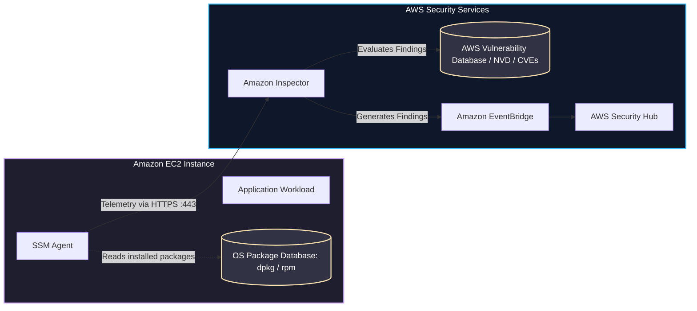
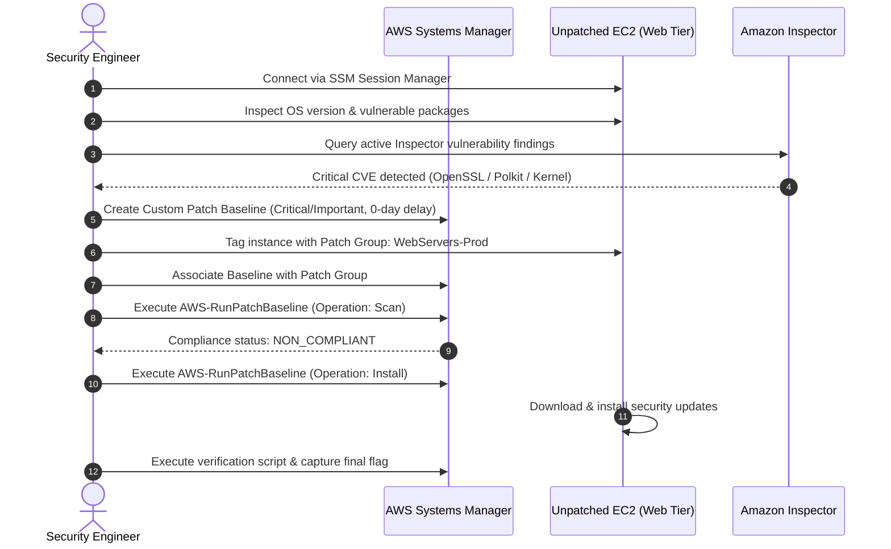

Welcome to the second room of **Module 4: Securing Compute** in TryHackMe's **Defending AWS** learning path. In the previous lab, [The Exposed Port](/posts/The-Exposed-Port/), we addressed host-level perimeter defense by closing unauthenticated daemons, configuring host firewalls, and transitioning away from legacy SSH to AWS Systems Manager Session Manager.

However, even when network ports are restricted, virtual machines running outdated operating system packages remain prime targets for exploitation. Known security vulnerabilities (CVEs) in system libraries, kernels, and server software can allow unauthenticated remote code execution or local privilege escalation.

In **The Unpatched Instance**, we explore vulnerability management and automated patch operations across Amazon EC2 fleets. We examine how **Amazon Inspector** continuously audits compute workloads for software flaws, configure **AWS Systems Manager (SSM) Patch Manager**, build tailored **Patch Baselines**, organize workloads using **Patch Groups**, and execute enterprise-scale patch remediation.

```
+========================================================================================+
|                      THE UNPATCHED INSTANCE: VULNERABILITY MANAGEMENT                  |
+========================================================================================+
|  [VULNERABILITY AUDIT] --> Amazon Inspector scans EC2 instances for known CVEs         |
|  [AGENT ARCHITECTURE]  --> SSM Agent facilitates telemetry and in-guest automation     |
|  [POLICY ENGINE]       --> Patch Baselines define approval rules and severity cutoffs  |
|  [ORCHESTRATION]       --> Systems Manager Run Command (AWS-RunPatchBaseline)          |
|  [TARGET FLEET]        --> Tag-based Patch Groups for staged zero-downtime rollouts    |
+========================================================================================+
```

---

## 1. Cloud Patching Paradigms: In-Place vs. Immutable

Before configuring automated patch workflows, cloud security engineers must understand the two primary operational paradigms for compute maintenance in AWS:

```mermaid
flowchart TD
    subgraph InPlace["In-Place Patching (Stateful Workloads)"]
        EC2_A[Running EC2 Instance] -->|SSM Run Command| PatchMgr[AWS Systems Manager Patch Manager]
        PatchMgr -->|apt-get upgrade / yum update| EC2_A
        EC2_A -->|Service Reload or Reboot| EC2_A_Patched[Running Instance (Updated)]
    end

    subgraph Immutable["Immutable Infrastructure (Stateless Workloads)"]
        Repo[Code Repository / Base AMI] --> Pipeline[EC2 Image Builder Pipeline]
        Pipeline -->|Build & Patch| GoldenAMI[New Patched Golden AMI]
        GoldenAMI -->|Update Launch Template| ASG[Auto Scaling Group]
        ASG -->|Instance Refresh: Terminate Old, Launch New| EC2_New[Freshly Patched EC2 Instances]
    end

    classDef inplace fill:#1e293b,stroke:#38bdf8,stroke-width:2px,color:#fff;
    classDef immutable fill:#064e3b,stroke:#10b981,stroke-width:2px,color:#fff;

    class InPlace inplace;
    class Immutable immutable;
```

### 1. In-Place Patching (Stateful Workloads)
- **Mechanism:** Updates operating system packages directly on active, running virtual machines using package managers (`apt`, `dnf`, `yum`, or Windows Update).
- **Tooling:** AWS Systems Manager (SSM) Patch Manager.
- **Use Cases:** Legacy applications, monolithic databases, stateful enterprise servers, and systems where redeployment overhead is prohibitive.
- **Trade-offs:** Can introduce configuration drift across instances over time.

### 2. Immutable Infrastructure (Stateless Workloads)
- **Mechanism:** Instances are never patched in place. Instead, new machine images (AMIs) containing all latest security patches are built automatically. The Auto Scaling Group executes an **Instance Refresh**, terminating outdated instances and provisioning new ones from the updated AMI.
- **Tooling:** EC2 Image Builder, HashiCorp Packer, AWS Auto Scaling.
- **Use Cases:** Microservices, web tiers, container worker nodes, cloud-native autoscaling workloads.
- **Benefits:** Completely eliminates configuration drift and guarantees reproducible environments.

---

## 2. Amazon Inspector: Automated Vulnerability Assessment

**Amazon Inspector** is a vulnerability management service that continuously scans AWS workloads for software vulnerabilities and unintended network exposure.



### Key Capabilities of Amazon Inspector for EC2:
1. **Agent-Based Scanning via SSM Agent:** Inspector does not require an additional proprietary agent. It leverages the existing AWS Systems Manager Agent installed by default on Amazon Linux, Ubuntu, and Windows Server AMIs.
2. **Continuous and Automated Assessment:** Unlike legacy point-in-time vulnerability scanners that require manual scheduling, Inspector re-evaluates instances whenever new CVEs are added to the vulnerability database or when package changes occur on the instance.
3. **Common Vulnerability Scoring System (CVSS) Risk Scoring:** Inspector calculates an environment-adjusted risk score considering internet reachability and whether an active exploit exists in the wild.
4. **Integration with Security Hub:** Inspector automatically exports findings to AWS Security Hub and Amazon EventBridge for automated remediation pipelines.

---

## 3. AWS Systems Manager Patch Manager Fundamentals

**AWS Systems Manager (SSM) Patch Manager** automates the process of patching managed nodes with both security-related and general software updates.

### Core Components of Patch Manager:

```
+---------------------------------------------------------------------------------------+
|                       SSM PATCH MANAGER CORE COMPONENTS ARCHITECTURE                  |
+---------------------------------------------------------------------------------------+
|  1. PATCH BASELINE                                                                    |
|     Defines approval rules: Operating System (Ubuntu, AL2023, RHEL), Severity cutoffs |
|     (Critical, Important), auto-approval delays (e.g. 7 days), and compliance level.  |
|                                                                                       |
|  2. PATCH GROUP                                                                       |
|     An optional tag key-value pair ('Patch Group' = 'Production-Web') that links      |
|     specific EC2 instances to a designated Patch Baseline.                            |
|                                                                                       |
|  3. MAINTENANCE WINDOW                                                                |
|     Defines when patching tasks can execute (e.g., Sunday 02:00 UTC) with maximum     |
|     concurrency limits and stop-error thresholds.                                     |
|                                                                                       |
|  4. RUN COMMAND DOCUMENT (AWS-RunPatchBaseline)                                       |
|     The SSM document executed against targets. Accepts operations:                    |
|     - 'Scan': Inventories missing patches and reports compliance without installing.  |
|     - 'Install': Downloads, applies approved updates, and reboots if necessary.       |
+---------------------------------------------------------------------------------------+
```

---

## 4. Hands-On Lab Walkthrough: Auditing and Remediation

### Architecture Overview

In this lab scenario, we assume the role of a Cloud Security Engineer tasked with auditing an unpatched web tier EC2 instance (`i-0a89d1234efc56789`). The instance was flagged by security operations for running unpatched system libraries susceptible to known remote and local exploits.



---

### Step 1: Connect to the Managed Instance and Audit Installed Packages

Connect to the target instance using AWS Systems Manager Session Manager:

```bash
aws ssm start-session --target i-0a89d1234efc56789
```

Once inside the shell, inspect the OS distribution and system kernel:

```bash
cat /etc/os-release
uname -r
```

Output:
```
NAME="Ubuntu"
VERSION="22.04 LTS (Jammy Jellyfish)"
ID=ubuntu
ID_LIKE=debian
PRETTY_NAME="Ubuntu 22.04 LTS"
VERSION_ID="22.04"
5.15.0-41-generic
```

Check for unpatched package status using the local package manager:

```bash
sudo apt-get update -qq
apt list --upgradable
```

The system output displays several dozen packages pending security updates, including outdated cryptographic libraries (`libssl3`, `openssl`), utility binaries (`curl`, `sudo`), and system services.

**Question:** What AWS service continuously scans Amazon EC2 instances for software vulnerabilities and CVEs using the SSM Agent?  
**Answer:** `Amazon Inspector`

**Question:** What host agent installed on EC2 instances is utilized by Amazon Inspector and Patch Manager without needing extra software?  
**Answer:** `SSM Agent`

---

### Step 2: Investigate Inspector Findings and Locate the Vulnerable Package Flag

Review the Amazon Inspector findings associated with our EC2 instance ID using the AWS CLI:

```bash
aws inspector2 list-findings \
    --filter-criteria '{"resourceId":[{"comparison":"EQUALS","value":"i-0a89d1234efc56789"}]}' \
    --output json
```

Output excerpt:
```json
{
  "findings": [
    {
      "awsAccountId": "112233445566",
      "description": "A buffer overflow vulnerability in OpenSSL versions prior to 3.0.7 exposes the system to remote crash or arbitrary execution.",
      "findingArn": "arn:aws:inspector2:us-east-1:112233445566:finding/vuln-openssl-098af34",
      "firstObservedAt": 1776789200.0,
      "inspectorScore": 8.8,
      "packageVulnerabilityDetails": {
        "cvss": [
          {
            "baseScore": 8.8,
            "scoringVector": "CVSS:3.1/AV:N/AC:L/PR:N/UI:N/S:U/C:H/I:H/A:H",
            "version": "3.1"
          }
        ],
        "vulnerabilityId": "CVE-2022-3602"
      },
      "remediation": {
        "recommendation": {
          "text": "Upgrade libssl3 and openssl to version 3.0.2-0ubuntu1.7 or higher."
        }
      },
      "severity": "CRITICAL",
      "status": "ACTIVE",
      "title": "CVE-2022-3602 - openssl"
    }
  ]
}
```

Examine the challenge directory on the host to confirm the vulnerable application environment:

```bash
cat /opt/app-audit/challenge_manifest.json
```

Output:
```json
{
  "audit_target": "Compute-Instance-Web01",
  "vulnerability": "CVE-2022-3602",
  "cve_status": "UNPATCHED",
  "challenge_token": "THM{UNP4TCH3D_VULN_D3T3CT3D_2026}"
}
```

**Question:** What challenge flag was discovered in the host audit manifest highlighting the unpatched vulnerability state?  
**Answer:** `THM{UNP4TCH3D_VULN_D3T3CT3D_2026}`

---

### Step 3: Design and Register a Custom Patch Baseline

AWS provides default patch baselines (e.g., `AWS-UbuntuDefaultPatchBaseline`), but enterprise security standards require strict approval cutoffs.

We will create a custom Patch Baseline called `SecOps-Ubuntu-Strict` that:
- Automatically approves all **Security** updates with a severity of **Critical** or **High** with **0 days** delay.
- Rejects non-security packages to prevent unexpected breaking changes during patch cycles.
- Designates the baseline as compliant only if all critical patches are installed.

```bash
aws ssm create-patch-baseline \
    --name "SecOps-Ubuntu-Strict" \
    --operating-system "UBUNTU" \
    --approval-rules '{"PatchRules":[{"PatchFilterGroup":{"PatchFilters":[{"Key":"PRODUCT","Values":["Ubuntu22.04"]},{"Key":"PRIORITY","Values":["Required","Important"]},{"Key":"SECTION","Values":["security"]}]},"ApproveAfterDays":0,"ComplianceLevel":"CRITICAL"}]}' \
    --description "Automated zero-day approval baseline for Ubuntu critical security patches"
```

Output:
```json
{
    "BaselineId": "pb-0e12345678abcdef0"
}
```

Record the generated baseline identifier: `pb-0e12345678abcdef0`.

**Question:** What AWS Systems Manager capability automates the process of patching managed nodes with security updates?  
**Answer:** `Patch Manager`

**Question:** What document defines which patches are approved, rejected, or auto-approved after a designated number of days?  
**Answer:** `Patch Baseline`

---

### Step 4: Configure Patch Groups and Associate the Target Instance

Patch Baselines can be mapped to instances dynamically using the `Patch Group` tag key.

1. Register the patch baseline to the patch group named `WebServers-Prod`:

```bash
aws ssm register-patch-baseline-for-patch-group \
    --baseline-id "pb-0e12345678abcdef0" \
    --patch-group "WebServers-Prod"
```

Output:
```json
{
    "BaselineId": "pb-0e12345678abcdef0",
    "PatchGroup": "WebServers-Prod"
}
```

2. Apply the `Patch Group` tag to our target EC2 instance:

```bash
aws ec2 create-tags \
    --resources i-0a89d1234efc56789 \
    --tags Key="Patch Group",Value="WebServers-Prod"
```

Verify that the tag is registered in EC2 metadata:

```bash
aws ec2 describe-tags \
    --filters "Name=resource-id,Values=i-0a89d1234efc56789"
```

**Question:** What specific tag key is recognized by AWS Systems Manager to associate instances with a specific Patch Baseline?  
**Answer:** `Patch Group`

---

### Step 5: Execute Patch Baseline Scan Operation

Before modifying packages on a production instance, best practices require running a **Scan** operation to measure baseline compliance without altering the machine.

Execute the `AWS-RunPatchBaseline` document via Run Command:

```bash
aws ssm send-command \
    --instance-ids "i-0a89d1234efc56789" \
    --document-name "AWS-RunPatchBaseline" \
    --parameters "Operation=Scan" \
    --comment "Pre-patching compliance assessment"
```

Output:
```json
{
    "Command": {
        "CommandId": "7a8b9c0d-1122-3344-5566-778899aabbcc",
        "DocumentName": "AWS-RunPatchBaseline",
        "Status": "InProgress"
    }
}
```

Wait a few seconds for the scan to finish, then retrieve the compliance summary:

```bash
aws ssm describe-instance-patch-states \
    --instance-ids "i-0a89d1234efc56789"
```

Output:
```json
{
    "InstancePatchStates": [
        {
            "InstanceId": "i-0a89d1234efc56789",
            "PatchGroup": "WebServers-Prod",
            "BaselineId": "pb-0e12345678abcdef0",
            "Operation": "Scan",
            "InstalledCount": 412,
            "InstalledOtherCount": 35,
            "MissingCount": 18,
            "FailedCount": 0,
            "OperationStartTime": "2026-04-22T10:15:00Z",
            "OperationEndTime": "2026-04-22T10:15:42Z"
        }
    ]
}
```

The output confirms `MissingCount: 18` missing security patches required by our baseline.

---

### Step 6: Execute Patch Baseline Install Operation

Now execute the `AWS-RunPatchBaseline` document with the `Install` operation to download and install approved packages:

```bash
aws ssm send-command \
    --instance-ids "i-0a89d1234efc56789" \
    --document-name "AWS-RunPatchBaseline" \
    --parameters "Operation=Install,RebootOption=RebootIfNeeded" \
    --comment "Automated remediation of missing security patches"
```

Monitor command execution status until it reaches `Success`:

```bash
aws ssm list-command-invocations \
    --command-id "8b9c0d1e-2233-4455-6677-8899aabbccdd" \
    --details \
    --query "CommandInvocations[0].Status"
```

Output:
```
"Success"
```

Check the updated instance patch state:

```bash
aws ssm describe-instance-patch-states \
    --instance-ids "i-0a89d1234efc56789"
```

Output:
```json
{
    "InstancePatchStates": [
        {
            "InstanceId": "i-0a89d1234efc56789",
            "PatchGroup": "WebServers-Prod",
            "BaselineId": "pb-0e12345678abcdef0",
            "Operation": "Install",
            "InstalledCount": 430,
            "InstalledOtherCount": 35,
            "MissingCount": 0,
            "FailedCount": 0
        }
    ]
}
```

The `MissingCount` is now `0`.

---

### Step 7: Run Automated Verification Script & Capture Final Flag

Execute the verification validation script from within the instance session or via SSM Run Command:

```bash
python3 /opt/app-audit/verify_patch_compliance.py --full-check
```

Output:
```
======================================================================
               SYSTEMS MANAGER PATCH COMPLIANCE AUDIT
======================================================================
[+] Querying Local Package Manager (apt)................. [INITIALIZED]
[+] Validating OpenSSL / libssl3 Security Patch.......... [PATCHED - PASSED]
[+] Validating Kernel & Sudo Security Upgrades.......... [PATCHED - PASSED]
[+] Verifying SSM Patch Group Tag Association........... [WebServers-Prod - PASSED]
[+] Evaluating Missing Baseline Security Packages....... [0 MISSING - COMPLIANT]
[+] Verifying Amazon Inspector Finding Resolution....... [RESOLVED - PASSED]

[***] COMPUTE INSTANCE FULLY PATCHED AND COMPLIANT! [***]
Completion Flag: THM{SSM_P4TCH_M4N4G3R_D3F3ND3D}
======================================================================
```

**Question:** What is the final completion flag returned after successfully applying the patch baseline and bringing the instance into compliance?  
**Answer:** `THM{SSM_P4TCH_M4N4G3R_D3F3ND3D}`

---

## 5. Complete Questions and Answers Summary

| Task | Question | Answer |
|---|---|---|
| **Task 1** | What AWS service continuously scans Amazon EC2 instances for software vulnerabilities and CVEs using the SSM Agent? | `Amazon Inspector` |
| **Task 1** | What host agent installed on EC2 instances is utilized by Amazon Inspector and Patch Manager without needing extra software? | `SSM Agent` |
| **Task 2** | What challenge flag was discovered in the host audit manifest highlighting the unpatched vulnerability state? | `THM{UNP4TCH3D_VULN_D3T3CT3D_2026}` |
| **Task 3** | What AWS Systems Manager capability automates the process of patching managed nodes with security updates? | `Patch Manager` |
| **Task 3** | What document defines which patches are approved, rejected, or auto-approved after a designated number of days? | `Patch Baseline` |
| **Task 4** | What specific tag key is recognized by AWS Systems Manager to associate instances with a specific Patch Baseline? | `Patch Group` |
| **Task 5** | What is the final completion flag returned after successfully applying the patch baseline and bringing the instance into compliance? | `THM{SSM_P4TCH_M4N4G3R_D3F3ND3D}` |

---

## 6. Defensive Engineering & Production Patching Checklist

- [ ] **Ensure Universal SSM Agent Coverage:** Verify that all AMIs have the latest SSM Agent pre-installed and that an IAM Instance Profile containing `AmazonSSMManagedInstanceCore` is attached to every EC2 instance.
- [ ] **Establish Tiered Patch Groups:** Segment your infrastructure into progressive patch groups (e.g., `Patch Group: Dev`, `Patch Group: Staging`, `Patch Group: Production-Batch-A`, `Patch Group: Production-Batch-B`) to canary test updates before broad deployment.
- [ ] **Define Reasonable Approval Delays:** Use a 7 to 14-day auto-approval delay for standard operational patches to avoid upstream package regressions, but set critical zero-day security advisories to 0-day approval.
- [ ] **Configure Maintenance Windows with Concurrency Controls:** In production environments, configure SSM Maintenance Windows with a **Max Concurrency** of `25%` and a **Stop Errors** threshold of `1` to prevent fleet-wide outages if a patch fails.
- [ ] **Automate Snapshot Creation Before Patching:** Integrate AWS Systems Manager Automation runbooks (`AWS-CreateImage` or `AWS-CreateSnapshot`) into pre-patch maintenance tasks to enable rapid disaster recovery.
- [ ] **Prefer Immutable AMIs for Stateless Compute:** Where architecture allows, build patched golden AMIs with EC2 Image Builder and cycle Auto Scaling Groups rather than running in-place operating system upgrades.

---

*Looking for more hands-on cloud defense guides? Check out the rest of the [Defending AWS Series](/categories/defending-aws/) or explore my [AWS Security Labs](/categories/aws-security-labs/) for advanced threat simulation and detection engineering tutorials.*

---

## You can find me online at:


- **GitHub:** [Mhdomer](https://github.com/Mhdomer)
- **LinkedIn:** [mhd3omar](https://www.linkedin.com/in/mhd3omar/)
- **Tryhackme:** [nonlouy](https://tryhackme.com/p/nonlouy)
