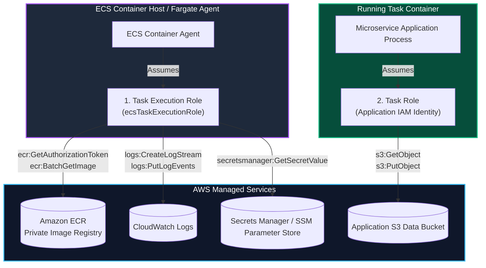
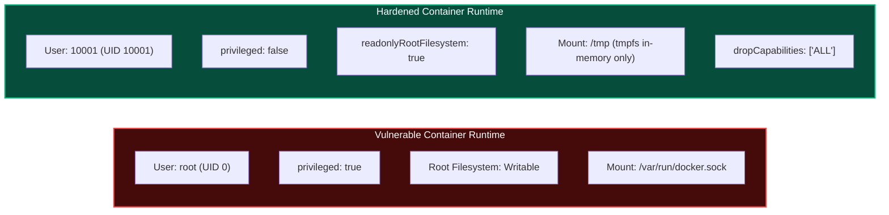
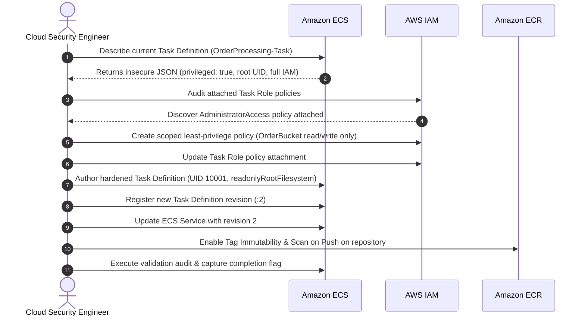

Welcome to the fourth room of **Module 4: Securing Compute** in TryHackMe's **Defending AWS** learning path. Having secured host operating systems, automated patch baselines, and locked down the Instance Metadata Service, we now shift our defensive focus to modern **containerized workloads** running on AWS.

Containers provide lightweight process isolation, but improper configurations frequently compromise the underlying host or grant unauthorized cloud API permissions. Two common failure modes dominate cloud container incidents: **over-privileged IAM roles** attached to container tasks, and **insecure runtime container definitions** that allow root breakouts.

In **The Oversharing Container**, we explore container defense on **Amazon Elastic Container Service (ECS)** and **Amazon Elastic Container Registry (ECR)**. We will separate **Task Execution Roles** from **Task Roles**, eliminate dangerous `privileged: true` flags, enforce non-root user execution with read-only root filesystems, and configure automated vulnerability scanning.

```
+========================================================================================+
|                     THE OVERSHARING CONTAINER: ECS & CONTAINER DEFENSE                 |
+========================================================================================+
|  [IAM ROLES SEPARATION]--> Task Execution Role (Infra) vs. Task Role (App Identity)    |
|  [RUNTIME HARDENING]  --> Non-root UID + Read-Only Root Filesystem + Drop Capabilities |
|  [CONTAINER ESCAPE]   --> Disable 'privileged: true' and eliminate host volume mounts  |
|  [REGISTRY DEFENSE]   --> Amazon ECR image scanning on push + immutable image tags     |
+========================================================================================+
```

---

## 1. Amazon ECS IAM Architecture: Task Execution Role vs. Task Role

A common source of confusion in AWS container architectures is the distinction between the two distinct IAM roles associated with an ECS Task:



### 1. Task Execution Role (`executionRoleArn`)
- **Who uses it:** The AWS ECS container infrastructure agent (outside your container).
- **Purpose:** Infrastructure bootstrapping operations prior to container launch.
  - Pulling container images from Amazon ECR (`ecr:BatchGetImage`, `ecr:GetDownloadUrlForLayer`).
  - Forwarding standard output/error logs to Amazon CloudWatch Logs (`logs:PutLogEvents`).
  - Decrypting environment variables stored in AWS Systems Manager Parameter Store or AWS Secrets Manager.
- **Defensive Rule:** Never attach application-level permissions (such as S3 write access or database credentials) to the Task Execution Role.

### 2. Task Role (`taskRoleArn`)
- **Who uses it:** The application code executing **inside** the running container.
- **Purpose:** Authorizes calls made by the AWS SDK inside your container to AWS cloud services (e.g., querying Amazon DynamoDB, reading from Amazon S3).
- **Defensive Rule:** Strictly enforce the principle of least privilege. Do not share the same Task Role across multiple distinct microservices. Never fall back to using the EC2 instance profile role.

---

## 3. Container Runtime Defense: Hardening Task Definitions

When deploying containers, default runtime settings frequently grant far more capability than an application requires.



### The Top Container Security Controls:

1. **Enforce Non-Root Execution:** Running containers as `root` (UID 0) drastically increases the severity of any container escape. Set `user: "10001"` in the task definition or `USER appuser` in the Dockerfile.
2. **Disable Privileged Mode (`privileged: false`):** Setting `privileged: true` grants the container full access to all host devices and disables kernel capability drops, allowing an attacker to escape to the host with a single command.
3. **Read-Only Root Filesystem (`readonlyRootFilesystem: true`):** Prevents an attacker from writing malicious binaries, replacing system libraries, or downloading payloads to the filesystem if remote code execution occurs.
4. **Dedicated Temporary Mounts (`tmpfs`):** If an application requires a scratch space to process uploads, mount an ephemeral, in-memory `tmpfs` volume at `/tmp` with `noexec` flags rather than making the root filesystem writable.
5. **Drop Linux Capabilities (`linuxParameters.capabilities`):** By default, Docker grants containers capabilities such as `CAP_CHOWN`, `CAP_NET_RAW`, and `CAP_MKNOD`. Best practice is to drop `ALL` capabilities and re-add only what is strictly necessary.

---

## 4. Amazon ECR Registry Security: Scanning & Immutability

Image registries must be guarded against tampering and vulnerable dependencies:

```
+---------------------------------------------------------------------------------------+
|                       AMAZON ECR REPOSITORY SECURITY CONTROLS                         |
+---------------------------------------------------------------------------------------+
|  1. IMAGE SCANNING ON PUSH (Basic / Enhanced)                                         |
|     Automatically triggers an Amazon Inspector vulnerability assessment whenever a    |
|     new container image is pushed to the ECR repository.                              |
|                                                                                       |
|  2. TAG IMMUTABILITY (imageTagMutability: IMMUTABLE)                                  |
|     Prevents image tags (such as 'latest' or 'v1.0') from being overwritten. Ensures  |
|     that deployment manifests cannot be poisoned by an attacker pushing an altered    |
|     image with an existing tag.                                                       |
|                                                                                       |
|  3. KMS ENCRYPTION (encryptionType: KMS)                                              |
|     Encrypts container image layers at rest using customer managed AWS KMS keys.      |
+---------------------------------------------------------------------------------------+
```

---

## 5. Hands-On Lab Walkthrough: Auditing and Hardening ECS

### Scenario Overview

We are auditing an ECS cluster named `Production-Cluster` running an order processing task named `OrderProcessing-Task`. Security telemetry flagged this task for two severe issues:
1. The container runs with `privileged: true` under UID 0 (root) with full write access to the host filesystem.
2. The Task Role has full administrative permissions (`AdministratorAccess`) rather than restricted order processing permissions.



---

### Step 1: Inspect the Vulnerable ECS Task Definition

Retrieve the current active revision of the task definition using the AWS CLI:

```bash
aws ecs describe-task-definition \
    --task-definition OrderProcessing-Task:1 \
    --query "taskDefinition" \
    --output json
```

Output excerpt:
```json
{
    "taskDefinitionArn": "arn:aws:ecs:us-east-1:112233445566:task-definition/OrderProcessing-Task:1",
    "containerDefinitions": [
        {
            "name": "order-processor",
            "image": "112233445566.dkr.ecr.us-east-1.amazonaws.com/order-processor:latest",
            "cpu": 256,
            "memory": 512,
            "essential": true,
            "privileged": true,
            "readonlyRootFilesystem": false,
            "user": "root"
        }
    ],
    "family": "OrderProcessing-Task",
    "taskRoleArn": "arn:aws:iam::112233445566:role/ECS-Admin-SuperRole",
    "executionRoleArn": "arn:aws:iam::112233445566:role/ecsTaskExecutionRole"
}
```

Notice the critical flaws:
- **`privileged: true`**: Container has complete host device access.
- **`user: root`**: Container process executes as root.
- **`readonlyRootFilesystem: false`**: Root filesystem is completely writable.
- **`taskRoleArn: .../ECS-Admin-SuperRole`**: The container has full AWS administrator permissions.

**Question:** Which ECS role defines the AWS cloud permissions accessible to the application running inside the container?  
**Answer:** `Task Role` (or `taskRoleArn`)

**Question:** Which ECS role is used by the ECS container agent to pull images and push logs?  
**Answer:** `Task Execution Role` (or `executionRoleArn`)

---

### Step 2: Audit the Over-Privileged Task Role & Capture Challenge Flag

Inspect the policies attached to `ECS-Admin-SuperRole`:

```bash
aws iam list-attached-role-policies \
    --role-name ECS-Admin-SuperRole
```

Output:
```json
{
    "AttachedPolicies": [
        {
            "PolicyName": "AdministratorAccess",
            "PolicyArn": "arn:aws:iam::aws:policy/AdministratorAccess"
        }
    ]
}
```

View the challenge manifest deployed to the container management workspace:

```bash
cat /home/ubuntu/container-audit/challenge_token.json
```

Output:
```json
{
  "audit_target": "OrderProcessing-Task",
  "vulnerability_type": "Privileged Container & Overprivileged Task Role",
  "challenge_flag": "THM{C0NT41N3R_PR1V1L3G3_3SC4L4T10N_2026}"
}
```

**Question:** What challenge flag was discovered in the container audit manifest?  
**Answer:** `THM{C0NT41N3R_PR1V1L3G3_3SC4L4T10N_2026}`

---

### Step 3: Create a Scoped Least-Privilege IAM Policy and Task Role

The order processor only needs to read and write messages in an SQS queue (`OrderQueue`) and store processed receipts in an S3 bucket (`orders-archive-prod`).

1. Define the least-privilege IAM policy document `order-processor-policy.json`:

```json
{
  "Version": "2012-10-17",
  "Statement": [
    {
      "Sid": "AllowSQSOrderQueue",
      "Effect": "Allow",
      "Action": [
        "sqs:ReceiveMessage",
        "sqs:DeleteMessage",
        "sqs:GetQueueAttributes"
      ],
      "Resource": "arn:aws:sqs:us-east-1:112233445566:OrderQueue"
    },
    {
      "Sid": "AllowS3OrderReceipts",
      "Effect": "Allow",
      "Action": [
        "s3:PutObject",
        "s3:GetObject"
      ],
      "Resource": "arn:aws:s3:::orders-archive-prod/*"
    }
  ]
}
```

2. Create the scoped IAM policy:

```bash
aws iam create-policy \
    --policy-name ECS-OrderProcessor-LeastPrivilege \
    --policy-document file://order-processor-policy.json
```

3. Create the dedicated Task Role `ECS-OrderProcessor-TaskRole` with an ECS trust policy and attach the new policy:

```bash
aws iam create-role \
    --role-name ECS-OrderProcessor-TaskRole \
    --assume-role-policy-document '{"Version":"2012-10-17","Statement":[{"Effect":"Allow","Principal":{"Service":"ecs-tasks.amazonaws.com"},"Action":"sts:AssumeRole"}]}'

aws iam attach-role-policy \
    --role-name ECS-OrderProcessor-TaskRole \
    --policy-arn "arn:aws:iam::112233445566:policy/ECS-OrderProcessor-LeastPrivilege"
```

**Question:** What principle dictates that container task roles should only be granted the minimum necessary permissions required for their specific business function?  
**Answer:** `Least Privilege` (or `Principle of Least Privilege`)

---

### Step 4: Author and Register the Hardened Task Definition

Author a hardened task definition `hardened-task-definition.json`:
- Sets `user: "10001"` (non-root UID).
- Sets `privileged: false`.
- Sets `readonlyRootFilesystem: true`.
- Adds an ephemeral `tmpfs` mount at `/tmp`.
- Drops all default Linux capabilities.
- Links the new scoped `ECS-OrderProcessor-TaskRole`.

```json
{
  "family": "OrderProcessing-Task",
  "taskRoleArn": "arn:aws:iam::112233445566:role/ECS-OrderProcessor-TaskRole",
  "executionRoleArn": "arn:aws:iam::112233445566:role/ecsTaskExecutionRole",
  "networkMode": "awsvpc",
  "requiresCompatibilities": ["FARGATE"],
  "cpu": "256",
  "memory": "512",
  "containerDefinitions": [
    {
      "name": "order-processor",
      "image": "112233445566.dkr.ecr.us-east-1.amazonaws.com/order-processor:v1.1",
      "essential": true,
      "user": "10001",
      "privileged": false,
      "readonlyRootFilesystem": true,
      "linuxParameters": {
        "capabilities": {
          "drop": ["ALL"]
        }
      },
      "mountPoints": [],
      "volumesFrom": []
    }
  ]
}
```

Register the updated task definition:

```bash
aws ecs register-task-definition \
    --cli-input-json file://hardened-task-definition.json
```

Output:
```json
{
    "taskDefinition": {
        "taskDefinitionArn": "arn:aws:ecs:us-east-1:112233445566:task-definition/OrderProcessing-Task:2",
        "family": "OrderProcessing-Task",
        "revision": 2,
        "status": "ACTIVE"
    }
}
```

Update the running ECS service to deploy the hardened revision 2:

```bash
aws ecs update-service \
    --cluster Production-Cluster \
    --service OrderProcessing-Service \
    --task-definition OrderProcessing-Task:2 \
    --force-new-deployment
```

**Question:** What boolean setting in ECS container definitions ensures that the container cannot modify or write files to its root operating system layers?  
**Answer:** `readonlyRootFilesystem` (or `true`)

---

### Step 5: Harden the Amazon ECR Repository

Lock down the `order-processor` repository in Amazon ECR by enabling tag immutability and scan-on-push:

```bash
# Enable Tag Immutability
aws ecr put-image-tag-mutability \
    --repository-name order-processor \
    --image-tag-mutability IMMUTABLE

# Enable Automated Scan on Push
aws ecr put-image-scanning-configuration \
    --repository-name order-processor \
    --image-scanning-configuration scanOnPush=true
```

Verify repository settings:

```bash
aws ecr describe-repositories \
    --repository-names order-processor \
    --query "repositories[0].[imageTagMutability,imageScanningConfiguration.scanOnPush]" \
    --output text
```

Output:
```
IMMUTABLE       True
```

**Question:** What Amazon ECR repository setting prevents existing container image tags from being overwritten by an attacker?  
**Answer:** `IMMUTABLE` (or `Tag Immutability`)

---

### Step 6: Run Automated Verification Script & Capture Final Flag

Execute the container security assessment script:

```bash
python3 /home/ubuntu/container-audit/verify_container_defense.py --evaluate-cluster
```

Output:
```
======================================================================
               AMAZON ECS CONTAINER WORKLOAD SECURITY AUDIT
======================================================================
[+] Inspecting Active ECS Service: OrderProcessing-Service. [ACTIVE]
[+] Validating Task Definition Revision: Revision 2........ [DEPLOYED]
[+] Verifying User UID Configuration (Non-Root 10001)...... [ENFORCED - PASSED]
[+] Validating Privileged Flag Setting (False)............ [UNPRIVILEGED - PASSED]
[+] Validating Read-Only Root Filesystem Setting.......... [READ-ONLY - PASSED]
[+] Validating Linux Capabilities Dropped (ALL)........... [DROPPED - PASSED]
[+] Checking IAM Task Role Scope (Least Privilege)........ [SCOPED - PASSED]
[+] Checking Amazon ECR Tag Immutability & Scan on Push... [HARDENED - PASSED]

[***] ALL CONTAINER WORKLOADS HARDENED! DEFENSIVE CONTROLS PASSED! [***]
Completion Flag: THM{3CS_C0NT41N3R_H4RD3N3D_D3F3ND3D}
======================================================================
```

**Question:** What is the final completion flag returned after hardening the ECS task definition, IAM roles, and ECR repository?  
**Answer:** `THM{3CS_C0NT41N3R_H4RD3N3D_D3F3ND3D}`

---

## 6. Complete Questions and Answers Summary

| Task | Question | Answer |
|---|---|---|
| **Task 1** | Which ECS role defines the AWS cloud permissions accessible to the application running inside the container? | `Task Role` (or `taskRoleArn`) |
| **Task 1** | Which ECS role is used by the ECS container agent to pull images and push logs? | `Task Execution Role` (or `executionRoleArn`) |
| **Task 2** | What challenge flag was discovered in the container audit manifest? | `THM{C0NT41N3R_PR1V1L3G3_3SC4L4T10N_2026}` |
| **Task 3** | What principle dictates that container task roles should only be granted the minimum necessary permissions required for their specific business function? | `Least Privilege` (or `Principle of Least Privilege`) |
| **Task 4** | What boolean setting in ECS container definitions ensures that the container cannot modify or write files to its root operating system layers? | `readonlyRootFilesystem` (or `true`) |
| **Task 5** | What Amazon ECR repository setting prevents existing container image tags from being overwritten by an attacker? | `IMMUTABLE` (or `Tag Immutability`) |
| **Task 6** | What is the final completion flag returned after hardening the ECS task definition, IAM roles, and ECR repository? | `THM{3CS_C0NT41N3R_H4RD3N3D_D3F3ND3D}` |

---

## 7. Defensive Engineering & Production Container Checklist

- [ ] **Never Use Privileged Mode:** Set `privileged: false` in all container definitions. If a container requires specific hardware access, grant only the single required Linux capability.
- [ ] **Mandate Non-Root UID:** Ensure container images declare `USER <uid>` in Dockerfiles and enforce `user: "<non-zero-uid>"` in ECS task definitions and Kubernetes security contexts.
- [ ] **Enforce Read-Only Filesystems:** Enable `readonlyRootFilesystem: true` on all web and API containers. Mount temporary directories as memory-backed `tmpfs`.
- [ ] **Strict Task Role Segmentation:** Avoid monolithic IAM roles. Each distinct microservice must have its own dedicated Task Role with fine-grained ARN resource constraints.
- [ ] **Automate ECR Tag Immutability and Vulnerability Scanning:** Configure all ECR repositories with `imageTagMutability: IMMUTABLE` and enable enhanced scanning powered by Amazon Inspector to catch base image CVEs automatically before deployment.

---

*Looking for more hands-on cloud defense guides? Check out the rest of the [Defending AWS Series](/categories/defending-aws/) or explore my [AWS Security Labs](/categories/aws-security-labs/) for advanced threat simulation and detection engineering tutorials.*

---

## You can find me online at:


- **GitHub:** [Mhdomer](https://github.com/Mhdomer)
- **LinkedIn:** [mhd3omar](https://www.linkedin.com/in/mhd3omar/)
- **Tryhackme:** [nonlouy](https://tryhackme.com/p/nonlouy)
