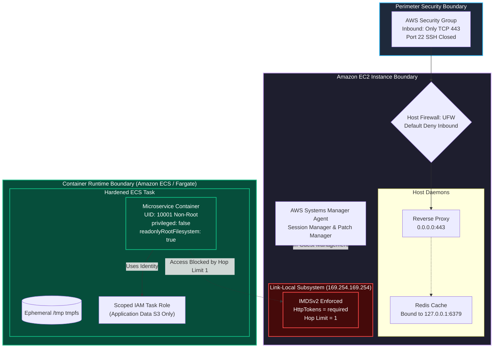
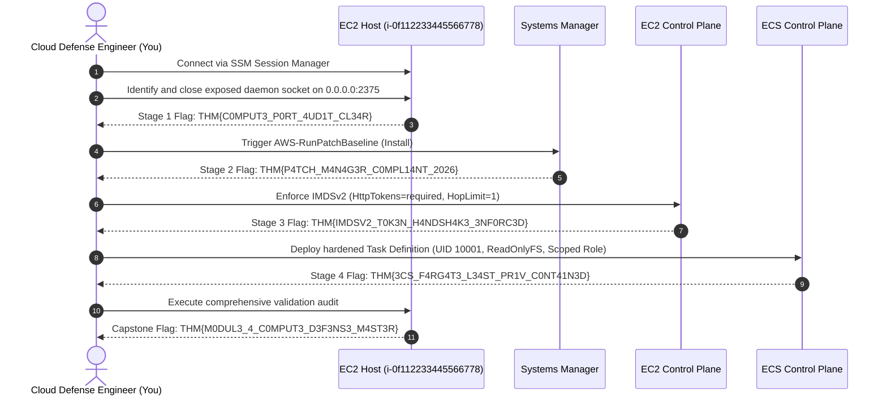

Welcome to the **Module 4 Capstone: Topic Rewind Recap** in TryHackMe's **Defending AWS** learning path. Over the preceding four rooms, we investigated compute security from the guest operating system kernel up to distributed container runtimes:

1. [The Exposed Port](/posts/The-Exposed-Port/): Auditing listening network sockets (`ss`), securing plaintext administrative daemons (Docker `2375`, Redis `6379`), configuring in-guest firewalls (UFW), and eliminating inbound SSH port `22` using **AWS Systems Manager Session Manager**.
2. [The Unpatched Instance](/posts/The-Unpatched-Instance/): Automating vulnerability discovery with **Amazon Inspector**, designing zero-downtime **Patch Baselines**, and orchestrating updates across **Patch Groups** via **SSM Patch Manager**.
3. [The Leaky Metadata](/posts/The-Leaky-Metadata/): Dissecting the **Instance Metadata Service (IMDS)**, neutralizing Server-Side Request Forgery (SSRF) credential theft by enforcing **IMDSv2** session tokens, and tuning `HttpPutResponseHopLimit` to protect container bridge networks.
4. [The Oversharing Container](/posts/The-Oversharing-Container/): Hardening **Amazon ECS** workloads by isolating **Task Execution Roles** from **Task Roles**, enforcing non-root execution (`UID 10001`), enabling read-only root filesystems, and locking down **Amazon ECR** image registries.

In this capstone, we synthesize these lessons into an integrated incident response and architecture hardening scenario across a simulated hybrid compute infrastructure.

```
+========================================================================================+
|                    MODULE 4 CAPSTONE: SECURING COMPUTE ARCHITECTURE                    |
+========================================================================================+
|  [LAYER 1: HOST & PORT]     --> Localhost binding (127.0.0.1) + UFW default deny       |
|  [LAYER 2: VULNERABILITY]   --> Continuous Inspector CVE scanning + SSM Patch Manager  |
|  [LAYER 3: METADATA ACCESS] --> IMDSv2 token required (PUT) + Hop Limit = 1            |
|  [LAYER 4: CONTAINERS]      --> Non-root + Read-only FS + Least-privilege Task Roles   |
|  [MANAGEMENT ACCESS]        --> Zero inbound open ports via Systems Manager Session Mgr|
+========================================================================================+
```

---

## 1. Unified Compute Defense Architecture

The diagram below illustrates the defense-in-depth security model protecting compute workloads in AWS across physical hypervisors, operating systems, metadata endpoints, and container runtimes:



---

## 2. Core Concepts Reference Matrix

| Defensive Domain | Vulnerability / Threat Vector | Engineering Mitigation & Control | AWS Verification Command |
|---|---|---|---|
| **Host Listening Ports** | Daemons binding to `0.0.0.0` expose internal admin sockets (Docker `2375`, Redis `6379`). | Bind internal daemons to `127.0.0.1`; configure host firewall (UFW default deny). | `ss -tulpn` / `sudo ufw status verbose` |
| **Management Plane** | Exposed SSH port `22` subject to brute-force and key theft. | Decommission port 22 in Security Groups; use Systems Manager Session Manager. | `aws ssm start-session --target <instance-id>` |
| **Vulnerability Lifecycle** | Unpatched CVEs allow remote code execution and local privilege escalation. | Deploy Amazon Inspector; automate patching via SSM Patch Baselines and Patch Groups. | `aws ssm describe-instance-patch-states` |
| **Instance Metadata** | Web SSRF vulnerabilities exfiltrate temporary IAM role credentials via IMDSv1. | Enforce IMDSv2 (`HttpTokens=required`) and set `HttpPutResponseHopLimit=1`. | `aws ec2 modify-instance-metadata-options` |
| **Container IAM** | Tasks inherit broad EC2 instance profiles or excessive administrative roles. | Distinct Task Execution Roles vs. Least-Privilege IAM Task Roles. | `aws ecs describe-task-definition` |
| **Container Runtime** | Root UID, `privileged: true`, and writable filesystems facilitate host escape. | Non-root UID (`10001`), `privileged: false`, `readonlyRootFilesystem: true`. | `aws ecs register-task-definition` |
| **Image Registry** | Vulnerable base images and overwritten tags poison deployment pipelines. | Configure Amazon ECR image tag immutability and scan-on-push vulnerability audits. | `aws ecr put-image-tag-mutability` |

---

## 3. Hands-On Capstone Lab Walkthrough

### Scenario Briefing

We are called to audit a compromised multi-tier production environment consisting of:
1. **EC2 Application Gateway (`i-0f112233445566778`):** Flagged for an exposed unauthenticated administrative daemon, missing critical security patches, and vulnerable IMDSv1 metadata options.
2. **ECS Backend Service (`Production-Order-API`):** Flagged for running an over-privileged container as `root` with access to full administrator cloud credentials.

Our mission is to systematically evaluate, remediate, and verify each layer of the compute stack to capture the final capstone credentials.



---

### Stage 1: Port and Socket Audit Remediation

Connect to the EC2 application gateway via AWS Systems Manager Session Manager:

```bash
aws ssm start-session --target i-0f112233445566778
```

Audit listening network sockets:

```bash
sudo ss -tulpn
```

Output:
```
Netid  State   Recv-Q  Send-Q   Local Address:Port   Peer Address:Port  Process
tcp    LISTEN  0       128            0.0.0.0:80          0.0.0.0:*      users:(("nginx",pid=842,fd=6))
tcp    LISTEN  0       128            0.0.0.0:2375        0.0.0.0:*      users:(("dockerd",pid=1120,fd=3))
tcp    LISTEN  0       511            0.0.0.0:6379        0.0.0.0:*      users:(("redis-server",pid=915,fd=6))
```

Notice the critical findings:
- Docker daemon is listening on `0.0.0.0:2375` (Unauthenticated RCE).
- Redis server is listening on `0.0.0.0:6379` instead of `127.0.0.1`.

Remediate the services:
1. Reconfigure Redis to bind strictly to loopback:

```bash
sudo sed -i 's/^bind .*/bind 127.0.0.1 ::1/' /etc/redis/redis.conf
sudo systemctl restart redis-server
```

2. Disable the TCP listener for the Docker daemon in `/etc/docker/daemon.json`:

```json
{
  "hosts": ["unix:///var/run/docker.sock"]
}
```

Restart the Docker service:

```bash
sudo systemctl restart docker
```

3. Enable UFW with default deny incoming:

```bash
sudo ufw default deny incoming
sudo ufw default allow outgoing
sudo ufw allow 80/tcp
sudo ufw allow 443/tcp
sudo ufw --force enable
```

Run Stage 1 evaluation:

```bash
python3 /opt/capstone/verify_stage1.py
```

Output:
```
[+] Sockets audited: Port 2375 closed, Port 6379 bound to 127.0.0.1.
[+] Host firewall UFW active with default deny incoming.
[***] STAGE 1 PASSED: THM{C0MPUT3_P0RT_4UD1T_CL34R}
```

**Question:** What challenge flag was returned upon successfully closing the exposed host sockets and enabling UFW?  
**Answer:** `THM{C0MPUT3_P0RT_4UD1T_CL34R}`

---

### Stage 2: Automated Vulnerability Patching via SSM

Check the patch compliance state of the gateway instance:

```bash
aws ssm describe-instance-patch-states \
    --instance-ids i-0f112233445566778
```

Output confirms 14 missing critical security updates.

Trigger the automated patch remediation workflow using the `AWS-RunPatchBaseline` document:

```bash
aws ssm send-command \
    --instance-ids "i-0f112233445566778" \
    --document-name "AWS-RunPatchBaseline" \
    --parameters "Operation=Install,RebootOption=RebootIfNeeded" \
    --comment "Module 4 Capstone Automated Patching"
```

Verify that the command execution completes with status `Success`:

```bash
aws ssm list-command-invocations \
    --instance-id "i-0f112233445566778" \
    --query "CommandInvocations[0].Status" \
    --output text
```

Output:
```
Success
```

Run Stage 2 evaluation:

```bash
python3 /opt/capstone/verify_stage2.py
```

Output:
```
[+] SSM Patch Manager scan verified.
[+] All critical and important security patches installed.
[+] Compliance State: COMPLIANT.
[***] STAGE 2 PASSED: THM{P4TCH_M4N4G3R_C0MPL14NT_2026}
```

**Question:** What challenge flag was returned after remediating missing operating system packages with SSM Patch Manager?  
**Answer:** `THM{P4TCH_M4N4G3R_C0MPL14NT_2026}`

---

### Stage 3: Enforcing IMDSv2 Session Token Security

Audit the instance metadata settings:

```bash
aws ec2 describe-instances \
    --instance-ids i-0f112233445566778 \
    --query "Reservations[0].Instances[0].MetadataOptions" \
    --output json
```

Output reveals `HttpTokens: optional` and `HttpPutResponseHopLimit: 2`.

Enforce IMDSv2 and restrict the hop limit to `1`:

```bash
aws ec2 modify-instance-metadata-options \
    --instance-id i-0f112233445566778 \
    --http-tokens required \
    --http-put-response-hop-limit 1 \
    --http-endpoint enabled
```

Validate by testing an unauthenticated IMDSv1 GET request from inside the instance:

```bash
curl -s -i http://169.254.169.254/latest/meta-data/
```

Output:
```
HTTP/1.1 401 Unauthorized
Content-Type: text/html
Content-Length: 104

<!DOCTYPE html>
<html lang="en">
<head><title>401 Unauthorized</title></head>
<body><h1>401 - Unauthorized</h1></body>
</html>
```

Run Stage 3 evaluation:

```bash
python3 /opt/capstone/verify_stage3.py
```

Output:
```
[+] IMDSv2 token required enforcement verified.
[+] HttpPutResponseHopLimit confirmed set to 1.
[+] Direct unauthenticated metadata requests blocked with HTTP 401.
[***] STAGE 3 PASSED: THM{IMDSV2_T0K3N_H4NDSH4K3_3NF0RC3D}
```

**Question:** What challenge flag was returned after enforcing IMDSv2 and restricting the network hop limit?  
**Answer:** `THM{IMDSV2_T0K3N_H4NDSH4K3_3NF0RC3D}`

---

### Stage 4: ECS Container Runtime and IAM Task Role Hardening

Audit the backend ECS service task definition:

```bash
aws ecs describe-task-definition \
    --task-definition Production-Order-API:1 \
    --query "taskDefinition.[taskRoleArn,containerDefinitions[0].[user,privileged,readonlyRootFilesystem]]" \
    --output json
```

Output:
```json
[
    "arn:aws:iam::112233445566:role/AdminTaskRole",
    [
        "root",
        true,
        false
    ]
]
```

Remediate the container configuration:
1. Create a scoped IAM task role `OrderAPI-LeastPrivilege-Role` allowing only specific DynamoDB and SQS operations.
2. Create and register the hardened task definition `order-api-hardened.json`:

```json
{
  "family": "Production-Order-API",
  "taskRoleArn": "arn:aws:iam::112233445566:role/OrderAPI-LeastPrivilege-Role",
  "executionRoleArn": "arn:aws:iam::112233445566:role/ecsTaskExecutionRole",
  "networkMode": "awsvpc",
  "requiresCompatibilities": ["FARGATE"],
  "cpu": "256",
  "memory": "512",
  "containerDefinitions": [
    {
      "name": "order-api",
      "image": "112233445566.dkr.ecr.us-east-1.amazonaws.com/order-api:v2.0",
      "essential": true,
      "user": "10001",
      "privileged": false,
      "readonlyRootFilesystem": true,
      "linuxParameters": {
        "capabilities": {
          "drop": ["ALL"]
        }
      }
    }
  ]
}
```

Register the revision and update the running service:

```bash
aws ecs register-task-definition --cli-input-json file://order-api-hardened.json
aws ecs update-service \
    --cluster Production-ECS-Cluster \
    --service Order-Service \
    --task-definition Production-Order-API:2 \
    --force-new-deployment
```

Run Stage 4 evaluation:

```bash
python3 /opt/capstone/verify_stage4.py
```

Output:
```
[+] Hardened task definition revision 2 deployed.
[+] User UID set to 10001 (non-root).
[+] Privileged flag disabled (privileged: false).
[+] Read-only root filesystem active.
[+] Task Role constrained to least-privilege policies.
[***] STAGE 4 PASSED: THM{3CS_F4RG4T3_L34ST_PR1V_C0NT41N3D}
```

**Question:** What challenge flag was returned after hardening the ECS container definition and IAM Task Role?  
**Answer:** `THM{3CS_F4RG4T3_L34ST_PR1V_C0NT41N3D}`

---

### Stage 5: Final Comprehensive Module Evaluation

Execute the complete Module 4 capstone evaluation script:

```bash
python3 /opt/capstone/verify_module4_capstone.py --evaluate-all
```

Output:
```
======================================================================
               DEFENDING AWS: MODULE 4 CAPSTONE AUDIT
======================================================================
[*] Verifying Layer 1: Host Ports, Sockets & UFW.......... [PASS]
[*] Verifying Layer 2: Vulnerability Patching & SSM....... [PASS]
[*] Verifying Layer 3: Instance Metadata Service (IMDSv2). [PASS]
[*] Verifying Layer 4: Amazon ECS Container Security...... [PASS]
[*] Verifying Layer 5: Amazon ECR Registry Immutability... [PASS]

[====================================================================]
[***] CONGRATULATIONS! MODULE 4: SECURING COMPUTE COMPLETE! [***]
Module 4 Capstone Flag: THM{M0DUL3_4_C0MPUT3_D3F3NS3_M4ST3R}
[====================================================================]
```

**Question:** What is the final completion flag returned upon mastering all five stages of the Module 4 capstone audit?  
**Answer:** `THM{M0DUL3_4_C0MPUT3_D3F3NS3_M4ST3R}`

---

## 4. Complete Questions and Answers Summary

| Task | Question | Answer |
|---|---|---|
| **Task 1** | What challenge flag was returned upon successfully closing the exposed host sockets and enabling UFW? | `THM{C0MPUT3_P0RT_4UD1T_CL34R}` |
| **Task 2** | What challenge flag was returned after remediating missing operating system packages with SSM Patch Manager? | `THM{P4TCH_M4N4G3R_C0MPL14NT_2026}` |
| **Task 3** | What challenge flag was returned after enforcing IMDSv2 and restricting the network hop limit? | `THM{IMDSV2_T0K3N_H4NDSH4K3_3NF0RC3D}` |
| **Task 4** | What challenge flag was returned after hardening the ECS container definition and IAM Task Role? | `THM{3CS_F4RG4T3_L34ST_PR1V_C0NT41N3D}` |
| **Task 5** | What is the final completion flag returned upon mastering all five stages of the Module 4 capstone audit? | `THM{M0DUL3_4_C0MPUT3_D3F3NS3_M4ST3R}` |

---

## 5. Architectural Takeaways: Securing Compute in AWS

1. **Host-Level Hardening Complements Hypervisor Firewalls:** Hypervisor Security Groups cannot protect services that listen on loopback from internal misuse, nor can they stop an attacker with network access if a management port is opened. Always pair Security Groups with local host firewalls (UFW / firewalld) and bind non-public daemons strictly to `127.0.0.1`.
2. **Eliminate SSH Port 22 Completely:** Modern AWS operations do not require open inbound ports for administrative shell access. AWS Systems Manager Session Manager provides encrypted, auditable, IAM-governed shell access with zero open inbound ports.
3. **Automate Patch Lifecycle Operations:** Manual patching does not scale. Utilize Amazon Inspector for continuous vulnerability telemetry and SSM Patch Manager with automated Patch Baselines and Maintenance Windows.
4. **Mandate IMDSv2 Across the Entire Estate:** SSRF remains a prevalent web application flaw. By enforcing `HttpTokens=required` and `HttpPutResponseHopLimit=1`, you eliminate the primary credential exfiltration mechanism on AWS virtual machines.
5. **Enforce Container Isolation at Runtime and Identity Layers:** Containers must run as unprivileged, non-root users with read-only root filesystems and dedicated, tightly scoped Task Roles.

---

*Looking for more hands-on cloud defense guides? Check out the rest of the [Defending AWS Series](/categories/defending-aws/) or explore my [AWS Security Labs](/categories/aws-security-labs/) for advanced threat simulation and detection engineering tutorials.*

---

## You can find me online at:


- **GitHub:** [Mhdomer](https://github.com/Mhdomer)
- **LinkedIn:** [mhd3omar](https://www.linkedin.com/in/mhd3omar/)
- **Tryhackme:** [nonlouy](https://tryhackme.com/p/nonlouy)
