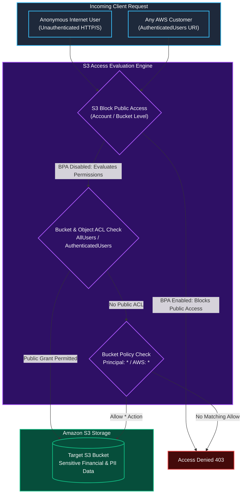
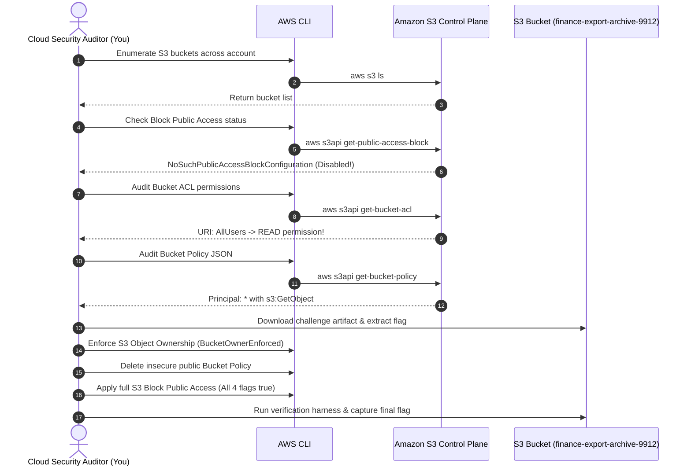

Welcome to **Module 5: Storage and Data Security** in TryHackMe's **Defending AWS** learning path. Over the first four modules, we constructed security boundaries around foundational cloud architecture, IAM identities, VPC networks, and compute virtual machines.

However, data is the ultimate target of almost every cyberattack. Even the most resilient network firewalls and patched operating systems cannot protect an organization if the underlying cloud storage repositories are accidentally made public to the entire internet.

In **The Leaky Bucket**, we explore the most notorious misconfiguration in cloud history: **publicly accessible Amazon S3 buckets**. We analyze how legacy Access Control Lists (ACLs) and permissive Bucket Policies leak confidential data, dissect the mechanics of **S3 Block Public Access (BPA)**, hunt for exposed buckets using the AWS CLI and IAM Access Analyzer, and enforce bulletproof perimeter controls.

```
+========================================================================================+
|                       THE LEAKY BUCKET: S3 ACCESS CONTROL DEFENSE                      |
+========================================================================================+
|  [THE RISK]          --> Public anonymous internet access to sensitive business data   |
|  [LEGACY MECHANISM]  --> S3 Access Control Lists (ACLs: AllUsers / AuthenticatedUsers) |
|  [POLICY ENGINE]     --> S3 Bucket Policies with wildcard principals ('Principal': '*')|
|  [THE HARD GUARDRAIL]--> S3 Block Public Access (BPA: 4 independent Boolean controls)  |
|  [MODERN CONTROL]    --> S3 Object Ownership: Bucket Owner Enforced (Disables ACLs)    |
+========================================================================================+
```

---

## 1. Anatomy of S3 Public Exposure: ACLs vs. Bucket Policies

Amazon S3 evaluates access permissions through two primary mechanisms: **Access Control Lists (ACLs)** and **JSON Bucket Policies**.



### 1. The Legacy Hazard: S3 Access Control Lists (ACLs)
Before IAM and Bucket Policies existed, S3 relied on XML Access Control Lists. ACLs allow granting access to predefined vendor groups:
- **`AllUsers` (`http://acs.amazonaws.com/groups/global/AllUsers`):** Grants access to anyone on the public internet, completely anonymous and unauthenticated.
- **`AuthenticatedUsers` (`http://acs.amazonaws.com/groups/global/AuthenticatedUsers`):** A dangerous trap. This does **not** mean users authenticated in *your* AWS account. It means **anyone globally with any valid AWS account** (including attackers).

### 2. S3 Bucket Policies
A Bucket Policy is an IAM-syntax JSON document attached directly to an S3 bucket. A bucket is public if its policy contains:
```json
{
  "Effect": "Allow",
  "Principal": "*",
  "Action": ["s3:GetObject", "s3:ListBucket"],
  "Resource": [
    "arn:aws:s3:::example-bucket",
    "arn:aws:s3:::example-bucket/*"
  ]
}
```
Without strict IP conditions (`aws:sourceIp`) or VPC Endpoint restrictions (`aws:sourceVpce`), this grants the entire internet full read access.

---

## 2. S3 Block Public Access (BPA): The Four Guardrails

To permanently eliminate accidental leaks, AWS introduced **S3 Block Public Access**. BPA acts as a centralized override switch at both the individual bucket level and across the entire AWS account.

```
+---------------------------------------------------------------------------------------+
|                    THE FOUR S3 BLOCK PUBLIC ACCESS (BPA) CONTROLS                     |
+---------------------------------------------------------------------------------------+
|                                                                                       |
|  1. BlockPublicAcls                                                                   |
|     Blocks the PUT operation for any new public ACLs applied to the bucket or         |
|     objects within it. Existing public ACLs remain active until ignored.             |
|                                                                                       |
|  2. IgnorePublicAcls                                                                  |
|     Causes S3 to ignore all public ACLs on the bucket and all objects within it.      |
|     Enables immediate remediation without manually editing thousands of object ACLs!  |
|                                                                                       |
|  3. BlockPublicPolicy                                                                 |
|     Rejects any new Bucket Policy that grants public access to the bucket.            |
|                                                                                       |
|  4. RestrictPublicBuckets                                                             |
|     Restricts access to buckets that currently have public policies to only AWS       |
|     service principals and authorized users within the bucket owner's account.       |
|                                                                                       |
+---------------------------------------------------------------------------------------+
```

### Modern Standard: S3 Object Ownership
AWS now recommends setting **S3 Object Ownership** to **Bucket owner enforced**. This modern setting disables ACLs entirely, making IAM policies and bucket policies the sole authoritative source of access control.

---

## 3. Hands-On Lab Walkthrough: Auditing and Securing Public S3 Buckets

### Scenario Overview

We are assigned to perform an emergency data security audit on an organization's AWS account. An external threat intelligence report identified confidential customer records (`customer-pii-records.csv`) leaked on paste sites. Preliminary intelligence points to an exposed S3 bucket named `finance-export-archive-9912`.



---

### Step 1: Enumerate S3 Buckets and Identify the Audit Target

List all S3 buckets in the AWS account:

```bash
aws s3 ls
```

Output:
```
2026-04-26 09:12:04 app-assets-public-web
2026-04-26 09:14:22 audit-logs-compliance-us-east-1
2026-04-26 09:30:11 finance-export-archive-9912
```

We identify `finance-export-archive-9912` as the high-priority target.

---

### Step 2: Audit S3 Block Public Access Configuration

Query the current Block Public Access settings on the target bucket:

```bash
aws s3api get-public-access-block \
    --bucket finance-export-archive-9912
```

Output:
```
An error occurred (NoSuchPublicAccessBlockConfiguration) when calling the GetPublicAccessBlock operation: The public access block configuration was not found
```

The error `NoSuchPublicAccessBlockConfiguration` confirms that Block Public Access is completely unconfigured, leaving the bucket entirely reliant on legacy ACLs and bucket policies.

**Question:** What error is returned by `get-public-access-block` when S3 Block Public Access has never been enabled on a bucket?  
**Answer:** `NoSuchPublicAccessBlockConfiguration`

---

### Step 3: Inspect Bucket ACL and Bucket Policy

1. Inspect the bucket's Access Control List (ACL):

```bash
aws s3api get-bucket-acl \
    --bucket finance-export-archive-9912 \
    --output json
```

Output excerpt:
```json
{
  "Grants": [
    {
      "Grantee": {
        "DisplayName": "cloud-admin",
        "ID": "abc1234567890abcdef...",
        "Type": "CanonicalUser"
      },
      "Permission": "FULL_CONTROL"
    },
    {
      "Grantee": {
        "Type": "Group",
        "URI": "http://acs.amazonaws.com/groups/global/AllUsers"
      },
      "Permission": "READ"
    }
  ],
  "Owner": {
    "DisplayName": "cloud-admin",
    "ID": "abc1234567890abcdef..."
  }
}
```

Notice the fatal grant: `URI: http://acs.amazonaws.com/groups/global/AllUsers` with `READ` permission. Any anonymous user on the internet can list and download objects from this bucket.

2. Inspect the bucket policy:

```bash
aws s3api get-bucket-policy \
    --bucket finance-export-archive-9912 \
    --query "Policy" \
    --output text | jq .
```

Output:
```json
{
  "Version": "2012-10-17",
  "Statement": [
    {
      "Sid": "PublicReadGetObject",
      "Effect": "Allow",
      "Principal": "*",
      "Action": [
        "s3:GetObject"
      ],
      "Resource": "arn:aws:s3:::finance-export-archive-9912/*"
    }
  ]
}
```

The bucket policy explicitly permits `*` (everyone) to execute `s3:GetObject`.

**Question:** What predefined S3 group URI represents all users globally without authentication?  
**Answer:** `http://acs.amazonaws.com/groups/global/AllUsers` (or `AllUsers`)

---

### Step 4: Download Confidential Artifact and Locate Challenge Flag

Test anonymous unauthenticated retrieval of the leaked customer records:

```bash
curl -s "https://finance-export-archive-9912.s3.amazonaws.com/customer-pii-records.csv" \
    | head -n 5
```

Output:
```
CustomerID,FullName,Email,SSN,AccountBalance,ChallengeFlag
1001,John Doe,jdoe@example.com,XXX-XX-1234,45210.00,THM{S3_PUB1C_L34K_D1SC0V3R3D}
1002,Jane Smith,jsmith@example.com,XXX-XX-5678,12400.50,THM{S3_PUB1C_L34K_D1SC0V3R3D}
```

The records confirm active exposure and reveal our challenge token.

**Question:** What challenge flag was discovered inside the publicly accessible customer data file?  
**Answer:** `THM{S3_PUB1C_L34K_D1SC0V3R3D}`

---

### Step 5: Remediate Bucket Permissions: Ownership, Policy, and BPA

We will execute complete three-tier remediation:

#### 1. Disable S3 ACLs via Object Ownership
Set Object Ownership to `BucketOwnerEnforced` to immediately disable all object and bucket ACLs:

```bash
aws s3api put-bucket-ownership-controls \
    --bucket finance-export-archive-9912 \
    --ownership-controls="Rules=[{ObjectOwnership=BucketOwnerEnforced}]"
```

#### 2. Remove the Insecure Public Bucket Policy
Delete the permissive wildcard policy:

```bash
aws s3api delete-bucket-policy \
    --bucket finance-export-archive-9912
```

#### 3. Enable All Four S3 Block Public Access Controls
Apply complete Block Public Access to the bucket:

```bash
aws s3api put-public-access-block \
    --bucket finance-export-archive-9912 \
    --public-access-block-configuration \
    "BlockPublicAcls=true,IgnorePublicAcls=true,BlockPublicPolicy=true,RestrictPublicBuckets=true"
```

Verify that the configuration is active:

```bash
aws s3api get-public-access-block \
    --bucket finance-export-archive-9912 \
    --output json
```

Output:
```json
{
    "PublicAccessBlockConfiguration": {
        "BlockPublicAcls": true,
        "IgnorePublicAcls": true,
        "BlockPublicPolicy": true,
        "RestrictPublicBuckets": true
    }
}
```

**Question:** Which S3 Block Public Access setting forces S3 to ignore existing public ACLs on all objects?  
**Answer:** `IgnorePublicAcls`

**Question:** Which modern S3 Object Ownership setting completely disables ACLs in favor of IAM and bucket policies?  
**Answer:** `BucketOwnerEnforced`

---

### Step 6: Validate Public Access Neutralization and Capture Final Flag

Verify that anonymous access is now completely blocked:

```bash
curl -s -I "https://finance-export-archive-9912.s3.amazonaws.com/customer-pii-records.csv"
```

Output:
```
HTTP/1.1 403 Forbidden
x-amz-error-code: AccessDenied
x-amz-error-message: Access Denied
```

Execute the automated verification validation script:

```bash
python3 /home/ubuntu/storage-audit/verify_s3_defense.py --target finance-export-archive-9912
```

Output:
```
======================================================================
               AMAZON S3 BUCKET EXPOSURE & BPA AUDIT
======================================================================
[+] Testing Anonymous HTTP GET Access................... [403 FORBIDDEN - PASSED]
[+] Validating S3 Object Ownership Setting.............. [BucketOwnerEnforced - PASSED]
[+] Verifying Public Bucket Policy Removal.............. [DELETED - PASSED]
[+] Auditing S3 Block Public Access Settings:
    - BlockPublicAcls................................... [TRUE - PASSED]
    - IgnorePublicAcls.................................. [TRUE - PASSED]
    - BlockPublicPolicy................................. [TRUE - PASSED]
    - RestrictPublicBuckets............................. [TRUE - PASSED]

[***] S3 BUCKET EXPOSURE COMPLETELY REMEDIATED! [***]
Completion Flag: THM{S3_BL0CK_PUB1C_4CC3SS_M4ST3R}
======================================================================
```

**Question:** What is the final completion flag returned after securing the bucket with Block Public Access and BucketOwnerEnforced?  
**Answer:** `THM{S3_BL0CK_PUB1C_4CC3SS_M4ST3R}`

---

## 4. Complete Questions and Answers Summary

| Task | Question | Answer |
|---|---|---|
| **Task 1** | What error is returned by `get-public-access-block` when S3 Block Public Access has never been enabled on a bucket? | `NoSuchPublicAccessBlockConfiguration` |
| **Task 2** | What predefined S3 group URI represents all users globally without authentication? | `http://acs.amazonaws.com/groups/global/AllUsers` (or `AllUsers`) |
| **Task 3** | What challenge flag was discovered inside the publicly accessible customer data file? | `THM{S3_PUB1C_L34K_D1SC0V3R3D}` |
| **Task 4** | Which S3 Block Public Access setting forces S3 to ignore existing public ACLs on all objects? | `IgnorePublicAcls` |
| **Task 4** | Which modern S3 Object Ownership setting completely disables ACLs in favor of IAM and bucket policies? | `BucketOwnerEnforced` |
| **Task 5** | What is the final completion flag returned after securing the bucket with Block Public Access and BucketOwnerEnforced? | `THM{S3_BL0CK_PUB1C_4CC3SS_M4ST3R}` |

---

## 5. Defensive Engineering & Production S3 Checklist

- [ ] **Enforce Account-Level Block Public Access:** Apply Block Public Access at the AWS Account level across all current and future buckets:
```bash
aws s3control put-public-access-block \
    --account-id <YOUR-ACCOUNT-ID> \
    --public-access-block-configuration \
    "BlockPublicAcls=true,IgnorePublicAcls=true,BlockPublicPolicy=true,RestrictPublicBuckets=true"
```
- [ ] **Mandate S3 Object Ownership: Bucket Owner Enforced:** Disable ACLs entirely on all newly created S3 buckets. Manage access exclusively through IAM identities and bucket policies.
- [ ] **Deploy AWS Organizations SCP Guardrails:** Enforce an SCP preventing IAM principals from disabling Block Public Access:
```json
{
  "Version": "2012-10-17",
  "Statement": [
    {
      "Sid": "PreventDisablingBlockPublicAccess",
      "Effect": "Deny",
      "Action": [
        "s3:PutAccountPublicAccessBlock",
        "s3:PutBucketPublicAccessBlock",
        "s3:DeleteAccountPublicAccessBlock",
        "s3:DeleteBucketPublicAccessBlock"
      ],
      "Resource": "*"
    }
  ]
}
```
- [ ] **Continuous Monitoring with AWS Config:** Enable AWS Config managed rule `s3-bucket-level-public-access-prohibited` and `s3-account-level-public-access-blocks-periodic` to trigger automated alerts upon drift.

---

*Looking for more hands-on cloud defense guides? Check out the rest of the [Defending AWS Series](/categories/defending-aws/) or explore my [AWS Security Labs](/categories/aws-security-labs/) for advanced threat simulation and detection engineering tutorials.*

---

## You can find me online at:


- **GitHub:** [Mhdomer](https://github.com/Mhdomer)
- **LinkedIn:** [mhd3omar](https://www.linkedin.com/in/mhd3omar/)
- **Tryhackme:** [nonlouy](https://tryhackme.com/p/nonlouy)
