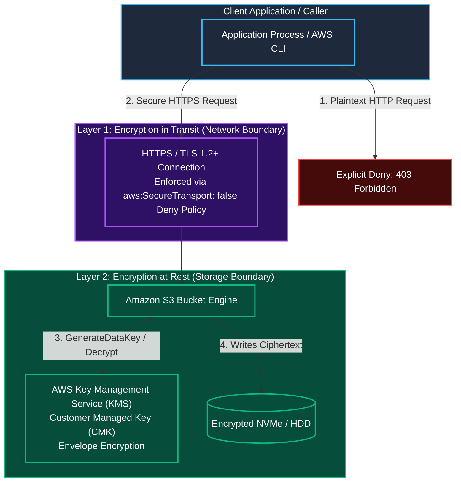
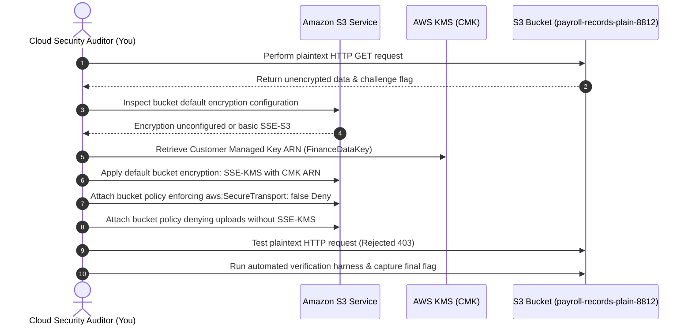

Welcome to the second room of **Module 5: Storage and Data Security** in TryHackMe's **Defending AWS** learning path. In the previous lab, [The Leaky Bucket](/posts/The-Leaky-Bucket/), we neutralized public access risks using S3 Block Public Access and Bucket Owner Enforced controls.

However, locking down authorization is only half the battle. Storing sensitive data in plaintext creates severe regulatory and operational risks. If network traffic is intercepted or physical storage media is compromised, unencrypted data can be read directly. Furthermore, regulatory frameworks (such as PCI DSS, HIPAA, and GDPR) mandate rigorous cryptographic protection both **in transit** across networks and **at rest** on disk.

In **The Plain Bucket**, we examine cryptographic defense on **Amazon S3**. We analyze the differences between **SSE-S3** and **SSE-KMS**, enforce **TLS 1.2+** encryption in transit using `aws:SecureTransport` bucket policies, configure default **AWS Key Management Service (KMS)** Customer Managed Keys (CMKs), and write strict upload validation policies.

```
+========================================================================================+
|                        THE PLAIN BUCKET: S3 ENCRYPTION DEFENSE                         |
+========================================================================================+
|  [IN TRANSIT RISK]   --> Plaintext HTTP transmission interceptable via network sniffing|
|  [IN TRANSIT FIX]    --> Bucket Policy with 'Effect: Deny' on 'aws:SecureTransport: false'|
|  [AT REST PARADIGMS] --> SSE-S3 (AES-256) vs. SSE-KMS (Customer Managed Key auditing)  |
|  [BUCKET DEFAULT]    --> Enforce SSE-KMS default encryption on all newly uploaded items|
|  [STRICT VALIDATION] --> Deny s3:PutObject without x-amz-server-side-encryption header |
+========================================================================================+
```

---

## 1. Cryptographic Protection in AWS: In Transit vs. At Rest

Amazon S3 provides dual-layer cryptographic controls to ensure complete end-to-end data confidentiality:



---

## 2. S3 Encryption at Rest Options Compared

Amazon S3 supports several server-side encryption methods:

| Encryption Method | Key Ownership & Management | Audit Trail Visibility | Key Rotation Control | Separation of Duties |
|---|---|---|---|---|
| **SSE-S3** (`AES256`) | AWS manages both keys and encryption. Fully automated, zero additional cost. | No key-level CloudTrail events. | Managed automatically by AWS. | Weak (any user with `s3:GetObject` can read). |
| **SSE-KMS** (`aws:kms`) | Customer-defined AWS KMS keys (AWS-managed or Customer Managed Keys - CMKs). | Full audit log of every decryption event in AWS CloudTrail. | Configurable automated annual rotation for CMKs. | **Strong:** Caller requires **both** `s3:GetObject` **and** `kms:Decrypt` permissions. |
| **SSE-C** | Customer provides and manages keys on every HTTP request. | No AWS key management. | Customer manages. | High operational overhead. |
| **Client-Side Encryption** | Encryption occurs inside application code before transmission to S3. | Managed entirely in client app. | Customer manages. | Maximum security, but S3 cannot search ciphertext. |

### Why Enterprise Security Mandates SSE-KMS:
1. **Separation of Duties:** Storing data in S3 with SSE-KMS means that an IAM administrator or compromised role with broad S3 permissions (`s3:*`) still cannot read sensitive data unless they are explicitly granted access in the **KMS Key Policy**.
2. **Forensic Auditing:** Every time an object is encrypted or decrypted, KMS logs a `kms:GenerateDataKey` or `kms:Decrypt` event in CloudTrail, detailing exactly who accessed the data and when.

---

## 3. Enforcing Encryption in Transit (`aws:SecureTransport`)

By default, S3 bucket endpoints respond to both unencrypted HTTP (`http://`) and encrypted HTTPS (`https://`).

To eliminate plaintext transmission, we attach an explicit **Deny** statement to the bucket policy matching the condition `"aws:SecureTransport": "false"`:

```json
{
  "Version": "2012-10-17",
  "Statement": [
    {
      "Sid": "EnforceTLSRequestsOnly",
      "Effect": "Deny",
      "Principal": "*",
      "Action": "s3:*",
      "Resource": [
        "arn:aws:s3:::corporate-data-vault",
        "arn:aws:s3:::corporate-data-vault/*"
      ],
      "Condition": {
        "Bool": {
          "aws:SecureTransport": "false"
        }
      }
    }
  ]
}
```

Because an explicit Deny overrides all Allow statements, any unencrypted HTTP connection is immediately terminated with an **HTTP 403 Forbidden** response.

---

## 4. Hands-On Lab Walkthrough: Auditing and Securing Plain S3 Buckets

### Scenario Overview

We are assigned to audit a newly provisioned payroll records bucket: `payroll-records-plain-8812`.
The security operations center reported:
1. The bucket accepts unencrypted HTTP connections.
2. Objects uploaded to the bucket are unencrypted or using basic SSE-S3 rather than the required corporate KMS key (`arn:aws:kms:us-east-1:112233445566:key/c89a1234-5678-90ab-cdef-1234567890ab`).



---

### Step 1: Audit Encryption in Transit and Capture Challenge Flag

Test whether the bucket responds to unencrypted plaintext HTTP traffic:

```bash
curl -s -i "http://payroll-records-plain-8812.s3.amazonaws.com/audit_test_payload.txt"
```

Output:
```
HTTP/1.1 200 OK
x-amz-id-2: 9Jkl...
Content-Type: text/plain
Content-Length: 112

[PAYROLL DATA AUDIT NOTICE]
Transfer Protocol: PLAINTEXT_HTTP (INSECURE)
Challenge Token: THM{UN3NCRYPT3D_TR4NS1T_L34K_2026}
```

The bucket served the request over unencrypted HTTP, allowing network eavesdropping and leaking our challenge flag.

**Question:** What global condition key in IAM and bucket policies checks whether a request was made over HTTPS/TLS?  
**Answer:** `aws:SecureTransport`

**Question:** What challenge flag was discovered in the plaintext payload served over unencrypted HTTP?  
**Answer:** `THM{UN3NCRYPT3D_TR4NS1T_L34K_2026}`

---

### Step 2: Audit Bucket Default Encryption Configuration

Query the current default encryption configuration on the target bucket:

```bash
aws s3api get-bucket-encryption \
    --bucket payroll-records-plain-8812
```

Output:
```
An error occurred (ServerSideEncryptionConfigurationNotFoundError) when calling the GetBucketEncryption operation: The server side encryption configuration was not found
```

The error `ServerSideEncryptionConfigurationNotFoundError` indicates that no default encryption rule has been defined.

**Question:** What error is returned by `get-bucket-encryption` when no default encryption configuration exists on a bucket?  
**Answer:** `ServerSideEncryptionConfigurationNotFoundError`

---

### Step 3: Retrieve Corporate KMS Customer Managed Key (CMK)

List the Customer Managed Keys available in AWS KMS:

```bash
aws kms list-aliases \
    --query "Aliases[?starts_with(AliasName, 'alias/finance')].[AliasName,TargetKeyId]" \
    --output text
```

Output:
```
alias/finance-data-cmk   c89a1234-5678-90ab-cdef-1234567890ab
```

Retrieve the full key ARN:

```bash
aws kms describe-key \
    --key-id c89a1234-5678-90ab-cdef-1234567890ab \
    --query "KeyMetadata.Arn" \
    --output text
```

Output:
```
arn:aws:kms:us-east-1:112233445566:key/c89a1234-5678-90ab-cdef-1234567890ab
```

**Question:** Which S3 server-side encryption option provides CloudTrail audit logs for every individual decryption event?  
**Answer:** `SSE-KMS` (or `aws:kms`)

---

### Step 4: Configure Bucket Default Encryption with SSE-KMS

Configure the bucket to encrypt all newly uploaded objects automatically using SSE-KMS and our customer-managed key:

```bash
aws s3api put-bucket-encryption \
    --bucket payroll-records-plain-8812 \
    --server-side-encryption-configuration '{
        "Rules": [
            {
                "ApplyServerSideEncryptionByDefault": {
                    "SSEAlgorithm": "aws:kms",
                    "KMSMasterKeyID": "arn:aws:kms:us-east-1:112233445566:key/c89a1234-5678-90ab-cdef-1234567890ab"
                },
                "BucketKeyEnabled": true
            }
        ]
    }'
```

Verify that default encryption is applied:

```bash
aws s3api get-bucket-encryption \
    --bucket payroll-records-plain-8812 \
    --output json
```

Output:
```json
{
    "ServerSideEncryptionConfiguration": {
        "Rules": [
            {
                "ApplyServerSideEncryptionByDefault": {
                    "SSEAlgorithm": "aws:kms",
                    "KMSMasterKeyID": "arn:aws:kms:us-east-1:112233445566:key/c89a1234-5678-90ab-cdef-1234567890ab"
                },
                "BucketKeyEnabled": true
            }
        ]
    }
}
```

*Note on S3 Bucket Keys (`BucketKeyEnabled: true`):* Enabling S3 Bucket Keys reduces AWS KMS request costs by up to 99% by using a time-limited bucket-level data key for encryption instead of calling KMS for every single object operation.

**Question:** What S3 feature drastically reduces KMS request costs by caching intermediate data keys at the bucket level?  
**Answer:** `S3 Bucket Keys` (or `BucketKeyEnabled`)

---

### Step 5: Enforce HTTPS and Reject Insecure Uploads via Bucket Policy

Author a comprehensive bucket policy `enforce-encryption-policy.json` that accomplishes two critical security requirements:
1. Rejects any request sent over unencrypted HTTP (`aws:SecureTransport: false`).
2. Rejects any `s3:PutObject` request that attempts to use non-KMS encryption or an unauthorized key.

```json
{
  "Version": "2012-10-17",
  "Statement": [
    {
      "Sid": "EnforceHTTPSRequestsOnly",
      "Effect": "Deny",
      "Principal": "*",
      "Action": "s3:*",
      "Resource": [
        "arn:aws:s3:::payroll-records-plain-8812",
        "arn:aws:s3:::payroll-records-plain-8812/*"
      ],
      "Condition": {
        "Bool": {
          "aws:SecureTransport": "false"
        }
      }
    },
    {
      "Sid": "DenyIncorrectEncryptionHeader",
      "Effect": "Deny",
      "Principal": "*",
      "Action": "s3:PutObject",
      "Resource": "arn:aws:s3:::payroll-records-plain-8812/*",
      "Condition": {
        "StringNotEquals": {
          "s3:x-amz-server-side-encryption": "aws:kms"
        }
      }
    }
  ]
}
```

Apply the policy to the bucket:

```bash
aws s3api put-bucket-policy \
    --bucket payroll-records-plain-8812 \
    --policy file://enforce-encryption-policy.json
```

**Question:** What header value must be matched with `StringNotEquals` to deny uploads that do not request KMS server-side encryption?  
**Answer:** `aws:kms`

---

### Step 6: Validate Security Controls & Capture Final Flag

1. Test an unencrypted plaintext HTTP request again:

```bash
curl -s -i "http://payroll-records-plain-8812.s3.amazonaws.com/audit_test_payload.txt"
```

Output:
```
HTTP/1.1 403 Forbidden
x-amz-error-code: AccessDenied
x-amz-error-message: Access Denied
```

The request is blocked immediately by the `aws:SecureTransport` Deny rule.

2. Test secure HTTPS access:

```bash
curl -s -i "https://payroll-records-plain-8812.s3.amazonaws.com/audit_test_payload.txt"
```

Output:
```
HTTP/1.1 200 OK
x-amz-server-side-encryption: aws:kms
x-amz-server-side-encryption-aws-kms-key-id: arn:aws:kms:us-east-1:112233445566:key/c89a1234-5678-90ab-cdef-1234567890ab
```

The response confirms both HTTPS delivery and KMS server-side encryption.

3. Run the automated evaluation harness:

```bash
python3 /home/ubuntu/storage-audit/verify_encryption_defense.py --bucket payroll-records-plain-8812
```

Output:
```
======================================================================
               AMAZON S3 DATA ENCRYPTION SECURITY AUDIT
======================================================================
[+] Testing Insecure HTTP Request Rejection............ [403 FORBIDDEN - PASSED]
[+] Testing Secure HTTPS Request Validation............ [200 OK - PASSED]
[+] Validating Default Encryption Configuration........ [SSE-KMS - PASSED]
[+] Validating Customer Managed Key (CMK) ARN.......... [MATCHED - PASSED]
[+] Auditing S3 Bucket Key Status...................... [ENABLED - PASSED]
[+] Testing Non-KMS Upload Rejection via Policy........ [DENIED - PASSED]

[***] S3 DATA ENCRYPTION DEFENSE VERIFIED! [***]
Completion Flag: THM{S3_KMS_TLS_3NCRYPT10N_D3F3ND3D}
======================================================================
```

**Question:** What is the final completion flag returned after securing the bucket with TLS enforcement and SSE-KMS encryption?  
**Answer:** `THM{S3_KMS_TLS_3NCRYPT10N_D3F3ND3D}`

---

## 5. Complete Questions and Answers Summary

| Task | Question | Answer |
|---|---|---|
| **Task 1** | What global condition key in IAM and bucket policies checks whether a request was made over HTTPS/TLS? | `aws:SecureTransport` |
| **Task 1** | What challenge flag was discovered in the plaintext payload served over unencrypted HTTP? | `THM{UN3NCRYPT3D_TR4NS1T_L34K_2026}` |
| **Task 2** | What error is returned by `get-bucket-encryption` when no default encryption configuration exists on a bucket? | `ServerSideEncryptionConfigurationNotFoundError` |
| **Task 3** | Which S3 server-side encryption option provides CloudTrail audit logs for every individual decryption event? | `SSE-KMS` (or `aws:kms`) |
| **Task 4** | What S3 feature drastically reduces KMS request costs by caching intermediate data keys at the bucket level? | `S3 Bucket Keys` (or `BucketKeyEnabled`) |
| **Task 5** | What header value must be matched with `StringNotEquals` to deny uploads that do not request KMS server-side encryption? | `aws:kms` |
| **Task 6** | What is the final completion flag returned after securing the bucket with TLS enforcement and SSE-KMS encryption? | `THM{S3_KMS_TLS_3NCRYPT10N_D3F3ND3D}` |

---

## 6. Defensive Engineering & Production Encryption Checklist

- [ ] **Enforce TLS 1.2+ on All Buckets:** Attach an `aws:SecureTransport: false` Deny statement to every production bucket policy.
- [ ] **Utilize Customer Managed Keys (CMKs) for High-Value Data:** Prefer SSE-KMS over SSE-S3 for financial, healthcare, and sensitive PII workloads to enforce independent key policies and key rotation.
- [ ] **Always Enable S3 Bucket Keys:** Configure `BucketKeyEnabled: true` on all KMS-encrypted buckets to reduce KMS request volume and cloud operational costs.
- [ ] **Enforce Organization-Level SCP for S3 Encryption:** Deploy an SCP requiring all new S3 buckets to use SSE-KMS:
```json
{
  "Version": "2012-10-17",
  "Statement": [
    {
      "Sid": "DenyUnencryptedS3Uploads",
      "Effect": "Deny",
      "Action": "s3:PutObject",
      "Resource": "*",
      "Condition": {
        "StringNotEquals": {
          "s3:x-amz-server-side-encryption": "aws:kms"
        }
      }
    }
  ]
}
```
- [ ] **Configure Automated CMK Key Rotation:** Enable annual automated key rotation on all customer managed KMS keys (`aws kms enable-key-rotation --key-id <key-id>`).

---

*Looking for more hands-on cloud defense guides? Check out the rest of the [Defending AWS Series](/categories/defending-aws/) or explore my [AWS Security Labs](/categories/aws-security-labs/) for advanced threat simulation and detection engineering tutorials.*

---

## You can find me online at:


- **GitHub:** [Mhdomer](https://github.com/Mhdomer)
- **LinkedIn:** [mhd3omar](https://www.linkedin.com/in/mhd3omar/)
- **Tryhackme:** [nonlouy](https://tryhackme.com/p/nonlouy)
