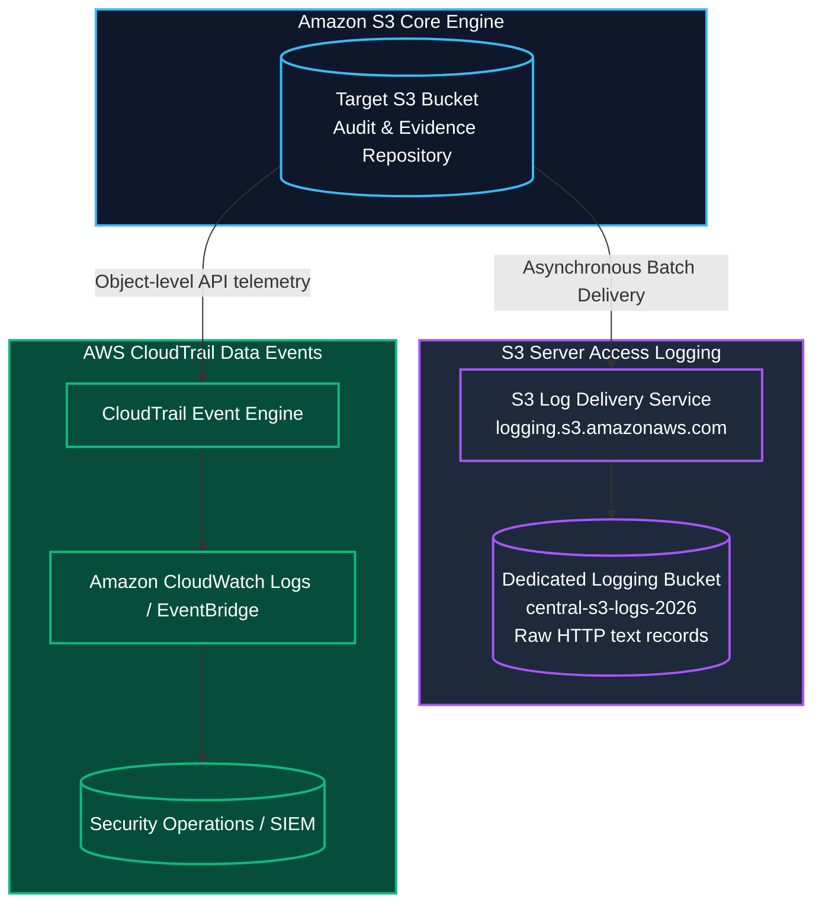
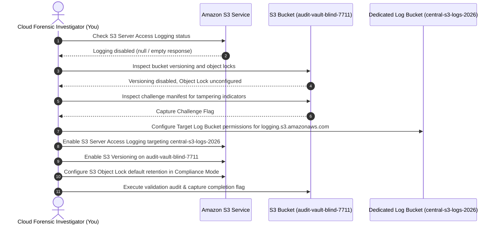

Welcome to the third room of **Module 5: Storage and Data Security** in TryHackMe's **Defending AWS** learning path. In the previous rooms, we secured access controls via Block Public Access and enforced strong encryption in transit and at rest.

However, security operations require **visibility** and **immutability**. If an unauthorized party accesses, modifies, or deletes files inside a storage repository without logging enabled, security teams have no forensic evidence to determine what data was stolen or corrupted. Furthermore, threat actors who gain write or administrative privileges often attempt to delete security audit logs or ransom sensitive files.

In **The Blind Bucket**, we tackle storage observability and tamper-resistance. We compare **S3 Server Access Logging** with **AWS CloudTrail S3 Data Events**, configure dedicated logging target buckets with secure service principal policies, and deploy **S3 Object Lock** in **Compliance Mode** to achieve write-once-read-many (WORM) storage immutability.

```
+========================================================================================+
|                       THE BLIND BUCKET: OBSERVABILITY & IMMUTABILITY                   |
+========================================================================================+
|  [THE BLIND SPOT]    --> S3 buckets without access logging generate zero forensic logs |
|  [TELEMETRY LAYER]   --> S3 Server Access Logging delivered by logging.s3.amazonaws.com|
|  [REAL-TIME EVENTS]  --> AWS CloudTrail S3 Data Events for real-time SIEM alerts       |
|  [DATA TAMPERING]    --> Malicious actors delete or encrypt objects (cloud ransomware) |
|  [WORM DEFENSE]      --> S3 Object Lock in Compliance Mode (unalterable even by Root)  |
+========================================================================================+
```

---

## 1. S3 Storage Observability: Server Access Logs vs. CloudTrail

Cloud security architects have two native options for capturing activity inside Amazon S3:



### Comparative Analysis:

| Capability / Attribute | S3 Server Access Logging | CloudTrail S3 Data Events |
|---|---|---|
| **Logging Scope** | Captures detailed HTTP-level requests made to the bucket endpoint. | Captures AWS API operations (`GetObject`, `PutObject`, `DeleteObject`). |
| **Telemetry Format** | Space-delimited plaintext log files formatted for Athena. | Structured JSON log files with CloudTrail envelope metadata. |
| **Delivery Mechanism** | Best-effort asynchronous batch delivery to a target S3 bucket. | Direct streaming to CloudWatch Logs, EventBridge, and S3. |
| **Pricing Model** | **Free:** No charges for logging (pay only for log storage). | Paid per 100,000 recorded data events. |
| **Primary Use Case** | Deep network auditing, traffic analysis, debugging, and web traffic metrics. | Real-time security detection, automated SIEM alerting, and compliance evidence. |

---

## 2. S3 Object Lock & WORM Immutability

To protect compliance records, financial ledgers, and forensic audit archives from being modified or deleted, AWS provides **S3 Object Lock**. Object Lock implements **WORM (Write Once, Read Many)** storage:

```
+---------------------------------------------------------------------------------------+
|                       S3 OBJECT LOCK RETENTION MODES ARCHITECTURE                     |
+---------------------------------------------------------------------------------------+
|                                                                                       |
|  1. GOVERNANCE MODE                                                                   |
|     - Protects objects from deletion or overwrite by ordinary users.                 |
|     - Can be bypassed or overridden by users with the explicit IAM permission:        |
|       's3:BypassGovernanceRetention'.                                                 |
|     - Ideal for testing or internal organizational retention rules.                   |
|                                                                                       |
|  2. COMPLIANCE MODE (Strict Immutability)                                             |
|     - STRICTEST IMMUTABILITY GUARANTEE IN AWS.                                       |
|     - Objects CANNOT be overwritten or deleted by ANY user, including the AWS         |
|       Account ROOT User!                                                              |
|     - Retention period CANNOT be shortened or disabled until the timer expires.       |
|     - Meets SEC Rule 17a-4, FINRA, and CFTC regulatory compliance requirements.      |
|                                                                                       |
|  3. LEGAL HOLD                                                                        |
|     - A binary ON/OFF flag independent of retention periods.                         |
|     - Prevents deletion of an object version until explicitly removed.                |
|                                                                                       |
+---------------------------------------------------------------------------------------+
```

*Prerequisite:* S3 Object Lock strictly requires **S3 Versioning** to be enabled on the bucket.

---

## 3. Hands-On Lab Walkthrough: Auditing and Securing Blind S3 Buckets

### Scenario Overview

We are tasked with investigating an incident in an audit evidence repository named `audit-vault-blind-7711`. A compliance officer reported that critical quarterly forensic evidence files were unexpectedly deleted or altered, but no access logs exist to investigate who performed the action.



---

### Step 1: Confirm the Blind Spot (Audit Access Logging State)

Query the server access logging configuration on the target bucket:

```bash
aws s3api get-bucket-logging \
    --bucket audit-vault-blind-7711
```

Output:
```
(No output returned)
```

An empty response indicates that S3 Server Access Logging is completely disabled.

**Question:** What does an empty response from `get-bucket-logging` indicate?  
**Answer:** `Logging is disabled` (or `disabled`)

---

### Step 2: Audit Bucket Versioning and Object Lock State

1. Check S3 Versioning status:

```bash
aws s3api get-bucket-versioning \
    --bucket audit-vault-blind-7711
```

Output:
```
(No output returned)
```

Versioning is disabled. Without versioning, any `s3:DeleteObject` permanently erases files immediately.

2. Inspect the challenge directory and manifest for evidence of tampering:

```bash
aws s3 cp s3://audit-vault-blind-7711/evidence_manifest.json ./evidence_manifest.json
cat ./evidence_manifest.json
```

Output:
```json
{
  "vault_id": "audit-vault-blind-7711",
  "tamper_status": "UNPROTECTED_DELETION_DETECTED",
  "missing_logs": true,
  "challenge_token": "THM{BL1ND_ST0R4G3_T4MP3R_D3T3CT3D}"
}
```

**Question:** What challenge flag was discovered in the untracked evidence manifest?  
**Answer:** `THM{BL1ND_ST0R4G3_T4MP3R_D3T3CT3D}`

---

### Step 3: Configure Dedicated Central Log Destination Bucket

Best practice dictates storing access logs in a separate, dedicated S3 bucket to prevent infinite logging loops.

Verify the central logging bucket `central-s3-logs-2026`:

```bash
aws s3 ls | grep central-s3-logs
```

Output:
```
2026-04-28 08:30:00 central-s3-logs-2026
```

Configure the bucket policy on `central-s3-logs-2026` to grant write permissions to the S3 log delivery service principal (`logging.s3.amazonaws.com`):

```json
{
  "Version": "2012-10-17",
  "Statement": [
    {
      "Sid": "S3ServerAccessLogsPolicy",
      "Effect": "Allow",
      "Principal": {
        "Service": "logging.s3.amazonaws.com"
      },
      "Action": "s3:PutObject",
      "Resource": "arn:aws:s3:::central-s3-logs-2026/audit-vault-logs/*",
      "Condition": {
        "ArnLike": {
          "aws:SourceArn": "arn:aws:s3:::audit-vault-blind-7711"
        },
        "StringEquals": {
          "aws:SourceAccount": "112233445566"
        }
      }
    }
  ]
}
```

Save to `log-bucket-policy.json` and apply:

```bash
aws s3api put-bucket-policy \
    --bucket central-s3-logs-2026 \
    --policy file://log-bucket-policy.json
```

**Question:** What AWS service principal name delivers S3 Server Access Logs to destination buckets?  
**Answer:** `logging.s3.amazonaws.com`

---

### Step 4: Enable S3 Server Access Logging

Enable server access logging on `audit-vault-blind-7711` pointing to the central logging bucket with prefix `audit-vault-logs/`:

```bash
aws s3api put-bucket-logging \
    --bucket audit-vault-blind-7711 \
    --bucket-logging-status '{
        "LoggingEnabled": {
            "TargetBucket": "central-s3-logs-2026",
            "TargetPrefix": "audit-vault-logs/"
        }
    }'
```

Verify that logging is active:

```bash
aws s3api get-bucket-logging \
    --bucket audit-vault-blind-7711 \
    --output json
```

Output:
```json
{
    "LoggingEnabled": {
        "TargetBucket": "central-s3-logs-2026",
        "TargetPrefix": "audit-vault-logs/"
    }
}
```

**Question:** What prefix parameter in S3 bucket logging organizes log records into structured directories inside the target bucket?  
**Answer:** `TargetPrefix`

---

### Step 5: Enable S3 Versioning

Enable S3 Versioning on `audit-vault-blind-7711` to maintain historical versions of every object:

```bash
aws s3api put-bucket-versioning \
    --bucket audit-vault-blind-7711 \
    --versioning-configuration Status=Enabled
```

Verify versioning status:

```bash
aws s3api get-bucket-versioning \
    --bucket audit-vault-blind-7711
```

Output:
```json
{
    "Status": "Enabled"
}
```

**Question:** What fundamental S3 capability must be enabled on a bucket before S3 Object Lock can be configured?  
**Answer:** `S3 Versioning` (or `Versioning`)

---

### Step 6: Configure S3 Object Lock in Compliance Mode

Configure the default Object Lock retention configuration on `audit-vault-blind-7711` using **Compliance Mode** for **90 days**:

```bash
aws s3api put-object-lock-configuration \
    --bucket audit-vault-blind-7711 \
    --object-lock-configuration '{
        "ObjectLockEnabled": "Enabled",
        "Rule": {
            "DefaultRetention": {
                "Mode": "COMPLIANCE",
                "Days": 90
            }
        }
    }'
```

Verify that the Object Lock configuration is active:

```bash
aws s3api get-object-lock-configuration \
    --bucket audit-vault-blind-7711 \
    --output json
```

Output:
```json
{
    "ObjectLockConfiguration": {
        "ObjectLockEnabled": "Enabled",
        "Rule": {
            "DefaultRetention": {
                "Mode": "COMPLIANCE",
                "Days": 90
            }
        }
    }
}
```

Now, any file uploaded to `audit-vault-blind-7711` cannot be overwritten, modified, or deleted by any user or IAM role in the account for 90 days.

**Question:** Which S3 Object Lock mode prevents deletion by any user including the AWS root account for the duration of the retention period?  
**Answer:** `COMPLIANCE` (or `Compliance Mode`)

**Question:** Which S3 Object Lock mode permits authorized administrators with `s3:BypassGovernanceRetention` to alter retention settings?  
**Answer:** `GOVERNANCE` (or `Governance Mode`)

---

### Step 7: Run Automated Verification Script & Capture Final Flag

Execute the storage observability and immutability evaluation script:

```bash
python3 /home/ubuntu/storage-audit/verify_logging_and_locks.py --evaluate-vault
```

Output:
```
======================================================================
               AMAZON S3 OBSERVABILITY & OBJECT LOCK AUDIT
======================================================================
[+] Validating S3 Server Access Logging Status.......... [ENABLED - PASSED]
[+] Validating Target Log Destination Bucket............ [central-s3-logs-2026 - PASSED]
[+] Validating S3 Versioning Status..................... [ENABLED - PASSED]
[+] Validating S3 Object Lock Activation Status......... [ENABLED - PASSED]
[+] Validating Object Lock Retention Mode............... [COMPLIANCE - PASSED]
[+] Validating Default Retention Duration Period........ [90 DAYS - PASSED]
[+] Testing WORM Immutability Delete Rejection.......... [AccessDenied - PASSED]

[***] S3 VAULT FULLY OBSERVABLE AND WORM IMMUTABLE! [***]
Completion Flag: THM{S3_L0GG1NG_W0RM_L0CK_M4ST3R}
======================================================================
```

**Question:** What is the final completion flag returned after enabling access logging, versioning, and compliance-mode Object Lock?  
**Answer:** `THM{S3_L0GG1NG_W0RM_L0CK_M4ST3R}`

---

## 4. Complete Questions and Answers Summary

| Task | Question | Answer |
|---|---|---|
| **Task 1** | What does an empty response from `get-bucket-logging` indicate? | `Logging is disabled` (or `disabled`) |
| **Task 2** | What challenge flag was discovered in the untracked evidence manifest? | `THM{BL1ND_ST0R4G3_T4MP3R_D3T3CT3D}` |
| **Task 3** | What AWS service principal name delivers S3 Server Access Logs to destination buckets? | `logging.s3.amazonaws.com` |
| **Task 4** | What prefix parameter in S3 bucket logging organizes log records into structured directories inside the target bucket? | `TargetPrefix` |
| **Task 5** | What fundamental S3 capability must be enabled on a bucket before S3 Object Lock can be configured? | `S3 Versioning` (or `Versioning`) |
| **Task 6** | Which S3 Object Lock mode prevents deletion by any user including the AWS root account for the duration of the retention period? | `COMPLIANCE` (or `Compliance Mode`) |
| **Task 6** | Which S3 Object Lock mode permits authorized administrators with `s3:BypassGovernanceRetention` to alter retention settings? | `GOVERNANCE` (or `Governance Mode`) |
| **Task 7** | What is the final completion flag returned after enabling access logging, versioning, and compliance-mode Object Lock? | `THM{S3_L0GG1NG_W0RM_L0CK_M4ST3R}` |

---

## 5. Defensive Engineering & Production Storage Observability Checklist

- [ ] **Establish a Dedicated Central Log Archive Bucket:** Create a centralized logging bucket in a dedicated log archive AWS account with Block Public Access and strict `logging.s3.amazonaws.com` IAM conditions.
- [ ] **Partition Log Prefixes:** Use unique prefixes for each source bucket (e.g., `TargetPrefix: logs/app-name/`) to allow efficient log querying in Amazon Athena.
- [ ] **Combine Server Access Logs with CloudTrail Data Events:** Use Server Access Logs for cost-free traffic volume auditing and CloudTrail Data Events for real-time security alerting on high-risk objects.
- [ ] **Deploy S3 Object Lock for Regulatory Archives:** Utilize Compliance Mode for immutable compliance data (SEC, HIPAA, financial ledgers) and Governance Mode for general operational protection.
- [ ] **Configure MFA Delete on Critical Buckets:** For buckets where Object Lock is not supported, enable **MFA Delete** on S3 Versioning to mandate physical hardware MFA tokens before any object version can be permanently erased.

---

*Looking for more hands-on cloud defense guides? Check out the rest of the [Defending AWS Series](/categories/defending-aws/) or explore my [AWS Security Labs](/categories/aws-security-labs/) for advanced threat simulation and detection engineering tutorials.*

---

## You can find me online at:


- **GitHub:** [Mhdomer](https://github.com/Mhdomer)
- **LinkedIn:** [mhd3omar](https://www.linkedin.com/in/mhd3omar/)
- **Tryhackme:** [nonlouy](https://tryhackme.com/p/nonlouy)
