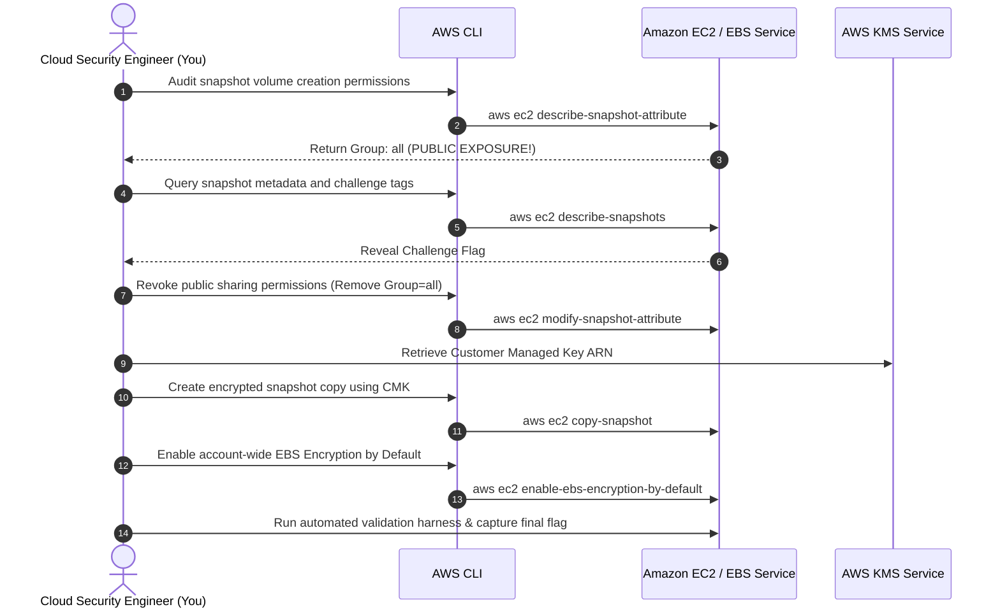

Welcome to the fourth room of **Module 5: Storage and Data Security** in TryHackMe's **Defending AWS** learning path. In the previous rooms, we addressed object storage security in Amazon S3. Now, we turn our defensive focus to **block storage**: **Amazon Elastic Block Store (EBS)**.

While S3 bucket misconfigurations receive heavy media coverage, an equally catastrophic yet frequently overlooked attack vector is the **publicly exposed EBS snapshot**. When an administrator accidentally shares an EBS snapshot with the public group (`all`), any AWS account globally can create an EBS volume from that snapshot, attach it to their own EC2 virtual machine, and inspect the raw filesystem: extracting database dumps, `/etc/shadow` files, configuration credentials, and private SSH keys.

In **The Shared Snapshot**, we audit block storage permissions, discover and remediate public snapshot exposure, master cross-account **KMS Customer Managed Key (CMK)** encryption constraints, and enable account-wide **EBS default encryption**.

```
+========================================================================================+
|                        THE SHARED SNAPSHOT: EBS STORAGE DEFENSE                        |
+========================================================================================+
|  [THE THREAT]        --> EBS snapshot shared with 'Group: all' (Global public access)  |
|  [ATTACK IMPACT]     --> Adversaries mount raw disks and extract database passwords    |
|  [REMEDIATION]       --> Revoke 'Group=all' from createVolumePermission attributes     |
|  [KEY ARCHITECTURE]  --> Default 'aws/ebs' key CANNOT be shared across accounts!       |
|  [ACCOUNT GUARDRAIL] --> Enable EBS Encryption by Default across all newly created disks|
+========================================================================================+
```

---

## 1. Amazon EBS Snapshot Sharing Architecture

Amazon EBS snapshots are point-in-time, incremental block-level backups stored automatically in Amazon S3 (managed under the hood by AWS).

```mermaid
flowchart TD
    subgraph OwnerAccount["Source AWS Account (Resource Owner)"]
        EBS_Vol[Amazon EBS Volume]
        Snapshot["EBS Snapshot<br>(snap-0a9b8c7d6e5f41234)"]
        EBS_Vol -->|CreateSnapshot| Snapshot
        Attr{"createVolumePermission<br>Permission Attribute"}
        Snapshot --> Attr
    end

    subgraph AdversaryAccount["Rogue External AWS Account"]
        AttackerVM[Attacker EC2 Instance]
        ClonedVol[Cloned EBS Volume]
    end

    Attr -->|Case 1: Group: all (VULNERABLE)| ClonedVol
    ClonedVol -->|Mounts raw filesystem /dev/xvdf| AttackerVM
    AttackerVM -->|Extracts MySQL dumps & SSH keys| Exfiltrated[Data Stolen]

    Attr -.->|Case 2: Specific Account ID (SECURE)| LegitimateAccount[Authorized Partner Account]

    classDef owner fill:#1e293b,stroke:#38bdf8,stroke-width:2px,color:#fff;
    classDef adversary fill:#450a0a,stroke:#ef4444,stroke-width:2px,color:#fff;
    classDef secure fill:#064e3b,stroke:#10b981,stroke-width:2px,color:#fff;

    class OwnerAccount,EBS_Vol,Snapshot,Attr owner;
    class AdversaryAccount,AttackerVM,ClonedVol,Exfiltrated adversary;
    class LegitimateAccount secure;
```

### The Sharing Scenarios:
1. **Private (Default):** Accessible only within the owning AWS account.
2. **Shared with Specific AWS Accounts:** Accessible only by designated 12-digit AWS account IDs (e.g., `112233445566`).
3. **Public (`Group: all`):** Made accessible to **every AWS customer globally**. Anyone can find the snapshot ID via the public AWS catalog, create an identical block volume, and read every sector.

---

## 2. The KMS Cross-Account Sharing Trap

A crucial architectural principle every cloud security engineer must memorize involves EBS snapshot encryption and AWS KMS:

```
+---------------------------------------------------------------------------------------+
|                    EBS SNAPSHOT KMS CROSS-ACCOUNT SHARING RULES                       |
+---------------------------------------------------------------------------------------+
|                                                                                       |
|  RULE 1: Snapshots encrypted with the default AWS-managed KMS key ('aws/ebs')         |
|          CANNOT BE SHARED ACROSS ACCOUNTS!                                            |
|          - AWS strictly prevents sharing the default AWS-managed service key.        |
|          - If you attempt to share a snapshot encrypted with 'aws/ebs', the AWS API  |
|            will return an 'OperationNotPermitted' error.                              |
|                                                                                       |
|  RULE 2: To share an encrypted snapshot across accounts, it MUST be encrypted with     |
|          a CUSTOMER MANAGED KEY (CMK).                                                |
|          - The source account must grant the target account permissions in the        |
|            KMS Key Policy ('kms:CreateGrant', 'kms:DescribeKey', 'kms:Decrypt').      |
|          - The target account copies the snapshot and re-encrypts it with their       |
|            own local KMS key.                                                         |
|                                                                                       |
+---------------------------------------------------------------------------------------+
```

---

## 3. Account-Wide Guardrail: EBS Encryption by Default

Historically, AWS provisioned unencrypted EBS volumes unless explicitly instructed during launch. This led to frequent human error and unencrypted data disks.

AWS allows administrators to enforce **EBS Encryption by Default** at the regional account level:
- When enabled, **every newly created EBS volume and snapshot** is automatically encrypted at rest upon creation.
- Applies even if a developer or automation script omits the `--encrypted` flag during instance provisioning.

---

## 4. Hands-On Lab Walkthrough: Auditing and Securing EBS Snapshots

### Scenario Overview

During a security review, our team is alerted to an Amazon EBS snapshot named `snap-0a9b8c7d6e5f41234` containing a backup of an internal PostgreSQL database disk (`Database-Backup-Disk`). Forensic monitoring indicates the snapshot permissions were modified during an administrative troubleshooting session.



---

### Step 1: Audit Snapshot Permissions and Identify Public Exposure

Query the volume creation permissions of the target snapshot:

```bash
aws ec2 describe-snapshot-attribute \
    --snapshot-id snap-0a9b8c7d6e5f41234 \
    --attribute createVolumePermission \
    --output json
```

Output:
```json
{
    "SnapshotId": "snap-0a9b8c7d6e5f41234",
    "CreateVolumePermissions": [
        {
            "Group": "all"
        }
    ]
}
```

The output confirms that `CreateVolumePermissions` contains `Group: all`. This snapshot is completely public to all AWS accounts worldwide.

**Question:** What attribute value in `CreateVolumePermissions` indicates that an EBS snapshot is publicly accessible to any AWS account?  
**Answer:** `all` (or `Group: all`)

**Question:** What AWS CLI command describes permissions associated with an Amazon EBS snapshot?  
**Answer:** `describe-snapshot-attribute`

---

### Step 2: Inspect Snapshot Details and Extract Challenge Flag

Inspect the snapshot tags and configuration details:

```bash
aws ec2 describe-snapshots \
    --snapshot-ids snap-0a9b8c7d6e5f41234 \
    --output json
```

Output excerpt:
```json
{
  "Snapshots": [
    {
      "Description": "PostgreSQL database volume backup - Confidential",
      "Encrypted": false,
      "OwnerId": "112233445566",
      "Progress": "100%",
      "SnapshotId": "snap-0a9b8c7d6e5f41234",
      "StartTime": "2026-04-29T08:14:00.000Z",
      "State": "completed",
      "VolumeId": "vol-0123456789abcdef0",
      "VolumeSize": 50,
      "Tags": [
        {
          "Key": "Name",
          "Value": "Postgres-DB-Backup"
        },
        {
          "Key": "DataClassification",
          "Value": "Restricted"
        },
        {
          "Key": "ChallengeFlag",
          "Value": "THM{PUB1C_3BS_SN4PSH0T_3XP0S3D}"
        }
      ]
    }
  ]
}
```

Notice two critical findings:
1. `Encrypted: false` (Stored completely in plaintext).
2. The challenge token embedded in the resource tags: `THM{PUB1C_3BS_SN4PSH0T_3XP0S3D}`.

**Question:** What challenge flag was discovered in the exposed snapshot metadata tags?  
**Answer:** `THM{PUB1C_3BS_SN4PSH0T_3XP0S3D}`

---

### Step 3: Revoke Public Sharing Permissions

Immediately revoke the public volume creation permission:

```bash
aws ec2 modify-snapshot-attribute \
    --snapshot-id snap-0a9b8c7d6e5f41234 \
    --attribute createVolumePermission \
    --operation-type remove \
    --group-names all
```

Verify that `CreateVolumePermissions` is now empty:

```bash
aws ec2 describe-snapshot-attribute \
    --snapshot-id snap-0a9b8c7d6e5f41234 \
    --attribute createVolumePermission
```

Output:
```json
{
    "SnapshotId": "snap-0a9b8c7d6e5f41234",
    "CreateVolumePermissions": []
}
```

The snapshot is now strictly private to our AWS account.

**Question:** What operation type parameter is used with `modify-snapshot-attribute` to revoke permissions?  
**Answer:** `remove`

---

### Step 4: Re-Encrypt Snapshot with Customer Managed Key (CMK)

Because the unencrypted snapshot remains vulnerable to unauthorized internal inspection, create an encrypted copy using our corporate KMS key (`arn:aws:kms:us-east-1:112233445566:key/b1234567-89ab-cdef-0123-456789abcdef`):

```bash
aws ec2 copy-snapshot \
    --source-region us-east-1 \
    --source-snapshot-id snap-0a9b8c7d6e5f41234 \
    --description "Encrypted copy of PostgreSQL database backup" \
    --encrypted \
    --kms-key-id "arn:aws:kms:us-east-1:112233445566:key/b1234567-89ab-cdef-0123-456789abcdef"
```

Output:
```json
{
    "SnapshotId": "snap-0fedcba9876543210"
}
```

**Question:** Can an EBS snapshot encrypted with the default AWS-managed KMS key (`aws/ebs`) be shared across different AWS accounts?  
**Answer:** `No`

**Question:** What type of KMS key must be utilized to share encrypted EBS snapshots with external AWS accounts?  
**Answer:** `Customer Managed Key` (or `CMK`)

---

### Step 5: Enforce Account-Wide EBS Encryption by Default

To prevent any unencrypted EBS volumes or snapshots from being provisioned in the future, enable EBS Encryption by Default across the region:

```bash
aws ec2 enable-ebs-encryption-by-default
```

Output:
```json
{
    "EbsEncryptionByDefault": true
}
```

Set the default KMS key to our Customer Managed Key:

```bash
aws ec2 modify-ebs-default-kms-key-id \
    --kms-key-id "arn:aws:kms:us-east-1:112233445566:key/b1234567-89ab-cdef-0123-456789abcdef"
```

Output:
```json
{
    "KmsKeyId": "arn:aws:kms:us-east-1:112233445566:key/b1234567-89ab-cdef-0123-456789abcdef"
}
```

Verify that default encryption status is active:

```bash
aws ec2 get-ebs-encryption-by-default
```

Output:
```json
{
    "EbsEncryptionByDefault": true
}
```

**Question:** What AWS CLI command enables automated encryption for all newly created EBS volumes across an AWS region?  
**Answer:** `enable-ebs-encryption-by-default`

---

### Step 6: Run Automated Verification Script & Capture Final Flag

Execute the EBS storage defense validation harness:

```bash
python3 /home/ubuntu/storage-audit/verify_ebs_defense.py --snapshot-id snap-0a9b8c7d6e5f41234
```

Output:
```
======================================================================
               AMAZON EBS SNAPSHOT & ENCRYPTION AUDIT
======================================================================
[+] Auditing Snapshot Permissions (snap-0a9b8c7d6e5f41234)... [CHECKING]
[+] Validating Public Group Removal (Group: all)......... [REMOVED - PASSED]
[+] Verifying Encrypted Snapshot Copy (snap-0fedcba9876543210) [ENCRYPTED - PASSED]
[+] Validating Customer Managed Key (CMK) Association... [MATCHED - PASSED]
[+] Auditing Account-Wide EBS Encryption by Default..... [TRUE - PASSED]
[+] Auditing Default Regional KMS Key ID Configuration.. [CMK CONFIGURED - PASSED]

[***] BLOCK STORAGE FULLY HARDENED AND SECURED! [***]
Completion Flag: THM{3BS_SN4PSH0T_KMS_S3CUR1TY_M4ST3R}
======================================================================
```

**Question:** What is the final completion flag returned after securing the EBS snapshot and enabling default encryption?  
**Answer:** `THM{3BS_SN4PSH0T_KMS_S3CUR1TY_M4ST3R}`

---

## 5. Complete Questions and Answers Summary

| Task | Question | Answer |
|---|---|---|
| **Task 1** | What attribute value in `CreateVolumePermissions` indicates that an EBS snapshot is publicly accessible to any AWS account? | `all` (or `Group: all`) |
| **Task 1** | What AWS CLI command describes permissions associated with an Amazon EBS snapshot? | `describe-snapshot-attribute` |
| **Task 2** | What challenge flag was discovered in the exposed snapshot metadata tags? | `THM{PUB1C_3BS_SN4PSH0T_3XP0S3D}` |
| **Task 3** | What operation type parameter is used with `modify-snapshot-attribute` to revoke permissions? | `remove` |
| **Task 4** | Can an EBS snapshot encrypted with the default AWS-managed KMS key (`aws/ebs`) be shared across different AWS accounts? | `No` |
| **Task 4** | What type of KMS key must be utilized to share encrypted EBS snapshots with external AWS accounts? | `Customer Managed Key` (or `CMK`) |
| **Task 5** | What AWS CLI command enables automated encryption for all newly created EBS volumes across an AWS region? | `enable-ebs-encryption-by-default` |
| **Task 6** | What is the final completion flag returned after securing the EBS snapshot and enabling default encryption? | `THM{3BS_SN4PSH0T_KMS_S3CUR1TY_M4ST3R}` |

---

## 6. Defensive Engineering & Production EBS Storage Checklist

- [ ] **Enforce EBS Encryption by Default Region-Wide:** Run `aws ec2 enable-ebs-encryption-by-default` across all enabled AWS regions in every account.
- [ ] **Deploy AWS Config Rule `ec2-ebs-snapshots-not-publicly-restorable`:** Continuous automated compliance detection that flags any snapshot shared with `Group: all` immediately.
- [ ] **Automate Remediation via AWS Systems Manager:** Attach an AWS Systems Manager Automation runbook (`AWSConfigRemediation-RevokeEbsSnapshotPublicAccess`) to the AWS Config rule for automated zero-second remediation.
- [ ] **Enforce AWS Organizations SCP Against Public Snapshots:** Deploy an SCP denying `ec2:ModifySnapshotAttribute` if `createVolumePermission` attempts to grant public access.
- [ ] **Use Customer Managed Keys (CMKs) for Cross-Account Backups:** Never rely on default `aws/ebs` keys if disaster recovery workflows require copying snapshots to a separate backup vault account.

---

*Looking for more hands-on cloud defense guides? Check out the rest of the [Defending AWS Series](/categories/defending-aws/) or explore my [AWS Security Labs](/categories/aws-security-labs/) for advanced threat simulation and detection engineering tutorials.*

---

## You can find me online at:


- **GitHub:** [Mhdomer](https://github.com/Mhdomer)
- **LinkedIn:** [mhd3omar](https://www.linkedin.com/in/mhd3omar/)
- **Tryhackme:** [nonlouy](https://tryhackme.com/p/nonlouy)
