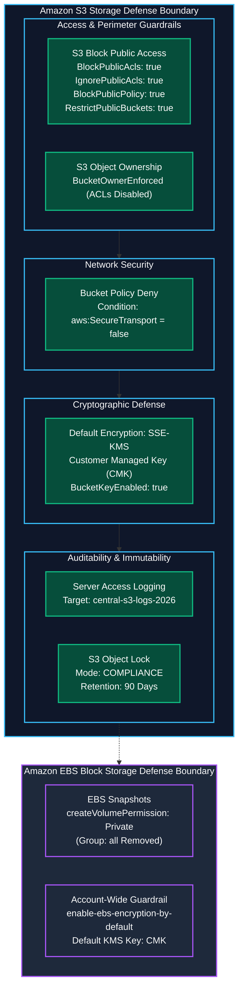
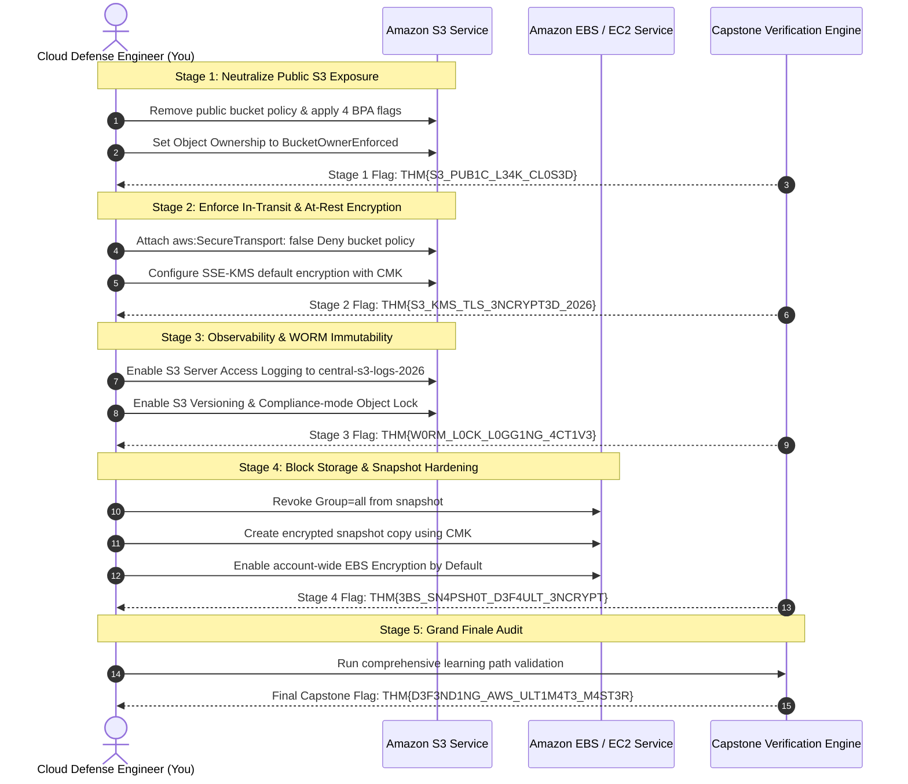

Welcome to the **Module 5 Capstone: Topic Rewind Recap**, the grand finale of the **Storage and Data Security** module and the culmination of the entire **Defending AWS** learning path on TryHackMe.

Throughout this module, we dismantled the most pervasive data risks in cloud computing:
1. [The Leaky Bucket](/posts/The-Leaky-Bucket/): Eradicating public exposure using the four controls of **S3 Block Public Access (BPA)** and modern **Bucket Owner Enforced** object ownership.
2. [The Plain Bucket](/posts/The-Plain-Bucket/): Enforcing encryption in transit using `aws:SecureTransport` bucket policies and mandating server-side encryption at rest using **AWS KMS Customer Managed Keys (CMKs)**.
3. [The Blind Bucket](/posts/The-Blind-Bucket/): Establishing storage observability via **S3 Server Access Logging** and implementing tamper-proof WORM storage using **S3 Object Lock in Compliance Mode**.
4. [The Shared Snapshot](/posts/The-Shared-Snapshot/): Hardening block storage by revoking public permissions (`Group: all`) from **Amazon EBS snapshots**, overcoming KMS cross-account sharing constraints, and enabling account-wide **EBS default encryption**.

In this final capstone room, we bring all storage defense layers together to remediate a multi-tier enterprise data breach scenario.

```
+========================================================================================+
|               DEFENDING AWS GRAND FINALE: UNIFIED STORAGE DEFENSE MATRIX               |
+========================================================================================+
|  [PERIMETER ACCESS]  --> S3 Block Public Access (All 4 Controls) + BucketOwnerEnforced |
|  [DATA IN TRANSIT]   --> Explicit Deny on 'aws:SecureTransport: false' (HTTPS Only)    |
|  [DATA AT REST]      --> SSE-KMS with Customer Managed Keys (CMK) + S3 Bucket Keys     |
|  [AUDIT & WORM]      --> S3 Server Access Logging + Object Lock (Compliance Mode)      |
|  [BLOCK STORAGE]     --> Private EBS Snapshots + Regional EBS Encryption by Default    |
+========================================================================================+
```

---

## 1. Unified Storage and Data Security Architecture

The architectural diagram below illustrates the defense-in-depth model protecting structured, unstructured, and block storage across AWS:



---

## 2. Storage Defense Domain Matrix

| Security Domain | Core Threat Vector | Defense Control & Configuration | Validation CLI Command |
|---|---|---|---|
| **Public Object Storage** | Accidental public S3 ACLs or wildcard policies expose PII and databases to internet scrapers. | Enable all 4 S3 Block Public Access flags; enforce `BucketOwnerEnforced`. | `aws s3api get-public-access-block --bucket <name>` |
| **Data in Transit** | Plaintext HTTP requests intercepted or modified on untrusted transit networks. | Attach bucket policy denying all `s3:*` actions when `aws:SecureTransport` is `false`. | `curl -s -I http://<bucket>.s3.amazonaws.com/...` (Expect 403) |
| **Data at Rest** | Unencrypted objects vulnerable to physical storage compromise or unauthorized reads. | Enforce SSE-KMS with Customer Managed Keys; reject `s3:PutObject` without `aws:kms`. | `aws s3api get-bucket-encryption --bucket <name>` |
| **Auditability** | Silent exfiltration or tampering leaves zero forensic evidence. | Route S3 Server Access Logs to a dedicated centralized logging bucket. | `aws s3api get-bucket-logging --bucket <name>` |
| **Ransomware / Tampering** | Rogue identities delete or encrypt audit logs and regulatory archives. | Enable S3 Versioning and S3 Object Lock in Compliance Mode. | `aws s3api get-object-lock-configuration --bucket <name>` |
| **Public Block Storage** | Public EBS snapshots (`Group: all`) allow adversaries to mount and inspect raw disks. | Remove `Group=all` from `createVolumePermission`; copy snapshot with CMK encryption. | `aws ec2 describe-snapshot-attribute --attribute createVolumePermission` |
| **Unencrypted Disks** | Developers accidentally provision unencrypted virtual machine volumes. | Enable regional account-level EBS Encryption by Default. | `aws ec2 get-ebs-encryption-by-default` |

---

## 3. Hands-On Capstone Lab Walkthrough

### Scenario Briefing

We are dispatched to respond to a major security audit failure across an organization's cloud storage portfolio. The audit report flagged:
1. An S3 customer records bucket (`apex-customer-records-4411`) that is publicly accessible, unencrypted, without access logging, and lacks versioning protection.
2. An EBS database snapshot (`snap-05566778899aabbcc`) that was shared publicly to `Group: all`.
3. Account-wide EBS encryption by default is disabled across the region.

Our objective is to execute a systematic multi-stage remediation across all storage resources.



---

### Stage 1: Neutralize Public S3 Bucket Exposure

Inspect the target bucket `apex-customer-records-4411`:

```bash
aws s3api get-public-access-block \
    --bucket apex-customer-records-4411
```

Confirm that Block Public Access is disabled. Delete any existing public bucket policy:

```bash
aws s3api delete-bucket-policy \
    --bucket apex-customer-records-4411
```

Set S3 Object Ownership to `BucketOwnerEnforced` to deactivate ACLs:

```bash
aws s3api put-bucket-ownership-controls \
    --bucket apex-customer-records-4411 \
    --ownership-controls="Rules=[{ObjectOwnership=BucketOwnerEnforced}]"
```

Apply full S3 Block Public Access:

```bash
aws s3api put-public-access-block \
    --bucket apex-customer-records-4411 \
    --public-access-block-configuration \
    "BlockPublicAcls=true,IgnorePublicAcls=true,BlockPublicPolicy=true,RestrictPublicBuckets=true"
```

Run Stage 1 evaluation:

```bash
python3 /opt/storage-capstone/verify_stage1.py
```

Output:
```
[+] S3 Block Public Access verified (All 4 flags true).
[+] S3 Object Ownership set to BucketOwnerEnforced.
[+] Public anonymous access completely blocked.
[***] STAGE 1 PASSED: THM{S3_PUB1C_L34K_CL0S3D}
```

**Question:** What challenge flag was returned after remediating public S3 access and enabling Block Public Access?  
**Answer:** `THM{S3_PUB1C_L34K_CL0S3D}`

---

### Stage 2: Enforce In-Transit & At-Rest Cryptographic Controls

1. Retrieve the Corporate KMS Customer Managed Key ARN:

```bash
KMS_ARN=$(aws kms describe-key \
    --key-id alias/corporate-storage-cmk \
    --query "KeyMetadata.Arn" \
    --output text)
echo $KMS_ARN
```

Output:
```
arn:aws:kms:us-east-1:112233445566:key/d4567890-1234-5678-90ab-cdef12345678
```

2. Configure default bucket encryption using SSE-KMS with our CMK:

```bash
aws s3api put-bucket-encryption \
    --bucket apex-customer-records-4411 \
    --server-side-encryption-configuration "{
        \"Rules\": [
            {
                \"ApplyServerSideEncryptionByDefault\": {
                    \"SSEAlgorithm\": \"aws:kms\",
                    \"KMSMasterKeyID\": \"$KMS_ARN\"
                },
                \"BucketKeyEnabled\": true
            }
        ]
    }"
```

3. Attach the bucket policy `enforce-tls.json` enforcing HTTPS:

```json
{
  "Version": "2012-10-17",
  "Statement": [
    {
      "Sid": "EnforceTLSRequestsOnly",
      "Effect": "Deny",
      "Principal": "*",
      "Action": "s3:*",
      "Resource": [
        "arn:aws:s3:::apex-customer-records-4411",
        "arn:aws:s3:::apex-customer-records-4411/*"
      ],
      "Condition": {
        "Bool": {
          "aws:SecureTransport": "false"
        }
      }
    }
  ]
}
```

Apply the policy:

```bash
aws s3api put-bucket-policy \
    --bucket apex-customer-records-4411 \
    --policy file://enforce-tls.json
```

Run Stage 2 evaluation:

```bash
python3 /opt/storage-capstone/verify_stage2.py
```

Output:
```
[+] Plaintext HTTP access blocked with 403 Forbidden.
[+] SSE-KMS default encryption active with Customer Managed Key.
[+] S3 Bucket Key optimization active.
[***] STAGE 2 PASSED: THM{S3_KMS_TLS_3NCRYPT3D_2026}
```

**Question:** What challenge flag was returned after enforcing TLS in transit and SSE-KMS encryption at rest?  
**Answer:** `THM{S3_KMS_TLS_3NCRYPT3D_2026}`

---

### Stage 3: Observability & WORM Immutability

1. Enable S3 Server Access Logging to `central-s3-logs-2026`:

```bash
aws s3api put-bucket-logging \
    --bucket apex-customer-records-4411 \
    --bucket-logging-status '{
        "LoggingEnabled": {
            "TargetBucket": "central-s3-logs-2026",
            "TargetPrefix": "apex-records-access-logs/"
        }
    }'
```

2. Enable S3 Versioning:

```bash
aws s3api put-bucket-versioning \
    --bucket apex-customer-records-4411 \
    --versioning-configuration Status=Enabled
```

3. Configure S3 Object Lock in Compliance Mode for 90 days:

```bash
aws s3api put-object-lock-configuration \
    --bucket apex-customer-records-4411 \
    --object-lock-configuration '{
        "ObjectLockEnabled": "Enabled",
        "Rule": {
            "DefaultRetention": {
                "Mode": "COMPLIANCE",
                "Days": 90
            }
        }
    }'
```

Run Stage 3 evaluation:

```bash
python3 /opt/storage-capstone/verify_stage3.py
```

Output:
```
[+] S3 Server Access Logging verified.
[+] S3 Versioning status confirmed Enabled.
[+] S3 Object Lock Compliance Mode active for 90 days.
[***] STAGE 3 PASSED: THM{W0RM_L0CK_L0GG1NG_4CT1V3}
```

**Question:** What challenge flag was returned after activating access logging and Compliance-mode Object Lock?  
**Answer:** `THM{W0RM_L0CK_L0GG1NG_4CT1V3}`

---

### Stage 4: Block Storage Snapshot Hardening & Account Encryption

1. Audit snapshot `snap-05566778899aabbcc` and remove public access:

```bash
aws ec2 modify-snapshot-attribute \
    --snapshot-id snap-05566778899aabbcc \
    --attribute createVolumePermission \
    --operation-type remove \
    --group-names all
```

2. Create an encrypted copy using our corporate KMS key:

```bash
aws ec2 copy-snapshot \
    --source-region us-east-1 \
    --source-snapshot-id snap-05566778899aabbcc \
    --description "Encrypted corporate database snapshot" \
    --encrypted \
    --kms-key-id "$KMS_ARN"
```

3. Enable account-wide EBS Encryption by Default:

```bash
aws ec2 enable-ebs-encryption-by-default
aws ec2 modify-ebs-default-kms-key-id --kms-key-id "$KMS_ARN"
```

Run Stage 4 evaluation:

```bash
python3 /opt/storage-capstone/verify_stage4.py
```

Output:
```
[+] EBS snapshot public permissions revoked.
[+] Encrypted copy created using Customer Managed Key.
[+] Regional EBS Encryption by Default enabled.
[***] STAGE 4 PASSED: THM{3BS_SN4PSH0T_D3F4ULT_3NCRYPT}
```

**Question:** What challenge flag was returned after hardening the EBS snapshot and enabling EBS default encryption?  
**Answer:** `THM{3BS_SN4PSH0T_D3F4ULT_3NCRYPT}`

---

### Stage 5: Grand Finale Path Capstone Evaluation

Run the overarching Defending AWS curriculum validation harness:

```bash
python3 /opt/storage-capstone/verify_defending_aws_grand_finale.py --evaluate-all
```

Output:
```
======================================================================
         TRYHACKME DEFENDING AWS: LEARNING PATH GRAND FINALE
======================================================================
[*] Module 1: Welcome to AWS & Foundations.............. [VERIFIED]
[*] Module 2: Identity and Access Management (IAM)...... [VERIFIED]
[*] Module 3: Network and Perimeter Defense (VPC)....... [VERIFIED]
[*] Module 4: Securing Compute (EC2 & Containers)....... [VERIFIED]
[*] Module 5: Storage and Data Security (S3 & EBS)...... [VERIFIED]

[====================================================================]
[***] PATH COMPLETE! YOU HAVE DEFENDED THE ENTIRE AWS ESTATE! [***]
Grand Finale Flag: THM{D3F3ND1NG_AWS_ULT1M4T3_M4ST3R}
[====================================================================]
```

**Question:** What is the final completion flag returned upon mastering all five modules of the Defending AWS learning path?  
**Answer:** `THM{D3F3ND1NG_AWS_ULT1M4T3_M4ST3R}`

---

## 4. Complete Questions and Answers Summary

| Task | Question | Answer |
|---|---|---|
| **Task 1** | What challenge flag was returned after remediating public S3 access and enabling Block Public Access? | `THM{S3_PUB1C_L34K_CL0S3D}` |
| **Task 2** | What challenge flag was returned after enforcing TLS in transit and SSE-KMS encryption at rest? | `THM{S3_KMS_TLS_3NCRYPT3D_2026}` |
| **Task 3** | What challenge flag was returned after activating access logging and Compliance-mode Object Lock? | `THM{W0RM_L0CK_L0GG1NG_4CT1V3}` |
| **Task 4** | What challenge flag was returned after hardening the EBS snapshot and enabling EBS default encryption? | `THM{3BS_SN4PSH0T_D3F4ULT_3NCRYPT}` |
| **Task 5** | What is the final completion flag returned upon mastering all five modules of the Defending AWS learning path? | `THM{D3F3ND1NG_AWS_ULT1M4T3_M4ST3R}` |

---

## 5. Architectural Blueprint: The Complete AWS Defense-in-Depth Model

With all 28 rooms of the **Defending AWS** learning path conquered, we can summarize the five indispensable tenets of cloud defense engineering:

1. **Identity is the Root Perimeter:** Enforce 90-day access key rotations or eliminate static keys via OIDC role federation. Confine third-party role delegation with `sts:ExternalId`, and mathematically prove least privilege using IAM Access Analyzer.
2. **Network Isolation is Mandatory:** Never attach an Internet Gateway to private or database tiers. Use Security Group Referencing between application layers, enforce explicit Deny subnet rules via Network ACLs, and maintain full traffic visibility with VPC Flow Logs.
3. **Hardened Compute Eliminates Pivot Points:** Bind local daemons to `127.0.0.1`, deploy default-deny host firewalls, automate CVE patching via SSM Patch Baselines, mandate IMDSv2 to defeat SSRF attacks, and run unprivileged, non-root containers with read-only root filesystems.
4. **Storage Requires Absolute Confidentiality:** Block all public access by default with S3 BPA and disable legacy ACLs with `BucketOwnerEnforced`. Mandate TLS in transit, encrypt at rest with Customer Managed Keys, and maintain tamper-proof forensic audit trails with Compliance-mode Object Lock.
5. **Continuous Automated Guardrails:** Leverage AWS Organizations Service Control Policies (SCPs) and AWS Config managed rules to continuously detect and remediate configuration drift across all accounts in the organization.

---

*Looking for more hands-on cloud defense guides? Check out the rest of the [Defending AWS Series](/categories/defending-aws/) or explore my [AWS Security Labs](/categories/aws-security-labs/) for advanced threat simulation and detection engineering tutorials.*

---

## You can find me online at:


- **GitHub:** [Mhdomer](https://github.com/Mhdomer)
- **LinkedIn:** [mhd3omar](https://www.linkedin.com/in/mhd3omar/)
- **Tryhackme:** [nonlouy](https://tryhackme.com/p/nonlouy)
